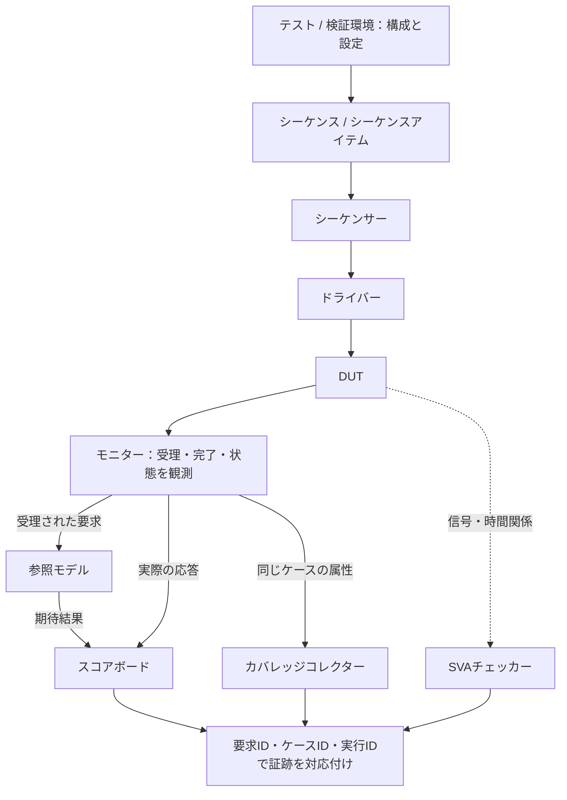
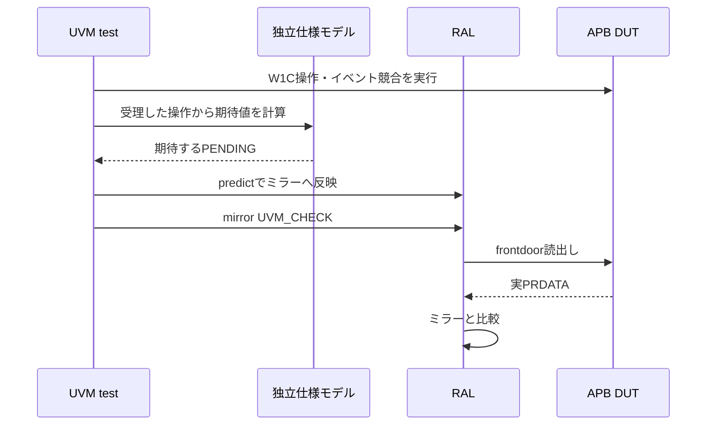

# UVMで要求と検証資産を結び付ける

[一般化した検証手順](spec-to-verification-method.md)の9.7節を具体化した資料です。UVM（Universal Verification Methodology）は、SystemVerilogのクラスライブラリと共通の構成を使って、検証部品を再利用するための方法論です。APIの標準はIEEE 1800.2で、Accelleraが参照実装を提供しています。規格の版とライブラリのリリースは分けて固定します。[Accelleraの配布情報](https://www.accellera.org/downloads/standards/uvm)、[公式参照実装](https://github.com/accellera-official/uvm-core/blob/main/README.md)

ここでは、UVMの構成を利用して要求・刺激・観測・判定・証跡をつなぐ運用を提案します。UVM自体が要求の抽出や要求カバレッジの承認を行うわけではありません。元のケーススタディはSystemVerilog言語規格の検証であり、UVM環境への適用実績ではありません。[APBを使うUVM・RALの実行例](../../examples/local-uvm/README.md)では、agent・monitor・独立したscoreboard・レジスタモデルを接続しています。Verilator 5.052とAccellera UVM 2020-3.2を使い、frontdoorの読書き、W1Cとイベント、リセット、変異の検出を確認できます。本文のUART記録例は引き続き説明用です。

UARTの刺激・期待値・観測・競合を実行して確認する教材として、[UART単体例](../../examples/gitlab-uart/README.md)と[APB・UART・割込みの結合例](../../examples/gitlab-apb-uart/README.md)を追加しています。これらはPythonと手続き的なSystemVerilogテストベンチであり、本文のUVMエージェントやRALを実装したものではありません。

## 1. 導入する範囲

複数のテストからバス操作を再利用する、制約付きランダムで組み合わせを探索する、複数インターフェースを協調させる、IPの検証部品をSoCへ移す、といった用途で採用を検討します。小さなIPで数本の直接テストから始める場合も、要求と観測点の定義は共通です。UVMの導入自体を検証完了の条件にはしません。

最初に、採用するIEEE 1800.2または既存UVM環境の版、ライブラリのリリース・パッチ、シミュレータとコンパイル条件、VIPの版・設定を記録します。UVM 1.2のUser's Guideは構成を学ぶ資料として使い、採用するAPIは実際に固定した実装で確認します。標準外のAPIや実装差にも注意します。[参照実装の互換性・実装固有APIの説明](https://github.com/accellera-official/uvm-core/blob/main/README.md)

## 2. 検証環境の構成

主な部品の役割は次のとおりです。[Accellera UVM User's Guideの1.1節](https://www.accellera.org/images/downloads/standards/uvm/uvm_users_guide_1.2.pdf)

| 部品 | 役割 |
| --- | --- |
| テスト（test）／検証環境（env） | テスト条件と、検証環境の構成を決める |
| シーケンス／シーケンスアイテム | 操作の手順と、送るトランザクションを表す |
| シーケンサー／ドライバー | 操作を調停し、信号レベルの刺激へ変換する |
| モニター | DUTとの実際の転送・状態を観測する |
| エージェント | インターフェースの検証部品をまとめる。activeでは駆動し、passiveでは観測に使う |
| 参照モデル／スコアボード | 期待結果を求め、観測結果と照合する |
| カバレッジコレクター | 必要な条件・組み合わせを観測したかを数える |

virtual interfaceや設定オブジェクトを`uvm_config_db`などで渡す際は、取得の成功と、設定した対象が正しいことを確認します。factory overrideによる差し替えも含め、実際に構築されたエージェント・チェッカー・設定を記録し、意図した構成と一致するかを確認します。[公式のconfiguration DB](https://github.com/accellera-official/uvm-core/blob/main/src/base/uvm_config_db.svh)、[factory](https://github.com/accellera-official/uvm-core/blob/main/src/base/uvm_factory.svh)

この手法では、刺激と判定を次のように接続します。アサーションはインターフェースやDUTへの`bind`などで併用できます。



実線は刺激・観測・結果の受け渡し、点線はSVAの観測関係です。図は接続の概念図で、クラス継承やフェーズの順序を示すものではありません。複数エージェント間の相関は8節、到達と合格の集計は11節で扱います。

参照モデルへ入れるのは、仕様上受理されたと観測できる要求です。ドライバーが送信を予定しただけの操作を、DUTが受理した操作として扱いません。要求・応答の順序が入れ替わる場合は、IDなどで対応を照合し、リセットで破棄される処理も仕様に合わせて扱います。

## 3. 要求IDとの対応付け

要求ごとに、次の対応を検証計画へ登録します。これは、この手法のために追加する対応表であり、UVMの標準APIではありません。

| 対応するもの | 記録する内容 |
| --- | --- |
| 刺激 | テスト、シーケンス、制約、必要な構成・前提条件 |
| 観測 | モニターのイベント・トランザクションと、受理・完了の判定条件 |
| 合否 | スコアボードの比較箇所、アサーションのプロパティ、メッセージID |
| 到達 | covergroup・coverpoint・bin・crossと、サンプリング条件 |
| 証跡 | 要求の改訂、環境の版、構成、seed、実行ID、結果の原本 |

シーケンスを実行しただけでは対応済みにしません。必要な条件が観測され、誤実装なら合否が変わることを別担当で確認します。1つのシーケンスが複数の要求を刺激しても、要求ごとの判定を登録します。

カバレッジの到達とチェッカーの成功を、同じ実行ID・構成に結び付けます。binが埋まっても比較が行われていなければ、要求は合格にしません。制約付きランダムでは`randomize()`の失敗を検出し、値の偏りや到達しないbinを調べます。到達困難な重要条件には直接シーケンスを用意します。

## 4. レジスタモデル（RAL）の扱い

UVMのレジスタモデルは、フィールド、アクセス属性、アドレスマップを表し、バスへの変換にadapterを使います。実バスの観測をモデルへ反映するには、モニターからの転送を`uvm_reg_predictor`へ渡す構成が使えます。[公式のregister predictor](https://github.com/accellera-official/uvm-core/blob/main/src/reg/uvm_reg_predictor.svh)

この手法では、モデルとRTLが同じ誤りを共有しないよう、次を確認します。

1. レジスタ定義の原本を仕様と照合し、オフセット、フィールド、アクセス属性、リセット値を独立に確認する。同じ原本からRTLとRALを生成して一致しても、この確認の代わりにはしない。
2. バス経由の要求はfrontdoorで検証する。backdoorの読み書きだけで、アドレスデコードやバス応答を確認したことにはしない。
3. RALの`reset()`はモデルをリセットする操作であり、DUTへのリセット駆動は別に行う。`predict()`やミラー値の更新を、DUTとの比較と取り違えない。`mirror()`は`UVM_CHECK`の指定とフィールドの比較設定を確認し、比較が省略されていないことを確かめる。アクセスの戻りstatusも検査する。[公式のregister API](https://github.com/accellera-official/uvm-core/blob/main/src/reg/uvm_reg.svh)
4. auto predictionと、モニターからの明示的なpredictionのどちらを使うかを決め、同じアクセスの二重更新を避ける。RAL以外から起きるアクセスやハードウェア更新の扱いも設計する。[公式のaddress map API](https://github.com/accellera-official/uvm-core/blob/main/src/reg/uvm_reg_map.svh)
5. W1C、RC、volatileなフィールド、バイトイネーブル、同時アクセス、リセットとの競合は個別の要求で判定する。読み出した値をそのまま期待値にして、その同じ値との比較を合格の根拠にはしない。

## 5. 小さなIPへの適用例

一般化した手順書の付録Aにある、`UART-REG-LCR-WLS-RESET`を例にします。要求は「リセット解除後、LCRへの書き込み前の最初のAPB読み出し完了時に、WLSが`2'b11`である」です。次の名前は説明用の例で、実在するテストの合格証跡ではありません。

1. `uart_reg_reset_test`で対象構成を設定し、リセット解除を待つ。
2. `lcr_reset_read_seq`で、書き込みより先にLCRの読み出しを要求する。
3. APBモニターが最初の読み出し完了を観測し、応答データをスコアボードへ送る。
4. `check_lcr_wls_reset`でWLSを仕様値と比較する。比較時点、マスク、Xの扱いも固定する。
5. `first_lcr_read_after_reset`の到達と、比較の実行件数・不一致件数を保存する。リセットなしの読み出しなどを誤って到達として数えない。
6. 必須構成の`uart-apb-base`と`uart-apb-lowpower`をそれぞれ実行し、両方の証跡を要求へ結び付ける。

対応表の記録例です。現行の照合キットへそのまま投入できる形式ではありません。

```json
{
  "requirement_id": "UART-REG-LCR-WLS-RESET",
  "requirement_revision": 1,
  "configurations": ["uart-apb-base", "uart-apb-lowpower"],
  "test": "uart_reg_reset_test",
  "sequence": "lcr_reset_read_seq",
  "observation": "APB monitor: first completed LCR read after reset, before any LCR write",
  "checker": "check_lcr_wls_reset",
  "coverage": "first_lcr_read_after_reset",
  "run_ids": [],
  "status": "not_run"
}
```

テスト名やメッセージIDの登録だけでなく、実装後には刺激と比較のファイル・識別子を証跡として登録し、独立した検証を受けます。WLSのリセット値を誤らせる変異で比較が失敗するかも確認します。

## 6. テストの終了と合格条件

`build_phase`・`connect_phase`で構築と接続を行い、`run_phase`などで刺激と観測を進め、`check_phase`で残件を検査し、`report_phase`で集計する構成が使えます。objectionは終了の調整に使う仕組みです。[公式の共通フェーズ](https://github.com/accellera-official/uvm-core/blob/main/src/base/uvm_common_phases.svh)、[objection](https://github.com/accellera-official/uvm-core/blob/main/src/base/uvm_objection.svh)

この手法では、シーケンスの終了後も、必要な応答と比較が終わるまで待つよう設計します。objectionを下げただけ、あるいは規定時間が経過しただけで正常終了にはしません。待ち続ける不具合にはタイムアウトを設け、判定不能として記録します。

回帰のランナーでは、少なくとも次を別々に確認します。

- コンパイル・エラボレーション・シミュレーションが必要なフェーズまで完了し、クラッシュやタイムアウトがない。
- 未承認の`UVM_ERROR`・`UVM_FATAL`、アサーション失敗、スコアボードの不一致がない。メッセージの抑制・重大度変更・report catcherなどで問題を隠していない。
- 必要な観測と比較の件数があり、未応答や未照合の残件がない。チェッカーやカバレッジの有効化設定も記録されている。
- 要求の合格基準に必要なbin・crossへ到達し、適用する必須構成を満たしている。

違法入力のテストなどで意図した診断を許す場合は、対象のメッセージID・条件・件数を先に決め、それ以外のエラーは失敗として扱います。プロセスの終了コード0や、`UVM_ERROR`が0件という情報だけから合格にしません。

## 7. 回帰・再利用・独立検証

実行ごとにテスト、seed、RTL・テストベンチ・UVMライブラリ・VIPの版、コンパイル条件、パラメータ、configuration、factory override、チェッカーとカバレッジの設定を保存します。seedだけが同じでも、構成や実装が変われば同じ実験とは扱いません。

IPのエージェントをSoCでpassiveにして再利用する場合も、観測点、クロック・リセット、アドレスマップ、接続先、前提条件を再確認します。IP単体での要求の合格を、SoC統合後の合格へ自動で引き継ぎません。

独立した検証者は、刺激の到達条件、モニターの観測漏れ、スコアボードのマスク・型・幅・順序、制約による未到達、終了判定、RALの予測と比較の関係を確認します。SVAやフォーマル検証、CDC/RDC、STAなどとの役割分担は、[一般化した手順書](spec-to-verification-method.md)に従います。

証跡と未達事項は[サインオフ記録の雛形](../templates/signoff-record.md)へつなぎます。カバレッジDBを統合する場合も、異なる要求改訂・構成の結果を混ぜず、元の実行IDを残します。

## 8. 機能間のクロスをUVMで実装する

[機能間の相互作用とクロス検証](feature-interaction-verification.md)で選んだ目標を、刺激・観測・判定へ対応付けます。複数エージェントの協調には仮想シーケンスなどを使えます（[UVM User's Guideの4.7節](https://www.accellera.org/images/downloads/standards/uvm/uvm_users_guide_1.2.pdf)）。

1. 仮想シーケンスから、バス操作、データ入力、リセットなどのシーケンスを、要求した順序・時間関係で起動する。並列起動だけで同時受理を達成したと扱わず、ドライバーやモニターのハンドシェイクに基づいて調整する。
2. 各モニターが、ケースID、トランザクションID、クロック・サイクル、受理・完了、事前状態を記録する。観測のタイミングを定め、テストベンチの実行順による取り違えを避ける。
3. 同じケースの観測を対応付けるコレクターが、同じケースの観測から時間差・競合・中断の条件を確定する。関係する情報がそろうまで保留し、別ケースの値や古い状態を組み合わせてサンプルしない。
4. スコアボード・SVAが、共有状態の優先順位、データの欠落・重複、許容遅延、復帰を判定する。機能ごとの個別スコアボードだけで足りるかもレビューする。
5. 確定した相互作用をcovergroupのcrossや時間関係の目標へ記録する。到達と比較の結果に同じケースID・実行IDを残し、必要な目標をすべて満たしたかを集計する。

たとえばイベントとW1Cの例では、初期PEND・実際の受理エッジ差・IRQ_ENを1つのケースの属性にします。IRQがマスクされていてもPENDの更新を検査し、12目標それぞれで到達と判定を確認します。`ignore_bins`やランダム制約の変更で未達を隠さず、除外・到達不能の判断はレビューに回します。

## 9. 制約付きランダムの実装と回帰

[ランダム検証の手順](constrained-random-verification.md)に従い、シーケンスアイテムのデータ制約と、シーケンスが選ぶ操作・順序・間隔を設計します。仕様上の条件、状態依存の条件、探索の重み、異常入力用の変更を分け、採用したconstraint block・inline制約・有効化設定を記録します。

ランダム化の戻り値を確認してから送信し、失敗時に古い値を送信しないようにします。制約の矛盾、未初期化の設定、factory overrideや`constraint_mode`・`rand_mode`の意図しない変更も調べます。ログの警告を消すだけでは生成失敗を解消したことになりません。

モニターからの観測に基づいて参照モデル・スコアボードを更新し、生成数、受理数、比較数、未照合の残件を分けて報告します。ランダム化した値をそのまま到達として記録せず、DUTが受理した状態・時間関係からカバレッジを収集します。

テスト・シナリオ・構成・seedに加え、UVM・VIP・ソルバ・制約・重みの版を実行へ結び付けます。オブジェクトの型名・インスタンス名の変更も再現性へ影響し得ます。失敗の環境と入力を保存して再現し、縮小した直接テストと、関連するランダム回帰を修正後の確認に使います。

## 10. SVAのassert・coverとの接続

[SVAの手順](sva-verification.md)に従い、interfaceやDUTへ適用するチェッカーと、UVMのケースID・要求IDを結び付けます。シーケンスで狙った前件が実際に受理されたかをcoverで確認し、スコアボードとSVAのどちらがデータ・時間関係を判定するかを明確にします。

bindしたチェッカーの適用先、enable、クロック・リセット、assertion制御とカバレッジ設定を記録します。UVMの正常終了や`UVM_ERROR`が0件であることだけでは、SVAが有効に評価され、必要なcoverへ到達したとは扱いません。SVA失敗をランナーの失敗へ伝える経路も確認します。

シーケンス終了後も、進行中のSVA評価と必要な応答が完了するまで観測します。リセットによる中断や試験終端での未完了を区別し、assertとcoverの結果を同じ実行ID・構成・適用先で保存します。

## 11. covergroupで機能の到達を計測する

[機能カバレッジの手順](functional-coverage.md)に従い、機能・状態・境界・遷移・クロスをcoverpointとbinへ展開します。モニターからanalysis portを介してsubscriberなどへ観測を送り、複数の観測が必要なら同じケースIDの情報をコレクターでそろえてから`sample()`します。

ドライバーが生成した予定値や、別トランザクションの古い状態を収集しません。スコアボードの比較やSVAの評価が未完了のうちは、そのケースを合格ケースのカバレッジに加算しません。到達情報とチェッカー結果のどちらも実行ID・構成へ結び付け、チェッカーの欠落や無効化で全件合格にならないことを確認します。

カバレッジモデルの版、収集の有効化、bin・crossの定義、除外と必要ヒット数を保存します。チャネル・エージェント・IPインスタンスごとの不足を、型全体やDBの和集合で隠さないようにします。

## 12. フォーマル検証との分担

[フォーマル検証の手順](formal-verification.md)に従い、フォーマル検証のハーネスと仮定を、UVMの刺激・チェッカー・要求IDへ対応付けます。IP単体で仮定したバスや相手側のプロトコルは、接続先のassertやシミュレーションなどで統合時の成立を確認します。共有するSVAも、フロントエンド、初期状態、リセット、クロックのモデルの違いをレビューします。

フォーマル検証の反例やcoverの到達トレースを、再現可能な直接テストや制約の調整へ戻します。到達トレースを得ただけではUVM回帰の合格やcovergroup DBのヒットに数えず、変換したテストを実行して必要なチェッカーと収集条件を確認します。証明済みの性質とシミュレーションで確認する統合シナリオを、それぞれの証跡へ結び付けます。

## 13. APBで動かす最小のUVM・RAL例

[実行手順](../../examples/local-uvm/README.md)から、既存APB RTLをUVMで検証できます。待ち0／2の各構成で9目標を要求し、通常のfrontdoor操作はauto prediction、ハードウェアイベントの更新は操作終了後の明示的なpredictionで扱います。独立したscoreboardと`mirror(UVM_CHECK)`による実読出しの照合を併用します。

この教材はUVMの構成とRALの具体例です。SystemVerilogの制約付き`randomize()`、ネイティブcovergroup DB、本文のUARTエージェントや全項目を実装したものではありません。3種類のRTL変異と誤った期待値の診断、native UVM summary、終了状態・件数・VCDを照合します。ライブラリは外部へ準備し、使用版とソースハッシュを証跡へ保存します。

### イベント後のpredictと実読出しを分ける

APBの実行例では、独立モデルからミラーを更新した後、frontdoorの読出しとscoreboardの照合も要求します。



図はlocal-uvmの明示的predictionの流れです。DUTの値をそのままpredictへコピーせず、独立scoreboardの比較も別に行います。


## 14. 制約付きランダム化・covergroupと仕様生成

[UVMランダム例](../../examples/local-uvm-random/README.md)では、上記APBのagent・monitor・独立scoreboardを再利用し、SVの`rand`・`constraint`・`randomize()`とネイティブcovergroupを実行します。各待ち構成・各通常実行で24 binを要求し、DBのbin一覧とヒット、同一seedの再現を確認します。固定の境界操作も含むため、ランダム刺激だけの収束性能を測る例ではありません。

[SystemRDL例](../../examples/local-register-spec/README.md)は、同じ仕様からRTL・Cヘッダー・RALを生成します。別に手書きした契約で共通の仕様誤りを検出し、RTL実行・Cコンパイル・実UVM RALの構造と属性を照合します。生成RALは生成RTLへfrontdoor接続していません。
