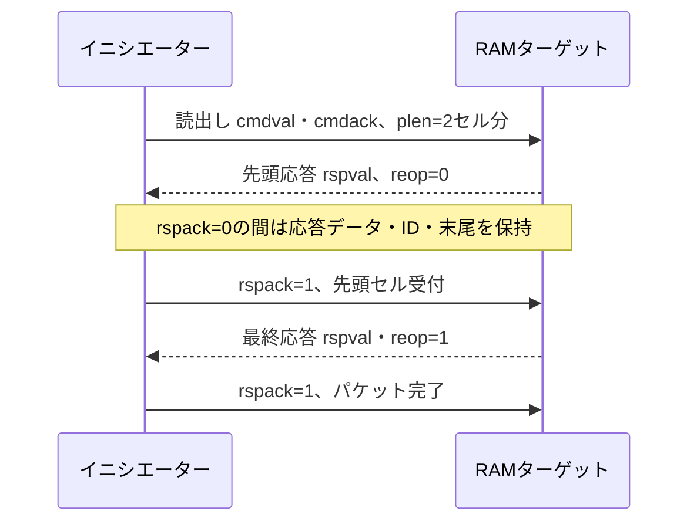

# VCIとSoCLibモデルを使う検証

VCIでは、コマンドを送るチャネルと応答を返すチャネルを別々に観測します。[SoCLibの最小例](../../examples/local-vci-soclib/README.md)は、実際のCABA `VciRam`と信号線モデルを使い、待ち・パケット・ID・リセットを自動判定する入口です。既存の[APB・AHB・AXIの例](../../examples/README.md#バスレジスタアドレス)と比較して学べます。

## モデルの粒度を先に決める

[SoCLib](https://www.soclib.fr/trac/dev)はSystemCによるSoCモデルのライブラリーです。[CABAの記述規則](https://www.soclib.fr/trac/dev/wiki/WritingRules/Caba)ではサイクル精度・ビット精度のモデルを記述します。本例はその実装を直接コンパイルします。旧SoCLib全体の構築環境やCPU用ツールチェーンを導入せず、RAMターゲットに範囲を絞っています。

| 確認したいこと | 選ぶ対象・判定 |
| --- | --- |
| バス上の受付・保持・応答 | CABAの実信号とクロックを観測し、受付時点で比較する |
| メモリ内容・部分書込み | バイト単位の独立モデルと読出し結果を照合する |
| CPUからのソフトウェア実行 | CPU・ROM・インターコネクト・実行コードを含む別構成を用意する |
| 合成・STA・RTLコードカバレッジ | 対応するRTLと実装環境を別に用意する |

モデルの動作一致から、RTLや製品の性能・タイミング・規格適合まで確認できたとは扱いません。

## 受付と完了を分ける

SoCLibのVCIでは、`cmdval && cmdack`でコマンドセル、`rspval && rspack`で応答セルを受け付けます。`eop`はコマンドパケット末尾、`reop`は応答パケット末尾です。`srcid`・`trdid`・`pktid`に対応する応答IDも照合します。アドレスやバイトイネーブルは[SoCLibのVCI規則](https://www.soclib.fr/trac/dev/wiki/VciProtocol)に従い、他のバスの前提をそのまま使わないようにします。

`plen`はバイト数で、この例ではセル数×4または×8を指定します。読出し1コマンドから1／2／4応答セルが返り、書込みは1／2／4コマンドセルから1応答セルが返ります。コマンドセル数をそのまま応答予定数にすると、取りこぼしや早すぎる完了を見逃します。パケット数、セル数、完了数、中断数を分け、最後に`受付パケット数 = 完了数 + リセット中断数`も確認します。

## 検証項目への落とし込み

| 条件 | 刺激 | 観測・合格条件 |
| --- | --- | --- |
| 部分書込み | 全ビット1の後に各バイトだけ更新 | 有効バイトだけ変わり、無効バイトは元の値を保持 |
| 2領域と端点 | 両領域・各最終ワードへアクセス | 領域間で内容が混ざらず、端点も読み戻せる |
| パケット | 2／4セル、書込みセル間に空白 | 全セルと末尾が一致し、早期応答がない |
| コマンド待ち | 読出し応答中に次コマンドを提示 | 未受付のコマンド・アドレス・データ・属性・IDを保持（ドライバー側の確認。DUTの不具合では失敗しない） |
| 応答待ち | 応答を観測後、`rspack=0`の追加待ちを0〜5サイクル挿入 | 応答の値・ID・エラー・末尾を保持 |
| 未割当 | 単一セルを割当外へ送る | エラーと返却IDを確認し、既存のRAM内容を保持 |
| リセット | 書込み途中・応答待ちで投入 | 未完了を中断として記録し、復帰後に残留応答がない |

SoCLibではBEのビット0がデータの最下位バイトに対応します。本例はアドレスをセル境界に整列させ、部分書込みだけBEを変えます。読出しのBE・`plen`の組合せで応答セル数が変わる実装上の規則があるため、部分読出しまで試す場合は、その予定数と有効バイトの定義を先に追加してください。

コマンドの保持を比べる`VCI_COMMAND_HOLD`は、イニシエーター役のドライバーが駆動した信号を見る検査です。ターゲットであるDUTの保持動作を確認するのは、DUTが駆動する応答信号を見る検査だけです。実行例では、待ち中に応答を変えるDUTの変異と、待ち中にコマンドを変えるドライバーの変異で、それぞれの検査が失敗することを確かめます。

固定試験で各条件を確実に通し、ランダム試験で幅・ID・待ち・データ・パケット長を組み合わせます。ランダムseedの追加を、必須目標の達成判定の代わりにはしません。クロスを増やす場合は[組合せの選び方](cross-test-selection-walkthrough.md)も参照してください。

## 外部モデルの取り込みと検出力

外部コードも正しいと仮定せず、独立した期待値で確認します。本例で見つかった64ビット部分書込みの切捨ては、全ビット1→下位1バイト更新→読出しの短い操作列で再現できます。元のコードを使う実行と修正版を使う実行の両方を残すことで、修正の必要性とチェッカーの検出力を確認します。

取得元・revision・ファイル一覧・原版ハッシュ・変更内容・ライセンスを記録し、実行時に収録版の内容も照合します。上流のライセンス表示を保ち、教材独自のコードと区別します。後日SoCLibを更新するときは、元の反例・変異・機能目標を新しい版で再実行してください。

CPUやインターコネクトへ拡張する際は、複数イニシエーターの仲裁、並行未完了数、IDの経路、アドレス割当、起動コード、リセット順序を検証計画に加えます。最小例の合格をそのまま上位SoCの合格には引き継ぎません。
