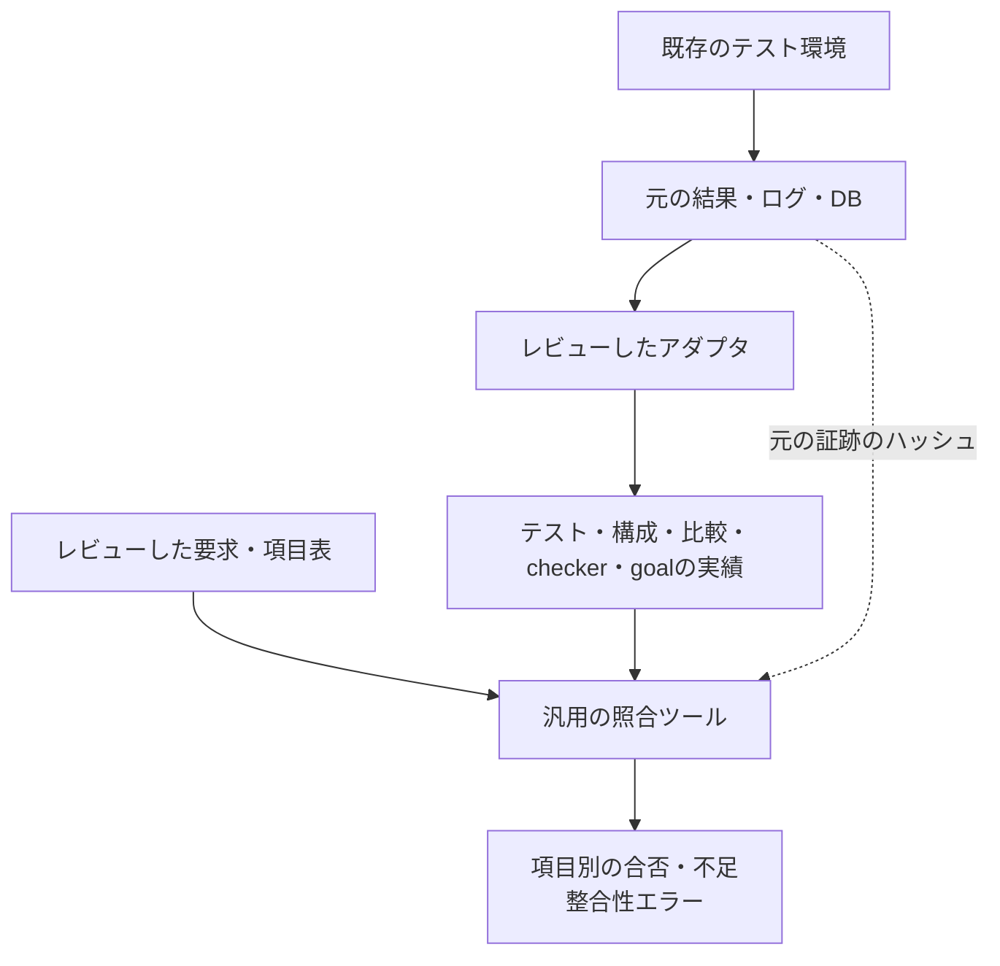

# 検証項目表と実行証跡を機械的に照合する

[仕様書から検証項目を作る実例](spec-to-test-items-walkthrough.md)で作った対応を、実行結果へ結び付ける手順です。項目を作っただけ、テストが終了しただけ、古い版が合格しただけの状態を、現在の検証完了と混同しないために使います。

[割り込みの実行例](../../examples/local-plan-traceability/README.md)と、標準ライブラリだけで動く[`tools/verification_plan.py`](../../tools/verification_plan.py)を追加しています。ケーススタディ由来の照合キットとは独立し、このリポジトリ単独で実行できます。

## 1. 自動照合とレビューを分担する

| 対象 | 自動で確認すること | レビューすること |
| --- | --- | --- |
| 出典・要求 | 出典ファイル・anchorの存在、ソースの版、要求IDの一意性 | 原文の解釈、要求抽出の抜け、仕様課題の解決 |
| 項目表 | 未対応要求、不明なID、構成とテストの対応 | 刺激・期待値・観測時点、選定した条件と残リスク |
| 実績 | 予定テストの欠落・重複、合否・完了・正の比較件数 | 比較が要求を検査すること、正規化アダプタの意味 |
| 確認目標 | 必須checker・goalの回数、構成別の不足 | checker・goalの検出力と計測条件 |
| 証跡の版 | 計画、仕様・RTL・検証環境、元のログ等のハッシュ | 証跡の採用判断、レビュー・承認と例外の記録 |

IDやカウンターがあるだけでは、適切な検証項目にはなりません。レビューで妥当性を確認した対応とアダプタを前提として、機械的に検査できる不整合を取り除きます。

## 2. 計画の形式

実際の形式は[計画JSON](../../examples/local-plan-traceability/plan.json)を参照してください。`schema_version`は1です。

- `id`：対象計画の識別子。
- `sources`：仕様・RTL・checker・アダプタなど、実績の有効性を左右するファイル。`--root`からの相対パスで、ルート外の参照は拒否する。
- `requirements`：要求IDと、出典の`source`・`anchor`。
- `tests`：実行単位のIDと、対象の`configuration`。
- `items`：項目ID、要求、使うテスト、構成、必須checker・goal、必要ヒット数`min_hits`。

出典のanchorは本文内の識別文字列の存在を調べるものです。仕様全体の意味を解析する機能ではありません。任意の行番号だけへ依存せず、出典の版と識別子を記録します。

各要求には少なくとも一つの項目、各項目には実行単位と判定・目標を対応付けます。同じ項目を複数構成で要求する場合は、構成を列挙し、そのすべてへテストを割り当てます。

## 3. 既存環境の結果を正規化する



証跡JSONには、次を記録します。

- 計画の`plan_id`とファイルの`plan_sha256`。
- `sources`と同じ集合の`source_sha256`。
- 元の実行証跡ファイル群の`artifacts`。パスは証跡JSONからの相対パス、または実行環境の絶対パス。
- テストごとのID・構成・`status`・`complete`・正の`comparisons`。
- そのテストで確認した`checkers`と`goals`の非負整数カウンター。

アダプタは終了コードだけをコピーせず、予定ケース、比較・完了数、checkerの有効化、実際の観測・DB、変異や診断の分類を、元の環境の契約に従って検査します。生成予定値や、失敗した実行の到達で必須目標を埋めません。

割り込み例では、成功したnative SVA実行と、状態更新の前件・結果、IRQのマスク中／許可中のcoverを使います。アダプタの`checkers`はその確認回数であり、シミュレータ内部のassert評価回数ではありません。環境が違う場合は、その環境で「判定を完了した」と言える根拠へ置き換えます。

## 4. 合格と未達を判定する

正常終了した同じ構成のテストで、その項目の必須checkerがすべて確認されている場合だけ、そのテストのcheckerとgoalの回数を集計します。checker確認のあるテストAと、checker未実行でgoalへ到達したテストBを持ち寄って合格にはしません。別ポート・別構成の実績を持ち寄って不足を補いません。必要回数が1を超える場合も、仕様上その回数でよい理由を計画へ残します。

未対応要求、予定実行の欠落・重複、比較0件、失敗・未完了、checker・goal不足、異なる構成、古いソース・ログ等は終了コード1になります。整合性エラーがあれば、項目を成功として表示しません。項目の対応を変更した場合は、その計画の版に対して再評価します。

```sh
python3 tools/verification_plan.py \
  --root . --plan examples/local-plan-traceability/plan.json \
  --evidence artifacts/plan-demo/evidence.json --out artifacts/plan-check
```

出力は`report.json`と`junit.xml`です。全体の整合性判定と項目別の判定を持ちます。既存の出力先は上書きしません。元のRTL試験の合格と、対応・版の照合の合格は別の判定です。

## 5. 仕様変更時に試す

例えばイベントとクリアの優先順位を変更するなら、仕様、要求、期待値、SVA、目標、変異の検出条件への影響を確認します。古い証跡を渡すと、計画またはソースのハッシュ不一致として拒否されます。新しい要求を追加して項目を作り忘れた場合も、未対応要求として拒否します。

ハッシュを新しく書き直すだけで、再検証や再承認の代わりにはしません。このツールは改ざんに対する署名・認証の仕組みでも、人の承認を証明する仕組みでもありません。アダプタ、元の実行、対応表をレビューし、[サインオフ記録](../templates/signoff-record.md)へ判断を残します。

[全例の統合実行](../../tools/REGRESSION.md)で同じ計画を再実行し、[クロスモデル](../templates/interaction-coverage-plan.md)と[項目作成シート](../templates/spec-to-test-items.md)へ不足と変更の影響を戻せます。

機械可読な計画を実行結果へ結び付ける運用の参考として、[OpenTitanのtestplanner](https://opentitan.org/book/util/dvsim/doc/testplanner.html)も参照できます。本書のJSON形式と割り込みアダプタは、この教材向けに作成しています。
