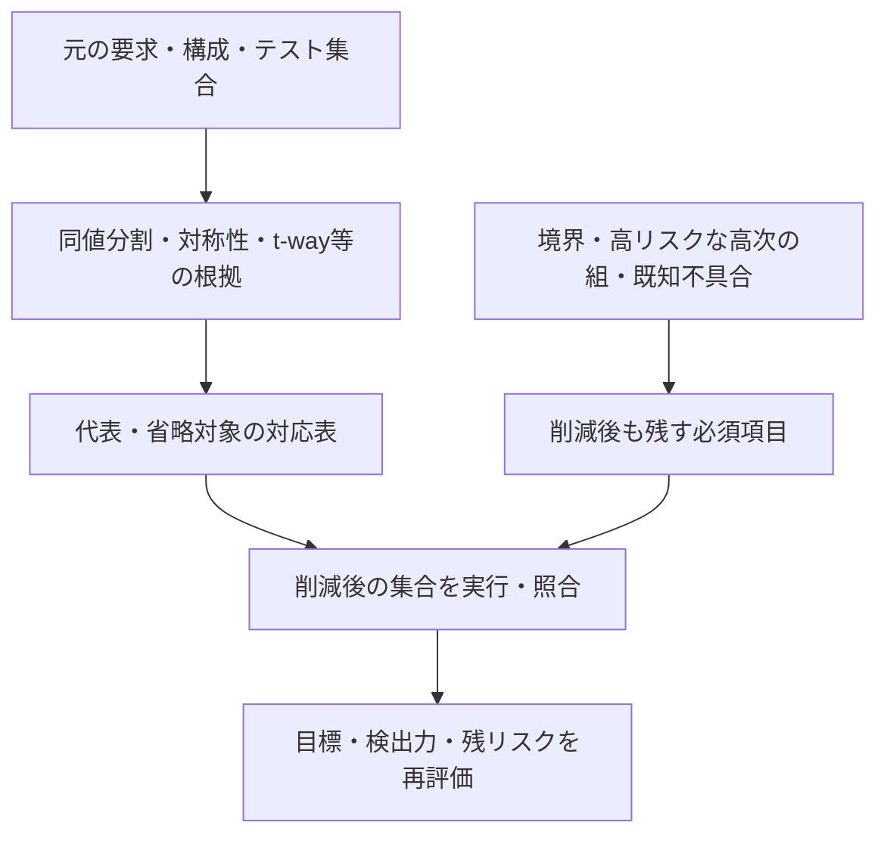
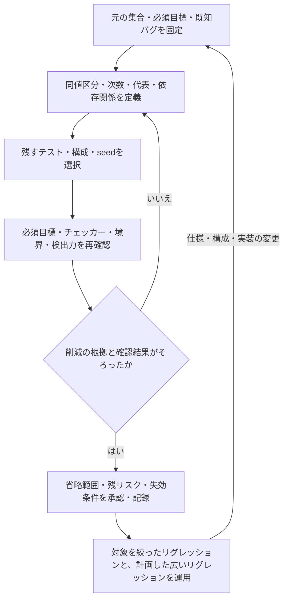

# 検証の組み合わせ・構成・実行数を削減する

[一般化した検証手順](spec-to-verification-method.md)の4.4節・9.14節を具体化した資料です。入力値、構成、事象列、テスト、seed、変異が増大したときに、同じ目的を重複して確認する部分を減らします。残す目標と省く範囲、その根拠を追跡し、単なる実行打ち切りと区別します。

以下は本リポジトリで定めた運用案です。製品で削減の妥当性を実証した結果ではありません。本資料では、機能検証の対象・実行数を減らすことを「削減」と呼びます。ATPGで等価故障などをまとめる「故障縮退」とは、対象と網羅率の意味を分けます。

## 1. 何を減らすかを分ける

| 手法 | 減らすもの | 適用の根拠と残すもの |
| --- | --- | --- |
| 同値分割・境界値 | 全入力値の列挙 | 同じ処理になる区分を定義し、各区分と境界を残す |
| pairwise／t-way・可変次数 | 全軸の直積 | 選んだ次数の合法な組を覆う。重要な高次の依存は別に残す |
| 対称性・代表構成 | 類似チャネル・パラメータの反復 | 置換・構成変更で同じ性質が保たれる根拠と、接続・非対称部分の検査 |
| 状態・事象列の整理 | 無制限の順序・長さ | 必要な状態遷移・競合・履歴・反復境界を残す |
| テスト集合の縮約 | 同じ目標を確認するテストの重複 | 要求・チェッカー・検出力・構成の対応と、削減後の再実行 |
| 変更影響によるリグレッション選択 | 変更ごとの実行範囲 | 依存関係に基づく選択と、広いリグレッションを行う時点 |
| カバレッジに基づくseed選択 | 重複の多いランダム実行 | 必須目標、既知バグの再現、負荷条件、探索の多様性 |
| フォーマル検証の抽象化・分割 | 扱う状態空間 | 性質を保存する対応関係、不変条件、分割間の証明責務 |
| 故障・変異の整理 | 同じ目的の注入の反復 | 同じ検出結果だけで等価とせず、動作差・等価性の根拠を残す |

優先順位を付けて先に実行すること、並列化すること、速い環境へ移すことは、対象を減らす削減とは分けて管理します。どの方式でも、要求自体を削除したり、未実行を合格へ移したりしません。代表ケースで確認した範囲と、未確認の範囲を示します。

## 2. 同値分割と境界値

仕様上の処理・応答・状態遷移が同じと期待する入力を区分へまとめ、代表を選びます。境界では処理が切り替わるため、境界値とその直前・直後を確認します。[ASTQBのISTQB教材](https://astqb.org/4-2-black-box-test-techniques/)も、同値分割と境界値分析を扱っています。代表の合格は、区分内の全値を数学的に証明したことではないため、区分の根拠をレビューします。

LSIでは、数値の大小だけで区分しないようにします。

- FIFOの使用量：空、1、満杯の直前、満杯。最小深さでは区分が重なるので目標を重複計上しない。
- 長さ・アドレス：最小・最大、許容範囲の直外、アラインメント、バースト・ページ境界、ラップ。
- データ：全0・全1、walking-one／walking-zero、上位ビット・符号・バイトレーンを識別できる値。
- 時間差：受理の直前・同時・直後、タイムアウトの境界。クロック比・位相・捕捉窓によって区分が変わるなら別に展開する。

「中間値は同じ」として、ビット位置・符号・アドレスデコード・ECCの差を消さないようにします。違法値の応答が要求される場合は、その区分も残します。境界値だけで複数機能の相互作用まで網羅したことにはしません。

## 3. 全組み合わせをt-wayで削減する

各因子・値の区分・合法性制約を定義し、必要な次数tを決めます。pairwiseはt=2で、任意の2因子の値の組を覆う方式です。重要な部分だけt=3以上や全組にする可変次数の計画も使えます。[NISTの組み合わせ試験](https://csrc.nist.gov/projects/automated-combinatorial-testing-for-software)と[ACTSの配布情報](https://csrc.nist.gov/Projects/Automated-Combinatorial-Testing-for-Software/Downloadable-Tools)は、制約・可変次数を含む参照先です。ソフトウェアでの検出実績を、LSIの保証や削減率として流用しません。

直交表を使う方法もあります。選んだ表が因子数・水準・必要な次数に対応するかを確認し、禁止条件や水準数が異なる因子を扱う場合は、制約付きのcovering arrayなども検討します。直交表を使ったという理由だけで、要求する組の網羅を省略せず検査します。

制約付きでは、t因子の値の組のうち、残りの因子にも値を割り当てれば全体の制約を満たせるものを対象にします。生成後に禁止条件を含むテストケースを削除するだけでは必要な組を失う場合があるため、合法性と組の網羅を再検査します。禁止操作のエラー応答を確認する試験は、合法な組を生成する制約とは別の計画に残します。

### 3因子の説明例

A・B・Cがそれぞれ0/1で、全8通りが合法と仮定します。次の4行で、A×B、A×C、B×Cの各4通り、合計12個の2因子目標を覆えます。

| ケース | A | B | C |
| --- | --- | --- | --- |
| P0 | 0 | 0 | 0 |
| P1 | 0 | 1 | 1 |
| P2 | 1 | 0 | 1 |
| P3 | 1 | 1 | 0 |

全組の8行から4行にできますが、`A && B && C`のときだけ起きる不具合は検出できません。その条件が重要なら111を直接狙う行を足します。5行にしても、残りの3因子の組を確認したことにはなりません。全3因子の相互作用が要求なら8通りを残します。

これは組の選択を説明する例で、DUTの実行結果ではありません。[既存の割り込みの12クロス目標](feature-interaction-verification.md)や[16個の機能目標](functional-coverage.md)を、この例に合わせて削減する提案ではありません。

### 4因子・3水準の説明例

制約のない4因子A・B・C・Dに各3水準（0・1・2）があると、全組合せは`3^4 = 81`行です。aとbを0〜2で動かし、`A=a`、`B=b`、`C=(a+b) mod 3`、`D=(a+2*b) mod 3`とすると、次の9行で任意の2因子の全水準対を含められます。

| ケース | A | B | C | D |
| --- | --- | --- | --- | --- |
| P0 | 0 | 0 | 0 | 0 |
| P1 | 0 | 1 | 1 | 2 |
| P2 | 0 | 2 | 2 | 1 |
| P3 | 1 | 0 | 1 | 1 |
| P4 | 1 | 1 | 2 | 0 |
| P5 | 1 | 2 | 0 | 2 |
| P6 | 2 | 0 | 2 | 2 |
| P7 | 2 | 1 | 0 | 1 |
| P8 | 2 | 2 | 1 | 0 |

2因子の目標は因子対6通り×水準対9通り＝54件です。9行でこれを覆っても、3因子以上の全組合せや動的な状態遷移を覆ったことにはなりません。成立に複数の操作や構成変更が必要なら、生成した行数、RTLテストの本数、実行回数、クロック数、実測コストを別に求めます。

たとえばC=0かつD=0を禁止し、P0だけを削除すると、A=0かつB=0の目標を失います。この目標はC=1・D=1などで制約を満たせるため、対象外にはできません。制約の追加後は、成立可能な対象集合と、選択ケースによる網羅を再計算します。

これは有限モデルの数学的な説明で、RTLの削減効果を測った例ではありません。既存テストから不足だけを追加する運用は、[機能間クロス検証の4.3節](feature-interaction-verification.md#43-既存テストの充足状況から追加を選ぶ)に従います。

## 4. 対称性と代表構成

同じRTLの複数チャネルについて、チャネル番号の置換で性質が保存されるなら、単体の詳細試験を代表チャネルへ集約する計画を検討できます。ただし、固定優先度、異なるアドレス・割り込み、マスク・権限、クロック・電源・配置に差があれば、その部分は同じとしません。各インスタンスの接続・設定の確認と、共有資源での同時動作は残します。

パラメータでは最小・標準・最大だけで十分とは限りません。幅1、深さ1、2のべき乗／非べき乗、アドレス幅が変わる境界、オプションの有無を調べます。たとえば深さ16の合格だけで、深さ3のポインタ処理まで確認済みにしません。最小構成と最大構成の間が単調に同じという根拠がある場合だけ、代表からの一般化を認めます。

代表と省略する構成の対応、仕様・構造上の根拠、保存する性質、非対称部分の検査、承認を記録します。必須構成の要求行は保持し、どの代表証跡・解析が各行を支えるかを示します。根拠が未確定なら、その構成は未確認のままです。

## 5. 事象列・状態空間を整理する

事象の値の組と、発生順序・間隔・中断を分けてモデル化します。無制限な全事象列の代わりに、必要な状態と遷移、遷移の前後、競合、エラー・復帰、特定の履歴を持つ経路を目標にします。必要なら順序を含むt-wayの方式を使います。[NISTの事象列の試験](https://csrc.nist.gov/Projects/automated-combinatorial-testing-for-software/combinatorial-methods-in-testing/event-sequence-testing)

状態遷移を各1回通っただけでは、カウンタのオーバーフロー、FIFOの周回、長時間の飢餓、処理の累積・リークを検査できない場合があります。必要な反復回数・履歴長・負荷区間は仕様と想定する誤りから決めます。独立な操作の順序を片方へ集約する場合も、共有状態・バス・通知・時間への影響がない根拠を確認します。

フォーマル検証では、cone of influence、抽象化、補助不変条件、assume-guaranteeによる分割を検討します。データ幅やFIFO深さを小さくしたモデルの合格を、根拠なしに大きい実装へ一般化しません。安全性・活性を保存する条件や証明依存は、[フォーマル検証の手順](formal-verification.md#4-モデル抽象化証明の分割)に従います。

## 6. リグレッションテストとseedを縮約する

### 6.1 目標とテストの対応で選ぶ

テストごとに、要求・構成・目標、実行したチェッカー、実際に比較して合格した条件、既知バグの再現、検出した変異、負荷と実行コストを対応付けます。同じコードカバレッジを出すテストでも、比較値・順序・チェッカーが異なれば重複とは限りません。

必須目標の集合を覆うテスト群を選ぶ、set coverとしての整理も使えます。たとえば、T1がG1/G2、T2がG2/G3、T3がG1/G2/G3を判定するなら、記録した目標だけではT3へ集約できます。ただし、T1/T2だけのチェッカー・境界・負荷・既知バグ再現がないかを確認します。同じ目標を別の方式で独立に確認する必要があるなら、方式ごとの目標として残します。

実測時間に対する追加目標数などで選ぶ貪欲な方法を使う場合も、最小解や同じバグ検出力を保証したとは報告しません。削減後に必須目標・構成・チェッカーを照合し、代表的な[ミューテーション](mutation-verification.md)や既知の不具合再現でバグ検出力の低下がないかを確認します。元のテストは、履歴と再実行可能な形で保持します。

### 6.2 変更影響で実行範囲を選ぶ

RTLの依存だけでなく、共有パッケージ、生成器、バス・ドメイン境界、チェッカー、仮定、制約、ツール・ソフトウェアの変更から影響する要求・テストを選びます。過去の動的な到達情報だけでは、新しく生まれた経路の影響を捉えられないことがあるため、依存・仕様の差分と併用します。選択根拠が不足する変更では実行を広げます。

変更時の短いリグレッション、定期的な広いリグレッション、サインオフ前の必須リグレッションの対象と発動条件を先に決めます。先に実行した小さい集合の合格を、広いリグレッション全体の合格として扱いません。再利用する古い証跡は、変更の影響を受けない根拠を別に記録します。

実際の起動・分散・資源制御・結果の照合・再実行は、[継続的リグレッション](continuous-regression.md)の手順へつなぎます。削減後の予定集合をマニフェストに持たせ、CIで実行できた集合と突き合わせます。

### 6.3 seedと長時間試験を選ぶ

新しい目標や変異を検出するseed、既知バグの再現seed、境界・高負荷・長時間の試験を保持し、重複の多い実行を減らします。一方で、新しいseedによる探索枠も残します。同じbinへ到達したという情報だけで、値・順序・履歴まで同じとは判断しません。

新規到達が少なくなる「飽和」は探索を見直す指標であり、バグがない証明や万能な停止条件ではありません。予算を使い切った場合は計画した範囲と未実行を報告します。seed数や各実行の長さを減らすときは、残す負荷・観測期間・終了時の未完了の扱いを固定します。

## 7. 故障・変異の対象を整理する

同じ箇所の同じ意味の変更を重複生成していないかを確認します。構造・性質の等価性から代表化する場合は、適用する入力・初期状態・観測点・構成と、元の対象への対応を残します。「一つのテストでどちらも検出した」だけでは、すべての条件で等価とは判断しません。

代表変異だけで行う短い検査と、広い変異集合の評価は別のキャンペーンとして扱います。抽出数・種類・階層・要求の偏りと未評価を示し、サンプルでの検出率を元の全変異の検出率へ読み替えません。分類・分母は[ミューテーション検証](mutation-verification.md#5-検出率と未完了を集計する)へ対応付けます。

## 8. 削減の根拠と実行結果を記録する

削減ごとに、次を計画へ記録します。

- 削減ID・版、対象要求・構成・目標、元の集合・生成規則と規模。
- 減らす対象、同値区分・代表・次数・依存関係などの選択規則と根拠。
- 残す集合と、省く各対象をどの代表・証明・別の試験が支えるかの対応。
- 必須の境界・高次の相互作用、異常・復帰、接続・非対称部分、長時間・負荷の試験。
- 元と削減後の対象数・実測コスト、必須目標の維持、変異・既知バグの検出結果。
- その方式で保証しない範囲、未確認・残リスク、レビュー・承認。
- 広いリグレッションの実施時点、削減判断が失効する変更、再評価・再実行の担当。

件数を減らしても、セットアップ時間や一つの長い試験への集約によって実行時間が増える場合があります。件数・計算資源・壁時計時間・失敗解析の負担を別に測ります。目標の定義や分母を変えた場合は、変更前の率と直接比較しません。

既存の同じ実行回で判定するAND集合の規則も維持します。部分実行の合格を寄せ集め、削減前の全リグレッションが同じ条件で通ったという証跡は作りません。結果と再利用する証跡の根拠を[サインオフ記録](../templates/signoff-record.md)へつなぎます。

### 削減前後で守る目標を対応付ける

代表選択の根拠に加え、残すべき境界・高次相互作用・検出力を削減後も確認します。

2因子の組を覆っても3因子以上の不具合をすべて検出できるとは限りません。削減判断が失効する変更と再評価条件も残します。

## 9. 小さく始める手順

代表テストが覆った目標と、省略した対象への対応を残します。図の確認は、削減前と同じバグ検出力を数学的に証明するものとは限らず、採用した根拠と残るリスクを記録する段階です。

1. 必須要求・構成・重要境界と、既知バグの再現を固定する。
2. 値の同値分割と、依存のない直積の整理から始める。
3. 小さい重要領域は全組を残し、大きい領域へ制約付きt-wayを使う。
4. 代表構成・テスト・seedを選び、目標・チェッカー・検出力の維持を確認する。
5. 実行コストと未確認の範囲を測り、広いリグレッションと変更時の再評価へつなぐ。

これは全製品に同じ削減率を求める手順ではありません。根拠を示せない重要な組は残し、削減を適用する範囲を限定します。

## 10. 参考にした一次資料

- [ASTQBのISTQB Foundation Level教材](https://astqb.org/4-2-black-box-test-techniques/)：同値分割と境界値分析の参照先です。
- [NISTの組み合わせ試験](https://csrc.nist.gov/projects/automated-combinatorial-testing-for-software)、[covering arrayの説明](https://math.nist.gov/coveringarrays/coveringarray.html)、[ACTSなどの配布情報](https://csrc.nist.gov/Projects/Automated-Combinatorial-Testing-for-Software/Downloadable-Tools)：次数、制約、可変次数を使う試験選択の参照先です。
- [NISTの事象列の試験](https://csrc.nist.gov/Projects/automated-combinatorial-testing-for-software/combinatorial-methods-in-testing/event-sequence-testing)：順序を扱う目標の参照先です。

LSIへの適用条件、リグレッションの運用、記録項目、3因子の具体例は、本リポジトリで定めたものです。組み合わせ生成ツールやリグレッション選択ツールを導入・実行した資料ではありません。

## 実行できる比較例

[GitLabでリグレッションの削減を比較する](../../examples/gitlab-reduction/README.md)では、説明用IRQ回路に対して全件・目標だけの選択・ストレス保持を実行します。学習の全件合格後に選択し、選択集合を新しく実行して19目標と変異の検出を照合します。目標が同じでも履歴依存の不具合を見逃す構成を含め、重要なストレス試験を残す意味を示します。本文3節のt-way例とは別の、テスト集合の選択に関する実行例です。

候補数・検査サイクル数・シミュレーション時間・学習／ビルドの負担を分けて記録します。比較ジョブ自体の実行量は増えるため、このジョブを導入しただけでCI費用が下がるという意味ではありません。

## APBのクロスモデルと既存テストから追加を選ぶ例

[APB＋割り込みの比較例](../../examples/local-apb-irq-coverage/README.md)では、要因ごとの2因子網羅、重点の全組、時間関係を別の目標群にし、既存ケースと追加候補の実績から不足を補うケースを選びます。既存の境界・ランダムケースと44／45目標を保持し、全候補と選択後を新しく実行して、目標・6種類の誤実装の検出・実行量を比較します。

全候補の学習と比較そのものの費用も保存します。ケース数の減少が同じ割合のサイクル数・実行時間の削減になるとは限らず、元のAPBリグレッションより短くなるという比較でもありません。モデルと測定条件をそろえた教材内の結果として読みます。
