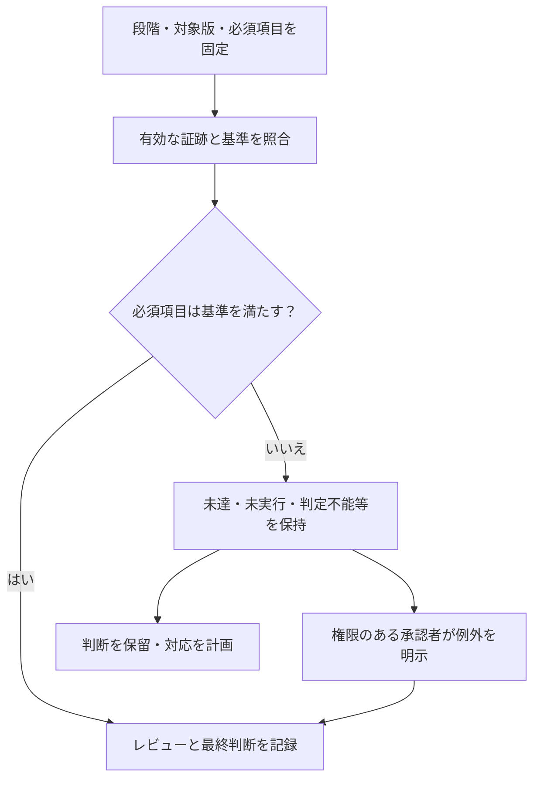

# サインオフ記録の雛形

[検証手順の4.4節](../method/spec-to-verification-method.md#44-検証計画と完了条件)と[14.10節](../method/spec-to-verification-method.md#1410-サインオフと変更管理)で使う記録です。製品・判定段階ごとにコピーし、項目を必要な構成・モード・コーナーまで展開します。以下は未記入の雛形であり、承認済みの判定ではありません。

## 技術的な状態と承認を分ける

必須項目の状態と証跡を確認し、未達がある場合は状態を保持して判断と責任を記録します。

例外承認は失敗や未実行を合格へ書き換える操作ではありません。この図と以下の記録欄は未記入の雛形です。

## 判定の対象

- 記録ID：
- 製品・IPと版：
- 判定する段階：テープアウト／初回シリコン評価完了／量産・出荷
- 判定日・判定会議：
- 対象仕様・要求台帳の版：
- 適用する規格・契約・社内フローと版：
- 必須構成・動作モード・コーナーの一覧と版：
- 検証領域の適用範囲・対象外・未確定と担当の記録ID・版（[領域別の雛形](verification-scope.md)）：
- 検証の削減計画と版、代表・省略対象の対応、根拠・承認・失効条件（[削減の手順](../method/verification-reduction.md)）：
- 設計データのマニフェストとハッシュ：
- シリコン個体・ロット・評価環境（該当する場合）：
- 作成担当・検証担当・最終判断の承認者：

設計データのマニフェストには、対象段階で必要なRTL、ネットリスト、制約、レイアウト、IP、PDK、ライブラリ、ツールとスクリプトの版を記録します。

## 判定項目の一覧

| 項目ID | 確認する内容・要求ID | 必要な段階 | 構成・モード・コーナー | 事前に決めた合格基準 | 状態 | 証跡・課題・例外承認ID | 担当・承認者 |
| --- | --- | --- | --- | --- | --- | --- | --- |
| CHECK-001 | 記入する | 記入する | 記入する | 記入する | 未判定 | 未登録 | 未定 |

状態は次のように分けます。未判定・未実行・判定不能・失敗が残る場合は、その段階の判断を保留するか、権限のある者の例外承認を受けます。

- **合格**：必要な範囲の基準を満たし、有効な証跡とレビュー記録がある。
- **失敗**：実行した結果、基準を満たさない。
- **未実行**：必要な実行がない。
- **判定不能**：タイムアウト・実行エラー・フォーマル検証の`unknown`などで判定できない。実行IDと終了理由を残す。
- **未判定**：基準・適用範囲・レビューが確定していない。古い証跡だけがある場合も含む。
- **例外承認**：未達の技術的状態を残したうえで、この段階に進むことが明示的に承認された。
- **対象外**：この製品・構成に適用されない根拠が承認された。
- **後段階で判定**：実測など、後の段階で判定する項目。実施段階・担当・期限を記録する。この段階で必須の項目には使わない。

## 各項目の証跡

判定項目ごとに記録します。該当しない欄にも理由を残します。

- 項目ID・要求IDと改訂：
- 対象の構成・条件：
- 入力マニフェスト・ハッシュ：
- 実行ID・日時・コマンド・ツールの版：
- 継続リグレッションの計画・マニフェストの版、campaign／パイプライン／外部session ID、ケース・ビルド・試行の対応と集約判定（[リグレッションの手順](../method/continuous-regression.md)）：
- 予定と結果の照合、未起動・欠落・取消・再実行・隔離の履歴、ログ・カバレッジ・長期証跡の保管場所と保持期間：
- シミュレーションのseed、終了理由、資源制限：
- 静的検査・CDC/RDCの対象、ルール・制約・構成、指摘と除外の対応、関連する機能検証の結果：
- Dynamic CDCのモデル・注入先、基準／許容遅延と捕捉条件、FF段数・遅延の選択方式、seed・相関、実際の遅延・相対到着順の観測と判定（[注入の手順](../method/verification-gap-review.md#42-同期化遅延のランダム化とメタスタビリティ影響注入)）：
- リセット・X伝搬・電源遷移のモデルと有効期間、故障注入の場所・種別・時刻・期間、取消・封じ込め・復帰の判定（[領域別の手順](../method/verification-gap-review.md)）：
- 性能の構成・クロック・負荷・測定区間・閾値と実測、要求元別の待ち・完了・未解決数：
- 権限・保護対象・ライフサイクル状態と対照／拒否ケース、統合・ソフトウェアの版と副作用・通知の判定：
- UVM使用時のライブラリ・VIPの版、テスト、構成・factory override、チェッカー・カバレッジ設定、比較件数・未照合の残件（[記録の考え方](../method/uvm-verification.md)）：
- フォーマル検証の方式（有限深さの反例探索／非有界の証明／活性／到達確認／等価性）、エンジン・ソルバ、深さ、初期状態、クロック・リセット、証明の境界（[計画・完了判定](../method/formal-verification.md)）：
- フォーマル検証の仮定台帳の版・出典・満たす側と統合時の確認、抽象化・分割の根拠、補助不変条件・依存する証明のIDと結果：
- フォーマル検証の対象プロパティと適用先、前件・必須経路のcover、vacuous pass・過剰な制約の点検、最終判定・反例の分類・到達トレース：
- 目視確認から自動判定へ移した範囲、元の確認条件との対応、正常・違反・無効化・未到達の対照確認、継続実行と残る目視の記録（[雛形](assertion-migration.md)）：
- SVAのラベル・要求ID・適用インスタンス、クロック・disable条件・履歴条件、有効化設定（[assert・coverの記録](../method/sva-verification.md)）：
- SVAの失敗、前件・完了経路のcover、評価の有効期間、リセット中断・終了時未完了、反例・到達トレース：
- 結果の原本・ログ・ハッシュ：
- 刺激や必要な事象への到達の証跡：
- 機能カバレッジのモデル・要求対応・必須bin／crossの版、構成・インスタンス別の分母・必要ヒット数・除外根拠（[機能カバレッジの手順](../method/functional-coverage.md)）：
- 計測方式・サンプリング条件・DB原本・実行ID、bin別のヒット数と未達、収集無効化・刺激不足の診断結果、通常ケースへ採用した実行の一覧：
- 正しさを判定するチェッカー・プロパティと結果：
- 未応答・未照合項目と、検査が無効化されていないことの確認：
- 必要な範囲に対する実行済み・未実行の範囲：
- レビュー担当・方法・日付・判定：
- 承認者・承認日・承認記録への参照：

カバレッジ項目への到達だけで合格にしません。AIのレビューを用いた場合はその方法を明記し、製品のサインオフ承認とは分けます。

## 集計と未達事項

- 固定した要求台帳・適用表の版：
- 構成ごとの全登録数、適用数、対象外数、適用未確定数：
- 対応率・合格率の分子／分母と、構成・重要度・種別の内訳：
- 必須要求の未達一覧：
- 削減前後の対象数・実測コスト、必須目標・構成・チェッカー・変異検出の維持、未確認・残リスク、広いリグレッションの実施状況：
- フォーマル検証の要求・構成別の非有界証明／有限深さのみ／反例／未実行／判定不能、仮定・依存する証明・必須coverの未完了、代替検証と残リスク：
- 未対応、失敗、未実行、判定不能、古い証跡、解釈保留の内訳：
- コード・機能カバレッジの目標と結果、除外した項目と理由：
- コードカバレッジの指標・階層・構成・ツール／計測設定・有効期間、生成ポイントと除外前後の分母・達成・未達、項目未生成の確認（[計測と未達分析](../method/code-coverage.md)）：
- コードカバレッジの未達から追加した試験・RTL修正、除外根拠・承認・失効条件、合格DBの統合元ID・カウンター照合、原本と注釈付きソース、同じ実行の機能比較結果：
- covergroupのモデル版と要求・機能対応表、必須bin・cross・必要ヒット数、収集条件とチェッカーの対応（[機能網羅の手順](../method/functional-coverage.md)）：
- covergroupの構成・インスタンス別の到達状況と、チェッカー合格ケースのカバレッジの内訳、未達目標、型の集計・DB mergeの条件と元の実行ID：
- 機能間の相互作用表と版、必須クロスの軸・区分・時間関係・対象構成（[目標の決め方](../method/feature-interaction-verification.md)）：
- クロスモデルの版、因子・水準・合法性制約、通常範囲の次数・重点因子群・時間関係、区分別の対象集合（[記録の雛形](interaction-coverage-plan.md)）：
- クロス目標の計画上の充足数／必須数、実観測の到達数／必須数、判定付きの合格数／必須数と、次数・因子群・構成・インスタンス別の内訳：
- 既存テストと目標の対応、未達への追加候補、未到達・失敗・判定不能・未実行・未確定、対象外・到達不能の根拠：
- 元の方式と追加・選択後の必須目標、既知バグ・変異の検出、実行回数・クロック数・CPU時間・壁時計時間・ライセンス使用量・計測メモリ・準備と解析のコスト：
- 相互作用への到達と判定を結び付けるケースID・実行ID、観測点とサンプリング条件：
- ランダムリグレッションの計画と版、シナリオ・構成・seed一覧、制約・重み・終了条件（[運用の手順](../method/constrained-random-verification.md)）：
- ランダムリグレッションの予定・合格・失敗・未実行・判定不能、生成失敗・受理・比較・未照合の件数：
- 継続リグレッションの起動・完了・結果収集の状況、構成別の未実行・不安定な試験、資源・ライセンス待ち・実行コスト、広いリグレッションと最終版の照合：
- ランダムリグレッションの未達への対応、失敗の再現情報・縮小ケース・修正後の確認：
- ATPG・故障注入などを実施した場合の計測式、分類と除外件数：
- ミューテーションの計画版・変異一覧、元の回路の合格、検出／未検出／等価／適用外／無効／未完了の件数と根拠、分母、改善前後の結果（[検出力の評価](../method/mutation-verification.md)）：
- 未解決の仕様・設計・製造・評価の課題IDと残リスク：

例外承認の件数は、技術的な合格件数に足しません。製品全体の要求が合格かどうかは、適用する必須構成をすべて満たすかで判断します。

## 例外承認

- 例外承認ID・関連する要求／項目ID：
- 技術的な未達状態と根拠：
- 許容する判定段階・製品・構成・コーナー・版：
- 影響・残リスク・代替策：
- 解消担当・期限、または承認が失効する条件：
- 承認権限を持つ者・承認日・承認記録への参照：

承認が得られるまで状態は未承認です。対象版や前提が変わった場合は、適用範囲を再確認して再承認します。

## 最終変更からの影響確認

- 変更ID・変更前後の版・変更理由：
- 影響する要求・チェック・制約・構成・物理データ：
- 検証領域の適用、ドメイン・接続・故障モデル・ソフトウェア、コードカバレッジの除外と統合試験の再確認：
- 追加・変更した機能と、相互作用表・高次のクロス目標・除外判断の再確認：
- フォーマル検証の仮定・初期状態・抽象化・分割・ツール変更による影響と、依存する証明・統合先の前提確認の再評価：
- 無効にした証跡と例外承認：
- 再実行した検査と実行ID：
- 継続利用する結果と、影響を受けないと判断した根拠・承認：
- 最終データ一式の照合結果：

## 最終判断

- 判断：**未承認**（承認者が「承認／条件付き承認／保留」を記録する）
- 条件・残リスク・後段階の必須項目：
- 最終判断の承認者・日付・承認記録への参照：
