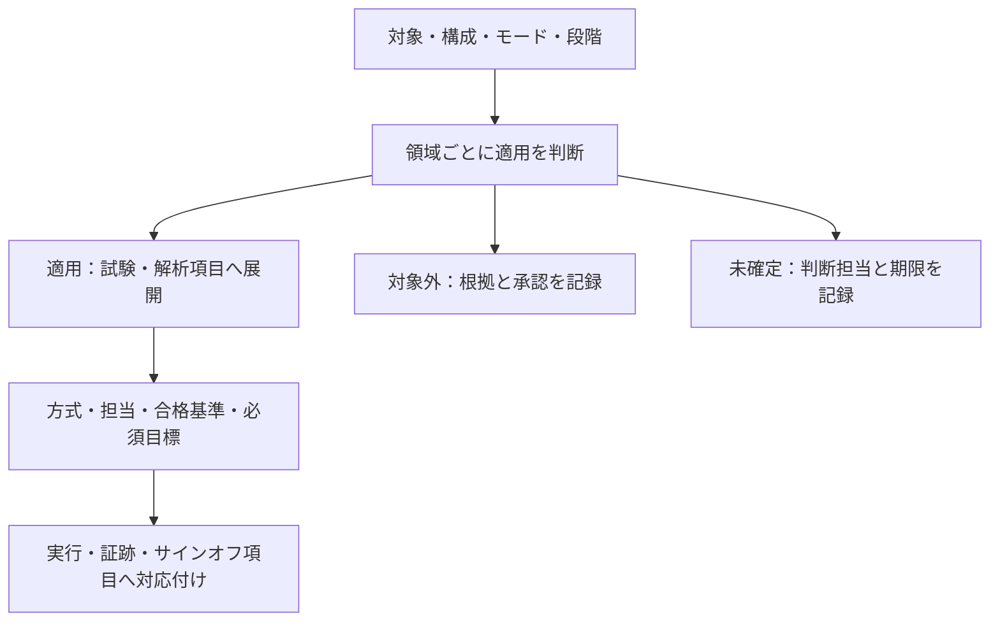

# 検証領域と適用範囲の記録

[検証計画の抜けを点検する手順](../method/verification-gap-review.md)で使う雛形です。製品・IP・開発段階ごとにコピーし、構成とモードに応じて行を分けます。以下は未記入・未判定で、承認済みの適用判断ではありません。

## 適用判断から検証項目へ展開する

製品・構成・段階ごとに領域の適用を判断し、適用する項目へ方式・担当・判定・証跡を割り当てます。

適用するが未実行の項目は、対象外へ移しません。図は雛形の記入順で、適用や合格の承認済み状態を示しません。

## 対象と入力

- 記録ID・改訂：
- 対象製品・IP・判定する段階：
- 仕様・要求台帳・ブロック図の版：
- RTL・IP・ソフトウェアの版：
- 必須構成・パラメータ・モードと版：
- クロック・リセット・電源ドメインと関係の一覧：
- インターフェース・メモリ・エラー経路・資産の一覧：
- 担当・レビュー担当・適用判断の承認者：

## 領域別の適用判断

「適用／対象外／未確定」を記録します。対象外には構成・仕様上の根拠と承認を付けます。適用するが未実行、という状態は対象外にしません。検証の結果は別欄で管理します。

| 領域ID | 領域 | 構成・モード | 適用 | 根拠・関連要求 | 実施段階・担当 | 計画・証跡・サインオフ項目ID |
| --- | --- | --- | --- | --- | --- | --- |
| SCOPE-STATIC | lint・構成別エラボレーション | 未記入 | 未確定 | 未記入 | 未定 | 未登録 |
| SCOPE-RESET-X | リセット・初期化・X伝搬 | 未記入 | 未確定 | 未記入 | 未定 | 未登録 |
| SCOPE-CDC-RDC | クロック・リセット境界 | 未記入 | 未確定 | 未記入 | 未定 | 未登録 |
| SCOPE-PROTOCOL-DATA | プロトコル・データ整合性 | 未記入 | 未確定 | 未記入 | 未定 | 未登録 |
| SCOPE-FAULT-RECOVERY | 異常・故障・復帰 | 未記入 | 未確定 | 未記入 | 未定 | 未登録 |
| SCOPE-PERFORMANCE | 性能・負荷・進行性 | 未記入 | 未確定 | 未記入 | 未定 | 未登録 |
| SCOPE-POWER | 低電力・電源遷移 | 未記入 | 未確定 | 未記入 | 未定 | 未登録 |
| SCOPE-SECURITY | 権限・セキュリティ・安全機構 | 未記入 | 未確定 | 未記入 | 未定 | 未登録 |
| SCOPE-CODE-COVERAGE | コードカバレッジと未達分析 | 未記入 | 未確定 | 未記入 | 未定 | 未登録 |
| SCOPE-EQUIVALENCE | 等価性・実装変更 | 未記入 | 未確定 | 未記入 | 未定 | 未登録 |
| SCOPE-SYSTEM-SW | システム・ソフトウェア統合 | 未記入 | 未確定 | 未記入 | 未定 | 未登録 |
| SCOPE-PHYSICAL | タイミング・物理・製造・実測 | 未記入 | 未確定 | 未記入 | 未定 | 未登録 |

最後の行は、STA、DFT、物理、電源・信頼性、AMS、シリコン評価など、実際の担当・判定段階ごとに展開します。別の領域が必要なら行を追加します。この一覧だけで仕様の抜けがないと判断しません。

## 試験・解析項目への展開

必要な項目ごとに次を記録し、要求・クロス目標・カバレッジと結び付けます。

- 項目ID・領域ID・関連要求IDと改訂：
- 対象構成・モード・動作中の状態：
- 検査する不具合・違反：
- 方式・ツール・必要なモデル・制約と版：
- 初期化・事前条件、刺激・負荷、故障注入の場所・時刻・期間：
- CDC遅延モデルの版・適用インスタンス、基準と許容遅延、実行／遷移ごとの選択、注入条件・窓・確率、seedと相関、実際の遅延・再収束の観測目標（[手順](../method/verification-gap-review.md#42-同期化遅延のランダム化とメタスタビリティ影響注入)）：
- 受理・完了・取消・復帰の定義、観測点とチェッカー：
- 合格基準・期限・性能閾値と仕様上の根拠：
- 必須の境界・状態・順序・クロス・カバレッジ目標：
- 機能カバレッジの要求対応・モデルの版、構成・インスタンス別の必須bin／cross・必要ヒット数・除外根拠：
- 計測方式（COVERログ／ネイティブDB等）、観測点・サンプリング条件、DB／カウンターと期待件数の照合、収集無効化・刺激不足を検出する対照ケース（[手法と実行例](../method/functional-coverage.md)）：
- クロスモデルの因子・水準・制約・次数・重点群・時間関係、既存証跡と未達の対応（[クロスモデルと検証結果の記録](interaction-coverage-plan.md)）：
- 削減ID・方式・根拠、元の集合と代表への対応、残す境界・高次の組・負荷、目標・検出力の維持と再評価条件（[削減の手順](../method/verification-reduction.md)）：
- 対照ケースと、チェッカーが誤りを検出することの確認：
- 終了条件、受理・完了・取消・未解決件数の確認：
- 担当・実行予定・レビュー担当：
- リグレッションの段階と起動条件、マニフェストのケースID、実行資源・ライセンス、再実行・結果収集・保持の方針（[継続リグレッション](../method/continuous-regression.md)）：
- 状態（未判定／未実行／合格／失敗／判定不能）、実行IDと証跡：
- 未達・除外・課題・例外承認ID、残リスク・対応・期限：

合格は、必要な条件へ到達して有効な判定が行われた証跡に基づけます。シミュレーション、フォーマル検証、静的解析、物理解析、実測の結果は、それぞれの範囲と意味を付けて記録します。

## 未確認と変更の影響

- 適用が未確定の領域・構成、判断担当・期限：
- 要求・接続・構成のうち、検証領域に対応しない項目：
- 適用するが計画・チェッカー・実行・判定が不足している項目：
- 外部IP・隣接ブロック・ソフトウェアが満たす前提と、その確認項目：
- コードカバレッジの対象RTL・構成・指標・ツールと計測設定、生成されたポイント集合、計測期間・初期化の扱い（[手順と実行例](../method/code-coverage.md)）：
- コードカバレッジの未生成項目・未達・除外前後の分母と根拠、統合元の合格実行IDとDB、注釈付きソース：
- コードカバレッジの未達・除外から追加した要求・試験：
- 変更IDと、構成・ドメイン・仮定・故障モデル・ソフトウェアへの影響：
- 再評価・再実行が必要な項目、無効にする旧証跡：
- [サインオフ記録](signoff-record.md)への参照：
