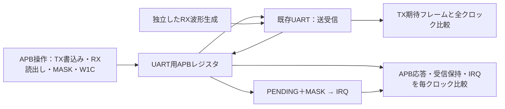

# GitLabでAPB・UART・割り込みの結合検証を実行する

APBから送信データを書き込み、シリアル受信データを読み、割り込みを確認・クリアする一連の動作を検証する教材です。[既存UART回路](../gitlab-uart/rtl/uart.sv)をそのまま接続し、UARTの実際の完了・エラーから割り込みイベントを生成します。イベントの外部注入だけで結合部を代用する構成ではありません。

PythonとIcarus Verilogを使います。APB待ち状態0／1／3×8N1／8E1／8O1の9構成を実行し、1ビットあたりのクロック数は8に固定します。

## 1. 説明用レジスタと割り込み仕様

| バイトアドレス | 名前 | アクセスと動作 |
| --- | --- | --- |
| `0x00` | MASK | 下位4ビットを読書き。1で割り込み許可。上位は読出し0・書込み無視 |
| `0x04` | STATUS | 読出し専用。bit0=送信可能、bit1=未読受信あり、bit2=最後の受信のパリティエラー、bit3=最後の受信のフレーミングエラー |
| `0x08` | TXDATA | 書込み専用。完了エッジで送信可能なら下位8ビットを送信開始。送信中ならエラー応答、追加送信なし |
| `0x0c` | RXDATA | 読出し専用。下位8ビットが受信データ。正常読出しで未読フラグだけクリア。未読データがなければエラー応答 |
| `0x10` | PENDING | 下位4ビットがイベント保持状態。読出しとW1C。上位は読出し0・書込み無視 |
| `0x14` | ID | 読出し専用、固定値`0x55415254` |
| その他 | 未割当・非整列 | エラー応答 |

4要因の対応は、bit0=送信完了、bit1=受信完了、bit2=受信パリティエラー、bit3=受信フレーミングエラーです。パリティなしではbit2のイベントは発生しません。エラー受信でも受信完了イベントとデータを通知します。

- MASKはIRQ出力だけに作用し、マスク中もPENDINGへイベントを保持します。IRQは`|(PENDING & MASK)`で生成します。
- W1Cと新規イベントが同じエッジに重なれば、同じビットはセットされたままになります。マスク更新とイベントが重なった場合は、更新後のMASKとPENDINGからIRQを生成します。
- RXDATAの読出しと新規受信が同時なら、APBへ旧データを返し、新データを未読として保持します。受信データやエラーフラグの読出しはPENDINGをクリアしません。割り込みの確認応答には別途W1Cが必要です。
- 受信保持は1バイトです。未読のまま次の受信が来ると新データとそのエラーフラグで上書きします。オーバーラン通知は実装していません。読出し後もデータと最後のエラーフラグは次の受信まで保持します。
- 同期リセットはバスの待ち、送受信途中のフレーム、MASK、PENDING、受信保持状態を初期化します。送信可能へ戻り、TX線はhighになります。

APBは[既存例](../gitlab-apb/README.md#1-対象とレジスタ仕様)と同じAPB3信号のサブセットです。SETUP／ACCESSを使い、要求を保持し、`PSEL && PENABLE && PREADY`の完了エッジで副作用を起こします。この教材ではエラー応答に伴うバス操作の副作用はなく、エラー読出しは0を返します。その間も独立したUARTイベントは取り込みます。エラー時の副作用抑止や読出し0はAPB全般の保証ではありません。プロトコルの参照先は[Arm IHI 0024](https://developer.arm.com/documentation/ihi0024/latest/)です。

既存の`apb_regs`は送受信データの受け渡しに対応しないため、そのまま流用していません。APBの待ち・完了処理と割り込み保持の考え方を既存例から引き継ぎ、UART用のレジスタ回路を作成しました。16550や特定製品のレジスタ互換性はありません。

## 2. 接続と独立した判定



送信の期待値は、正常完了したTXDATA書込みとフレーム仕様から作ります。スタート、8ビットのデータ、パリティ、ストップを各クロックで比較し、SETUP・待ち状態中やエラー時に送信を開始していないことも確認します。送信完了イベントはTX線のストップ期間終了後、送信可能へ戻った次のエッジで保持します。

受信はPythonが独立したバイト列からRX波形を作り、予定するデータ・エラー・保持時刻も入力へ記録します。実装内部のUART出力・イベント線を期待値へ使いません。受信の期待時刻は、既存UARTの2段同期化・中央サンプル・登録済み有効パルスと、結合レジスタの1クロックの取込み遅延に基づきます。最初のlowを取り込むエッジをS、分周数をDとすると、レジスタへの反映は`S + 3 + D/2 + (9 + パリティ有無) × D`です。パリティ有無は0または1です。UARTの仕様や遅延を変えたら、この期待時刻も仕様と照合して見直します。

テストベンチはAPB応答・読出し値、MASK、PENDING、受信データ・未読状態・エラーフラグ、TX線・送信可能状態、IRQを比較します。レジスタ状態は説明用の外部観測出力も使い、読出し間に起きる誤更新を検出します。APB応答は立上り前、更新状態とTX線はNBA更新後に確認します。マスターのSETUPと要求保持も監視します。

CPUや実ファームウェアを動かす構成ではありません。レジスタアクセスと割り込み処理の順序をバス刺激で模擬します。

## 3. 相互作用の目標

| 対象 | 確認する動作 |
| --- | --- |
| 送受信の結合 | APB送信→実波形、実受信→APB読出し、別データによる同時送受信、代表値`00/FF/55/01/80` |
| 保持とマスク | マスク中の保持→許可→再マスク、W1Cによる解除、複数要因の一部・最後のクリア |
| 競合 | W1Cと実イベント、MASK更新と実イベント、旧RXDATA読出しと新規受信、未読データの上書き |
| バスのフェーズ | SETUP・待ち中・エラー応答と受信イベントの重なり、連続したAPB転送 |
| 不正操作 | 送信中の書込み、空の受信読出し、方向違反、読出し専用への書込み、非整列・未割当アドレス |
| リセット | 送信途中・受信途中かつIRQ出力中のリセット、その後の送受信と割り込み復帰 |

主なクロスは**各要因×マスク2状態×W1Cの対象ビット2状態×同時イベント2状態**です。事前のPENDINGが1のときに記録します。要因の発生には実際のTX完了・正常RX・パリティ誤りRX・フレーミング誤りRXを使います。パリティなしでは3要因×8=24目標、有効時は4要因×8=32目標です。

[要求カタログ](requirements.json)全体では、パリティなしが60目標（wait=0）／61目標（wait=1/3）、有効時が69／70目標です。パリティの2要求と、wait=0の待ち状態要求は、適用しない構成で理由付き除外を記録します。

カバーは実行中の観測を出力し、正常ケースの全比較と予定サイクル数・完了数が一致した場合だけ集計します。変異や途中で失敗したケースを、正常目標の達成へ加算しません。これは選定した目標の達成で、全データ・全履歴・全条件の直積の網羅ではありません。SVAやcovergroup DBの計測値ではありません。

## 4. 固定ケース・ランダム化と実行方法

固定ケースが必須クロスと競合を確保し、ランダム列で履歴を変えます。ランダム化するのは送受信データ、割り込みマスク・W1Cデータ、正常／パリティ誤り／フレーミング誤り、同時送受信と送信中の追加書込み、受信中のレジスタ操作、リセット、待ち時間です。

Python 3.10以上とIcarus Verilogの`iverilog`／`vvp`が必要です。リポジトリのルートから実行します。

```sh
python3 examples/gitlab-apb-uart/run.py --wait 1 --parity 1
python3 -m unittest discover -s examples/gitlab-apb-uart/tests -v
python3 examples/gitlab-apb-uart/run.py --wait 3 --parity 2 --profile nightly --seed 73
```

`--parity=0/1/2`はなし／偶数／奇数です。smokeは1 seed×16シナリオ、nightlyは連続した3 seed×128シナリオです。`--operations`で1 seedのシナリオ数を変えられます。1シナリオは複数のAPB転送やシリアルフレームを含み、操作数とフレーム数・バス転送数・検査サイクル数は異なります。

`--out`は未作成のディレクトリを指定し、1ツール実行あたりの既定タイムアウトは10秒です。既存のUART RTLとIRQ例のプロセス実行処理を使うため、`examples`一式を保持してください。再現時はseedだけでなく、保存した全入力・構成・ソースハッシュ・ツール版も照合します。

## 5. 結合不具合の検出力を確認する

| 変異 | 結合部の不具合 | 期待する違反 |
| --- | --- | --- |
| 1 | マスク中のイベントをPENDINGへ保持しない | `APBUART_PENDING` |
| 2 | IRQの生成時にMASKを無視 | `APBUART_IRQ` |
| 3 | W1Cが同時イベントを消す | `APBUART_PENDING` |
| 4 | APB→UARTの送信データLSBを反転 | `APBUART_TX_DATA` |
| 5 | UART→APBの受信保持データLSBを反転 | `APBUART_RX_DATA` |

既存UARTには変異を入れず、結合部を5種類に分けて壊します。各変異は予定した違反ラベルで失敗した場合だけ検出成功です。ビルド失敗、タイムアウト、無関係な異常終了、完了記録の欠落は検出として扱いません。

```sh
# 正常ケースにも変異を入れ、回帰全体の失敗を確認（終了コード1が期待値）
python3 examples/gitlab-apb-uart/run.py --demo-bug 3
```

ランナーのセルフテストは14テストです。9構成・5種類の変異・入力とseedの再現に加え、欠落目標、変異によるカバー混入、完了記録・完了数の破損、波形入力の欠落、マスターの要求保持違反、証跡の上書き防止を確認します。

## 6. GitLabと保存する証跡

ルートの`.gitlab-ci.yml`が[CI設定](gitlab-ci.yml)を読み込みます。`apb-uart-runner-tests`の成功後に9構成を実行します。push・MR・webはsmoke、scheduleはnightlyです。手動実行では`APB_UART_REGRESSION_SEED`でseed、`APB_UART_DEMO_BUG=1～5`で失敗デモを選べます。定期実行にはGitLab側のスケジュール設定も必要です。

JUnitはsmokeが各8件（正常2＋変異5＋要求・カバーの合否判定1）、計72件です。nightlyは各10件、計90件です。ランナーのセルフテスト14件は別枠です。

`artifacts/apb-uart-wait1-parity1/`などへ、全クロックの入力と予定受信、seed、構成、ソースハッシュ、ツール版、ビルド結果、ケース別のログ・VCD・判定・完了数、要求カタログ、カバー・除外理由、JUnitを保存します。送信完了数、受信保持数、正常受信読出し数、APB完了数、エラー応答数を予定と比較し、欠落・不一致はエラーです。アーティファクトは`when: always`で14日間保存しますが、中断やRunner障害では回収できない場合があります。

## 7. 適用範囲と実行確認

この例は、単一クロックと同じビット周期で動く説明用回路の有限シミュレーションです。入力はクロック立下りで駆動し、受信イベントとAPB操作の位相を組み合わせます。ボーレートの周波数誤差やジッター、アナログCDC安全性、FIFO・オーバーラン通知、BREAK、RTS/CTS、APBクロックとUARTクロックの分離、実CPU・割り込みコントローラ・ドライバ、製品の規格適合性は対象外です。[UART単体例](../gitlab-uart/README.md)と合わせて適用範囲を確認してください。

検証観点の参考はOpenTitanの[UARTテスト計画](https://opentitan.org/book/hw/ip/uart/data/uart_testplan.html)と[ソフトウェア操作例](https://opentitan.org/book/hw/ip/uart/doc/programmers_guide.html)です。コード・レジスタ定義を転載したものではなく、この教材の独自仕様を検証しています。[機能間のクロス検証](../../docs/method/feature-interaction-verification.md)も参照してください。

ローカルでランナー14テストとnightly全9構成を確認しました。nightlyはseed 17〜19を各128シナリオ実行し、各構成で必須目標を達成、5種類の変異を検出しました。

公開デモの[MR !11](https://gitlab.com/kurochan001/lsi-verification-method-ci-demo/-/merge_requests/11)で、[CI #2990155891](https://gitlab.com/kurochan001/lsi-verification-method-ci-demo/-/pipelines/2990155891)の全50ジョブ成功とJUnit 311件をGitLab画面で確認しました。追加分は72件です。保存済みの全9構成の`summary.json`・`coverage.json`でも60/60・61/61・69/69・70/70目標、5種類の変異、各7/7ケース完了、正常ケース2件の成功、適用除外と未達なしを照合しました。対象コミットは`ae584e41`です。

GitLabで確認したのはsmokeです。全例を含むscheduleの384件は今回GitLabで実行していません。その後MR !11はmainへマージされ、[mainのCI #2990167574](https://gitlab.com/kurochan001/lsi-verification-method-ci-demo/-/pipelines/2990167574)も全50ジョブ成功、JUnit 311件・失敗／エラー0件です。

確認記録と全体構成図の[MR !12](https://gitlab.com/kurochan001/lsi-verification-method-ci-demo/-/merge_requests/12)もmainへ取り込み済みです。[MR !12のCI #2990210417](https://gitlab.com/kurochan001/lsi-verification-method-ci-demo/-/pipelines/2990210417)で全50ジョブ・JUnit 311件・失敗／エラー0件を確認し、その後の[mainのCI #2990241122](https://gitlab.com/kurochan001/lsi-verification-method-ci-demo/-/pipelines/2990241122)も成功しています。現行構成は[実行例一覧](../../README.md#gitlab実行例の現在の構成)を参照してください。
