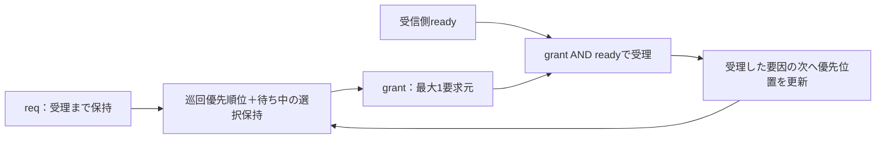

# GitLabでラウンドロビン・アービタを検証する

複数の要求元から一つを選ぶアービタを、排他制御、受信待ち中の選択保持、受理順序、公平性の観点で検証する例です。要求元2／3／4の3構成をPythonとIcarus Verilogで実行します。商用ツールは不要です。

## 1. 仲裁の仕様

| 信号 | 意味 |
| --- | --- |
| `req[N-1:0]` | 各要求元の要求。未受理の要求は1を保持 |
| `grant[N-1:0]` | 選択した要求元を示すone-hot、または要求なしの0 |
| `ready` | 受信側がそのクロックで受理できる状態 |
| `rst_n` | active lowの同期リセット |

クロック立上りで`grant[i] && ready`が成立した要求だけを受理します。grantの提示だけでは受理しません。要求元は未受理のreqを下げず、リセットによる取消を許可します。受理後もreqを1に保つ場合は、続く新しい要求として扱います。

初期優先位置は要求元0です。選択が固定されていなければ、その位置から番号順に巡回して最初の要求を選びます。受理した要求元の次を新しい優先位置とし、要求がない間は位置を保持します。これは等しい重みのラウンドロビンで、固定優先度や重み付き仲裁ではありません。

`ready=0`の選択を一度クロックで取り込んだら、その要求が受理されるまでgrantを保持します。途中で別の要求元が現れても選択を変更しません。リセットは優先位置・選択保持を初期化し、未受理要求を取り消します。リセットのエッジは受理として数えません。



この例は同期した要求の仲裁だけを扱います。データ経路、パケット途中の占有、QoS・重み・優先度変更、非同期入力は別の検証対象です。

## 2. 公平性の条件と待ち時間

要求を出し続ける要求元は、**他の要求元の受理を最大N−1回待ち、自分を含むN回目までの受理機会で受理される**ことを検査します。受理機会は、リセット中でなく、要求があり、readyが1のクロックです。要求があるのにgrantを出さない場合も別途失敗させます。

受信側が停止すると受理機会自体がなくなるため、実クロック数の待ちと混同しません。要求の継続中ずっとready=1なら、上記は最大Nサイクルの待ちに対応しますが、任意に長い停止を許す環境へ同じ実時間上限を適用しません。

| 記録 | 意味 |
| --- | --- |
| `opportunities`／`accepted` | 受理機会と実際の受理数。両者の一致を要求 |
| `SERVICE count` | 要求元ごとの受理回数。合計と全体の受理数を照合 |
| `max_service_wait` | 完了した要求について、自分の受理を含む受理機会数の最大値。N以下 |
| `max_wall` | 要求の提示からの最大サイクル待ち。受信停止と、後で取り消した要求の待ちも含む |
| `cancelled` | リセットで取り消した未受理要求の件数 |

未受理の間も、他の要求元の受理がN回に達したら、その時点で公平性違反にします。最後は全要求を受理してから終了し、残った要求を単に無視して合格にはしません。リセットによる取消は受理とは分けます。

受信側を停止したままの診断ケースでは、readyを0にして長く待たせ、最後にリセットで取り消します。受理機会0・受理0・長い実サイクル待ちを確認します。このケースの成功は停止条件を識別できたという意味で、公平性を確認した証跡や通常機能のカバーには使いません。

## 3. チェッカーと必須目標

RTLは優先位置を持つ巡回探索、参照モデルは要求元の並びを回転する方式で期待順序を計算します。DUT内部の位置・ロックを参照しません。これとは別に、要求元ごとの待ちを数える公平性モニターを動かします。

毎クロック、grantが既知か、最大1要求元か、要求のない要因へgrantしていないか、待ち中に選択を変えていないか、期待順序と一致するかを確認します。送信側の要求保持も監視します。grantは受理エッジの前の値で記録し、受理後に優先位置が更新された値と取り違えません。

| 必須目標 | 個数 |
| --- | --- |
| 全要求マスク×ready | 2のN乗×2 |
| 要求元ごとの受理 | N |
| 隣の要求元への受理順序の回転 | N |
| 受信待ち、新規要求到来、再開 | 3 |
| アイドル／未受理要求のリセット、復帰 | 3 |
| 全競合でのN回の受理窓、全要求元の受理 | 2 |
| 最後の要求の解消 | 1 |

要求は7件で、2要求元は21目標、3要求元は31目標、4要求元は49目標です。`requirements.json`から構成ごとの分母を生成し、別の構成の観測で補いません。

要求マスク×readyの固定テストは、リセット直後の優先位置を使います。優先位置・要求マスク・ロック状態の全直積を網羅したという意味ではありません。連続競合、待ち中の新規要求、ランダムな履歴、リセットを別に確認します。

観測はそのサイクルの比較後に出し、正常ケース全体が完了した場合だけ集計します。変異・停止診断の観測は通常機能の達成に使いません。選定した機能目標の計測であり、SVAやcovergroup DBの値ではありません。

## 4. ローカルで実行する

Python 3.10以上とIcarus Verilogの`iverilog`・`vvp`を用意し、リポジトリのルートから実行します。

```sh
python3 examples/gitlab-arbiter/run.py --ports 3
python3 -m unittest discover -s examples/gitlab-arbiter/tests -v
python3 examples/gitlab-arbiter/run.py --ports 4 --profile nightly --seed 73
```

smokeは境界1ケース＋ランダム1 seed×200サイクル＋変異3ケース＋停止診断1ケース＋必須目標判定で**JUnit 7件／構成**です。nightlyはランダムを3 seed×2,000サイクルへ拡張して**JUnit 9件／構成**になります。初期リセットと最後の要求解消はランダムサイクル数に含めません。

入力生成器は仕様上の受理順序から未受理要求の保持を計算し、DUTに依存しない全入力を事前に保存します。`--seed`と`--cycles`で入力を選べます。厳密な再現には全入力、ソースハッシュ、ツール版も照合します。既存の`--out`は上書きしません。

ランナーはFIFO例を基に拡張し、IRQ例のプロセス実行・終了判定処理を利用します。`examples`一式を保持してください。

## 5. 意図的な不具合とチェッカーの自己確認

| `--demo-bug` | 不具合 | 通常リグレッションでの検出ラベル |
| --- | --- | --- |
| 1 | 複数の要求へ同時にgrant | `ARB_ONEHOT` |
| 2 | 待ち中の選択保持を無視して再選択 | `ARB_STABILITY` |
| 3 | 受理後も優先位置0のまま固定 | `ARB_ORDER` |

通常リグレッションでも3種類の変異を別々に実行し、検出を要求します。次は正常ケースにも不具合を入れ、終了コード1とJUnitのfailureを確認するデモです。

```sh
python3 examples/gitlab-arbiter/run.py --demo-bug 3
```

固定優先度の変異は、通常は順序違反で先に止まります。専用の自己確認では順序チェッカーだけを無効にし、要求を保持したまま受信を続けて、公平性モニターが`ARB_FAIRNESS`で飢餓を検出することも確認します。この無効化は単体テスト内の明示した構成だけで、通常リグレッションには使いません。

13テストで、3構成、3種類の変異、seedと入力の再現、受信停止の診断、独立した公平性検出、要求の不正な取下げ、受理・待ち記録の欠落、必須目標の未達、異常終了、証跡の上書き防止などを確認します。タイムアウトや無関係な異常を変異検出の成功にしません。

## 6. GitLab CIと証跡

ルートの`.gitlab-ci.yml`で[CI設定](gitlab-ci.yml)を読み込みます。`arbiter-runner-tests`の成功後、2／3／4要求元の3ジョブを実行します。push・MR・webはsmoke、scheduleはnightlyです。定期実行にはGitLab側のスケジュール設定が必要です。

手動パイプラインでは`ARB_DEMO_BUG=1/2/3`で失敗デモ、`ARB_REGRESSION_SEED`でseedを選べます。ジョブはランナーの非0終了で失敗し、JUnitは結果表示に使います。

`artifacts/arbiter-p3/`などへ、構成・全入力・予定ケース・ソースハッシュ、ツール版、ビルド結果、ケース別の入力・ログ・VCD波形・受理数・待ち時間・結果、要求・カバーの集計、JUnitを保存します。`SERVICE`と`METRICS`の記録が欠ける正常ケースはエラーにします。アーティファクトは`when: always`で14日間保存し、中断やRunner障害では回収できない場合があります。

## 7. 実行確認

2026-10-26にPython 3.14.7・Icarus Verilog 14.0開発版で13テストとnightly全3構成を確認しました。各構成で21/21・31/31・49/49目標を達成し、3種類の変異を検出しました。nightlyはseed 17〜19を各2,000サイクル実行しています。停止診断の実サイクル待ちは9／13／17、受理機会と受理数はすべて0でした。

公開デモの[MR !9](https://gitlab.com/kurochan001/lsi-verification-method-ci-demo/-/merge_requests/9)で、[CI #2989838991](https://gitlab.com/kurochan001/lsi-verification-method-ci-demo/-/pipelines/2989838991)の全33ジョブ成功、JUnit 199件・失敗／エラー0件を確認しました。アービタの3ジョブはIcarus Verilog 11.0で実行され、保存済み証跡でも21/21・31/31・49/49目標、3種類の変異、停止診断、予定6ケースの完了と対象コミット`9ae64ad5`を確認しました。追加分のJUnitは21件、ランナーのセルフテストは別枠の13テストです。

境界ケースの受理数は2／3／4要求元で19／40／85、最大受理機会待ちは2／3／4でした。停止診断の受理機会と受理数は0で、実サイクル待ちは9／13／17でした。GitLabで確認したのはsmokeです。nightlyはローカルで実行し、全例を含むscheduleの242件はGitLabで今回実行していません。その後MR !9はmainへマージされ、[mainのCI #2989957235](https://gitlab.com/kurochan001/lsi-verification-method-ci-demo/-/pipelines/2989957235)でも全33ジョブ・JUnit 199件の成功を確認しました。

有限のシミュレーションによる確認であり、任意の無限の要求列に対する活性証明ではありません。製品では公平性の方式、受理条件、取消、占有期間、負荷と環境の進行条件を仕様と照合してください。[性能・負荷・進行性の点検](../../docs/method/verification-gap-review.md#7-性能負荷進行性)と[フォーマル検証の進行性](../../docs/method/formal-verification.md#2-要求から証明計画を作る)も参照してください。

2026-10-27の全体レビューで、ランナーが渡す`+WAVE`をテストベンチが読まず、VCDが生成されない問題を修正しました。13テストの構成別確認に、全ケースのVCDファイルとヘッダの検査を加えています。この波形保存の修正はローカルで確認し、上記GitLabの実行記録は修正前の版に対するものです。
