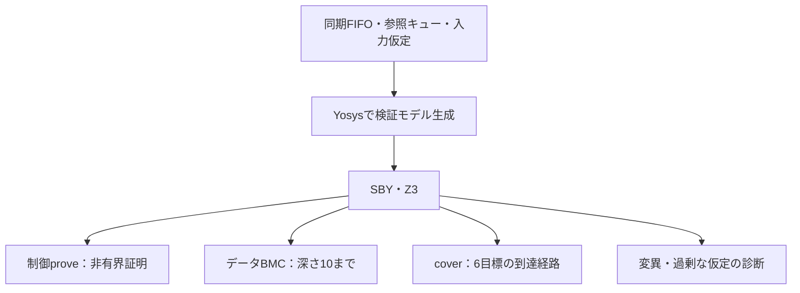

# 商用ツールを使わずGitLabでFIFOをフォーマル検証する

GitLabのジョブ内にオープンソースのYosys・SymbiYosys（SBY）・Z3を用意し、既存の[同期FIFO](../gitlab-fifo/README.md)を検査する例です。手元のPCにフォーマル検証ツールをインストールしなくても、GitLabで実行できます。

制御プロパティの非有界証明、データの有界検査、必要な状態への到達確認を別のタスクにします。意図的な不具合で反例が出ること、過剰な仮定では正常動作を確認できないことも試します。

## フォーマルモデルから3種類の結果へ

FIFOと独立参照モデルをハーネスで接続し、制御・データ・到達の問いを別々に実行します。



図は本例の固定タスクです。BMCやcoverのPASSを、任意時間の全データ動作の証明へ読み替えません。

## 1. 使用するツール

| ツール | この例での役割 |
| --- | --- |
| Yosys | RTLとハーネスを読み込み、検証用のモデルを生成する |
| SymbiYosys（SBY） | 証明・有界検査・到達性のタスクとエンジンを実行・管理する |
| Z3 | SMTソルバーとして、反例・到達経路や帰納法の成立を調べる |
| YoWASP | WebAssembly版のYosysとSBY関連コマンドをPythonパッケージとして提供する |

[`tools-requirements.txt`](tools-requirements.txt)で確認済みのパッケージ版を固定し、GitLabのPythonイメージへpipでインストールします。商用EDAライセンスは使いません。Runnerの計算資源・実行時間には、利用環境の条件が適用されます。

YoWASPはYosysの非公式な配布パッケージです。使用版はマニフェストとツールの版表示へ残します。[YoWASPの説明](https://yowasp.org/)、[SBYの導入方法](https://yosyshq.readthedocs.io/projects/sby/en/stable/install.html)

## 2. 検証対象と前提

対象RTLは[`../gitlab-fifo/rtl/sync_fifo.sv`](../gitlab-fifo/rtl/sync_fifo.sv)をそのまま使います。データ幅8、深さ1・3の2構成をそれぞれ検査します。FIFOの同時読出し・書込み、空・満杯時の受付条件はシミュレーション例と共通です。

[`fifo_formal.sv`](fifo_formal.sv)は、仕様から作った占有数と線形の参照キューをDUTの出力と比較します。最初のサンプリングエッジだけリセットを仮定し、その後のリセット、書込み・読出し要求、入力データは任意です。満杯時の書込み要求や空での読出し要求も禁止しません。

単一クロック、同期リセット、2値モデルです。起動前の状態は初回リセット後の保証と分け、履歴のない最初のサンプルで`$past`を検査しません。非同期FIFO、CDC、X/Z、複数クロック、無期限の活性は対象外です。

ネイティブのYosysフロントエンドが扱う即時の`assert`・`assume`・`cover`と`$past`を使います。SystemVerilogの並行アサーションをすべて読める環境ではありません。[SBYの構文と履歴の説明](https://yosyshq.readthedocs.io/projects/sby/en/stable/verilog.html)

## 3. 証明・有界検査・到達性を分ける

| タスク | 対象と期待する結果 | この結果で言えること |
| --- | --- | --- |
| `control-proof` | `prove`で6つの制御プロパティがPASS | 仮定と対象構成の下で、対象の制御プロパティを帰納法で非有界に証明した |
| `data-bmc` | `bmc`・深さ10でPASS | データ比較を含む7プロパティについて、その有限深さまで反例が見つからなかった |
| `scenario-cover` | `cover`・深さ10で6目標へ到達 | 目標へ至る経路を得た。全経路の正しさや非有界のデータ整合性を証明した結果ではない |

制御の6プロパティは、占有数の一致、占有数の範囲、full／empty、読出し有効信号、リセット、読出しのないサイクルの出力保持です。データ比較`ap_data`は、`data-bmc`と通常のcoverタスクで有効にします。`control-proof`がPASSしても、データ順序を非有界に証明したとは報告しません。

6つのcoverは、リセット解除後の空、満杯、同時要求、データ保持中リセット、その後の読出し、折返しを含む反復転送です。同時要求のcoverは要求信号の同時成立を見ます。深さ1では、読出しと書込みの両方を同時に受け付けることを要求しません。

通常のcoverでは`cover_assert on`を指定し、アサーションを破る経路を目標の達成には使いません。これら6目標は、シミュレーション例の18／22目標とは別の計画です。フォーマルの到達だけでシミュレーションのカバレッジを埋めません。モードと深さの意味は[SBYの設定資料](https://yosyshq.readthedocs.io/projects/sby/en/stable/reference.html)に従います。

## 4. 不具合と過剰な仮定を検出する

通常モデルとは別に、3つの変異へBMCを実行します。

| タスク | 意図的な不具合 | 必須の反例ラベル |
| --- | --- | --- |
| `detect-mutation1` | 読出しデータの最下位ビットを反転 | `ap_data` |
| `detect-mutation2` | 満杯でも書込みを受け付ける | `ap_count` |
| `detect-mutation3` | データ保持中のリセットを無視 | `ap_reset` |

SBYのFAILだけでは検出成功にしません。想定したアサーションの違反、SBYの終了状態と終了コード、反例VCDの存在を確認します。エラー、タイムアウト、unknown、別の理由のFAILは検出成功になりません。

さらに、常時リセットという意図的に過剰な仮定を加えます。

1. `overconstrained-proof`：制御の証明はPASSする。
2. `detect-overconstraint`：正常動作の6つのcoverがすべて深さ10で未到達となり、FAILする。

この組で、証明がPASSしただけでは必要な動作を確認したことにならないと分かります。リセット値の検査まで無効になったという意味ではありません。有限深さのcover未到達を一般的な到達不能の証明とはせず、この例では仮定の式もレビューして原因を確認します。2タスクの結果は診断用であり、通常モデルの検証実績へ加算しません。

## 5. GitLabで実行する

この例を含むコミットをGitLabへ置くと、ルートの[`.gitlab-ci.yml`](../../.gitlab-ci.yml)から[`gitlab-ci.yml`](gitlab-ci.yml)を読み込みます。

- `formal-runner-tests`：判定・証跡の確認テスト8件を実行する。フォーマルツールのインストールは不要。
- `fifo-formal`：ジョブ内でツールをインストールし、深さ1・3をmatrixで実行する。各構成8タスク、合計16件のJUnit結果を保存する。
- `FORMAL_DEMO_BUG=1`：通常モデル側にもデータ不具合を入れ、正常系の`data-bmc`が失敗してパイプラインが失敗するデモ。

このジョブでは、シミュレーション用の`before_script`を上書きし、専用のPythonイメージとツール準備を使います。既存のIRQ・FIFOシミュレーションの準備処理とは分けています。JUnit表示だけで合否を決めず、ランナーの終了コードへ失敗を反映します。

## 6. 手元でも試す場合

手元へのインストールは任意です。Linux・macOSなどのPOSIX環境、Python 3.10以上で、一時ディレクトリの仮想環境へ用意できます。リポジトリのルートで実行します。

```sh
python3 -m venv /tmp/lsi-formal-venv
. /tmp/lsi-formal-venv/bin/activate
python3 -m pip install -r examples/gitlab-formal/tools-requirements.txt
python3 examples/gitlab-formal/run.py --depth 3
python3 examples/gitlab-formal/run.py --depth 1
python3 -m unittest discover -s examples/gitlab-formal/tests -v
```

正常モデルの回帰では、通常タスクのPASS、3変異の反例、過剰な仮定による未到達の確認がそろうと、ランナーが終了コード0になります。診断用タスク内のSBYのFAILと、回帰全体の失敗を区別してください。

## 7. 保存する証跡と判定

既定の出力先は`artifacts/formal-local-日時/`、GitLabでは`artifacts/formal-d深さ/`です。新しいディレクトリを使い、古い結果は上書きしません。

マニフェストには、対象RTL・ハーネス・設定・ランナーのハッシュ、構成、探索深さ、仮定を含む予定タスク、パッケージ版、CIのIDを保存します。タスクごとに、生成したSBY設定、モデル、最終状態、全ログ、反例・到達のVCDとwitness、個別判定を保存します。GitLabのアーティファクトの保持期間は14日です。

読み込み後の`model/design.json`から、assert・assume・coverの名前を固定した一覧と照合します。プロパティの欠落や、計画にない仮定があれば成功にしません。証明では帰納法の完了、coverでは全目標の到達とトレースを確認します。タスクの欠落・エラー・未完了を0件の失敗と取り違えません。

`summary.json`はタスク別の実際のSBY状態と、この教材の期待結果に対する判定を分けて保存します。タイムアウトやSIGTERM／SIGINTでは実行中のプロセスグループを停止します。途中終了の場合、最終JUnit・summaryの完成は保証しません。

パッケージ版を固定しても、コンテナタグ・Python版・配布バイナリまで同一になるとは限りません。実際の版と入力を証跡に残し、厳密な再現が必要な運用ではイメージdigestなども固定します。

## 8. 実行確認の記録

2026-10-26に、ローカルの一時仮想環境で深さ1・3の全8タスクをそれぞれ実行し、通常タスクと診断タスクが予定どおりに判定されることを確認しました。`--demo-bug 1`では、制御の証明がPASSしてもデータのBMCがFAILし、回帰の終了コードが1になることを確認しました。証跡の判定テスト8件も合格しています。

同日の[GitLab MR !3](https://gitlab.com/kurochan001/lsi-verification-method-ci-demo/-/merge_requests/3)の[パイプライン #2988351229](https://gitlab.com/kurochan001/lsi-verification-method-ci-demo/-/pipelines/2988351229)では、Python 3.11.17のイメージ内でツールを自動インストールし、深さ1・3の全16タスクが予定どおりの結果になりました。マニフェストから、依存パッケージが`tools-requirements.txt`の版と一致することも確認しました。

既存のIRQ・FIFO回帰と確認テストを含む全12ジョブが成功し、JUnitは計90件（従来74件＋フォーマル16件）、失敗・エラー0件です。各フォーマルジョブの`summary.json`で、制御の証明、深さ10のデータBMC、6目標の到達、3変異の反例、過剰な仮定の診断を照合しました。この結果は2節・3節の対象と証明範囲に限ります。

MR !3はmainへマージ済みです。マージコミット[`2364977d`](https://gitlab.com/kurochan001/lsi-verification-method-ci-demo/-/commit/2364977dbf2b2c335c271b47c9e2633e32271948)の[main CI #2988462019](https://gitlab.com/kurochan001/lsi-verification-method-ci-demo/-/pipelines/2988462019)でも、全12ジョブ・JUnit 90件・失敗／エラー0件を確認しました。現行mainからツールの自動準備を含めて実行できます。
