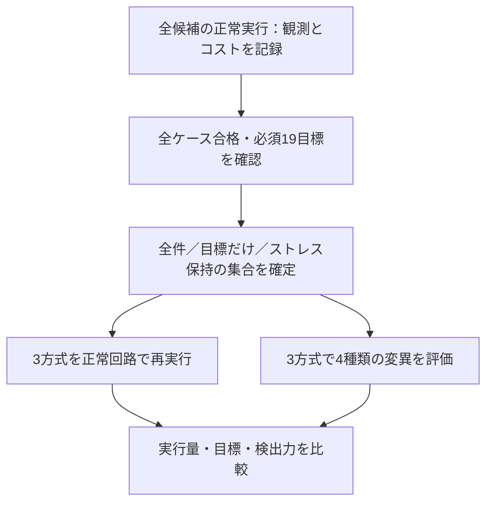

# GitLabでリグレッションの削減を比較する

全件リグレッション、目標だけで選ぶリグレッション、重要なストレス試験を残すリグレッションを、実際のRTLシミュレーションで比較する例です。実行量を減らした結果と、目標を満たしても不具合を見逃す場合を分けて示します。PythonとIcarus Verilogを使い、商用ライセンスは不要です。

## 1. 比較する対象

既存の[IRQ回路](../gitlab-regression/rtl/irq_pending.sv)を対象に、PENDの初期状態2通り×IRQ許可2通り×イベント／クリア操作4通りの16目標と、リセットの3目標を定義します。要求は2件、必須目標は計19件です。

smokeの候補は、個別操作16ケース、操作をまとめた4ケース、リセット・復帰1ケース、長い連続イベント1ケース、短いランダム列2ケースの**24ケース**です。nightlyでは短いランダム列を4 seedへ増やし、各列を32から128サイクルに延ばすため、候補は26ケースになります。ここでの「全件」はこの候補集合全体であり、全入力・全履歴を列挙する意味ではありません。

| 方式 | 選び方 |
| --- | --- |
| `full` | 候補をすべて実行 |
| `coverage_only` | 未達の必須目標数／検査サイクル数が大きいケースから貪欲に選択 |
| `guarded` | 事前指定した長い連続イベントの試験を残し、残りを同じ方法で選択 |

同点時の規則も固定し、壁時計時間の揺らぎを選択へ持ち込みません。貪欲法による選択であり、ケース数やコストの最小解を証明するものではありません。

## 2. 学習と再検証を分ける

まず全候補の正常回路を実行し、比較に合格した後の観測と検査サイクル数を記録します。学習で失敗・未完了・未達があれば、失敗したケースを外して選択することはせず、リグレッションを失敗させます。

選択した集合は`selection.json`へ保存してから、3方式をそれぞれ**新しく実行**します。学習結果を検証結果として流用しません。各方式の正常動作と19目標を照合し、不具合を入れた回路でも全選択ケースを実行します。



通常実行のカバレッジ目標は、初期状態・許可・操作を分類する手続き的な観測です。SVAやcovergroup DBの値ではありません。長い連続イベントへの到達も別に記録しますが、基本の19目標へは混ぜません。`guarded`が残すケースは`requirements.json`の`guard_cases`で明示します。

## 3. 検出力が変わる例

| 変異 | 不具合 | 比較で確認すること |
| --- | --- | --- |
| M1 | イベントとクリアの競合でクリアを優先 | 全方式で検出 |
| M2 | マスク中にイベントを保持しない | 全方式で検出 |
| M3 | 保持状態があるとリセットしない | 全方式で検出 |
| M4 | 連続イベントが8サイクルを超えるとイベント保持を抑止 | 全件とストレス保持では検出し、目標だけの方式は見逃す |

M1〜M3は既存RTLの変異を使います。M4は評価用ラッパーへ追加した履歴依存の変異で、長い連続の後にクリアとイベントが重なると誤動作します。M2はイベントのみなら`IRQ_SET_ONLY`、クリアとの競合なら`IRQ_SET_WINS`でも検出できます。それ以外の無関係な失敗やタイムアウトを検出成功にはしません。

選択スコアに変異の検出結果は使いません。M4と短いランダム列は、目標の分類だけでは長い履歴を保護できないことを示すために設計した比較条件です。短いランダム列の連続イベントは最大4サイクルに制約しています。未知の不具合に対する検出率を統計的に推定する実験ではありません。

**比較教材のCIが成功するのは、この見逃しも含めて期待した差を再現できた場合です。** `coverage_only`を製品リグレッションとして承認する意味ではありません。基本の19目標を満たすことと、すべての履歴・不具合を検査することは別です。

## 4. ローカルで実行する

Python 3.10以上とIcarus Verilogの`iverilog`・`vvp`を用意し、リポジトリのルートから実行します。

```sh
python3 examples/gitlab-reduction/run.py
python3 -m unittest discover -s examples/gitlab-reduction/tests -v
python3 examples/gitlab-reduction/run.py --profile nightly --seed 73
```

既存IRQ RTLとプロセス実行処理を使うため、`examples`一式を保持してください。`--seed`で短いランダム列を選びます。全入力、版、学習結果、選択理由を保存し、既存の`--out`は上書きしません。

保護対象を外すデモと、学習時の正常モデルへ不具合を入れるデモは次です。どちらも終了コード1が期待値です。

```sh
python3 examples/gitlab-reduction/run.py --omit-guard
python3 examples/gitlab-reduction/run.py --demo-bug 1
```

`--omit-guard`では、19目標を満たしていても保護対象の欠落とM4の見逃しにより失敗します。`--demo-bug`は1〜4を選べ、学習で不具合を検出した場合は選択へ進みません。

## 5. 実行量と時間の読み方

2026-10-26のローカル実行（smoke、seed 17）では次の結果でした。

| 方式 | 正常ケース数 | 検査サイクル数 | 必須目標 | M1〜M3 | M4 |
| --- | --- | --- | --- | --- | --- |
| 全件 | 24 | 233 | 19/19 | 全検出 | 検出 |
| 目標だけ | 9 | 42 | 19/19 | 全検出 | 未検出 |
| ストレス保持 | 8 | 47 | 19/19 | 全検出 | 検出 |

検査サイクル数は、入力列の各行を比較したチェック数の合計です。正常実行が完了してから集計します。42サイクルは全件比約82.0%、47サイクルは約79.8%の削減ですが、シミュレータの初期化・起動・ビルドを含む時間削減率ではありません。ストレス保持はケース数が少なくても、目標だけの方式より検査サイクル数が多くなっています。

`summary.json`には正常リグレッションのシミュレーション秒数、変異評価のサイクル数・秒数、学習とビルドの時間も分けて保存します。小さい回路の単発測定なので、壁時計時間から一般的な高速化率は主張しません。

この比較ジョブ自体は学習と全方式の再実行を行うため、単一の全件リグレッションより実行量が増えます。選択集合を今後の変更時リグレッションへ使う効果を評価する教材です。実際の運用では、依存関係や検証条件が変わったら学習・選択を更新し、定期的な広いリグレッションも残してください。

## 6. GitLab CIと証跡

ルートの`.gitlab-ci.yml`から[CI設定](gitlab-ci.yml)を読み込みます。`reduction-runner-tests`の11テスト後、`reduction-comparison`で実際の比較を行います。push・MR・webはsmoke、scheduleはnightlyです。`REDUCTION_SEED`でseed、`REDUCTION_DEMO_BUG=1/2/3/4`で学習時の不具合デモを選べます。

JUnitは**18件の集約判定**です。学習1件、選択1件、正常リグレッション3件、変異評価12件、実行量比較1件で、個々のシミュレーション件数とは異なります。たとえばsmoke・seed 17では、学習24件と3方式×正常／4種類の変異の計229回を実行します。nightlyでも集約判定は18件ですが、候補と実行量は増えます。

`artifacts/reduction/`へ、全候補と入力・ソースハッシュ、ツール版、ビルド結果、学習時と再実行時のケース別入力・ログ・結果、選択理由、全実行一覧、比較結果、JUnitを保存します。選択集合は`selection.json`、全実行は`runs.json`、集約は`summary.json`で追跡できます。波形は出力せず、入力と失敗サイクルを記録します。

アーティファクトは`when: always`で14日間保存します。中断やRunner障害では回収できない場合があります。学習が失敗した場合は選択・比較を未実行として記録し、未実行を合格へ移しません。

## 7. 実行確認

2026-10-26にPython 3.14.7・Icarus Verilog 14.0開発版で11テスト、smokeとnightly、保護対象を外すデモ、不具合デモを確認しました。nightly・seed 17の全件は26ケース・685検査サイクルで、選択後は42／47サイクル、3方式とも19目標を達成しました。

公開デモの[MR !8](https://gitlab.com/kurochan001/lsi-verification-method-ci-demo/-/merge_requests/8)で、[CI #2989712015](https://gitlab.com/kurochan001/lsi-verification-method-ci-demo/-/pipelines/2989712015)の全29ジョブ成功、JUnit 178件・失敗／エラー0件を確認しました。削減比較はIcarus Verilog 11.0で実行され、保存済み`summary.json`・`manifest.json`・`selection.json`でもseed 17、候補24ケース、229回のシミュレーション、233／42／47検査サイクル、各方式19目標、M1〜M3の維持とM4の検出差を確認しました。対象コミットは`a5c63877`です。追加分のJUnitは18集約判定、ランナーのセルフテストは別枠の11テストです。

初回CIは共有Runnerの補助イメージ取得時の認証エラーで既存ジョブが準備段階で停止しました。検証コードを変更せず再実行し、上記の成功を確認しています。GitLabで確認したのはsmokeで、nightlyはローカルで実行しました。全例を含むscheduleの215件をGitLabで今回実行した結果ではありません。その後、MR !8はmainへマージされ、[mainのCI #2989744619](https://gitlab.com/kurochan001/lsi-verification-method-ci-demo/-/pipelines/2989744619)も全29ジョブ・JUnit 178件で成功しています（2026-10-26確認）。

製品への適用では、ここで省略した時間関係・長時間負荷・構成・独立した検査方式も評価してください。[検証の削減の手順](../../docs/method/verification-reduction.md)と[継続リグレッション](../../docs/method/continuous-regression.md)が参照先です。
