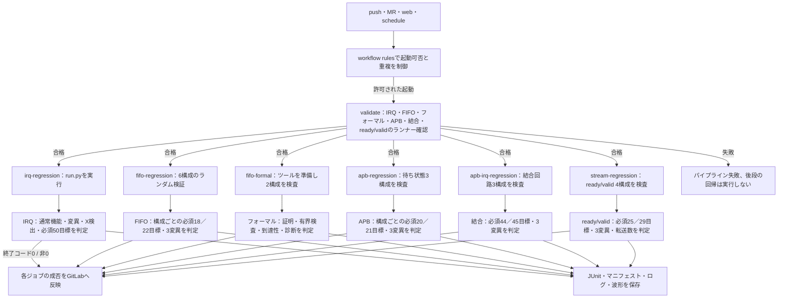

# GitLabで割り込みの継続的リグレッションを動かす

有償EDAライセンスを使わず、PythonとIcarus Verilogで動く最小例です。GitLabへこの例を含むコミットを置くと、ランナーの確認テストと、説明用IRQ回路の回帰を実行します。[継続的リグレッションの手順](../../docs/method/continuous-regression.md)を具体的なファイルにしたものです。

同じCI設定には、[FIFOのランダム検証例](../gitlab-fifo/README.md)と[商用ツール不要のフォーマル検証例](../gitlab-formal/README.md)、[APBレジスタ検証例](../gitlab-apb/README.md)、[APBと割込みの結合検証例](../gitlab-apb-irq/README.md)、[ready/valid通信のランダム検証例](../gitlab-stream/README.md)も含まれます。現行の全体構成は[READMEの実行例一覧](../../README.md#gitlab実行例の現在の構成)、以下の件数は特記がなければIRQ・CDC回帰の内訳です。

## 1. 実行するもの

- [`.gitlab-ci.yml`](../../.gitlab-ci.yml)：下記のCI設定をincludeする入口。
- [`gitlab-ci.yml`](gitlab-ci.yml)：依存ツールの準備、ランナー確認、回帰、JUnit・アーティファクト保存。
- [`run.py`](run.py)：計画生成、コンパイル、ケース実行、判定、マニフェスト・JUnit・結果の作成。
- [`irq_pending.sv`](rtl/irq_pending.sv)：説明用の回路と、検証用に選べる3個の変異。CDC受信回路側の1個と合わせて4個。
- [`irq_tb.sv`](tb/irq_tb.sv)：仕様に基づく状態・IRQの比較。失敗ラベルと完了記録を出力する。
- [`cdc_delay_model.sv`](tb/cdc_delay_model.sv)：転送ごとに1／2／3受信サイクルの遅延を選ぶ検証用モデル。
- [`cdc_receiver.sv`](rtl/cdc_receiver.sv)：2経路の一致を待ち、toggleごとに1回だけ受理する説明用の回路。
- [`requirements.json`](requirements.json)：版付きの8要求と、必須の50カバレッジ目標。
- [`test_runner.py`](tests/test_runner.py)：実シミュレーションと異常時のCLI・JUnit判定の確認。

仮の仕様は、イベントでPENDをセット、W1Cでクリア、同時ならセット優先、操作なしは保持、IRQはPENDとIRQ_ENの論理積です。この例はactive lowの**同期リセット**を使います。セット優先はこの例の仕様で、W1C全般の規則ではありません。

通常回路に対して次を実行します。

- 基本動作16ケース：初期PEND 2通り×IRQ_EN 2通り×操作4通り。
- 時間関係の12ケース：初期PEND 2通り×IRQ_EN 2通り×イベントとclearの時間差−1／0／＋1。
- 動作中リセットの3ケース：PEND保持中、イベント・clearとの競合、mask中。解除後の保持と最初のイベントも比較する。
- CDCモデルの1ケース：2経路それぞれの−1／0／＋1受信サイクルの9組×立上がり・立下がり、計18目標。
- 定期回帰のみ、3個のseedによる64操作ずつのランダム列を追加。

別に、クリア優先、maskによる保存停止、PEND=1でのリセット無視、CDC受信回路の早すぎる受理の4変異を、対応するチェッカーで検出します。さらに、状態へXを注入し、IRQまで伝搬した未知値をチェッカーが検出する自己確認を1件行います。**予定した変異・X注入の検出は、この確認項目の成功**です。通常回路の失敗とは区別して記録し、コンパイル不能や任意のクラッシュを検出成功にしません。

| プロファイル | 通常回路のケース | 変異検出 | Xの自己確認 | 要求・カバレッジ判定 | JUnitの合計 |
| --- | --- | --- | --- | --- | --- |
| smoke | 32 | 4 | 1 | 1 | 38 |
| nightly | 35（うち3ケースは各64操作） | 4 | 1 | 1 | 41 |

ここでの件数はケース単位です。手続き的なチェッカーが判定した観測から`COVER`記録を出し、Pythonが要求の必須目標と照合します。covergroup DBやSVAのカバレッジを計測した件数ではありません。製品IP、UVM、フォーマル検証、実バス・ソフトウェアの検証は含みません。

CDCは、送信値を転送完了まで保持する検証用モデルです。送信側と受信側は異なる周期で動かし、各転送の遅延組をseedで並べ替えます。受信回路が両経路の一致を待ち、各toggleを早期受理・欠落・重複なく受理することを判定した後、実際の受信サイクルから18目標を収集します。途中の経路間の不一致は許します。物理的なメタスタビリティ、MTBF、短パルス・req/ack・非同期FIFOの検証を済ませたモデルではありません。

Xの確認は、PENDへ注入したXがIRQへ伝わり、`IRQ_OUTPUT_UNKNOWN`で検出される限定した例です。設計全体のX伝搬解析や、シミュレータ固有のXpropを置き換えるものではありません。

## 2. まずローカルで実行する

LinuxまたはmacOSなどのPOSIX環境で、Python 3.10以上、`iverilog`と`vvp`がPATHに必要です。Debian系Linuxなら、管理権限のある環境で`apt-get update`と`apt-get install python3 iverilog`などにより用意します。Pythonの追加パッケージは不要です。

リポジトリのルートで実行します。

```sh
python3 -m unittest discover -s examples/gitlab-regression/tests -v
python3 examples/gitlab-regression/run.py
python3 examples/gitlab-regression/run.py --profile nightly --seed 17
```

正常なら、ランナー確認の統合テストと回帰が合格します。回帰には次のような出力があります。

```text
PASS     atomic-p0-en0-op0: 3 checked cycles
DETECTED detect-clear-priority: expected mutation detected by IRQ_SET_WINS
DETECTED detect-masked-storage: expected mutation detected by IRQ_SET_ONLY
Coverage: 50/50 required goals
Regression: PASS
```

各実行の出力先は`artifacts/local-日時/`です。`--out`で指定もできますが、古い結果との混同を防ぐため、既存のディレクトリには書き込みません。`artifacts/`はGitの対象外です。

通常回路へクリア優先の不具合を入れるデモは、次です。

```sh
python3 examples/gitlab-regression/run.py --demo-bug 1
```

このコマンドは**終了コード1**になり、通常回路の8ケースが失敗します。要求・カバレッジの判定も失敗するため、JUnitは合計9個のfailureになります。4個の予定した変異検出とXの自己確認は別に成功します。

## 3. GitLabへ置いて実行する

**IRQ・CDCを含む現行パイプラインの流れ**



IRQ・FIFO・APB・APBと割込みの結合検証・ready/validはscheduleではnightly、それ以外の上記の起動ではsmokeを既定とします。フォーマル検証は同じ8タスクを各構成で実行します。JUnitは結果表示用で、ジョブの成否はランナーの終了状態に反映します。中断やRunner障害ではアーティファクトを回収できない場合があり、MRのマージ制御にはGitLab側の設定も必要です。

GitLab上に空のプロジェクトを用意し、この例を含むコミットをpushします。新規プロジェクトではREADMEなどで初期化しない方法が簡単です。未コミットのファイルはpushでは送られないため、例のファイルを含むコミットを使います。

既存のGitHub向け`origin`を保持し、別の`gitlab` remoteへ送る例です。URLは自分のプロジェクトへ置き換え、GitLabに対応した認証を使います。既存の`gitlab` remoteがある場合は、その設定を確認します。

```sh
git remote add gitlab 'https://gitlab.com/YOUR_NAMESPACE/YOUR_PROJECT.git'
git push gitlab HEAD:main
```

このYAMLの前提は、Linuxコンテナを実行でき、untagged ジョブを受け付けるRunnerです。GitLab-hostedのLinux Runner、または対応する自社管理のDocker executorなどを使用します。プロジェクトのRunner設定、利用枠、外部イメージ・Debianパッケージを取得できることを確認します。

設定は`debian:bookworm-slim`の中でPythonとIcarusをインストールします。Shell executorでは`image`の環境は使われないため、そのままでは同じ前提になりません。Shell executorへ対応させるなら、ホストへ必要ツールを用意し、`before_script`を採用環境に合わせます。executorごとの対応は[GitLab公式](https://docs.gitlab.com/runner/executors/)で確認できます。

GitLabのパイプライン画面で次を確認します。

1. `runner-tests`が合格する。
2. `irq-regression`が合格し、ログ末尾に`Regression: PASS`がある。
3. `irq-regression`のTests表示に38項目あり、失敗・errorが0である。現行の通常パイプライン全体では、FIFO・フォーマルを含む90項目になる。
4. アーティファクトの`summary.json`で通常回路32合格・変異4検出・Xの自己確認1検出を、`coverage.json`で8要求・50/50目標の合格を確認する。

プロジェクトのCI Lint／Pipeline editorでも、includeを含む設定を検査します。ジョブがpendingのままなら、適合するRunner・untaggedの受付・利用枠を確認します。依存パッケージの取得で失敗した場合は環境の失敗で、回路の不具合とは分けます。

MRでは、ルートの`workflow:rules`がMRパイプラインを有効にし、MRが開いているブランチのpushパイプラインを抑止します。現行設定ではランナー確認3ジョブと回帰9ジョブを実行します。GitLab側では、対象プロジェクトの「Pipelines must succeed」などのマージ条件を有効にし、必要なブランチ保護も設定します。ローカルのYAML変更だけでプロジェクトのマージ条件が有効になるわけではありません。

実行先では、作業ブランチをpushしてMRを作成・更新し、必要な12ジョブが含まれることと、失敗したMRのマージが止まることを確認します。パイプラインの重複はイベントと対象SHAを照合して確認します。[GitLabのMR設定](https://docs.gitlab.com/ci/pipelines/merge_request_pipelines/)と[workflowの説明](https://docs.gitlab.com/ci/yaml/workflow/)が参照先です。

## 4. GitLabで赤になるデモ

パイプラインを手動で作成するときに、変数`IRQ_DEMO_BUG`を文字列`1`に設定してmainを実行します。画面名は版によりNew パイプライン／Run パイプラインなどです。

変数の入力欄が出ない場合は、プロジェクトのパイプライン変数の利用権限を確認します。設定を変更せずに試すには、検証用ブランチで`gitlab-ci.yml`の`IRQ_DEMO_BUG`の既定を一時的に`"1"`へ変えてコミットし、確認後に`"0"`へ戻します。下記の実測ではこの方法でMRの失敗と復帰を確認しました。

- `runner-tests`は通常の確認を行い、合格する。
- `irq-regression`は通常回路としてクリア優先の誤実装を実行し、終了コード1で失敗する。
- Testsに通常回路の8失敗と要求・カバレッジ判定の1失敗が表示され、失敗時もJUnit・ログ・波形がアーティファクトへ保存される。

次の正常回帰では`IRQ_DEMO_BUG=0`を使います。デモで失敗したパイプラインの記録は残します。変数を1のままスケジュールやプロジェクトの既定へ保存すると、その回帰も意図的に失敗する設定になります。

JUnitのアップロードだけではジョブを失敗させられません。この例では、Pythonランナーが失敗・errorを終了コード1へ反映します。[GitLabのJUnit説明](https://docs.gitlab.com/ci/testing/unit_test_reports/)

## 5. 夜間の継続実行

GitLabのPipeline schedulesで、たとえば次を指定します。

- 対象ブランチ：main。
- cron：`0 2 * * *`、タイムゾーン：Asia/Tokyo。
- 変数`REGRESSION_SEED`：`17`など、記録する開始seed。

`CI_PIPELINE_SOURCE`が`schedule`ならnightlyを選びます。開始seed・開始seed+1・開始seed+2の各64操作を追加し、変異・X・要求判定と合わせて41項目になります。同じ開始seedなら固定列の再確認です。探索seedを変える場合も設定値とマニフェストを保存します。

スケジュールを手動で起動できる機能も使って41項目を確認します。通常のNew パイプラインはsmokeの38項目です。定期実行の作成・権限・対象ブランチは[GitLab公式](https://docs.gitlab.com/ci/pipelines/schedules/)を参照します。

## 6. 保存するものと判定

CIでは`artifacts/irq/`を失敗時も含めて14日間保存します。

| ファイル | 内容 |
| --- | --- |
| `manifest.json` | 予定ケース、プロファイル・seed・操作列、ソースのSHA-256、Python版、CIのコミット/パイプライン/ジョブ ID |
| `tools.json`、`*-version.log` | 実際に使ったIcarusとvvpの版表示 |
| `builds.json`、`build-*.log` | 変異ごとのコンパイルコマンド・結果 |
| `summary.json` | 予定・結果の照合、通常回路と変異確認を分けた件数・合否 |
| `requirements.json`、`coverage.json` | 使用した要求の版・目標、観測した目標とケースIDの対応、要求別の合格・未達 |
| `junit.xml` | GitLabのTests表示用のケース別結果 |
| ケースごとのディレクトリ | 入力操作列、実行コマンド・状態、ログ、VCD波形 |

予定の全ケースを実行し、正常終了の記録と比較サイクル数、意図した失敗ラベルを確認します。タイムアウト、コンパイル不能、完了記録なし、別の理由による変異の失敗は、成功にしません。通常のランナーでは、どれも集約判定を失敗へ反映します。

ケースの成功だけで目標への到達を推測せず、宣言した目標と実際の`COVER`記録を照合します。途中の観測はログへ残しても、失敗した通常ケースや、正しさを壊した変異ケースから、正常機能の到達を補いません。Xの自己確認では、その検出に対応する目標だけを採用します。

`requirements-and-coverage`は、予定したケースとは別のJUnit項目です。全ケースが成功しても要求の必須目標が欠ければ、この項目が失敗し、回帰も終了コード1になります。汎用の要求台帳を更新する機能ではなく、この例の要求スナップショットを判定する実装です。

タイムアウトでは起動時に分離したプロセスグループを停止します。ランナーへのSIGTERM／SIGINTでも実行中のグループを停止して異常終了します。途中のマニフェスト・個別ログは残しますが、中断した回帰の最終JUnit・summaryの完成は保証しません。外部計算機ファームの取消や、別sessionへ離脱したプロセスの停止は別の実装が必要です。

この最小例は1個の回帰ジョブ内でケースを順番に実行します。ケースの分散実行、外部計算機ファームの取消、商用ライセンスの全体制御、カバレッジDBのmerge、要求台帳の自動更新は未実装です。実案件へ拡張する場合は[継続回帰の運用](../../docs/method/continuous-regression.md)に従います。

コンテナのタグとaptのパッケージは、将来同じバイナリを指すとは限りません。この例では実行時のツール版・ソースを記録します。厳密な再現が必要なら、検証済みのイメージを作成しdigest・ツール版を固定します。

## 7. 確認した範囲

2026-10-25にmacOS、Python 3.14.7、Icarus Verilog 14.0 devel（`s20260301-411-gca6b8d376`）で、12個の統合テストを実行しました。smokeの通常32ケース、4変異・X自己確認、8要求・50目標の合格に加え、nightly、デモの8失敗とカバレッジ判定、コンパイラ不足・タイムアウト・完了記録欠落・別チェッカーによる失敗、子プロセス停止、未達カバレッジと変異からの混入防止を確認しました。

GitLab用YAMLは、公開されている[公式JSONスキーマ](https://gitlab.com/gitlab-org/gitlab/-/blob/master/app/assets/javascripts/editor/schema/ci.json)でローカル検査しました。

同日に、[GitLabデモプロジェクト](https://gitlab.com/kurochan001/lsi-verification-method-ci-demo)を作成し、Web IDEからこの回帰例とルートCI設定・ライセンスを登録しました。教材全体のミラーではなく、独立した初期コミットから作った`demo/expanded-regression`ブランチと[MR !1](https://gitlab.com/kurochan001/lsi-verification-method-ci-demo/-/merge_requests/1)です。検証時は非公開で、その後同日にPublicへ変更しました。現在はログインなしでソース・履歴・CIの実行記録を閲覧できます。

GitLab-hosted Linux Runner、`debian:bookworm-slim`、Python 3.11.2、Icarus 11.0で次を確認しました。初回はアカウント未確認で停止し、その解除後はCDCモデルの`input integer`でコンパイルエラーになりました。入力を明示的な32ビット符号付きwireへ修正し、コンパイル診断をCIログにも表示するようにしました。

- [通常回帰 #2986024650](https://gitlab.com/kurochan001/lsi-verification-method-ci-demo/-/pipelines/2986024650)：両ジョブ成功、ランナーの12テスト合格、[JUnit 38件・失敗0・error 0](https://gitlab.com/kurochan001/lsi-verification-method-ci-demo/-/pipelines/2986024650/test_report)、必須目標50/50。取得したアーティファクトの入力8ファイルのSHA-256を、手元の実装と照合しました。
- [不具合デモ #2986027250](https://gitlab.com/kurochan001/lsi-verification-method-ci-demo/-/pipelines/2986027250)：`runner-tests`成功、回帰失敗。[JUnit 38件中9失敗・error 0](https://gitlab.com/kurochan001/lsi-verification-method-ci-demo/-/pipelines/2986027250/test_report)で、機能8件と要求・カバレッジ判定1件の失敗を確認しました。失敗時もアーティファクトを取得でき、MRに`Merge blocked: 1 check failed`が表示されました。
- [正常設定へ復帰 #2986030185](https://gitlab.com/kurochan001/lsi-verification-method-ci-demo/-/pipelines/2986030185)：両ジョブ成功、MRが`Ready to merge!`へ戻りました。
- [schedule実行 #2986030512](https://gitlab.com/kurochan001/lsi-verification-method-ci-demo/-/pipelines/2986030512)：同じ`d37f6400`をnightly・seed 17で実行し、[JUnit 41件・失敗0・error 0](https://gitlab.com/kurochan001/lsi-verification-method-ci-demo/-/pipelines/2986030512/test_report)、機能35件・4変異・X自己確認・必須目標50/50の成功をアーティファクトでも確認しました。

GitLabのPipeline editorで構文正常を確認し、展開した設定をCI Lintでも検査しました。MRが開いているブランチのpushを模擬すると、`workflow:rules`によりパイプラインが作成されません。実際の変更ではMR パイプラインに両ジョブが含まれます。

2026-10-25の検証では、`Pipelines must succeed`を有効、skippedの成功扱いを無効にしました。mainはマージをMaintainersに限定し、直接pushをNo one、force pushを無効に設定しました。検証終了時にはMRを未マージで残し、その後同日のユーザー指示により[MR !1をmainへマージ](https://gitlab.com/kurochan001/lsi-verification-method-ci-demo/-/commit/b0440823fb1ff9015f4ca911a0ec81ed18492459)しました。検証時の[schedule](https://gitlab.com/kurochan001/lsi-verification-method-ci-demo/-/pipeline_schedules)は`0 2 * * *`・Asia/Tokyo・対象`demo/expanded-regression`で、Inactiveに設定しました。上記はscheduleの手動起動を確認した記録で、毎晩の継続運用や製品への適用実績ではありません。現行mainで定期運用する場合は、対象ブランチと有効状態を確認してください。

2026-10-26にはFIFOのMR !2、フォーマル検証のMR !3もmainへマージされました。[mainのCI #2988462019](https://gitlab.com/kurochan001/lsi-verification-method-ci-demo/-/pipelines/2988462019)で全12ジョブ・JUnit 90件の成功を確認しています。上記の38／41件・2ジョブという数値は、IRQ例だけを実行していた当時の記録です。
