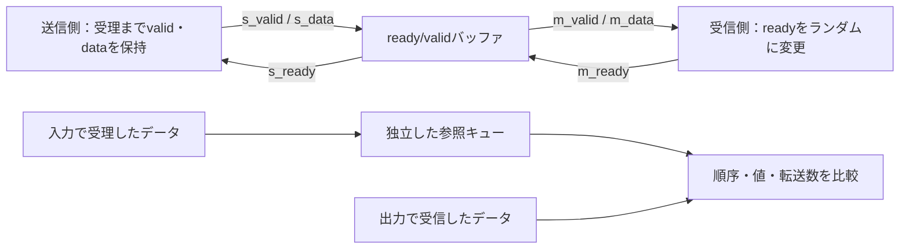

# GitLabでready/valid通信をランダム検証する

送信側と受信側の間に置くバッファを、待ち状態（バックプレッシャー）付きで検証する例です。待ち中のvalid・データ保持、同時送受信、欠落・重複・順序違い、リセット時の破棄と復帰を確認します。PythonとIcarus Verilogで動作し、GitLab CIから実行できます。

## 1. 通信と回路の仕様

| 信号 | 方向 | 意味 |
| --- | --- | --- |
| `s_valid`, `s_data` | 送信側→バッファ | 送信するデータと有効表示 |
| `s_ready` | バッファ→送信側 | 入力を受理できる状態 |
| `m_valid`, `m_data` | バッファ→受信側 | 受信側へ提示するデータと有効表示 |
| `m_ready` | 受信側→バッファ | 出力を受信できる状態 |

同一クロックの立上りで、入力は`s_valid && s_ready`、出力は`m_valid && m_ready`が成立したときだけ転送します。送信側は、一度validを立てたら受理されるまでvalidとデータを保持します。受信側はreadyを自由に変えられます。データを受理した順序で、一度ずつ出力します。

説明用回路では、次の動作を定めます。

- バッファは深さ1／3、データ幅8／16の4構成です。空状態からの入力を同じエッジで受信側へ通すバイパスはありません。
- 空きがあれば入力を受理できます。満杯でも同じエッジで出力を受信する場合は、入力を受理して入れ替えます。
- 出力が有効で受信側が待っている間は、m_validとm_dataを保持します。無効期間のm_dataの値は規定しません。
- 同期リセットは、立上りでバッファ内のデータを破棄します。そのエッジの入力・出力は転送として数えません。送信側の未受理の提示もリセットで取り消せます。
- `s_ready`には`m_ready`からの組合せ経路があります。前後の回路を接続する際は、この依存関係を含めてタイミングとループの有無を確認します。

ready/validの説明は[Charles Eric LaForestの設計資料](https://fpgacpu.ca/fpga/handshake.html)を参照しました。上記のデータ保持、容量、満杯時の入替え、リセットは、この回路で検証する仕様です。AXI／AXI4-Stream全体の適合性検証ではなく、パケット境界やIDなどの付加情報は扱いません。



## 2. 刺激とチェッカー

固定テストで境界と必須目標を確保し、seed付きランダム列で送信の間隔、受信待ち、データ、リセットの履歴を変えます。入力生成器は仕様上の占有数から、送信側が待たされた場合のvalid・データ保持を計算します。DUTの内部信号や実行結果を使わないため、全クロックの入力を実行前に保存できます。

SystemVerilogのチェッカーは、独立した線形キューで受理データを保持します。DUTのポインタ・メモリ・占有数を参照しません。立上り前にready、valid、提示データ、送信側の保持を比較し、NBA更新後にも出力状態と待ち中の保持を比較します。DUTのreadyが仕様と違う場合も、その時点で失敗させます。

| 検査 | 合格条件 |
| --- | --- |
| 欠落・重複・順序 | 出力で受信するデータが参照キューの先頭と一致し、出力の有無も期待する状態と一致 |
| 待ち中の保持 | 出力のvalid・dataを保持。送信側も未受理データを保持 |
| 同時送受信 | 満杯からの入替えを含め、先に受信するデータと新規入力を区別 |
| 連続転送 | 連続するクロックで受信し、ポインタが周回しても順序を保持 |
| リセット | バッファ内のデータを破棄数へ計上し、解除後の新しいデータを正しく受信 |
| 完了 | 最後に受信側をreadyにし、未受理の提示も含めて排出。残データ・待ち中の提示がない |

各クロックで、**受理数＝受信数＋リセット破棄数＋残データ数**を照合します。終了時は残データ0を要求し、ログの`ACCOUNTING`もPythonが入力列から算出した予定値と照合します。リセット前に受理して破棄したデータと、まだ受理していない送信側の提示は区別します。

## 3. 必須目標と構成ごとの判定

`requirements.json`で次の目標を定義します。

| 分類 | 目標数 |
| --- | --- |
| 占有状態×s_valid×m_ready | 空・満杯・中間の各4目標。深さ1は中間4目標を除外 |
| 受信した代表データ | 0、全1、交互パターンの3目標 |
| 待ちと再開 | 入力待ち、出力待ち、受信再開の3目標 |
| 転送 | 同時送受信、満杯時の入替え、連続受信、排出の4目標 |
| リセット | 空、データあり、出力待ち中、復帰の4目標 |
| 周回 | 深さの2倍以上の受理・受信の2目標 |
| 完了 | 全データ排出の1目標 |

深さ1は**要求8件・25目標**、深さ3は**要求9件・29目標**です。深さ1の中間占有状態は理由を記録して除外します。幅を含めた4構成を独立に判定し、他構成の観測で補いません。

観測はそのサイクルの比較に合格してから出力し、正常ケース全体が完了した場合だけ集計します。変異ケースの観測は通常機能の達成には数えません。必須目標の未達はリグレッションを失敗させます。これは選定した機能目標であり、SVAやcovergroup DBの計測値ではありません。

## 4. ローカルで実行する

Python 3.10以上とIcarus Verilogの`iverilog`・`vvp`を用意し、リポジトリのルートから実行します。

```sh
python3 examples/gitlab-stream/run.py --depth 3 --width 8
python3 -m unittest discover -s examples/gitlab-stream/tests -v
python3 examples/gitlab-stream/run.py --depth 1 --width 16 --profile nightly --seed 73
```

smokeは境界1ケース＋ランダム1 seed×200サイクル＋変異3ケース＋必須目標判定で**JUnit 6件／構成**、nightlyはランダムを3 seed×2,000サイクルへ拡張して**JUnit 8件／構成**です。初期リセットと最後の排出はランダムサイクル数に含めません。

`--cycles`で1 seedのランダムサイクル数、`--seed`で開始seedを指定できます。入力保持と受信待ちがあるため、サイクル数と転送数は一致しません。厳密な再現には保存した全入力、ソースハッシュ、ツール版も照合します。`--out`は既存ディレクトリを上書きしません。

ランナーはFIFO例を基に拡張し、IRQ例のプロセス実行・終了判定処理を利用しています。`gitlab-stream`だけでなく`examples`一式を保持してください。

## 5. 意図的な不具合で検出力を確認する

| `--demo-bug` | 不具合 | 予定する検出ラベル |
| --- | --- | --- |
| 1 | 受信待ち中の先頭データを上書き | `STREAM_STABILITY` |
| 2 | 満杯時の同時送受信で入力データを格納しない | `STREAM_DATA` |
| 3 | 受信済みデータを解放せず再提示 | `STREAM_VALID` |

通常リグレッションでも3種類の変異を別々に実行し、所定の比較で検出する必要があります。正常ケースにも不具合を入れてCIを失敗させるデモは次です。

```sh
python3 examples/gitlab-stream/run.py --demo-bug 2
```

このデモは終了コード1になり、正常ケースの失敗をJUnitへ反映します。変異が生き残れば失敗、ビルド失敗・タイムアウト・無関係な異常・完了記録のない終了は判定エラーです。転送数の照合記録が欠けた正常ケースもエラーにします。

ランナーの13テストで4構成、変異、入力の再現、欠落目標、カバレッジ混入防止、転送数記録の欠落、不正な送信側の保持、未知のvalid・壊したデータの検出、証跡の上書き防止などを確認します。

## 6. GitLab CIと証跡

ルートの`.gitlab-ci.yml`で[この例のCI設定](gitlab-ci.yml)を読み込みます。`stream-runner-tests`の成功後、深さ1／3×幅8／16の4ジョブで実行します。push・MR・webはsmoke、scheduleはnightlyです。定期実行にはGitLab側のスケジュール設定が必要です。

手動パイプラインの変数`STREAM_DEMO_BUG=1/2/3`で失敗デモ、`STREAM_REGRESSION_SEED`でseedを選べます。ジョブはランナーの非0終了で失敗し、JUnitを結果表示に使います。

`artifacts/stream-d3-w8/`などへマニフェスト、全入力と予定転送数、ソースハッシュ、ツール版、ビルド結果、ケース別入力・ログ・VCD波形、目標・未達・除外、集計・JUnitを保存します。`when: always`で14日間保存しますが、Runner障害や中断では回収できない場合があります。

## 7. 実行確認

2026-10-26にPython 3.14.7・Icarus Verilog 14.0開発版で13テストとnightly全4構成を確認しました。各構成で25/25または29/29目標を達成し、3種類の変異を検出しました。nightlyはseed 17〜19を各2,000サイクル実行しています。

公開デモの[MR !6](https://gitlab.com/kurochan001/lsi-verification-method-ci-demo/-/merge_requests/6)で、[CI #2989066110](https://gitlab.com/kurochan001/lsi-verification-method-ci-demo/-/pipelines/2989066110)の全25ジョブ成功、JUnit 150件・失敗／エラー0件を確認しました。ready/validの4ジョブはIcarus Verilog 11.0で実行され、保存済み`summary.json`と`manifest.json`でも25/25または29/29目標、3種類の変異の検出、予定5ケースの完了、対象コミット`91879757`を確認しています。追加分のJUnitは24件、ランナーのセルフテストは別枠の13テストです。

境界ケースの転送数は深さ1で受理23・受信22・リセット破棄1、深さ3で受理51・受信48・リセット破棄3でした。幅8／16とも予定値とログが一致しました。GitLabで確認したのはsmokeです。ready/validのnightly全4構成はローカルで確認しており、全例を含むscheduleの185件をGitLabで実行した結果ではありません。その後、SVAのMR !7を含むMR !6がmainへマージされ、[mainのCI #2989619450](https://gitlab.com/kurochan001/lsi-verification-method-ci-demo/-/pipelines/2989619450)も全27ジョブ・JUnit 160件で成功しています（2026-10-26確認）。

有限のシミュレーションで確認した範囲です。任意の無限の待ちを含む活性証明や、非同期クロック間の転送を確認した結果ではありません。製品への展開では、データ幅・深さ、付加情報、リセットによる破棄の扱い、タイミングと帯域の仕様を照合してください。[ランダム検証](../../docs/method/constrained-random-verification.md)と[継続リグレッション](../../docs/method/continuous-regression.md)も参照してください。
