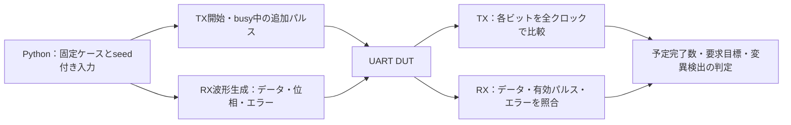

# GitLabでUARTのランダム検証を実行する

8ビットUARTの送受信を、シリアル波形と独立した期待値で検証する教材です。PythonとIcarus Verilogを使い、8N1／8E1／8O1と、1ビットあたり8／16クロックの計6構成を実行します。正常転送に加え、パリティ・フレーミングエラー、偽スタート、転送中のリセットを扱います。

## 1. 説明用回路の仕様

- フレームはスタート0、データ8ビット（LSBから）、任意のパリティ、ストップ1の順です。アイドルはhighです。`PARITY=0/1/2`はパリティなし／偶数／奇数です。
- `DIVISOR=8/16`は1ビットのクロック数です。ボーレートは`clk周波数 / DIVISOR`です。テストのクロック周期は10 nsで、値は短時間で実行するための設定です。
- `tx_ready=1`のクロック立ち上がりで`tx_start=1`なら送信を開始します。`tx_start`は1クロックの開始パルスです。送信中の開始パルスは無視し、キューには保存しません。
- 受信入力は2段FFを経由し、スタートの中央付近を確認後、各ビットを1回ずつサンプリングします。多数決方式は実装していません。
- 受信完了時に`rx_valid`を1クロック出力します。エラーのあるフレームもデータとともに通知し、`parity_error`と`framing_error`はその有効パルスに付随します。パリティなしでは`parity_error=0`です。
- ストップビットがlowならフレーミングエラーです。受信後は入力がhighになるまで待機します。`rst_n`はlow有効の同期リセットで、送受信途中のフレームを破棄します。

フレーム形式とエラーの基本事項は、Microchipの[Frame Formats](https://onlinedocs.microchip.com/oxy/GUID-173AD72D-41FE-4760-A93C-7078A02BD908-en-US-7.1.1/GUID-585072A2-2328-4EDD-B24F-E2E7672632B5.html)と[Receiver Error Flags](https://onlinedocs.microchip.com/oxy/GUID-173AD72D-41FE-4760-A93C-7078A02BD908-en-US-7.1.1/GUID-7B4385C0-7B06-44CC-B8BC-07E8CDDB8721.html)を参照しました。開始パルス、エラー通知のタイミング、リセットなどはこの教材独自の仕様で、特定製品のUARTを再現したものではありません。

## 2. 検証構成



送信データと受信データは別に生成します。単なるTX→RXループバックでは、送信と受信の同じ誤りが相殺される場合があるためです。TXは独立に作った期待フレームと各クロックで比較し、ビット長、データ順、パリティ、ストップ、完了を確認します。RXは別の時間ベースで生成したシリアル入力に対し、完了モニターでデータ、エラーフラグ、1クロックの有効パルス、余分な受信や未完了を確認します。

## 3. 固定ケースとランダム化

固定ケースでは送受信の`00/FF/55/01/80`、同時送受信、送信中の開始パルス、低いストップビット、短い偽スタート、転送中リセットと復帰を必ず実行します。パリティ有効時はパリティ反転も実行します。

ランダムケースでは、送受信データ、正常／各エラー／偽スタート／リセットの操作、送信中の追加パルスの有無、待ち時間0～2ビット分、受信開始位相2種類を選びます。受信開始はクロックの立ち下がりから1 ns／7 ns後です。送受信のビット周期は同じで、周波数誤差は付けていません。操作間にはハーネスの待ち時間も入るため、最小間隔の連続フレームを検証したとは扱いません。

smokeはseed 1個×32操作、nightlyは連続したseed 3個×128操作です。各seedの最後には正常転送を追加し、最後がリセットでも復帰を確認します。`--frames`はランダム操作数で、すべてが完了フレームになるわけではありません。固定ケースはパリティなし9操作、有効時10操作です。

## 4. 要求・カバーと変異

[要求カタログ](requirements.json)には9要求を定義しています。パリティなしではパリティ要求を理由付きで除外し、8要求・21目標、有効時は9要求・22目標を構成ごとに判定します。代表データ、送受信、同時動作、busy中の開始無視、エラー、偽スタート、リセット／復帰、アイドル、開始位相が対象です。全256データや全条件の直積を網羅したという意味ではありません。

カバーはテストベンチの観測から集計します。正常ケース全体が成功した場合だけ加算し、変異ケースや途中まで実行した失敗ケースの観測は加算しません。SystemVerilogのcovergroupやSVAの例ではありません。

変異は次の意図的な不具合です。期待する違反ラベルで失敗した場合だけ検出として扱います。

| 番号 | 不具合 | 期待する違反 |
|---|---|---|
| 1 | 送信データのLSB反転 | `UART_TX_DATA` |
| 2 | 受信データのLSB反転 | `UART_RX_DATA` |
| 3 | フレーミングエラーの通知抑制 | `UART_RX_FRAMING` |
| 4 | パリティエラーの通知抑制 | `UART_RX_PARITY` |

パリティなしの構成では変異4を実行しません。ビルド失敗、タイムアウト、無関係な異常終了は検出成功に数えません。

## 5. ローカル実行

Python 3とIcarus Verilogの`iverilog`／`vvp`が必要です。リポジトリのルートから実行します。

```sh
python3 examples/gitlab-uart/run.py --divisor 8 --parity 0
python3 examples/gitlab-uart/run.py --divisor 16 --parity 2 --profile nightly --seed 73
python3 -m unittest discover -s examples/gitlab-uart/tests -v
```

再現には`manifest.json`の構成、seed、操作数、ソース版を使います。`--out`には未作成のディレクトリを指定します。1ツール実行あたりの既定タイムアウトは10秒です。

```sh
# 正常ケースにも不具合を入れてCI失敗を確認する例（終了コード1が期待値）
python3 examples/gitlab-uart/run.py --parity 1 --demo-bug 4
```

通常回帰内の「予定した変異を検出できた」という成功と、この失敗デモは別です。GitLabでは`UART_DEMO_BUG=1/2/3`を指定できます。`4`はパリティ有効時だけ適用できるため、全6構成のマトリクスで指定すると、パリティなしの2ジョブは引数エラーになります。変異4のデモは上記の単独構成で実行してください。

## 6. GitLabと保存する証跡

ルートの`.gitlab-ci.yml`が[CI設定](gitlab-ci.yml)を読み込みます。`uart-runner-tests`の成功後、分周数2種類×パリティ3種類の6ジョブを実行します。push・MR・webはsmoke、scheduleはnightlyです。seedは`UART_REGRESSION_SEED`で変更できます。

smokeはパリティなし各6件、有効時各7件、合計40件のJUnitを出力します。nightlyは各8／9件、合計52件です。各件数には要求・カバーのゲート1件と変異検出を含み、ランナー確認13テストは別枠です。

`artifacts/uart-div8-parity0/`などへ、全入力・seed・構成・ソースハッシュ、ツール版、ビルド結果、ケース別のログ・波形・判定、要求カタログ、カバーと除外理由、JUnitを保存します。`METRICS`の送受信完了数・リセット数・偽スタート数を予定入力と照合し、欠落や不一致をエラーにします。`clocks`は実際のシミュレーションのクロック数です。アーティファクトは`when: always`で14日間保存します。中断やRunner障害では回収できない場合があります。

## 7. 適用範囲と実行確認

この例は説明用RTLの有限シミュレーションです。FIFO・オーバーラン、BREAK、5～9ビットの切替、2ストップビット、RTS/CTS、APBレジスタ・割込みとの結合、周波数ずれの限界、ジッター・ノイズの耐性、CDC構造解析、メタステーブルのアナログ挙動、製品UARTの規格適合性は対象外です。2段FFと位相変更だけでCDCの安全性を証明したとは扱いません。

ローカルで6構成のsmoke、ランナー確認13テスト、および各構成で3 seed×1000ランダム操作を確認しました。公開デモの[MR !10](https://gitlab.com/kurochan001/lsi-verification-method-ci-demo/-/merge_requests/10)で、[CI #2990037734](https://gitlab.com/kurochan001/lsi-verification-method-ci-demo/-/pipelines/2990037734)の全40ジョブ成功、JUnit 239件・失敗／エラー0件を確認しました。

UARTの6ジョブはIcarus Verilog 11.0で実行され、保存済み証跡でも21/21または22/22目標、3／4変異、予定した全5／6ケースの完了、送受信完了数、入力ソースのハッシュとコミット`0bc95660`を確認しました。追加分のJUnitは40件です。GitLabで確認したのはsmokeで、全例を含むscheduleの294件は今回実行していません。その後MR !10はmainへマージされ、[mainのCI #2990074629](https://gitlab.com/kurochan001/lsi-verification-method-ci-demo/-/pipelines/2990074629)でも全40ジョブ・JUnit 239件の成功を確認しました。

APBレジスタ・割込みとの接続は、別の[結合検証例](../gitlab-apb-uart/README.md)で扱います。単体例の確認範囲とは分けて記録します。
