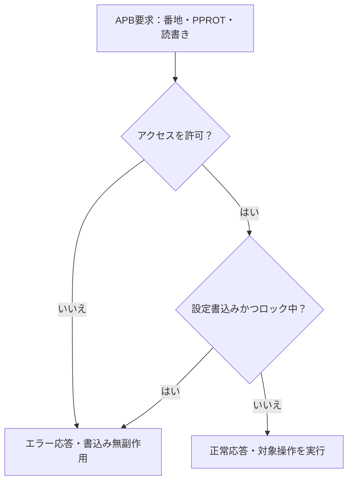

# APBのアクセス保護と設定ロックを検証する

新規の教材用APBレジスタを使い、許可された操作の成功と、拒否された操作のエラー・無副作用を対で確認します。APB4の信号のうちPPROTを使い、PSTRBは省略した32ビット全幅アクセスです。GitLabへは追加しません。

## アクセス判定と状態更新

PPROTの許可判定と設定ロックを通過した操作だけが、保護レジスタを更新します。



公開データは全属性でアクセス可能です。保護対象とロック自身の操作条件は、下記の番地・方針に従います。

| 確認する場面 | 期待する動作 | 主な照合対象 |
| --- | --- | --- |
| 属性による拒否 | 読出しは0、書込みは無副作用 | 応答と全状態 |
| ロック後の設定書込み | 許可属性でも拒否 | ロックと設定値 |
| リセット後 | ロックを解除して再設定可能 | 復帰後の読書き |

## 番地と保護方針

`0x00`は公開データ、`0x10`は保護された設定、`0x14`は1ビットの設定ロックです。全値はリセットで0になります。未定義番地はエラーです。

[Arm APB仕様のPPROT](https://documentation-service.arm.com/static/60d5b617677cf7536a55c273)に従い、PPROT[0]を特権、[1]を非セキュア、[2]を命令アクセスの属性として受け取り、設定とロックは「特権・セキュア・データ」の操作だけを許可します。公開データは全属性で読書きできます。属性値は信頼された上位から渡される前提で、要求元の認証機構を実装した例ではありません。

ロックへ1を書けば、次のリセットまで設定の書込みを拒否します。0の書込みでは解除せず、設定の許可された読出しは継続できます。拒否した読出しは0を返し、拒否した書込みは全状態を維持します。エラー判定、読出しマスク、状態更新をそれぞれ照合します。

設定ロックの参考にした公開例は[OpenTitanのREGWEN](https://opentitan.org/book/util/reggen/)です。本例の番地、PPROTの組合せ、エラー応答方針は独自の教材仕様であり、OpenTitanのRTLを転載したものではありません。

## 試験と実行

8通りのPPROT、許可と拒否の読書き、未定義番地、ロック設定と解除試行、リセット後の再設定を含めます。APB待ち0／2の2構成で各14目標を要求します。状態は転送前後だけでなく各サイクルで比較し、SETUPや待ち中の早すぎる更新も検出します。

4種類の変異は権限チェックの迂回、ロックの無視、拒否書込みの状態更新、禁止読出しの情報露出です。通常実行と変異検出のカバレッジは分けます。

```sh
python3 examples/local-access-control/run.py --out artifacts/access-control
python3 examples/local-access-control/run.py --profile nightly
python3 -m unittest discover -s examples/local-access-control/tests -v
```

[共通手順](../local-common/README.md)を使います。smokeは40操作、nightlyは300操作×3 seedに固定シナリオを加えます。2構成合計JUnitは14／18件です。物理サイドチャネル、実デバイスへの故障攻撃、システム全体の情報非干渉を保証する検証ではありません。
