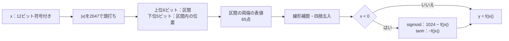

# 区分線形の活性化関数を誤差の上限で検証する

ニューラルネットワークの活性化関数（sigmoid・tanh）を、表と線形補間で近似する回路の教材です。近似回路の出力は数学的な値と一致しないので、ビット列の一致では判定できません。この例では、仕様で誤差の上限を決め、12ビット入力の全4096通りで上限内に収まるかを確かめます。上限を緩めると小さな誤りを見逃すことも、診断の実行で示します。

## 表と補間で近似する



表の値は`round(1024 × f(区間の端))`です。設計時に倍精度で計算した定数をRTLへ埋め込み、回路は指数関数を計算しません。

| 構成 | 関数 | 入力の形式と範囲 | 出力 |
| --- | --- | --- | --- |
| `sigmoid` | 1 / (1 + e^-v) | Q3.8、-8〜8未満 | 1024倍、0〜1024 |
| `tanh` | tanh(v) | Q2.9、-4〜4未満 | 1024倍、-1024〜1024 |

## 合否は誤差の上限で決める

要求は「すべての入力で、出力と`1024 × f(x)`の差が1.25 LSB以下」です。Pythonは各入力の正確な値を倍精度の`math.exp`・`math.tanh`で計算し、1/256 LSB単位の整数にしてベクトルへ書きます。許容幅もその行に入れ、テストベンチは`|256 × y − 期待値| ≤ 許容幅`を確かめます。RTLの表や補間の手順はPythonに写しません。

上限は実装を見てから決める値ではなく、仕様の要求です。この設計の最大誤差は、事前の解析と実測でsigmoidが0.926 LSB（237/256）、tanhが1.063 LSB（272/256）でした。テストベンチは、通常実行の最大誤差を`OBS max_error`としてログに残します。

| 確認する場面 | 期待する動作 | 主な照合対象 |
| --- | --- | --- |
| 全4096入力 | すべて1.25 LSB以内 | 各出力の誤差 |
| 負の側 | 正の側と対称な式で正しく反転 | 1 LSBのずれも上限で検出 |
| 最小値-2048 | 絶対値が12ビットで収まらない唯一の入力 | 頭打ちの処理 |
| 出力待ち | 値を保持し、次の入力を待たせる | `in_ready`・保持 |

出力レジスタは1段です。`out_ready`が0の間は値を保持し、次の入力を受理しません。

## 固定シナリオとランダム刺激

固定シナリオは、-2048から2047までの全入力を順に連続投入します。その後、出力待ち、出力待ち中のリセット、リセット後の計算を行います。ランダム刺激は、入力を一様に選び、出力待ちとまれなリセットを混ぜます。

[要求カタログ](requirements.json)は4要求・14目標です。全区間の通過、表の点ちょうどの入力、0.75 LSBを超える誤差の観測、正負両方向の誤差を含みます。両構成とも、固定シナリオだけで14目標に達します。

## 意図的な誤実装と、緩い上限の診断

| 番号 | 誤実装 | 誤差の最大（sigmoid／tanh） | 期待する検出ラベル |
| --- | --- | --- | --- |
| 1 | 負の側の反転を1 LSB誤る（`1023−f`、`~f`） | 1.914／1.914 LSB | ACT_TOLERANCE |
| 2 | 補間で四捨五入せず切り捨てる | 1.473／1.559 LSB | ACT_TOLERANCE |
| 3 | 区間内の位置を1ビットずらす | 16.0／31.9 LSB | ACT_TOLERANCE |
| 4 | 絶対値を11ビットで扱い、-2048を0にしてしまう | 511.7／1023.3 LSB | ACT_TOLERANCE |

誤差の最大は、変異1・2が診断の実行での実測値です。変異3・4は最初の違反で停止するため、全入力に対する事前の解析値を示しています。

診断として、変異1・2を上限2.5 LSBで実行し、合格してしまうことを確かめます。上限を緩めると、変異1・2の誤差（最大1.9 LSB）は見逃されます。変異3・4のような大きな誤りは緩い上限でも検出できます。診断の合格は通常の目標へ加算しません。

変異4で誤差が出る入力は、全4096通りのうち-2048の1つだけです。300入力のランダム刺激では、seed 17はこの入力を選んで検出し、seed 18・19は選ばずに見逃します。全数を検査する固定シナリオなら確実に検出できます。

## 実行

```sh
python3 examples/local-activation/run.py --out artifacts/activation
python3 examples/local-activation/run.py --profile nightly --out artifacts/activation-nightly
python3 -m unittest discover -s examples/local-activation/tests -v
```

[共通手順](../local-common/README.md)を使います。smokeは300入力×1 seed、nightlyは3000入力×3 seedを固定シナリオとは別に実行します。各構成で、固定シナリオ1件、ランダム1件（nightlyは3件）、変異4件、診断2件と、カバレッジの合否判定1件を実行します。JUnitは各構成9／11件、全体18／22件で、セルフテストは7件です。

## 確認範囲

2026-10-30にPython 3.14.7、Icarus Verilog 14.0開発版で、両構成のsmoke／nightly、14目標、4種類の変異、診断4件、セルフテスト7件が成功しました。Verilator 5.052の`--lint-only -Wall`で出る警告は、幅の拡張（`WIDTHEXPAND`）と未使用ビット（`UNUSEDSIGNAL`）だけです。

期待値の計算にはPythonの倍精度浮動小数点を使います。誤差は1/256 LSB単位に丸めて比べるため、上限ちょうどの判定にはその丸めの幅（1/512 LSB）が含まれます。softmax、GELU、FP16入力、近似の区間配置の最適化、モデル全体の精度への影響は扱いません。
