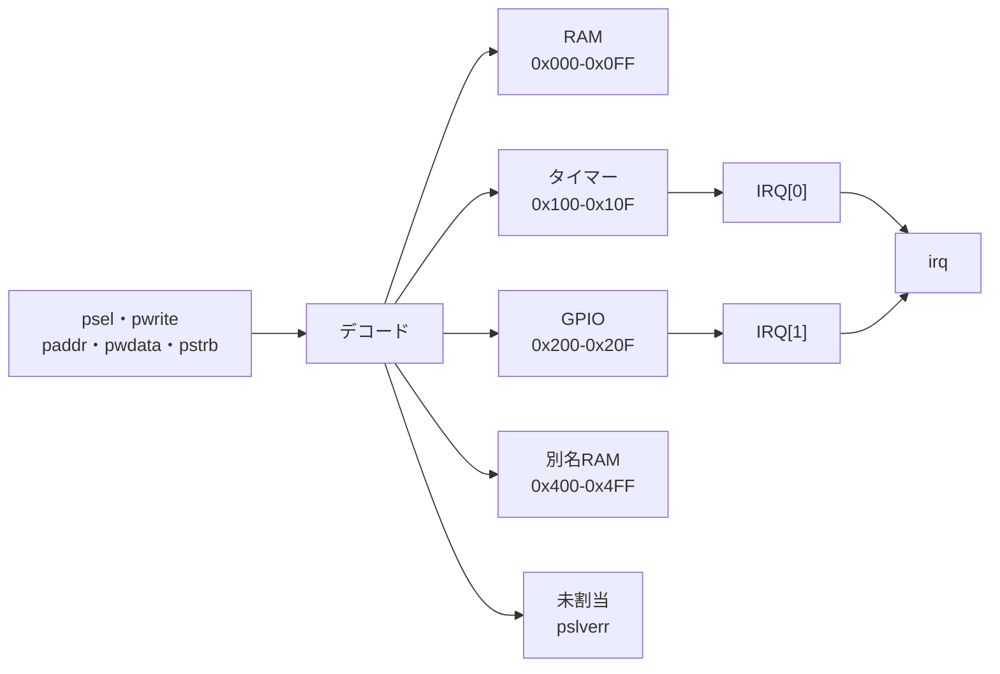
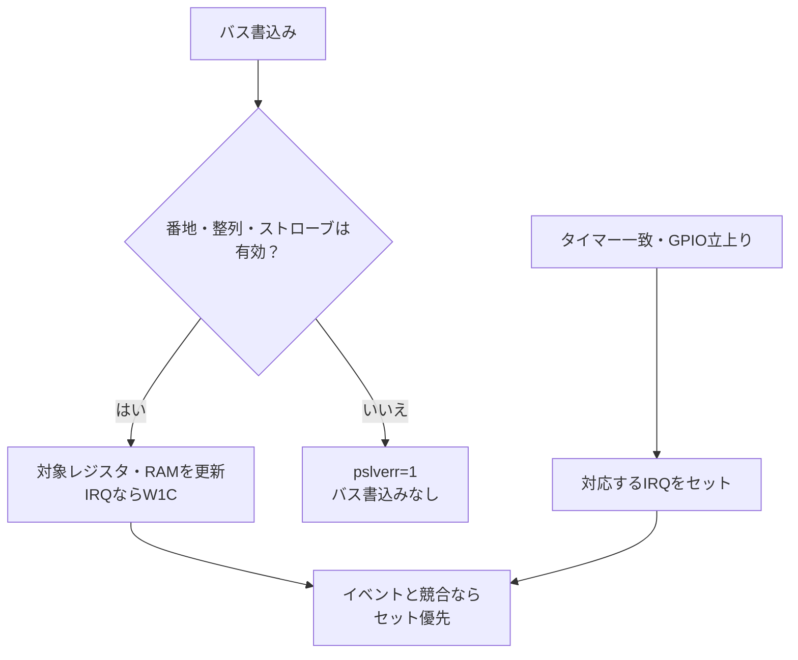

# アドレスデコード・別名・バイトストローブ・IRQ集約を検証する

RAM、タイマー、GPIOを持つ小さなバスで、アドレスデコード、未割当アクセス、別名アドレスの扱い、バイトストローブ、割り込みの集約とW1Cを確認する教材です。バスがエラーを返したときに副作用が残らないこと、IRQのビット対応が入れ替わらないことを分けて判定します。

## アドレスマップ



図は教材のデコード範囲です。実SoCのバス幅・待ち・アドレス変換を再現したものではありません。

## 仕様

| 範囲 | 内容 | 主なレジスタ |
| --- | --- | --- |
| 0x000–0x0FF | RAM 64ワード | バイトストローブ対応 |
| 0x100–0x10F | タイマー | CTRL(0x100)、COUNT(0x104)、MATCH(0x108)、IRQ(0x10C) |
| 0x200–0x20F | GPIO | OUT(0x200)、IN(0x204)、EDGE(0x208)、IRQ(0x20C) |
| 0x400–0x4FF | RAMの別名（構成による） | `ALIAS=1`でRAM、`ALIAS=0`でエラー |
| その他 | 未割当 | `pslverr=1`、副作用なし |

- `pready`は常に1です。この教材は待ち状態を持ちません。
- 未整列アクセス、未割当アドレス、制御レジスタへの部分ストローブ、読出し専用レジスタへの書込みはエラーです。
- RAMは`pstrb`の各ビットに対応するバイトレーンだけを更新します。
- タイマーは`CTRL[0]`でカウントし、`COUNT`が`MATCH`と一致し`CTRL[1]=1`ならIRQ[0]を立てます。IRQ[0]はW1Cです。
- GPIOは`EDGE`で許可したビットの立上りでIRQ[1]を立てます。IRQ[1]はW1Cです。
- 同じサイクルに新しいイベントとW1Cが起きた場合、W1Cで消した後にイベントを立てるため、新しいイベントは失われません。
- `irq`は`{gpio_irq, timer_irq}`の2ビットです。

## 書込みの副作用とIRQの競合

エラー応答はバス書込みを止めます。一方、タイマーの加算やGPIO立上りの検出は継続するため、エラー中に自律動作でIRQが変わる場合はあります。



| 対象IRQビットの更新前の値 | 有効なW1C | 新しいイベント | 更新後の値 |
| --- | --- | --- | --- |
| 1 | なし | なし | 1を維持 |
| 1 | あり | なし | 0へクリア |
| 0 | なし | あり | 1へセット |
| 1 | あり | あり | 1を維持し、新イベントを残す |

RAMの例では、`0x11223344`へ`0x55667788`をWSTRB相当の`pstrb=0101`で書くと`0x11663388`になります。ゼロストローブはRAMを変更しません。別名有効時は0x000と0x400、0x0FCと0x4FCがそれぞれ同じワードです。

タイマーのCOUNTは16ビットで折り返し、MATCHは保存した32ビットの下位16ビットで比較します。GPIOのOUT・IN・EDGE検出は下位4ビットです。エラー後もRAM全64ワードを最後に読み戻し、最終書込みの検査漏れを防ぎます。

## 独立した期待値と構成

PythonはRAM、タイマー、GPIO、IRQの状態を保持し、デコード結果と各サイクルの読出し値をRTLと別に求めます。固定シナリオはRAMのバイト書込み、別名アクセス、タイマー満了、GPIO立上り、2本同時のIRQ、W1C、部分ストローブ拒否、未割当書込みの無副作用、リセット復帰を含みます。

| 構成 | 0x400–0x4FFの扱い |
| --- | --- |
| `alias` | RAMの別名として読書き |
| `strict` | 未割当としてエラー |

[要求カタログ](requirements.json)は4要求・13目標です。GPIO出力は後続のレジスタ読出しだけに頼らず、毎サイクルにピン値も比較します。

## 意図的な誤実装

| 番号 | 誤実装 | 期待する検出ラベル |
| --- | --- | --- |
| 1 | 未割当アクセスのエラーを返さない | MAP_DECODE |
| 2 | RAM書込みでバイトストローブを無視する | MAP_DATA |
| 3 | IRQの2ビットを入れ替える | MAP_IRQ |
| 4 | エラーになった未割当書込みがRAMを変更する | MAP_DATA |

変異2と4は後続のRAM読出しで検出します。負の試験の観測は通常の13目標へ加算しません。

## 実行

```sh
python3 examples/local-address-map/run.py --out artifacts/address-map
python3 examples/local-address-map/run.py --profile nightly --out artifacts/address-nightly
python3 -m unittest discover -s examples/local-address-map/tests -v
```

smokeは200操作×1 seed、nightlyは1000操作×3 seedを固定シナリオへ加えます。各構成7／9件、全体14／18件のJUnitで、確認テストは8件です。

## 確認範囲

2026-10-28にPython 3.14.7、Icarus Verilog 14.0開発版で両構成のsmoke／nightly、13目標、4変異、確認6件が成功しました。

2026-10-29のレビュー修正後も両構成のsmoke／nightlyが成功し、確認テストは8件です。再発防止ケースと図表を追加し、実行したソースハッシュを現行ファイルと照合しています。

この教材はAPBに似た単純なゼロ待ちバスで、実APBの待ち・エラー応答・プロテクション、AHB/AXI、MMU、アドレス変換、実タイマー精度、GPIOの電気特性、割り込みコントローラの優先順位は対象外です。別名は教材の構成差を作るためのもので、製品で許可すべきアドレスという意味ではありません。
