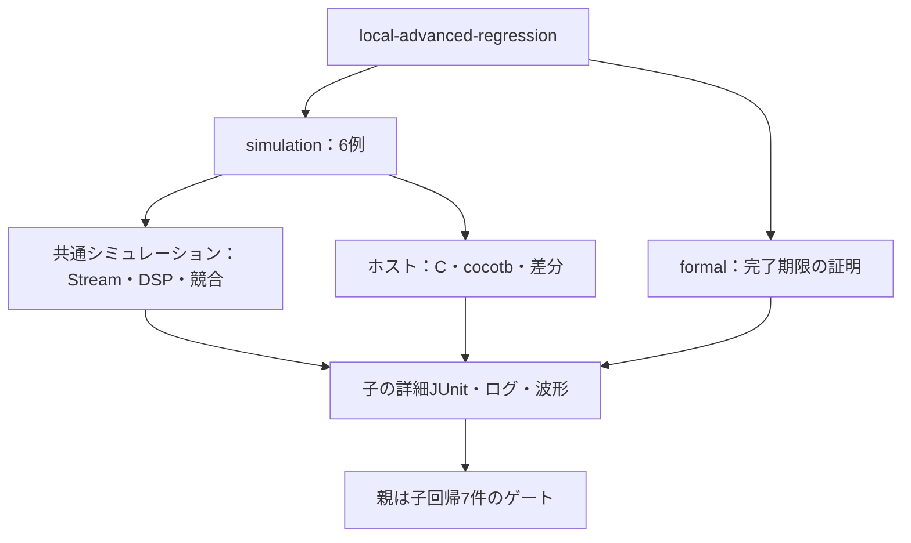

# パケット・ソフトウェア・数値演算・完了性の7例

既存の結合例から、データの意味と検証環境の使い方を広げるローカル教材です。GitLab・CI設定を変更せず、次の7例をまとめて実行します。

- [AXI4-Stream](../local-axis/README.md)：パケット境界、有効バイト、停止、途中パケットの破棄。
- [Cドライバ](../local-c-driver/README.md)：コンパイルしたCから実DMA RTLへアクセスし、起動・状態監視・IRQ・復旧を確認。
- [同一領域の読書き競合](../local-memory-order/README.md)：実際の取込み時点に従う参照メモリで複数マスターを照合。
- [固定小数点DSP](../local-dsp/README.md)：符号、丸め、上下限、飽和、履歴、出力待ち。
- [cocotb](../local-cocotb/README.md)：Pythonの刺激・位相モニター・レジスタモデルで既存APBを検証。
- [シミュレーター差分](../local-differential/README.md)：IcarusとVerilatorの仕様照合・有効観測列の比較。
- [完了期限の証明](../local-progress/README.md)：受信側の進行条件を明記した証明と、その条件を外した反例。

## 7例の実行範囲と集計階層

simulationは6例、formalは完了期限1例を選び、親は各子回帰の結果を集約します。



親ゲートと子の件数を合算しません。段階を一部選択した場合、未選択の例は合格扱いにしません。

| 直下の子の区分 | smoke JUnit | nightly JUnit |
| --- | --- | --- |
| 共通シミュレーション3例 | 35件 | 45件 |
| ホスト3例 | 37件 | 51件 |
| 完了期限のフォーマル | 16件 | 16件 |

## 準備と実行

POSIX、Python 3.10以上、Icarus、Verilator、C／C++コンパイラー、makeを使います。cocotbは[専用仮想環境](../local-cocotb/README.md)、フォーマルは[既存の仮想環境](../local-formal-common/README.md)を用意します。既存環境を上書きせず再利用できます。

```sh
python3 examples/local-advanced-regression/run.py \
  --cocotb-python /tmp/lsi-cocotb-venv/bin/python \
  --formal-python /tmp/lsi-bus-formal-venv/bin/python \
  --out artifacts/advanced-all
```

`--formal-python`の子では、そのPythonのbinディレクトリを子プロセスのPATHへ追加します。親の環境は変更しません。ツールやパッケージを自動インストールせず、不在は失敗にします。

```sh
python3 examples/local-advanced-regression/run.py --stage simulation --profile nightly \
  --cocotb-python /tmp/lsi-cocotb-venv/bin/python --out artifacts/advanced-nightly
python3 examples/local-advanced-regression/run.py --stage formal \
  --formal-python /tmp/lsi-bus-formal-venv/bin/python
```

既定stageはall、simulationは6例、formalは完了期限の1例です。`--profile`と`--seed`はシミュレーションへ渡します。`--python`で通常の子、`--cocotb-python`と`--formal-python`で専用環境を選択し、省略時は親と同じPythonを使います。詳細な構成・タスク選択は各例のCLIを直接使ってください。

`--timeout`は子回帰全体の上限（既定1800秒）、`--formal-timeout`は各SBYタスクの上限（300秒）です。既存の`--out`は上書きしません。

## 判定と集計

親は各子の終了0、summaryの成功、予定数と結果数の一致を確認します。親の7件は子回帰の集約ゲートです。子の個別JUnit、cocotbの生JUnit、2バックエンドの実行を同じ試験の追加件数として二重集計しません。

シミュレーション6例の子JUnitはsmoke 72／nightly 96件、完了期限のフォーマルは16件です。このうち[共通シミュレーションランナー](../local-common/README.md)の3例は35／45件、[ホストランナー](../local-host-common/README.md)の3例は37／51件です。元の回帰とは別計画・別の出力先へ保存します。

負の試験には、RTL変異、Cコードの誤り、期待値の誤り、異なるバックエンド設定、進行条件の欠如があります。検出件数を一律のRTL変異検出率として扱いません。各例の注入先と必要な検出ラベルを確認してください。

2026-10-27に全7例の回帰と6例のnightlyが成功しました。全ローカルの確認テストは既存143＋追加47＝190件です。比較対象のソースハッシュ、正常カバレッジ、波形・反例・ログ・ツール版を子ごとに保存しています。

```sh
python3 -m unittest discover -s examples/local-advanced-regression/tests -v
```

親ランナーの確認4件は、子の成功フラグで結果欠落や失敗を隠せないこと、実行環境不在、出力先保護を確認します。各例の実行範囲は個別READMEを参照してください。

一覧形式の子結果は、空でない一意のチェックIDも要求します。IDの欠落・重複、不正な結果要素を成功にしません。
