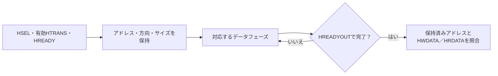

# AHB-Liteのパイプライン・待ち状態・ERROR応答を検証する

32ビットのAHB-Liteレジスタ回路を、独立した参照モデルで検証するローカル教材です。アドレスとデータの対応、待ち状態、バイトレーン、2サイクルのERROR応答、転送中リセットを扱います。待ち状態0／1／3の3構成で動きます。

## アドレス受付とデータ完了を分ける

HREADYが有効なエッジで保持したアドレスを、対応するデータフェーズの完了まで使います。



待ち中に提示する次アドレスを、進行中のデータフェーズへ取り違えないことが中心です。下記のT0〜T3表は、待ち0の具体例です。

## 1. インターフェースとレジスタ

AHB-Liteの信号サブセットを使い、単一マスター・単一スレーブのバスを想定します。`HREADYOUT`をバスの`HREADY`へ戻し、応答マルチプレクサーは置きません。アドレスは10ビットで、HSELが選択する1KB領域の相対バイトアドレスとして扱います。

| アドレス | 属性 | 内容 |
| --- | --- | --- |
| 0x000、0x004、0x008、0x00C | R/W | 初期値0の32ビットレジスタ4個 |
| 0x010〜0x013 | R/O | IDの32ビットワード0x4148424Cの各バイト |
| その他の領域 | エラー | 未定義アドレス |

リトルエンディアンで、HSIZE=0／1／2をバイト／ハーフワード／ワードとして扱います。書込みデータはHADDR下位とHSIZEで選ばれた**HWDATAのレーン**から取り、他のバイトを保持します。例えばアドレス1のバイト書込みにはHWDATA[15:8]を使います。読出しでは対応するワード全体をHRDATAへ出し、要求元が必要なレーンを選ぶ仕様です。

非整列、32ビットバスを超えるHSIZE、未定義領域、IDへの書込みはERRORにします。非整列と過大HSIZEは、プロトコル上不正な要求を意図的に加える負のテストです。正常なAHB転送の例として扱いません。

## 2. アドレスとデータを分けて受け付ける

`HREADY=1`の立上りで、HSEL=1かつHTRANSがNONSEQ／SEQのアドレス・制御だけを保持します。HSELや現在のHADDRは次のアドレスフェーズの信号なので、進行中のデータフェーズの書込み先には使いません。

| 立上り | T0 | T1 | T2 | T3 |
| --- | --- | --- | --- | --- |
| アドレスフェーズ | write A | write B | read A | IDLE |
| データフェーズ | なし | data A | data B | read結果A |

上は待ち状態0の例です。書込みは、対応するデータフェーズがOKAYで完了する立上りで反映します。待ち中は、次の有効アドレス・制御と現在の書込みデータを保持し、アドレスを重複受理しません。HSEL=0、IDLE、BUSYは新たなデータフェーズを作りませんが、既に受理した転送は完了できます。

固定刺激はSINGLEとINCR4を使い、INCR4のNONSEQ＋3つのSEQの途中にBUSYも入れます。RTLはHBURSTによるビート数管理をせず、受付済みアドレスごとに処理します。WRAPや他のバースト長、HPROT・ロック属性、複数マスター、インターコネクトは検証範囲に含めません。

## 3. OKAY・ERRORとリセット

正常転送は、データフェーズ開始からWAIT_CYCLES個の待ちを入れて完了します。エラーでは通常の待ちに続けて、次の2サイクルを必ず返します。

| 応答サイクル | HREADYOUT | HRESP | 動作 |
| --- | --- | --- | --- |
| ERRORの前半 | 0 | 1 | データフェーズを延長し、次アドレスの取消しを可能にする |
| ERRORの後半 | 1 | 1 | エラーとして完了、書込みは反映しない |

ERROR前半を観測した刺激側は、次サイクルにHTRANSをIDLEへ変えて、提示中の次要求を取り消します。その要求は改めてNONSEQとして発行します。追加の通常待ちではHRESP=0です。

アクティブLowの非同期リセットで全レジスタと受付状態をクリアし、HREADYOUT=1、HRESP=0へ戻します。受理後でも、データフェーズ完了前のリセットなら書込みを破棄します。

アドレスの受付、HTRANS、待ち、2サイクルのERROR応答は[Arm IHI 0033A AHB-Lite仕様](https://documentation-service.arm.com/static/5f914801f86e16515cdc2a27)の3〜5章を参照しています。レジスタ構成、固定待ち数、読出し未使用レーンの値、エラー対象は教材独自の仕様です。

## 4. 独立した期待値と検査

Pythonは、RTLのレジスタ配列・待ちカウンタを写さず、**バイト単位の記憶領域と絶対時刻の完了予定**を使います。前の転送の完了と次のアドレス受理を同じエッジで処理し、HWDATAはその時点で進行中の転送へ対応付けます。

テストベンチはエッジ前にready・response・成功読出しデータを、エッジ後に全レジスタを比較します。別の経過サイクル計測でも応答長を確認します。各ベクトルは1クロックで、生成した刺激はDUTの応答を見て進める方式ではありません。RTLが停止したり誤ったreadyを返したりすれば、予定との不一致で失敗します。

固定シナリオには連続書込み・読出し、3サイズ、IDLE／BUSY／非選択、代表データ、4種のエラー、次要求取消し、リセット復帰を含みます。ランダム検証はアドレス・方向・データ・サイズ・IDLE挿入を変更し、SINGLE／INCR4、バースト中のBUSY、受理後のデータフェーズをリセットで中断する操作も選びます。意図的な不正要求も加えます。[要求カタログ](requirements.json)は4要求・21目標で、受理・読出し・書込み・エラー・待ちの件数も照合します。

## 5. 意図的な誤実装

| 番号 | 誤実装 | 期待する検出ラベル |
| --- | --- | --- |
| 1 | データフェーズで現在のHADDRへ書く | AHB_STATE |
| 2 | 狭いサイズでもワード全体を上書き | AHB_STATE |
| 3 | ERRORを1サイクルで完了 | AHB_RESPONSE |
| 4 | 読出しデータのLSB反転 | AHB_DATA |

予定したチェッカーと非ゼロ終了まで確認します。変異検出の観測は通常の21目標へ算入しません。

## 6. 実行と確認範囲

[共通の準備・証跡](../local-common/README.md)に従い、リポジトリのルートから実行します。

```sh
python3 examples/local-ahb/run.py --out artifacts/ahb-smoke
python3 examples/local-ahb/run.py --configuration wait3 --seed 42 --iterations 100 --out artifacts/ahb-seed42
python3 examples/local-ahb/run.py --profile nightly --out artifacts/ahb-nightly
python3 -m unittest discover -s examples/local-ahb/tests -v
```

構成名は`wait0`、`wait1`、`wait3`です。smokeは64ランダム操作×1 seed、nightlyは500×3 seedを実行します。1操作はSINGLE、4ビートのINCR4、または転送中リセットです。BUSYやIDLE、末尾の4レジスタ読出しとリセットの追加サイクルはiterationsに含みません。`checks`は入力サイクル数です。

構成当たりのJUnitはsmoke **7件**、nightly **9件**（固定1＋ランダム1／3＋変異4＋合否判定1）。3構成の合計は**21／27件**です。

```sh
python3 examples/local-ahb/run.py --configuration wait1 --demo-bug 1 --out artifacts/ahb-intentional-failure
```

このコマンドは通常回路側にもアドレス対応の不具合を入れるため、終了コード1と`AHB_STATE`による失敗が期待結果です。

2026-10-27にPython 3.14.7、Icarus Verilog 14.0開発版で全3構成のsmoke／nightly、各21目標・4種類の変異、セルフテスト9件が成功しました。GitLabへの追加・CI起動は行っていません。AHB全体への適合、任意の入力列の証明や製品への適用実績を示す結果ではありません。

## 7. フォーマル検証も実行する

[AHB／AXIのフォーマル例](../local-bus-formal/README.md)を追加しました。AHBは同じ3構成で、応答・ERROR・リセットの3プロパティを非有界に証明し、データを含む4プロパティを既定深さ12で検査します。8到達目標、4種類の変異の反例、過剰な仮定の診断も実行します。証明の仮定と適用範囲、ツールの準備はリンク先を参照してください。

```sh
python3 examples/local-bus-formal/run.py --bus ahb --out artifacts/ahb-formal
```

フォーマルの目標・JUnitは、このページのシミュレーションの21目標・21／27件とは別です。

## 8. プロトコル・クロス・結合・性能を追加で確認する

[バス検証の追加例](../local-bus-validation/README.md)では、同じRTLの全3構成へ独立チェッカー・ネイティブSVAを接続し、方向×サイズ×応答の12クロス、X、短パルスリセット、性能、lint・line／toggleを確認します。[APB結合例](../local-bus-bridge/README.md)は別のブリッジRTLを使います。元の21目標やフォーマルの集計と区別して実行してください。
