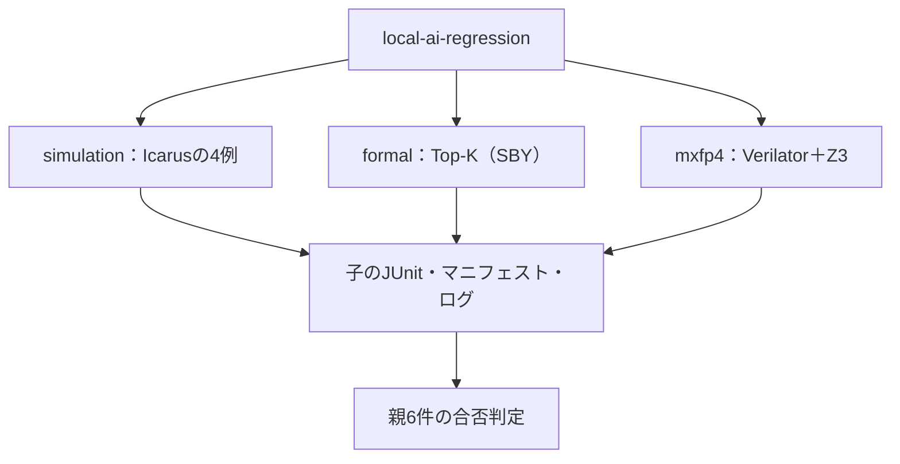

# AI用回路の6例をまとめて実行する

推論アクセラレータを構成する回路の6例を、1つの親ランナーから実行します。GitLabの登録・CI設定・利用枠は使いません。

| 例 | 回路 | 主に扱う検証の観点 |
| --- | --- | --- |
| [INT8シストリックアレイ](../local-systolic-array/README.md) | 重み固定方式の行列ベクトル積 | 入力のずらしとそろえ直し、全体停止、重み更新と処理中データの競合、累算幅 |
| [再量子化](../local-requantize/README.md) | INT32→INT8、チャネルごとの倍率・シフト・ゼロ点 | 出典から書き下した2段階の丸め、全32シフトでのタイ、設定の取り込み時点 |
| [活性化関数](../local-activation/README.md) | 区分線形近似のsigmoid・tanh | 誤差の上限による判定、全4096入力、緩い上限での見逃しの診断 |
| [畳み込みのラインバッファ](../local-conv-window/README.md) | 3×3窓、ゼロパディング、ストライド | 端・角、フレーム終わりの排出、連続フレーム、等価変異 |
| [Top-K選択](../local-topk/README.md) | ソーティングネットワークによる上位K個 | すべての入力についてのフォーマル証明、反例による変異検出 |
| [FP16／MXFP8／MXFP4](../local-mxfp4/README.md) | GEMMと量子化 | 設計仕様とRTLの取り込み、有理数モデルによるビット照合 |

## 実行範囲と集約



| 区分 | smoke JUnit | nightly JUnit |
| --- | --- | --- |
| Icarusの4例・8構成（シストリック14／18、再量子化14／18、活性化18／22、ラインバッファ14／18） | 60 | 76 |
| Top-Kのフォーマル（2構成×6タスク） | 12 | 12 |
| MXFP4（独自ランナーの合否判定） | 26 | 26 |
| 親ランナーの合否判定 | 6 | 6 |

子は独自の証跡を持ち、親はその合否だけを確かめます。親と子のJUnitを足し合わせて数えないでください。

## 子の成功を親で確認する

親は子の終了コードと`summary.json`を確認します。子のランナーによって`summary.json`の形が違うので、それぞれ次の条件で成功とみなします。

- **Icarusの共通ランナー**：`success`と`complete`が真で、結果数が予定数と一致すること
- **フォーマルの共通ランナー**：全タスクの結果があり、証明・到達は`pass`、変異は`detected`であること
- **MXFP4のランナー**：`complete`が真で、全検査が`pass`であること

どの形でも、予定数0、結果の欠落・重複、IDの空や形式不正は失敗にします。

## 準備と実行

```sh
python3 examples/local-ai-regression/run.py --stage simulation
python3 examples/local-ai-regression/run.py --formal-python /tmp/lsi-bus-formal-venv/bin/python
python3 examples/local-ai-regression/run.py --profile nightly --formal-python /tmp/lsi-bus-formal-venv/bin/python
python3 -m unittest discover -s examples/local-ai-regression/tests -v
```

- `--stage`：`all`（既定）、`simulation`、`formal`、`mxfp4`から選びます。
- `simulation`はPythonとIcarus Verilogだけで動きます。
- `formal`には、[共通フォーマル手順](../local-formal-common/README.md)の仮想環境を`--formal-python`で指定します。親はその仮想環境の`bin`をPATHへ加えてTop-Kを実行します。
- `mxfp4`には、Verilator、C++コンパイラ、make、PATH上のZ3が必要です。
- `--profile`と`--seed`はIcarusの4例とMXFP4に渡します。Top-Kには`--formal-timeout`（既定600秒）を渡します。
- `--child-timeout`は子1つの上限で、既定3600秒です。

ツールの自動インストールは行わず、既存の出力先は上書きしません。セルフテストは5件です。
