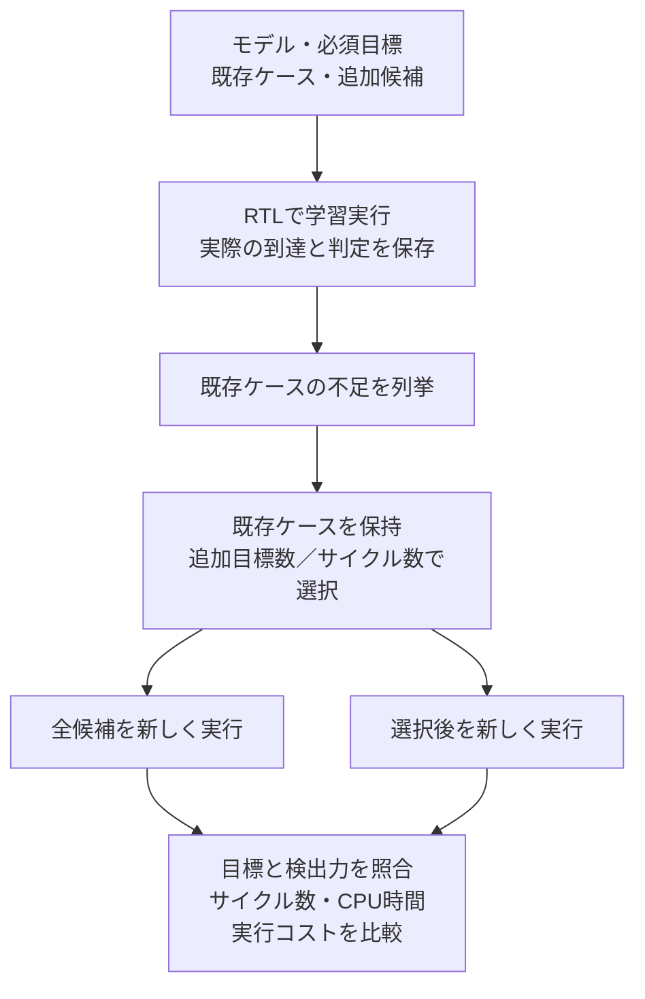

# APB＋割り込みでクロス網羅と追加ケースの選択を実行する

[機能クロス網羅の提案](../../docs/feature-interaction-coverage-proposal.md)を、既存の[APB＋割り込み回路](../gitlab-apb-irq/README.md)へ適用したローカル教材です。元のRTL、通常時の判定、44／45必須目標を使い、事前状態を含むクロスと時間関係を追加計測します。GitLabのCI設定・利用枠は使いません。Python 3.10以上とIcarus Verilogで実行します。

## 1. 既存テストの実績から追加ケースを選ぶ



既存の境界ケースとランダムケースを保持し、追加候補を含む集合から、実観測に基づくgreedy法で追加を選びます。学習ケースが失敗した場合や、全候補でも目標を満たせない場合は選択へ進みません。学習結果を検証結果へ流用せず、全候補と選択後の両方を再実行します。

この比較用ランナーでは、まず既存ケースと追加候補をすべて実行して到達実績を得ます。その学習費用も保存します。比較ジョブ全体を導入するだけで、元のリグレッションより費用が下がるという意味ではありません。必要な目標の定義は固定し、最小ケース数やバグ不在を保証しません。

## 2. モデルと分母

[`model.json`](model.json)の版を保存し、各割り込み要因とwait=0／1／3の構成を独立に判定します。通常のクロスの因子は事前PENDING・マスク・W1Cクリアビット・イベントの4つで、いずれも0／1です。要因番号は因子として混ぜず、要因ごとに同じモデルを適用します。

| 目標群 | 分母／wait構成 | 到達条件・役割 |
| --- | --- | --- |
| `pairwise` | 96 | 4要因×因子対6通り×水準対4通り。正常なW1C転送完了の実観測から数える |
| `priority` | 32 | 事前PENDING=1に限定した、4要因×マスク×クリア×イベントの全組。既存の重点クロスを維持 |
| `temporal` | 48 | 4要因×初期PENDING 2通り×マスク2通り×イベントの受理エッジ差3通り |
| `legacy` | 44／45 | 既存カタログの全目標。wait=0は44、wait=1／3は45。元のカタログと適用条件を保持 |
| `full4_diagnostic` | 64 | 4要因×4因子の全16通り。比較用の診断であり、選択後の必須条件にはしない |

各群の分母・意味は異なるため、合算した率を検証完了の指標にはしません。元の手順書にある単一PENDの12目標と、新しい実回路の48目標も別のモデルです。4因子の全組が未達でも、選定した2因子・重点・時間関係を満たす場合があります。これは対象に選ばなかった高次条件の正しさまで確認した結果ではありません。

### 時間関係の観測条件

W1Cを実際に受理したPCLKエッジを0とし、対象ビットの唯一のイベントが-1／0／+1のどこで受理されたかを数えます。初期PENDINGはエッジ-1の更新前です。3エッジともリセット非アクティブで、マスクが更新前後を通して一定、前後エッジに同じビットの別のW1Cクリアがない場合に記録します。別実行のイベントや状態を持ち寄りません。

通常クロスも、SETUP、待ち中、エラー応答、読出しからは計上しません。事前PENDING=0を含む新しい2因子目標と、事前PENDING=1だけの既存32クロスを区別します。

### 計画・到達・合格の分離

| 記録 | 根拠 |
| --- | --- |
| 計画上の充足 | 仕様に基づくPythonの状態モデルと、保存した入力列から求めた予定目標 |
| 観測した到達 | テストベンチが出力する実際のAPB信号・更新前後のPENDING／CONFIG・IRQと、同じケースのクロック列 |
| 判定付きの合格 | 通常ケースの全チェックと終了を確認し、全サイクルの観測と判定記録がそろった場合の目標 |

既存テストベンチへ任意の`+TRACE=path`出力を追加しています。`OBS`は状態のチェッカーが失敗する前に実値を保存し、`OK`はそのサイクルのAPB・状態・IRQの全比較を終えた後に出力します。観測の欠落・重複、X/Z、入力列との不一致、更新前後の状態の不連続、終了不足はエラーです。途中まで到達しても、失敗・未完了のケースを合格には数えません。

`legacy`は既存の`COVER`ログ、新しい群は`TRACE`を基にしたPythonコレクターで計測します。ネイティブcovergroup DBやSVAの実行例ではありません。期待値は既存の独立した参照モデルで判定し、DUTの出力を期待値へ戻しません。

## 3. 候補と選択の範囲

| ケース群 | smoke | nightly | 内容 |
| --- | --- | --- | --- |
| 既存ケース | 2 | 4 | 元の境界ケースと、1／3 seedのランダム操作。選択後も全件保持 |
| 状態の追加候補 | 64 | 64 | 要因ごとの4因子の全組。各ケースでリセット・初期化・W1C・読戻しまで実行 |
| 時間関係の追加候補 | 48 | 48 | 要因・初期PENDING・マスク・エッジ差を変えて実行 |
| 全候補 | 114 | 116 | 学習と、全候補側の再実行で使用 |

選択には、合格した学習実行で新しく満たせる必須目標数／予定サイクル数を使います。元の境界・ランダムケースを先に保持し、不足を埋める候補だけを追加します。ケースIDによる順序も固定し、同じソース・モデル・カタログ・構成・profile・seed・ランダム操作数・ツール版を再現条件とします。

## 4. 実行

macOS／LinuxなどのPOSIX環境で、PATH上の`iverilog`と`vvp`を使います。追加のPythonパッケージは不要です。例同士のRTL・ランナーを再利用するため、リポジトリ全体を取得し、ルートから実行してください。

```sh
python3 examples/local-apb-irq-coverage/run.py --out artifacts/apb-irq-coverage-smoke
python3 examples/local-apb-irq-coverage/run.py --profile nightly --out artifacts/apb-irq-coverage-nightly
python3 examples/local-apb-irq-coverage/run.py --wait 1 --seed 73 --transactions 40 --out artifacts/apb-irq-coverage-wait1
python3 -m unittest discover -s examples/local-apb-irq-coverage/tests -v
```

- `--wait all|0|1|3`：既定はall。構成の結果を混ぜず、必須目標を構成ごとに照合します。
- `--profile smoke|nightly`：既定はsmoke。既存ランダム操作は200×1 seed／2000×3 seedです。nightlyはローカルの実行量を増やす指定で、自動スケジュールではありません。
- `--transactions`：既存ランダムケースの各seedの操作数。1〜10000。固定の境界・追加候補は削減しません。
- `--seed`：非負整数。nightlyはseed・seed+1・seed+2です。
- `--model`・`--requirements`：モデルと元のカタログの入力。現実装の因子・要因数・次数は固定で、汎用のcovering array生成器ではありません。追加の未到達目標による失敗確認にも使えます。
- `--timeout`：各版取得・ビルド・実行の秒数。全体の時間上限ではありません。
- `--iverilog`・`--vvp`：使用ツールを指定します。
- `--out`：新規の出力先。既存ディレクトリは上書きしません。

## 5. 検出力と異常時の判定

通常RTLを変えず、検出力確認用のパラメータで次の6種類を注入します。追加したレジスタ側の変異はテストベンチの`REGISTER_MUTATION`から指定し、既定値0では元の動作を維持します。

| 誤実装 | 注入先 | 必須の検出ラベル |
| --- | --- | --- |
| マスク中のイベントを保存しない | 結合部 | `APB_IRQ_PENDING` |
| マスクを無視してIRQを出す | 結合部 | `APB_IRQ_OUTPUT` |
| クリア後もIRQを保持する | 結合部 | `APB_IRQ_RELEASE` |
| イベントよりW1Cクリアを優先する | レジスタ | `APB_IRQ_PENDING` |
| SETUPで書込みを反映する | レジスタ | `APB_STATE` |
| 不正書込みがCONFIGを変更する | レジスタ | `APB_ERROR_SIDE_EFFECT` |

両方式に含まれる既存ケースを先にし、固定順に実行して、予定した違反を最初に検出したところで止めます。全ケース×全変異を実行したという集計にはしません。予定ラベルと異常終了、観測・波形の存在を照合し、クラッシュ・ビルド失敗・タイムアウトを検出成功へ数えません。変異ケースの到達は通常の合格数に加算しません。

次は、終了コード1となることを確認する診断です。

```sh
python3 examples/local-apb-irq-coverage/run.py --wait 1 --omit-additions --out artifacts/apb-irq-without-additions
python3 examples/local-apb-irq-coverage/run.py --wait 0 --demo-bug clear-priority --out artifacts/apb-irq-priority-bug
```

追加候補を省くと、既存44／45目標が埋まっていても、新モデルの不足で失敗します。通常実行へ誤実装を入れた場合は、観測した到達を残して学習を失敗させ、合格の証跡を作りません。

## 6. 証跡とコストの読み方

- `manifest.json`：モデル・元のカタログ・使用ソースのSHA-256、候補の全入力列と予定目標、必須群、保持対象、選択・変異実行の方針。
- `model.json`・`requirements.json`：使用したモデルと既存カタログ。
- `tools.json`・`builds.json`：ツール版、ビルド引数、終了コード、ログ。
- ケースごとの`vectors.txt`・`trace.txt`・`wave.vcd`・`simulation.log`・`result.json`：実行ID、実際の到達サイクル、判定付き目標、観測ファイルのSHA-256。
- `coverage.json`：構成別の既存実績、学習、選択、再実行の計画・到達・合格と不足。4因子の診断も別表示。
- `selection.json`：保持した既存ケース、追加したケース、各段階で新しく満たす目標と選択根拠。
- `costs.json`：ランナー全体、モデルとマニフェストの準備、版取得、ビルド、全シミュレーションの壁時計時間。シミュレーションのCPU時間は各実行前後の子プロセス使用量から測定。
- `summary.json`・`junit.xml`：ツール版取得1件＋各wait構成19件の合否判定。全3構成では58件、1構成では20件。選択後の再実行は、選択の根拠とした学習時のトレースと判定付き目標を再現することも照合します。各シミュレーションの件数とは別です。

全候補／選択後の正常実行のケース数・検査サイクル数・CPU時間・壁時計時間を比較します。この教材のクロック数は、実際に観測した入力列の検査サイクル数で、起動直後など計測区間外のクロックは含みません。学習・ビルド・変異検出の負担は別に保存し、ランナー全体の時間から消しません。ライセンス使用量、計測の最大メモリ、手作業の解析コストは未測定と明記します。ケース数とクロック数の比率を、同じ割合の費用削減へ読み替えません。

## 7. 対応範囲と確認記録

単一PCLKの4要因IRQ回路を対象にした教材です。因子間モデルは要因ごとに分けており、要因間の全組合せ、全APB規格への適合性、任意の初期状態、CDC、実製品の削減効果を確認したものではありません。複数要因・待ち・エラー・リセットの既存シナリオは、元のカタログと既存ケースを保持して確認します。

2026-10-29にIcarus Verilogでwait=0／1／3のsmoke・nightly、各方式の目標、6種類の誤実装を確認しました。新しいセルフテスト16件と、既存APB＋割り込みの12件が成功しています。セルフテストでは、欠落・重複・X・入力不一致の観測、前件が成立しない時間関係、通常実行の誤実装、未到達の追加目標、追加ケースの省略、ビルド失敗を合格にしないことも確認します。

元のケースだけの実績は次のとおりです。既存44／45目標と重点32目標はすべて合格していても、事前状態を含む2因子や時間関係には不足があります。選択後は、その不足を埋める追加ケースも再実行して合格を確認しています。

| profile | wait | 元ケースの2因子合格数／96 | 元ケースの時間関係合格数／48 | 追加した候補数 |
| --- | --- | --- | --- | --- |
| smoke | 0 | 92 | 14 | 34 |
| smoke | 1 | 94 | 14 | 34 |
| smoke | 3 | 90 | 20 | 28 |
| nightly | 0 | 96 | 46 | 2 |
| nightly | 1 | 96 | 43 | 5 |
| nightly | 3 | 96 | 40 | 8 |

以下はseed=17、ランダム操作数は既定値での正常再実行の記録です。両方式とも2因子96・重点32・時間関係48・既存44／45目標が合格しています。実行数はモデルとseedに依存し、一般的な削減率ではありません。

| profile | wait | 全候補のケース数→選択後 | 正常実行のクロック数：全候補→選択後 |
| --- | --- | --- | --- |
| smoke | 0 | 114→36 | 1847→1124 |
| smoke | 1 | 114→36 | 2512→1556 |
| smoke | 3 | 114→30 | 3823→2284 |
| nightly | 0 | 116→6 | 15911→14874 |
| nightly | 1 | 116→9 | 22315→20987 |
| nightly | 3 | 116→12 | 35230→33317 |

nightlyでは保持する既存ランダムケースの比重が大きいため、ケース数は大幅に減っても、クロック数の削減は約5〜7%です。元のAPBリグレッションより短くなったという比較ではありません。詳細な実行IDとソースハッシュは各出力のマニフェストへ保存しています。
