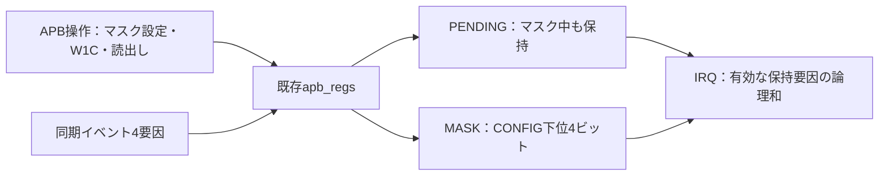

# APBと割り込みの結合検証を実行する

APBからマスクを設定し、イベント発生、割り込み出力、W1Cによる確認応答、割り込み解除までを検証する例です。[既存のAPBレジスタ回路](../local-apb/rtl/apb_regs.sv)をそのままインスタンス化し、保持状態とマスクから4要因共通の割り込み出力を生成します。商用ツールは不要で、PythonとIcarus Verilogを使います。

## 1. 結合回路の仕様

| バイトアドレス | 名前 | この例での用途 |
| --- | --- | --- |
| `0x00` | CONFIG／MASK | 下位4ビットが各要因の割り込み許可。1で許可、0でマスク。上位28ビットも読書き可能だが割り込みに影響しない |
| `0x04` | ID | 固定値`0x41504233`、読出し専用 |
| `0x08` | PENDING | 下位4ビットがイベント保持状態。W1C。上位は読出し0・書込み無視 |
| その他 | 未割当・非整列 | エラー応答。バス書込みによる状態変更なし |

マスクは割り込みの出力だけに作用します。マスク中に発生したイベントもPENDINGへ保持し、その後マスクを解除すると割り込みを出力します。再びマスクしても保持状態は消えません。

各ビットの次状態は、完了したW1Cでクリアしてから、そのクロックのイベントでセットします。同一ビットでクリアとイベントが重なればイベント優先です。割り込みは`|(PENDING & MASK)`で、レジスタ更新後の状態へ組合せ回路として追従します。マスク更新とイベントが転送完了の同じエッジに重なった場合も、更新後のマスクと保持状態から出力します。

複数要因が有効なら、一部の要因をクリアしても割り込みを保持します。すべての有効要因をクリア、またはマスクすると解除します。同期リセットはマスク・保持状態を0にし、割り込みを解除します。

APBのSETUP／ACCESS、待ち時間0／1／3、エラー応答の扱いは[APB単体例の仕様](../local-apb/README.md#1-対象とレジスタ仕様)を引き継ぎます。SETUP・待ち状態中やエラー応答のクロックでも、バス操作と独立したイベントの取り込みは継続します。イベント入力はクロックに同期している前提です。非同期入力を扱う場合は別途CDCを検証します。



この例はバス操作列でソフトウェアの設定・確認応答を模擬します。CPUや実ファームウェアを実行する構成ではありません。既存の単一要因`irq_pending`モジュールを二重に接続せず、APB回路内のPENDINGを唯一の保持状態として使います。

## 2. 検証する相互作用

| 項目 | 刺激と合格条件 |
| --- | --- |
| マスク中の保持→解除 | マスク中にイベントを入れ、PENDING読出しで保持を確認。許可するとIRQが立つ |
| 再マスク | 保持状態を残したままIRQのみ解除する |
| W1Cと再発生 | 要因ごとにマスク×クリア×イベントを全組合せで実行し、保持状態とIRQを比較 |
| 複数要因 | 2要因を有効にし、一つ目のクリア後もIRQを維持、最後のクリアで解除する |
| マスク更新とイベント | 許可／禁止への更新と同じ完了エッジにイベントを発生させ、更新後の状態を比較 |
| バス待ち・エラーとイベント | SETUP・待ち状態・エラー応答中もイベントを取りこぼさず、未完了書込みの副作用を発生させない |
| リセットと復帰 | IRQ出力中にリセットして解除し、その後の新規イベントで再びIRQが立つ。リセット中はPREADY・PSLVERRが0であること |

SystemVerilogの参照モデルがAPB応答、読出し値、CONFIG、PENDING、IRQを毎クロック比較します。W1Cはビットごとの更新、IRQは各ビットの有効性の走査で期待値を計算します。実装の内部信号やIRQ出力を期待値の生成に使いません。転送のSETUPと待ち中の要求保持も監視します。

CONFIG・PENDINGは結合回路の外部観測出力として比較します。APBの読出しだけでは隠れる途中の誤更新も検出できます。信号はクロック立上り前に応答を、NBA更新後にレジスタとIRQを比較します。

`requirements.json`の主なクロスは、**4要因×マスク2状態×クリア2状態×イベント2状態＝32目標**です。各ビットに事前の保持状態がある場合だけ、このクロスを記録します。順序、同時動作、複数要因、イベント発生フェーズ、リセットを加え、wait=0は要求9件・44目標、wait=1/3は要求10件・45目標です。wait=0の待ち状態目標は理由付きで除外します。

これは選定した説明用目標の網羅です。正常ケースの全チェック完了を確認してから観測を集計し、構成間の補完や変異ケースによる補完は行いません。必須目標が欠ければリグレッションを失敗させます。SVAやcovergroup DBの計測値ではありません。

## 3. ローカルで実行する

Python 3.10以上とIcarus Verilogの`iverilog`・`vvp`を用意し、リポジトリのルートから実行します。

```sh
python3 examples/local-apb-irq/run.py --wait 1
python3 -m unittest discover -s examples/local-apb-irq/tests -v
python3 examples/local-apb-irq/run.py --wait 3 --profile nightly --seed 73
```

| プロファイル | 正常ケース | 変異ケース | 必須目標判定 | JUnit／構成 |
| --- | --- | --- | --- | --- |
| smoke | 境界1＋ランダム1 seed×200転送 | 3 | 1 | 6 |
| nightly | 境界1＋ランダム3 seed×2,000転送 | 3 | 1 | 8 |

ランダム転送ではアドレス、読書き、データ、リセットに加え、SETUP・待ち・完了の各クロックのイベントを変えます。必須クロスは固定テストで確保し、ランダム列で異なる履歴を探索します。ランダム試行だけで32目標を埋める構成ではありません。

`--transactions`で1 seedのランダム転送数、`--seed`で開始seedを指定します。厳密な再現には保存した全入力、ソースハッシュ、ツール版も照合します。`--out`は既存ディレクトリを上書きしません。

既存APB RTLとIRQ例のプロセス実行・終了判定処理へ依存するため、`examples`一式を保持してください。この例のランナーとチェッカーはAPB単体例を基に拡張しています。

## 4. 意図的な不具合を検出する

| 変異 | 結合部の不具合 | 予定する検出ラベル |
| --- | --- | --- |
| 1 | マスク中のイベントをPENDINGへ渡さない | `APB_IRQ_PENDING` |
| 2 | IRQ生成時にマスクを無視する | `APB_IRQ_OUTPUT` |
| 3 | IRQを保持してしまい、W1C後も解除しない | `APB_IRQ_RELEASE` |

既存APB RTLには変異を入れず、結合部の3種類の変異を別々に実行します。通常リグレッションも所定の比較で3種類の変異を検出する必要があります。次は正常ケースへも不具合を入れ、終了コード1とJUnitのfailureを確認するデモです。

```sh
python3 examples/local-apb-irq/run.py --wait 1 --demo-bug 1
```

生き残った変異は失敗、ビルド失敗・タイムアウト・別のエラー・完了記録のない終了は判定エラーです。ランナーの12テストで、3構成、変異の検出、seedと入力の再現、欠落目標、カバレッジ混入防止、壊した応答やマスター入力の検出、証跡の上書き防止を確認します。

## 5. 構成ごとの実行と証跡

wait=0/1/3の3構成を、`--wait`で1構成ずつ実行します。失敗デモは`--demo-bug 1/2/3`、seedは`--seed`で選べます。ランナーは失敗を非0の終了コードで返し、JUnitは結果表示に使います。

出力先（既定は`artifacts/apb-irq-local-日時/`）へマニフェスト、ソースハッシュ、ツール版、ビルド結果、ケース別入力・ログ・VCD波形、要求ごとの観測・未達・除外、集計・JUnitを保存します。

## 6. 実行確認

2026-10-26にPython 3.14.7・Icarus Verilog 14.0開発版でランナー12テストとnightly全3構成を確認しました。各構成で44/44または45/45目標を達成し、3種類の変異を検出しました。nightlyはseed 17〜19を各2,000転送実行しています。

公開デモの[MR !5](https://gitlab.com/kurochan001/lsi-verification-method-ci-demo/-/merge_requests/5)で、[CI #2988726525](https://gitlab.com/kurochan001/lsi-verification-method-ci-demo/-/pipelines/2988726525)の全20ジョブ成功、JUnit 126件・失敗／エラー0件を確認しました。結合検証の3ジョブはIcarus Verilog 11.0で実行され、保存済み`summary.json`と`manifest.json`でも44/44または45/45目標、3種類の変異の検出、予定5ケースの完了、対象コミット`0da7a642`を確認しています。追加分のJUnitは18件、ランナーのセルフテストは別枠の12テストです。

確認したGitLab実行はsmokeで、結合検証のnightly全3構成はローカルで確認しました。全例を含むscheduleの153件をGitLabで実行した結果ではありません。その後、MR !5はmainへマージされ、[mainのCI #2988757915](https://gitlab.com/kurochan001/lsi-verification-method-ci-demo/-/pipelines/2988757915)も全20ジョブ・JUnit 126件で成功しています（2026-10-26確認）。

製品への展開では、割り込みの極性・レベル／パルス方式、CPU側の確認応答、優先順位・共有割り込み、CDC、実際のレジスタ仕様とソフトウェアの順序制約を照合してください。[機能間のクロス検証](../../docs/method/feature-interaction-verification.md)と[継続リグレッション](../../docs/method/continuous-regression.md)も参照してください。

## クロスモデルの計測と追加ケースの選択

[ローカルの比較例](../local-apb-irq-coverage/README.md)では、本例の通常RTL・カタログ・境界／ランダムケースを保持し、事前PENDINGを含む2因子目標、重点クロス、前後1エッジの時間関係を別に計測します。実観測から追加候補を選び、学習結果を流用しない再実行で、元の44／45目標と6種類の誤実装の検出、実行量を比較します。

本例のテストベンチに、任意の`+TRACE=path`出力と、検出力確認用の`REGISTER_MUTATION`（既定0）を追加しました。通常のコマンド・出力・JUnit件数は維持しています。
