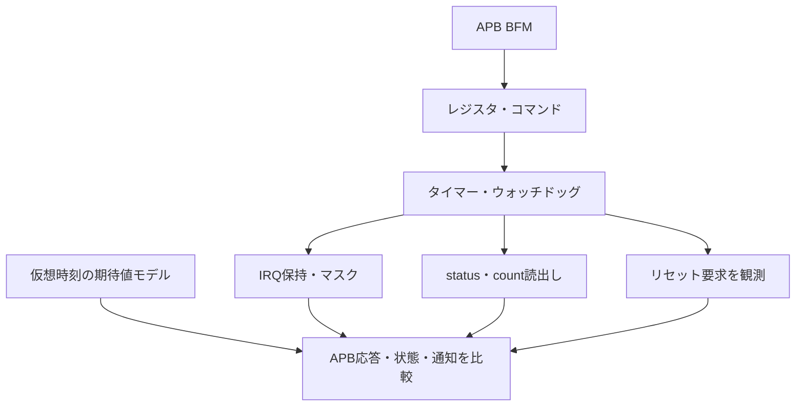

# APB＋タイマー＋ウォッチドッグの結合検証

APB経由でタイマーとウォッチドッグを設定し、カウント、割込み、リセット要求まで照合するローカル教材です。[既存タイマー・ウォッチドッグ](../local-timer-watchdog/README.md)のRTLをそのまま使い、APBレジスタとIRQマスクを追加します。幅4／8×待ち状態0／2の4構成で検証します。

## レジスタ操作から満了・通知へ

APB設定とコアの満了を同じ時刻で扱い、レジスタ読出し・IRQ・リセット要求を独立モデルと比較します。



リセット要求は検査対象の出力です。外部システム全体を実際にリセットする配線を示したものではありません。

## 1. レジスタと受付仕様

32ビットデータ、8ビットのバイトアドレスを持つAPB3の信号サブセットです。`PSEL`、`PENABLE`、`PREADY`がすべて1の立上りで完了し、正常な書込みだけを反映します。SETUPは1クロック、ACCESSで0／2クロック待たせます。連続転送でも毎回SETUPを設けます。アドレス・制御・書込みデータは待ち中も保持します。

| アドレス | 名前 | 属性 | 内容 |
| --- | --- | --- | --- |
| 0x00 | CONTROL | R/W | bit0 タイマーenable、bit1 periodic、bit2 ウォッチドッグenable、bit3 IRQ出力enable |
| 0x04 | TIMER_RELOAD | R/W | 幅4／8の下位ビットだけ保持、上位は0として読む |
| 0x08 | WATCHDOG_RELOAD | R/W | 同上 |
| 0x0C | COMMAND | R/W | 書込み1で単発操作：bit0 タイマーload、bit1 ウォッチドッグload、bit2 kick、bit3 IRQ clear。読出しは0 |
| 0x10 | STATUS | R/O | bit0 内部IRQ保持、bit1 timer_expired、bit2 watchdog_reset_request |
| 0x14 | TIMER_COUNT | R/O | タイマー残数 |
| 0x18 | WATCHDOG_COUNT | R/O | ウォッチドッグ残数 |
| 0x1C | ID | R/O | 0x54494D52 |

未定義・非整列アドレスとR/Oへの書込みは、完了時に`PSLVERR=1`を返します。未定義アドレスの読出し値は0です。エラーや完了前の要求はレジスタとCOMMANDに反映しません。ただし、既に有効なカウンタはバス待ち中も通常どおり進みます。

CONTROLの上位28ビットとCOMMANDの上位28ビットは無視します。CONTROL更新は完了エッジ後に保持され、コアはそのエッジでは更新前のenable／periodicを参照します。RELOADの書込みだけではカウントをロードしません。COMMANDのload時にコアの保持reload値も更新します。

同期アクティブLowリセットで、レジスタとコアを0へ戻します。リセット中はPREADY=0とし、ACCESS中の未完了要求も破棄します。再開時はレジスタを設定し直します。APBの基本的な転送手順は[ArmのAPB仕様](https://developer.arm.com/documentation/ihi0024/latest)を参照し、上記レジスタとエラー方針は教材独自の仕様です。

## 2. タイマー・ウォッチドッグと競合の仕様

単体例の優先順位を引き継ぎます。

- reload=0は停止、enable=0はカウント保持。loadはenableに関係なく有効です。
- タイマーは残数1からの減算で満了します。periodicならload時に保持した値へ戻り、単発なら0で停止します。周期1では満了通知が連続して1になり得ます。
- 満了とIRQ clearが同時なら、満了によるセットが優先します。外部IRQをマスクしても内部IRQは保持し、STATUSから読めます。解除すれば保持中のIRQが出力へ伝わります。
- ウォッチドッグはloadがkickより優先し、有効なkickは同時のタイムアウトより優先します。kickはenable=0なら無視します。
- ウォッチドッグは満了時に1クロックのリセット要求を出して停止し、**この教材内で回路を自動リセットする接続はありません。**

## 3. 独立した期待値と固定シナリオ

Pythonは、レジスタの受付規則と、enable時だけ進む仮想時刻・満了予定時刻を組み合わせて期待値を生成します。RTLのダウンカウンタや内部イベントを期待値に使いません。APBのready・error・完了時read値をエッジ前に比較し、カウンタ、満了、内部IRQ・外部IRQ、レジスタ保持値をエッジ後に比較します。

固定シナリオは、全レジスタの読戻し、上位ビットの切捨て、停止中load、最大値からの満了、周期1、IRQマスクと解除・クリア、未定義アドレス、R/O書込み、ACCESS中リセットと再設定を含みます。競合は次のように明示的に整列します。

- タイマーreload=1の周期動作中にCOMMANDのclearを完了し、新規満了と同時にする。
- 同じ周期動作中のloadで、そのクロックの満了を抑止する。
- ウォッチドッグreloadを「待ち数＋2」として停止中load後にenableし、次のkickコマンドの**完了直前の残数を1**にする。
- ウォッチドッグload＋kickを同時に指定し、loadを優先する。
- 同じ値を両カウンタへloadし、同時満了させる。

[要求カタログ](requirements.json)は5要求・24目標です。各幅・待ち状態で独立に達成し、APB完了・エラー・待ちサイクル、タイマー満了、ウォッチドッグ要求の件数も照合します。追加ランダム検証は、読書き、設定値、コマンド、アイドル間隔、エラーアドレス、リセット中断を変更します。

## 4. 意図的な誤実装

| 番号 | 誤実装 | 期待する検出ラベル |
| --- | --- | --- |
| 1 | CONTROLをSETUPで更新 | APB_TIMER_STATE |
| 2 | 満了よりIRQ clearを優先 | APB_TIMER_IRQ |
| 3 | COMMANDをSETUP・待ち中にも実行 | APB_TIMER_STATE |
| 4 | IRQ出力マスクを無視 | APB_TIMER_IRQ |

正常な単体コアでも結合時の受付や配線を誤ることがあるため、バス応答と内部動作を併せて照合します。変異2だけは既存コアの教材用変異を有効にし、それ以外はAPBラッパーの変異です。各ケースは予定したラベルと非ゼロ終了まで確認します。

## 5. 実行

[共通の準備・証跡](../local-common/README.md)に従い、リポジトリのルートから実行します。

```sh
python3 examples/local-apb-timer/run.py --out artifacts/apb-timer-smoke
python3 examples/local-apb-timer/run.py --configuration width8-wait2 --seed 42 --iterations 100 --out artifacts/apb-timer-seed42
python3 examples/local-apb-timer/run.py --profile nightly --out artifacts/apb-timer-nightly
python3 -m unittest discover -s examples/local-apb-timer/tests -v
```

構成名は`width4-wait0`、`width4-wait2`、`width8-wait0`、`width8-wait2`です。smokeは各40ランダム操作×1 seed、nightlyは300×3 seedを実行します。1操作はAPB転送またはリセット中断に後続の待機0〜4クロックを加えたもので、`checks`は入力ベクトルのサイクル数です。

構成当たりのJUnitはsmoke **7件**、nightly **9件**（固定1＋ランダム1／3＋変異4＋ゲート1）。4構成の合計は**28／36件**です。

```sh
python3 examples/local-apb-timer/run.py --configuration width4-wait2 --demo-bug 3 --out artifacts/apb-timer-intentional-failure
```

このコマンドは通常回路側にも早すぎるコマンド実行を入れるため、終了コード1と`APB_TIMER_STATE`による失敗が期待結果です。

## 6. 確認範囲

2026-10-27にPython 3.14.7、Icarus Verilog 14.0開発版で全4構成のsmoke／nightly、各24目標・4変異、確認テスト7件が成功しました。GitLabへの追加・CI実行は行っていません。

単一クロックのAPB3信号サブセットであり、CPU・実ドライバー、割込みコントローラー、システムのリセット配線、CDC、APB4/5の追加信号や製品の安全性は対象外です。バスとコアが正常でも、ソフトウェアの設定手順やシステム全体の要求は別途検証します。
