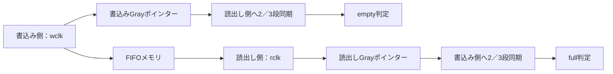

# 非同期FIFOのクロック比・位相・ジッターを検証する

書込みと読出しのクロックが異なる8ビットFIFOを、参照キューで検証します。深さ4／8×同期段数2／3の4構成で、データ順序、満杯・空、同期遅延を含むフラグ、共通リセットと復帰を確認するローカル教材です。

## データ経路とGrayポインター同期

データはFIFOメモリを通り、空・満杯判定に必要な反対側のポインターだけを同期して渡します。



図は論理的なCDC経路です。同期遅延のあるフラグを参照モデルで比較しますが、メタステーブルの物理特性を証明する図ではありません。

## 1. この回路の仕様

- `wr_en=1`かつエッジ直前の`full=0`なら、wclkの立上りで受理します。
- `rd_en=1`かつエッジ直前の`empty=0`なら、rclkの立上りで先頭データを取り出し、`rd_valid=1`にします。読出しを受理しないrclkエッジではvalid=0、データは直前値を保持します。validはrclk間で保持されます。
- 両ドメインは、自分のバイナリポインターと、そのGrayコード表現を保持します。相手のGrayポインターを固定段数のFFへ通し、ローカルの次ポインターと比較してフラグを登録します。
- 書込み後も、読出し側のempty解除には同期とフラグ登録の遅延があります。読出し後のfull解除も同様で、実際の占有数から即座に計算するフラグではありません。
- 共通のアクティブLow非同期リセットで、両ドメインの状態を同時に初期化し、未読データを破棄します。full=0、empty=1、valid=0、出力データ=0です。メモリ配列自体はクリアせず、新しい受付条件で古いデータの読出しを防ぎます。

リセット解除のアナログなrecovery／removal違反はモデル化しません。片側だけをリセットする仕様も含めません。深さは2のべき乗を前提とし、確認するパラメーターは4／8、同期段数は2／3です。

## 2. 独立した期待値とクロック刺激

Pythonは、RTLの循環バッファ・Gray符号化を写さず、**参照キューと折り返さない書込み／読出し累計**を保持します。相手の累計を受信クロックの履歴で遅延させ、次の累計との差・一致からfull／emptyの期待値を求めます。同時立上りでは、両側とも更新前の相手の累計をサンプルします。

テストベンチは1 tickを2nsとして、入力をクロック遷移の1ns前に設定し、遷移の1ns後に比較します。これはデジタルシミュレーションの刺激順序です。全tickでフラグ・valid・データを比較し、送信元のGrayポインターは、受付時に1ビットだけ変化し、それ以外では保持されることも点検します。**受信側の連続サンプル間で1ビットだけ変わることは要求しません。** 低速側が複数の更新を飛び越す場合があるためです。

固定シナリオは次の4種類を、各構成で実行します。半周期の単位はtickです。

| profile | 書込み半周期 | 読出し半周期 | 確認すること |
| --- | --- | --- | --- |
| 0 | 3 | 5 | 書込みが速い・位相差あり |
| 1 | 5 | 3 | 読出しが速い・位相差あり |
| 2 | 4 | 4 | 同時立上りを含む同周期 |
| 3 | 3±1 | 5±1 | 各半周期に−1／0／＋1 tickのジッター |

各profileで、空への読出し、満杯までの書込み、排出、連続両方向動作、ポインターの複数周回、未読データを持った共通リセット、再充填と排出を行います。ジッターは常に正の半周期になる範囲で生成し、FF段数は**実行中に切り替えず構成ごとに固定**します。追加ランダム区間はprofile 3を使い、要求とデータを変えます。最後に排出区間を設けます。

[要求カタログ](requirements.json)は4要求・17目標です。受付数・拒否数と全tickの比較完了も確認します。リセットで捨てたデータがあるため、実行全体の書込み数と読出し数が一致するとは限りません。

## 3. 意図的な誤実装

| 番号 | 誤実装 | 期待する検出ラベル |
| --- | --- | --- |
| 1 | 読出しデータのLSB反転 | ASYNC_DATA |
| 2 | fullを通知しない | ASYNC_FLAGS |
| 3 | 空でも読出しを受理 | ASYNC_VALID |
| 4 | 書込みポインターをバイナリのまま公開 | ASYNC_GRAY |

変異4は送信元Grayの構造的な違反で検出します。実機のメタステーブルによるデータ破壊をシミュレーションしたものではありません。各変異は予定したラベルと非ゼロ終了まで確認し、通常検証の17目標を埋める観測には使いません。

## 4. 実行

[共通の準備・証跡](../local-common/README.md)に従い、リポジトリのルートから実行します。

```sh
python3 examples/local-async-fifo/run.py --out artifacts/async-smoke
python3 examples/local-async-fifo/run.py --configuration depth8-sync3 --seed 42 --iterations 1000 --out artifacts/async-seed42
python3 examples/local-async-fifo/run.py --profile nightly --out artifacts/async-nightly
python3 -m unittest discover -s examples/local-async-fifo/tests -v
```

構成名は`depth4-sync2`、`depth4-sync3`、`depth8-sync2`、`depth8-sync3`です。smokeは600ランダムtick×1 seed、nightlyは5000×3 seedを追加します。`--iterations`はランダム区間の長さで、固定シナリオや末尾の排出区間は削減しません。`checks`はtick数です。

構成当たりのJUnitはsmoke **7件**、nightly **9件**（固定1＋ランダム1／3＋変異4＋合否判定1）。全4構成の合計は**28／36件**です。

```sh
python3 examples/local-async-fifo/run.py --configuration depth4-sync2 --demo-bug 4 --out artifacts/async-intentional-failure
```

このコマンドは通常回路側にも変異を入れるため、終了コード1と`ASYNC_GRAY`による失敗が期待結果です。

## 5. 確認範囲と一次資料

2026-10-27にPython 3.14.7、Icarus Verilog 14.0開発版で全4構成のsmoke／nightly、各17目標・4種類の変異、セルフテスト6件が成功しました。GitLabでのCI追加・実行は行っていません。

ジッターを加えたRTL検証だけで、CDCの物理的安全性、MTBF、Grayバスのスキューやリセット解除の安全性は確認できません。構造的なCDC/RDC解析、実装後のタイミング制約・解析は別に必要です。[AlteraのDCFIFOタイミング制約の資料](https://docs.altera.com/r/docs/683241/25.1.1/agilextm-7-embedded-memory-user-guide/user-configurable-timing-constraint)にも、実装遅延と制約の点検が説明されています。本例は製品FIFOや実メモリマクロの再現ではありません。
