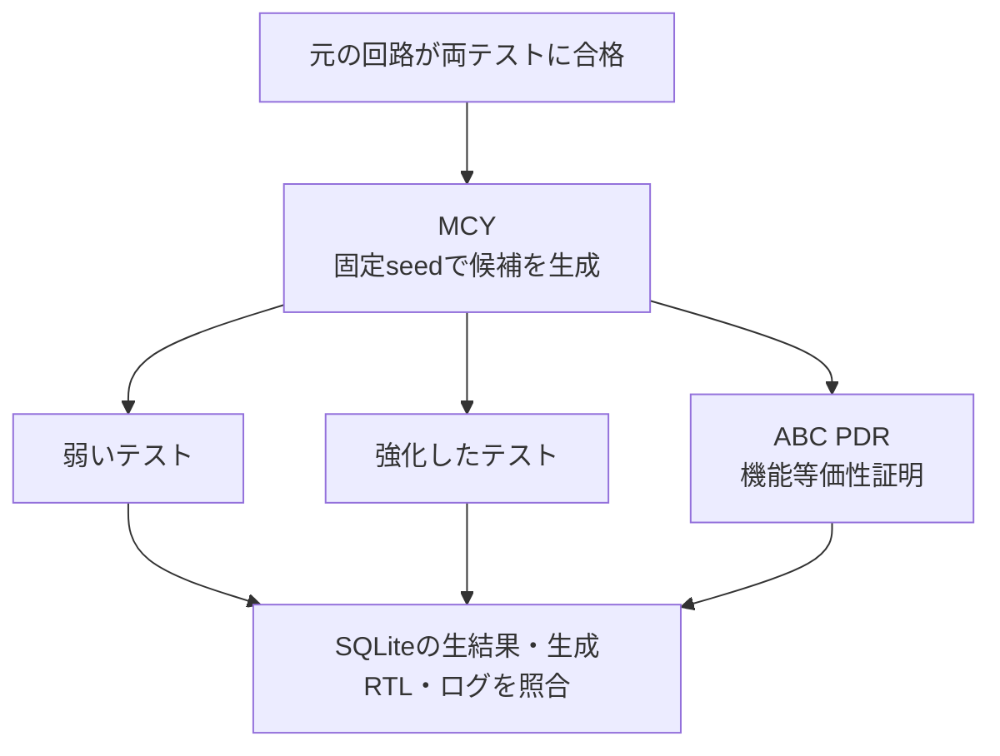

# MCYによる誤実装の自動生成とテストの検出力比較

2ビットの割り込み保留回路から、YosysHQ MCYで誤実装候補を自動生成します。同じ候補を弱いテスト・強化したテスト・非有界の機能等価性証明で評価し、未検出と機能的に等価な変更を区別します。

[ミューテーション検証の手法](../../docs/method/mutation-verification.md)を実際の自動生成キャンペーンで試す例です。既存例の手作業で埋め込んだ`MUTATION`切替えとは別に、MCYが合成モデルの信号や演算へ変更を加えます。

## 仕様と比較範囲

- 立上りエッジでイベントを保留し、W1Cでクリアする。同時ならイベントを優先する。
- マスクはIRQ出力だけを制御し、保留状態は消さない。
- 同期リセットで保留を0へ戻す。
- 機能出力は`pending`と`irq`。`debug_hint`は仕様上未規定の診断用出力で、比較対象から除く。

診断用カウンターへの変更などが、機能出力について等価な候補になります。未規定という条件を実製品へ無条件に持ち込まず、比較対象の除外理由をレビューしてください。



## 実行

Python 3.13以上、Icarus 14系、[固定版OSS CAD Suite](../../tools/ENVIRONMENT.md#oss-cad-suiteの固定版)が必要です。商用ライセンスは使いません。

```sh
python3 tools/setup_oss_cad.py --out artifacts/toolchains/oss
artifacts/toolchains/full/python/bin/python examples/local-auto-mutation/run.py \
  --oss-home artifacts/toolchains/oss/oss-cad-suite \
  --profile nightly --seed 17 --out artifacts/auto-mutation
```

MCYの生成数はsmoke 32件、nightly 96件です。そのうち1件はMCYが必ず加える無変更の設計（`mutate -mode none`）で、3評価の対照です。変更を加える候補はsmoke 31件、nightly 95件になります。各件で以下を実行します。

| 評価 | 内容 | 結果の意味 |
| --- | --- | --- |
| 弱いテスト | イベントなしの33比較 | 保持やマスクの一部だけを観測する |
| 強化したテスト | 全4保留状態×reset有無×イベント4通り×clear4通り×mask4通り。各条件をreset・状態設定・対象操作の3段階で再生、計1536比較 | この仕様の全512状態遷移と出力を比較する |
| 機能等価性 | 同じ初期reset・任意入力で元の回路と`pending`・`irq`を比較、SBY＋ABC PDR | PASSならこのモデルと観測範囲で非有界に等価。FAILなら不一致の反例を要求する |

## 分類と合格条件

| 分類 | 条件 | 検出率への扱い |
| --- | --- | --- |
| 等価 | 等価性PASS、両テストPASS | 分母から除外 |
| 検出 | 等価性FAIL、テストが予定の比較でFAIL | 分子・分母へ含める |
| 未検出 | 等価性FAIL、テストPASS | 分母だけへ含める |
| 判定の矛盾 | 等価性PASSなのにテストFAIL | キャンペーン失敗。期待値・比較範囲等を調べる |
| 未完了 | 時間切れ・コンパイル失敗・証跡不足等 | キャンペーン失敗。検出には数えない |

検出率は`検出した非等価候補数 / 判定が完了した非等価候補数`です。等価性不明を等価扱いにして除外しません。無変更の対照は等価でなければならず、等価候補・分母の数に入れません。正常回路が両テストに合格し、全候補の3評価が完了し、無変更の対照を除いて等価候補が存在し、弱いテストの未検出が強化したテストでは残らないことを要求します。実行ファイルがない対照ケースも実行し、検出ではなくERRORになることを確認します。

100%は生成した有限の候補集合に対する数値です。未知の不具合や仕様の誤りまで検出できるという結論には使えません。MCY内部の等価性タスク数も、全体ランナーの「証明専用例のタスク数」へ合算しません。

## 証跡

`mutation-report.json`に無変更の対照、候補ID・生成命令・3評価・分類・分母・検出率を保存します。`project/database/db.sqlite3`と`project/evidence/ID/`には生成RTL、ハッシュ、入力列、比較ログ、等価性のプロパティ一覧・反例を残します。MCYの一時フォルダーが消えた後も監査できます。

元回路・生成候補・予定候補数・各3評価の一意性・未処理キュー0件・結果とタグの一致を確認します。実行前後で固定ツールの内容とリポジトリの入力ハッシュも照合します。

参照：[MCYの方法論](https://yosyshq.readthedocs.io/projects/mcy/en/latest/methodology.html)、[MCYのテスト設定](https://yosyshq.readthedocs.io/projects/mcy/en/latest/testsetup.html)。
