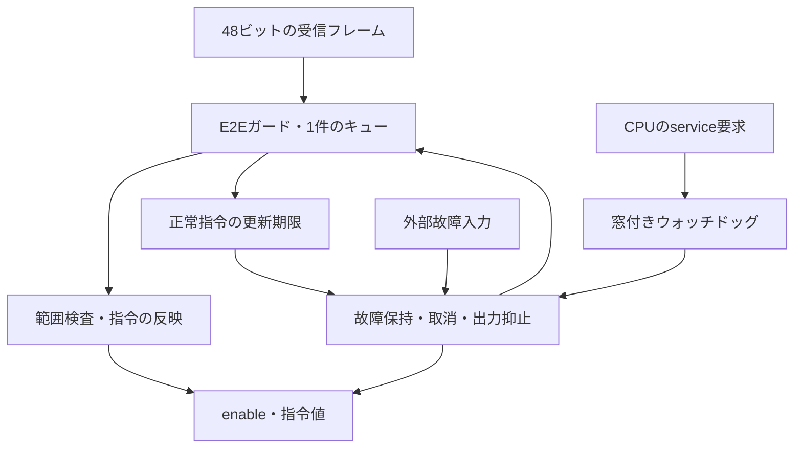
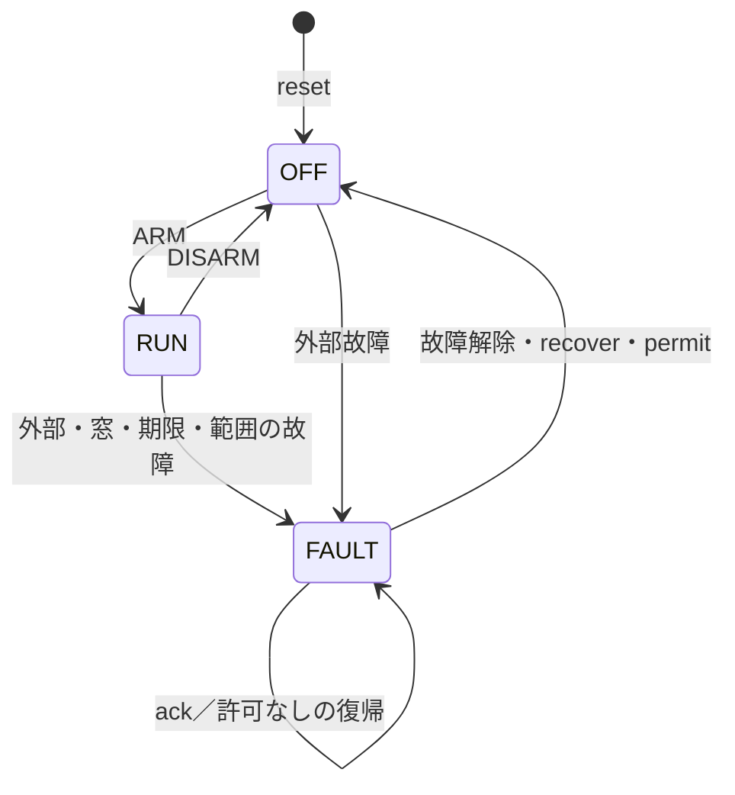

# 通信保護・窓付きウォッチドッグを結合する小規模ECU

[E2EガードRTL](../local-e2e-guard/README.md)を実際にインスタンス化し、CPUからのサービス要求、正常指令の更新期限、出力抑止と復帰を一緒に検証します。[オートモーティブの手順](../../docs/method/automotive-verification.md)で要求から試験へ展開できます。CPUの命令実行・CANコントローラー・物理的な駆動回路は含めない、デジタルなECU制御経路の教材です。

## 接続



## 時間と優先順位

| 項目 | 仕様 |
| --- | --- |
| 指令 | 正常なE2E出力を次のエッジで反映。範囲は0〜1000、上限超過は故障 |
| ウォッチドッグ | ARM／最後の正常serviceのエッジからの間隔dを数える。MIN≤d≤MAXのserviceを許可 |
| 早期・遅延 | d<MINのserviceは早期故障。d=MAXでserviceがなければ遅延故障。MAXちょうどのserviceは正常 |
| 通信の期限 | ARM／最後の指令反映からFRESH_MAXエッジ以内。期限ちょうどの反映は正常 |
| 不正フレーム | 破棄と理由を通知。直前の正常指令を保持し、更新期限を延長しない |
| 故障 | 外部、早期、遅延、通信期限、範囲をそれぞれcauseのbit 0〜4へ保持。同時原因はOR |
| 出力抑止 | 故障エッジでenable=0・指令=0。未完了指令は取消し、同エッジの反映・次入力を禁止 |
| IRQ | 故障でセット。ackはIRQだけをクリアし、同時の故障セットが優先 |
| DISARM | 通常停止し、未完了指令を取消す。同時に検出した故障はDISARMより優先 |
| 復帰 | 故障入力が解除され、recoverとpermitが共に1ならOFFへ。別のARM操作でRUNへ進む |
| 初期化 | リセット／OFF／故障／停止ではガードをクリア。再開後の最初の番号は0 |

`service=1`の各エッジを1回の要求と数えます。連続して1を提示すると早期サービスになり得ます。実デバイスのWDI端子のエッジ検出を再現する仕様ではありません。

入力フレームの受付と、保護を通過した指令の反映は別のエッジです。期限直前の入力受付だけでは更新を完了したことになりません。`frame_ok`はガードの検査通過、`applied`は制御指令への反映、`cancelled`は未完了指令の取消通知です。`pending`はキューの有無を示します。



## 構成と検査

| 構成 | Data ID | MIN | MAX | FRESH_MAX |
| --- | --- | --- | --- | --- |
| `win3-9-fresh13` | 0xA12F | 3 | 9 | 13 |
| `win5-13-fresh19` | 0x35C9 | 5 | 13 | 19 |

RTLは経過カウンターを使い、Pythonは絶対時刻のサービス履歴・反映履歴から期限を求めます。全サイクルで、受付可能、状態、指令、原因、IRQ、反映・取消、検査通過・破棄、キューを照合します。

[5要求・22目標](requirements.json)は、MIN／MAXの境界、サービス連続提示、正常指令の期限直前反映、CRC・ID・順序の不正入力が続く場合の期限、範囲外、複数故障、未完了指令と故障の競合、ack、許可なしの復帰、復帰とARMの同時提示、リセット取消を含みます。ランダム試験は正常動作と故障・復帰を含む6／24エピソードを、smoke 1 seed／nightly 3 seedで追加します。

早期監視の無効化、遅延判定の1サイクルずれ、不正フレームによる期限延長、故障と同時の誤反映、ackによる故障解除の5種類を、両構成で指定チェッカーにより検出します。

## 実行と完了

```sh
python3 examples/local-automotive-ecu/run.py --out artifacts/automotive-ecu
python3 examples/local-automotive-ecu/run.py --profile nightly --out artifacts/automotive-nightly
python3 -m unittest discover -s examples/local-automotive-ecu/tests -v
```

Python 3.10以上と[固定版Icarus](../../tools/ENVIRONMENT.md)を使います。smokeは28、nightlyは32判定です。既定seedは17、nightlyは17／18／19です。

完了件数は`inputs=validated+rejected`と、`validated=applied+cancelled+reset_cancels`を要求します。リセットによる取消は通常の取消と分けます。最後にキューが空、enable=0、指令=0であることも確認します。

入力・期待値・各ソースのハッシュ、VCD・CSV、ビルドと実行の記録、JUnit、構成ごとの到達目標を保存します。到達目標は手続き型の機能記録で、RTLコードカバレッジや診断網羅率とは別です。

出力0・enable=0はこの教材の停止方針です。実車で必要な制動・保持・縮退動作、独立クロックの監視、物理的な故障反応、ISO 26262への適合やASILの達成を、この例だけで確認したことにはしません。
