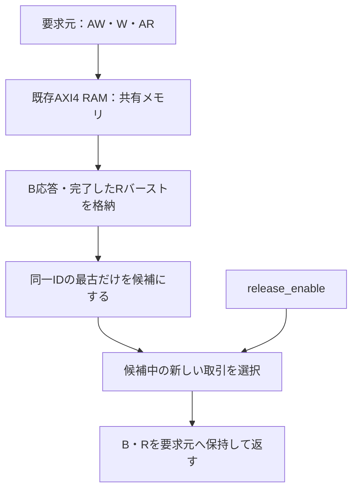
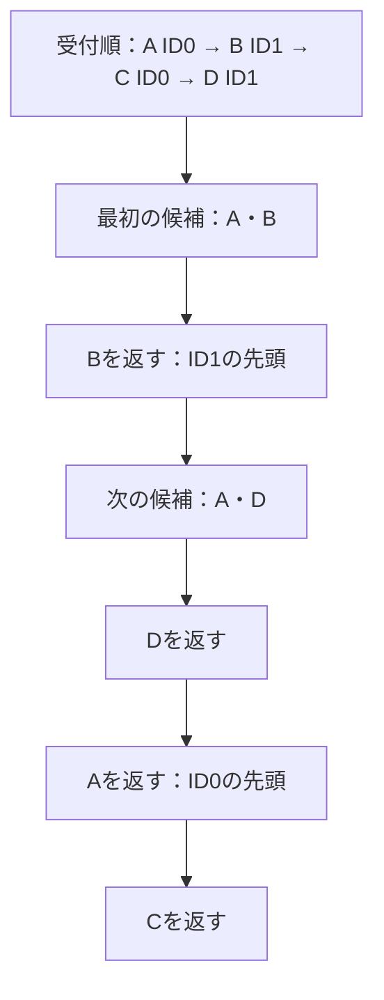

# AXI4の応答順序入れ替えとID別の順序を検証する

既存の[AXI4 RAM](../local-axi4/README.md)へ、新規のB応答・読出しバーストのバッファを接続します。共有メモリを保ち、異なるIDのB／R応答を入れ替えても、同じID内の応答順序が保たれることを確認します。

## バッファと順序規則



32ビット・2ビットID・8KiB・整列INCR 1〜4ビートの範囲です。バッファは各方向2／4取引で、Wは既存RAMのAW受付順に流します。Rはバースト全体を取り込んでから選び、選択後は最後のビートまで切り替えません。RのインターリーブやAXI4のWデータのインターリーブを実装した例ではありません。

`release_enable`は本教材のスケジューリング入力です。0は新しい応答の選択を止めますが、提示済みVALIDは撤回しません。試験では全応答を取り込んでから1にし、各IDの先頭のうち受付順が最も新しい取引を選びます。この選択方針はAXIの必須規則ではありません。読みと書きの間の順序保証も追加しません。

| 観点 | 刺激 | 判定 |
| --- | --- | --- |
| 同じID | 同じIDを複数回使う | 同一ID内の受付順・各ビートのデータ |
| 異なるID | 複数応答を保持してから選択 | B／R両方で順序の入れ替えを実観測 |
| 応答待ち | BREADY／RREADYを止める | VALID・ID・RESP・データ・LASTの保持 |
| 部分・ゼロ書込み | WSTRBを変更 | 独立バイトメモリと全RAMの比較 |

PythonはID別のキューから予定順を計算します。SVはID・RESP・LASTと、独立した期待メモリを照合します。初期値はアドレス依存で、異なる番地の取違えも検出します。各構成10目標、BID・RIDの破損、同一ID内の逆順、RDATA反転の4変異です。

## 4件の応答を返す具体例

受付順をA→B→C→D、IDを0→1→0→1とします。全応答を取り込んだ後、各IDの先頭から候補を選ぶため、本教材の選択方針ではB→D→A→Cになります。BとRはそれぞれ独立にこの規則を適用します。



| 返却順 | 選択候補 | 選ぶ取引 | 同じID内で維持する関係 |
| --- | --- | --- | --- |
| 1 | A・B | B（ID1） | DはBより先に返せない |
| 2 | A・D | D（ID1） | B→Dが完了 |
| 3 | A | A（ID0） | CはAより先に返せない |
| 4 | C | C（ID0） | A→Cが完了 |

表の1行は取引1件です。Rが複数ビートなら、選んだ取引のRLASTまで返してから次を選びます。READYが0の間は選択と応答を保持し、返却順を進めません。

## 実行と範囲

```sh
python3 examples/local-axi-reorder/run.py --out artifacts/axi-reorder
python3 examples/local-axi-reorder/run.py --profile nightly
python3 -m unittest discover -s examples/local-axi-reorder/tests -v
```

[共通手順](../local-common/README.md)を使います。smokeは16バッチ、nightlyは100バッチ×3 seedに固定4バッチを加えます。JUnitは14／18件、確認テスト6件です。リセットはバッファとRAMを一緒に初期化します。未対応属性、4ビートを超えるバースト、任意ターゲットの応答逆転・不正応答、物理タイミング、全AXI適合性は対象外です。

順序の基準は[Arm AXI仕様A6章](https://documentation-service.arm.com/static/602a9df190ee6824a1e02b98)を参照しています。原文・外部RTLは転載せず、既存教材RAMを再利用しています。

応答の前後関係は未返却バッファ内の相対順位で管理し、返却時に順位を詰めます。長時間実行で通し番号が桁あふれする問題を避け、リセットせずにスロットを繰り返し再利用する試験でも順序を照合します。
