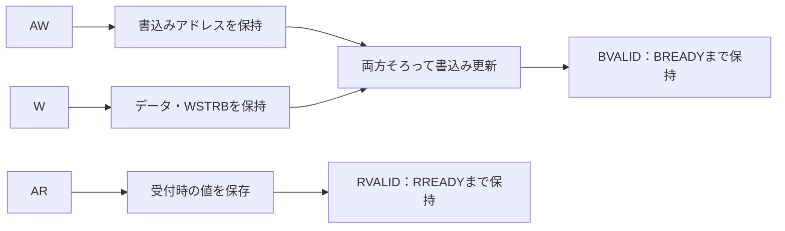

# AXI4-Liteの独立チャネル・WSTRB・応答保持を検証する

32ビットのAXI4-Liteレジスタ回路を、独立した参照モデルで検証するローカル教材です。AWとWの到着順序、全16通りのWSTRB、B／Rのバックプレッシャー、読書きの同時動作、未完了要求のリセットを確認します。応答生成の追加遅延0／2の2構成で動きます。

対象は**AXI4-Lite**です。AXI4の複数ビートバースト、ID、アウトオブオーダー、排他アクセス、AXI4-Streamは含みません。Liteでも複数未完了転送を扱えますが、この回路は方向ごとに1件へ受付を制限し、読みと書きは並行して処理します。

## AWとWの独立受付と応答保持

AWとWがそろってから更新し、読出しはAR受理時の値を保存して、BとRを別々に保持します。



この教材は方向ごとに未完了1件まで受け付けます。同じエッジの読書きでは、ARが更新前の値を保存します。

## 1. レジスタとインターフェース

8ビットのバイトアドレスを使い、4バイト境界のアドレスだけを受け付けます。

| アドレス | 属性 | 内容 |
| --- | --- | --- |
| 0x00、0x04、0x08、0x0C | R/W | 初期値0の32ビットレジスタ4個 |
| 0x10 | R/O | ID 0x4158494C |
| その他・非整列アドレス | エラー | 読出し値0、応答SLVERR |

正常な読書きはOKAY=0、未定義・非整列アドレスとIDへの書込みはSLVERR=2を返し、書込みを反映しません。DECERRを生成するインターコネクトは置きません。AWPROT／ARPROTは入力に持ちますが、アクセス権の判定には使いません。

WSTRBの各ビットは対応するWDATAの8ビットレーンだけを更新します。全16通りをサポートし、正常アドレスでWSTRB=0なら値を変えずOKAYを返します。IDへの書込みはWSTRB=0でもSLVERRとする独自方針です。

## 2. 5チャネルと受付・応答のタイミング

各チャネルはVALIDとREADYが両方1の立上りで転送します。AW先行、W先行、同時のどれでも受理でき、先に受けた内容を保持します。片方だけでBVALIDを生成しません。書込み処理が始まってからB応答を受け取るまでは、次のAW／Wを受け付けません。読みも、ARを受けてからR応答を受け取るまでは次のARを受け付けません。

両方の書込み要求を最後に受けたエッジをTとすると、レジスタ更新とBVALIDの生成は**T＋1＋RESP_DELAY**のエッジです。読出しはAR受理のエッジをTとして、T＋1＋RESP_DELAYでRVALIDを生成します。この正確な遅延と受付能力は教材の設計方針で、AXI4-Lite一般の必須サイクル数ではありません。

BREADY／RREADYが0でも、応答の準備ができればVALIDを出します。応答を受け取るまでVALIDと応答内容を保持し、BREADY／RREADYを待ってからVALIDを出す動作にはしません。VALID=0のチャネルのデータ値は比較対象外です。

読出し値は**AR受理時に保存**します。同じエッジに書込みが完了した場合は更新前の値を返し、その後に同じレジスタが更新されても保留中のRDATAは変えません。これはこのレジスタ回路の競合仕様であり、独立した読み書きにAXI一般の順序保証があるという意味ではありません。

アクティブLowの非同期リセットで、レジスタ、片方だけ受けたAW／W、B／Rの応答をクリアします。検証では要求側もリセットに合わせてVALIDを下げ、解除後に新しい要求を発行します。

基本的なチャネルとハンドシェイクは[Arm IHI 0022E](https://documentation-service.arm.com/static/5f915b62f86e16515cdc3b1c)のA3章・B1章を参照しています。レジスタ・エラー方針、全WSTRB対応、読出しスナップショットと固定遅延は、この教材で選んだ仕様です。

## 3. 独立した期待値と検査

Pythonは、RTLのフラグやカウンタを写さず、**AW／Wの別キュー、バイト単位の記憶領域、応答の絶対時刻**を使います。ARの値を先に保存し、同じエッジの書込み更新との優先順位も定義します。

テストベンチはエッジ前にREADY、VALID、有効な応答・読出しデータを比較し、エッジ後に全レジスタを比較します。独立したモニターでも、BVALIDより前にAW／W両方を受けていること、RVALIDより前にARを受けていること、バックプレッシャー中のVALID・データ保持を確認します。要求側もAW／W／ARのREADY待ち中にVALIDと内容を保持しているか検査します。期待値はDUT内部状態から作りません。

固定シナリオは次を含みます。

- AW先行・W先行・同時と、書込み・読出しの並行受付。
- 全16通りのWSTRBと読戻し、0／全1／交互データ。
- B／R応答の即時受理と待機、未定義・非整列・R/O書込みのエラー。
- 先行するB／R応答でREADYが下がっている間にも次のAW／W／ARを提示し、受理まで内容を保持。
- 書込みと同一エッジのAR受理、およびR応答を待たせたまま同じレジスタを更新。
- AWだけ、Wだけ、B保留、R保留でのリセットと、再開後の正常転送。

ランダム検証では、方向、アドレス、データ、WSTRB、AW／Wの開始遅延0〜8、B／Rの待ち0〜12、読書きの並行、PROTを変えます。AWのみ、Wのみ、B保留、R保留のどこでリセットするかと、その前の待ち時間もランダムに選びます。要求を受理するまではVALIDと内容を保持します。生成ベクトルは予定に基づくため、DUTの誤ったREADYに刺激まで追従してしまうことを避けます。

[要求カタログ](requirements.json)は5要求・39目標です。各チャネルの受付・応答数、エラー数、応答待ちサイクル数も照合します。リセットで破棄する要求があるため、全実行のAW数・W数・B数が一致することは合格条件にしません。

## 4. 意図的な誤実装

| 番号 | 誤実装 | 期待する検出ラベル |
| --- | --- | --- |
| 1 | 保持済みデータの代わりに現在のWDATAを使用 | AXI_STATE |
| 2 | WSTRBを無視して全バイト更新 | AXI_STATE |
| 3 | BREADY=0のときBVALIDを落とす | AXI_STABILITY |
| 4 | 保留中のRDATAを現在のレジスタ値へ追従させる | AXI_STABILITY |

変異1の検出では、W転送後のVALID=0の期間にWDATAを変えます。受理後のバス値への依存を見つけるための、合法な刺激です。変異2は、この回路が全WSTRBを反映する仕様に対する違反です。AXI4-Liteのすべてのレジスタスレーブで、WSTRB無視が必ずプロトコル違反になるという意味ではありません。

各変異は予定したラベルと非ゼロ終了まで確認し、通常の39目標を埋める観測には使いません。

## 5. 実行と確認範囲

[共通の準備・証跡](../local-common/README.md)に従い、リポジトリのルートから実行します。

```sh
python3 examples/local-axi/run.py --out artifacts/axi-smoke
python3 examples/local-axi/run.py --configuration delay2 --seed 42 --iterations 100 --out artifacts/axi-seed42
python3 examples/local-axi/run.py --profile nightly --out artifacts/axi-nightly
python3 -m unittest discover -s examples/local-axi/tests -v
```

構成名は`delay0`と`delay2`です。smokeは40ランダム操作×1 seed、nightlyは300×3 seedを実行します。1操作は読出しまたは書込みで、書込みに並行読出しを加える場合があります。末尾の4レジスタ読出しとリセットはiterationsに含みません。`checks`は入力サイクル数です。

構成当たりのJUnitはsmoke **7件**、nightly **9件**（固定1＋ランダム1／3＋変異4＋ゲート1）。2構成の合計は**14／18件**です。

```sh
python3 examples/local-axi/run.py --configuration delay2 --demo-bug 3 --out artifacts/axi-intentional-failure
```

このコマンドは通常回路にも応答保持の不具合を入れるため、終了コード1と`AXI_STABILITY`による失敗が期待結果です。

2026-10-27にPython 3.14.7、Icarus Verilog 14.0開発版で全2構成のsmoke／nightly、各39目標・4変異、確認テスト9件が成功しました。GitLabへの追加・CI起動は行っていません。AXI4全体の検証例や、規格全体の適合性、無限の入力列の証明、実システムの性能評価を示す結果ではありません。

## 6. フォーマル検証も実行する

[AHB／AXIのフォーマル例](../local-bus-formal/README.md)を追加しました。AXIは同じ2構成で、受付・応答・保持・因果関係・リセットと補助不変条件の11プロパティを非有界に証明し、データ・応答内容を含む12プロパティを既定深さ12で検査します。補助条件もassertによる証明対象で、入力のassumeへ追加するものではありません。12到達目標、4変異の反例、過剰な仮定の診断も実行します。

```sh
python3 examples/local-bus-formal/run.py --bus axi --out artifacts/axi-formal
```

RTLの`FORMAL`専用assertは通常シミュレーションに影響しません。フォーマルの目標・JUnitは、このページのシミュレーションの39目標・14／18件とは別です。仮定とリセットのモデル、ツールの準備はリンク先を参照してください。

## プロトコル・クロス・結合・AXI4を追加で確認する

[バス検証の追加例](../local-bus-validation/README.md)では、同じRTLの全2構成へ独立チェッカー・ネイティブSVAを接続し、AW／W順序×ストローブ×応答待ちなどの22クロス、X、短パルスリセット、性能、lint・line／toggleを確認します。[APB結合](../local-bus-bridge/README.md)と[バースト・IDを扱うAXI4](../local-axi4/README.md)は別RTLです。Liteの39目標やフォーマルの結果を、そのままAXI4の検証結果へ広げないでください。
