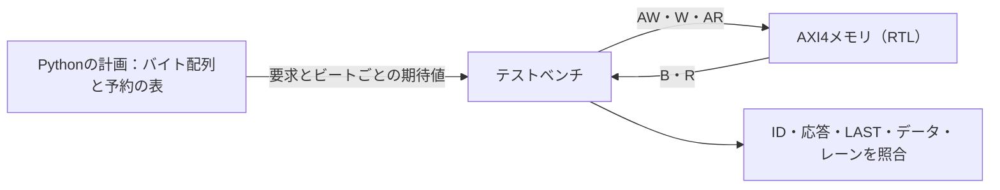

# AXI4のWRAP・FIXED・狭い転送・排他アクセス・256ビートを検証する

[AXI4の例](../local-axi4/README.md)が対象外にしている機能を、別のRTLで検証します。WRAPとFIXEDのバースト、狭い転送、サイズに整列していない開始アドレス、排他アクセス、256ビートのバースト、4KiB境界です。ビートごとのアドレスとバイトレーンは、PythonのモデルがRTLとは別の書き方で求め、テストベンチが全ビートを照合します。バスの検証の全体は[バスプロトコルの検証手順](../../docs/method/bus-protocol-verification.md)にあります。

## 何をどこで比べるか



| 機能 | 期待する動作 | 主な照合 |
| --- | --- | --- |
| WRAP | 長さ2・4・8・16。容器（ビート幅×ビート数に整列した範囲）の上端から下端へ折り返す | 書いた後に容器全体をINCRで読む。逆も行う |
| FIXED | 全ビートが同じ番地。最後に書いたビートが残り、隣の番地は変わらない | 隣を含めてINCRで読む |
| 狭い転送・非整列 | 各ビートが運ぶのは、ビートの番地から、その番地を含む容器の終わりまで | 読出しは有効レーンの値と、それ以外のレーンが0であること |
| 256ビート | ビート数とLASTの位置を保つ | 全ビートの値とLAST |
| 4KiB境界 | ちょうど境界で終わる要求は実行。またぐ要求はSLVERRで、書き込まない | 応答と、拒否後の読み戻し |
| 排他アクセス | 排他読出しがIDごとの予約を作り、同じ形の排他書込みだけがEXOKAYで実行される | 応答と、失敗時に書かれていないこと |

## 対象の仕様

[`axi4_full_ram.sv`](rtl/axi4_full_ram.sv)は、32ビットデータ・13ビットのバイトアドレス・8KiB・2ビットIDのメモリです。書込みと読出しは、それぞれ1件ずつ処理します。処理中は次のアドレスを受けません（複数の未完了は[AXI4の例](../local-axi4/README.md)が扱います）。

- **バースト**：FIXED（1〜16ビート）、INCR（1〜256ビート）、WRAP（2・4・8・16ビート、開始アドレスはサイズに整列）。サイズは1・2・4バイトです。
- **ビートのアドレス**：INCRは、最初のビートだけ開始アドレスそのもので、2ビート目からは容器の先頭に整列します。FIXEDは毎回同じ番地です。WRAPは、開始アドレスを含む「ビート幅×ビート数」の範囲の中を進み、上端の次は下端です。
- **バイトレーン**：1ビートが運ぶのは、ビートの番地から容器の終わりまでのバイトです。書込みは、そのレーンのうちWSTRBが1のバイトだけを更新します。レーンの外のWSTRBは無視します。読出しは、レーンの外を0にして返します。この2つは教材独自の仕様です。
- **拒否する要求**：8バイト以上のサイズ、予約されたバースト種別、WRAPの不正な長さと非整列の開始、FIXEDの17ビート以上、4KiB境界をまたぐINCRには、SLVERRを返します。書込みはデータを全ビート受け取って捨て、読出しは要求されたビート数だけ0を返します。メモリの終わりは4KiB境界なので、範囲外へ出る要求は境界またぎとして拒否されます。
- **WLAST**：数えたビートの位置とWLASTが合わないと、SLVERRを返します。それまでのビートは書込み済みで、元へは戻しません。
- **リセット**：非同期にかかり、メモリと予約を消します。メモリを0にするのは教材独自の仕様です。

排他アクセスは、次の規則です。IDがマスターの代わりで、予約はIDごとに1つです。

| 操作 | 動作 |
| --- | --- |
| 排他読出し（ARLOCK=1） | 16ビート以下・合計バイト数が2のべき乗・開始アドレスが合計バイト数に整列、の形なら予約を作り、全ビートにEXOKAYを返す。形が合わない要求は通常の読出し（OKAY）で、そのIDの予約を消す |
| 排他書込み（AWLOCK=1） | そのIDの予約が残っていて、アドレス・ビート数・サイズ・バースト種別が排他読出しと同じなら、実行してEXOKAYを返す。違えば書かずにOKAYを返す。成否によらず、そのIDの予約を使い切る |
| 実行された書込み | 通常・排他を問わず、書込みが触れうるバイト範囲に重なる予約を、全IDについて消す。範囲はWSTRBによらず、バーストのアドレスだけで決める |
| 通常の読出し | 予約に影響しない |

排他の判定はアドレスを受けた時点、予約の消去は最後のデータビートの時点です。読みと書きが時間的に重なる場合の扱いは、RTLでは「同じサイクルなら消去が勝つ」と決めていますが、この例の試験は読みと書きを重ねないので確かめていません。

仕様の根拠は[Arm AMBA AXI and ACE Protocol Specification（IHI 0022E）](https://documentation-service.arm.com/static/5f915b62f86e16515cdc3b1c)の、バーストのアドレス構造・データのバイトレーン・排他アクセスを扱う章です。式や表は写さず、自分の言葉で書いています。節番号と細部（WRAPの条件、排他アクセスの制限）は規格の本文と1つずつ照合していません。拒否する要求への応答、レーンの外の扱い、失敗した排他書込みが予約を使い切ることは、規格が決めていないか、実装に任せている部分をこの教材で決めたものです。

## 独立した期待値

[`run.py`](run.py)の`Plan`は、バイト配列と予約の表を持ち、要求を行の順に適用します。RTLは「前のビートの番地から次の番地を求める」「レーンをマスクで求める」という書き方で、範囲の重なりは両端の比較で判定します。モデルは次のように別の形で書いています。

- ビートkの番地を、開始アドレスとkから直接求めます（INCRは容器の番号、WRAPは範囲内の剰余）。
- 1ビートが運ぶバイトを、バイトアドレスの並びとして列挙します。
- 予約との重なりは、バイトアドレスの集合の共通部分で判定します。

モデルの番地とレーンは、セルフテストが手計算の値と照合します。同じ人が同じ仕様の理解で書いているので、規格の読み違いは共有しえます。

## テストベンチ

[`axi4_full_tb.sv`](tb/axi4_full_tb.sv)は、ベクトルの1行を1つの要求または1ビートとして読みます。信号の観測とプロトコルの検査は、すべて1つのタスク（`tick`）の中にあり、クロック同期のブロックと刺激が競合しない書き方です。

- **応答の照合**：BのIDと応答、RのID・LAST・応答・データを全ビートで比べます。比較は4値（`!==`）で、有効なビートにXがあれば不合格です。
- **常時の検査**：保持中のB／Rが変わらないこと、処理中に次のアドレスを受けないこと、データの受付がデータの期間だけであること、応答が要求より先に出ないこと。
- **処理中の要求**：行の`chain`の印で、次の要求のアドレスを、今の要求のデータや応答の間ずっと出し続けます。受理されるのは今の要求が終わった後です。
- **アドレスより先のデータ**：行の`w_first`の印で、最初のデータを先に出し、アドレスまで待たされることを確かめます。
- **冒頭**：書込みバーストの途中と読出しの保持中のリセット、BとRの両方が保持中のリセットを行い、メモリが消えたことを読んで確かめます。
- **時間切れ**：各待ちは600クロックで打ち切り、検査とは別のラベル（`AXF_TIMEOUT`）で終わります。

失敗のラベルは、`AXF_DATA`（有効レーンの値）、`AXF_LANE`（レーンの外が0でない）、`AXF_LAST`、`AXF_ID`、`AXF_RESP`（OKAYとSLVERRの食い違い）、`AXF_EXCL`（EXOKAYが関わる食い違い）、`AXF_HANDSHAKE`、`AXF_PROTOCOL`、`AXF_RESET`、`AXF_TIMEOUT`、`AXF_INPUT`です。

## 試験

固定シナリオ（`boundaries`）は2,556行で、書込み100件・読出し107件、書込み1,120ビート・読出し1,225ビートです。SLVERRは18件、EXOKAYは28件です。どの目標にも固定シナリオだけで届きます。

- **WRAP**：4つの長さそれぞれで、容器の途中から・最上段からの書込みと読出し。ハーフワードとバイトのWRAPも行います。容器の直後に目印の語を置き、折り返さずにはみ出す誤りが見えるようにしています。
- **書いた形と違う形で読む**：WRAPやFIXEDや狭い転送で書いた後は、ワードのINCRで読みます。同じ形で読むと、アドレスの進め方の誤りが書込みと読出しで打ち消し合うためです。
- **境界**：4KiB境界でちょうど終わる4ビートと256ビート、1ビート越える要求、1バイトだけ越える要求、非整列でちょうど最後のバイトまでの要求、メモリの終わり。
- **拒否の規則**：規則ごとに、その規則だけに反する要求を書込みと読出しで1つずつ出し、後でメモリが変わっていないことを読みます。
- **排他**：成功、2回目の失敗、失敗した試みの後の失敗、他のIDの書込みによる失敗、隣接する書込み（上・下、バイト・FIXED・WRAP・非整列）では消えないこと、1バイトだけ重なる書込み（上端・下端）で消えること、アドレス・ビート数・サイズ・バースト種別が1つだけ違う書込みの失敗、予約を持たないIDの試み、2つのIDの競争、形の合わない排他読出し3種類、複数ビート、WRAPの排他、通常の読出しでは消えないこと、リセットで消えること。
- **握手**：要求のないサイクル、処理中に出し続ける次の要求（書込み・読出し）、アドレスより先のデータ、BとRの待ち。

ランダム試験は、通常の要求、排他の試み（狭い番地の範囲に集めて、一致と衝突が起きやすくしています）、拒否される要求、空きサイクル、リセットを混ぜます。smokeは60操作×1 seed、nightlyは400操作×3 seedです。`checks`は行数です。

## 実行

```sh
python3 examples/local-axi4-full/run.py --out artifacts/local-axi4-full-smoke
python3 examples/local-axi4-full/run.py --profile nightly --out artifacts/local-axi4-full-nightly
python3 -m unittest discover -s examples/local-axi4-full/tests
```

共通オプションは[共通ランナーの説明](../local-common/README.md)にあります。構成は`full`の1つです。JUnitはsmoke 10件／nightly 12件（固定1＋ランダム1／3＋変異7＋合否判定1）です。

## 要求と目標

[要求カタログ](requirements.json)は8要求・64目標です。目標は`COVER`ログによる簡易な機能カバレッジで、行の検査が合格した後にだけ出します。

| 要求 | 内容 | 目標 |
| --- | --- | ---: |
| AXF-BURST | 3種類のバーストのアドレス、WRAPの4つの長さと折返し | 15 |
| AXF-NARROW | 狭い転送と非整列のレーン、ストローブ | 8 |
| AXF-LENGTH | 1ビートと256ビート | 3 |
| AXF-BOUNDARY | 4KiB境界のちょうどと越え | 5 |
| AXF-ERROR | 拒否の規則ごとの応答と、書かないこと | 11 |
| AXF-EXCLUSIVE | 排他アクセスの成功と失敗の各条件 | 13 |
| AXF-HANDSHAKE | 処理中の要求、保持、アドレスより先のデータ | 6 |
| AXF-RESET | 途中と保持中のリセット | 3 |

## 変異

| 番号 | 誤り | 検出するラベル |
| ---: | --- | --- |
| 1 | WRAPが折り返さない | `AXF_DATA` |
| 2 | FIXEDが番地を進める | `AXF_DATA` |
| 3 | 非整列の読出しが、開始より下のバイトも返す | `AXF_LANE` |
| 4 | 通常の書込みが予約を消さない | `AXF_EXCL` |
| 5 | 読出しのビート数の比較が7ビット幅（256ビートが128で終わる） | `AXF_LAST` |
| 6 | 4KiB境界の検査がない | `AXF_RESP` |
| 7 | 狭いINCRが番地を4ずつ進める | `AXF_DATA` |

7種類とも、固定シナリオが予定のラベルで検出します。`--demo-bug 1..7`は、通常の試験にも誤りを入れて終了コード1になることを確かめるためのものです。

## 確認範囲と残る制限

- 書込みと読出しは各1件ずつで、複数の未完了、応答の順序の入替え、Rの交互配置はありません。読みと書きを時間的に重ねた試験もありません。
- 排他アクセスは、このメモリの中の予約の表だけです。インターコネクトをまたぐ監視、複数のスレーブ、AXI3のロック転送は扱いません。ソフトウェア側の使い方は[LR／SCとAMOの例](../local-riscv-atomic/README.md)が別の回路で扱います。
- 排他の合計バイト数の上限（128バイト）は、32ビットデータ・16ビート以下では届かないので、検査していません。
- レーンの外の読出しデータを0にすること、レーンの外のWSTRBを無視することは、この教材の仕様です。規格はどちらも不定または要求元の責任としています。
- AxCACHE・AxPROT・AxQOS・AxREGION・USERはポートを省略しています。64ビット以上のデータ幅、ACE、AXI5は対象外です。
- 規格の節番号と細部は本文と照合していません。AXI4への適合を示すものではありません。
- フォーマルの証明はありません。確かめたのは、固定シナリオとランダム試験が通った範囲です。

## 確認記録

2026-11-21に、macOS arm64、Python 3.13.15、Icarus Verilog 14.0開発版（`ca6b8d3`）で、smokeとnightly（既定のseed 17〜19）、別の5 seedのsmoke、セルフテスト13件が合格しました。Verilator 5.052の`--lint-only --Wall`は、変異0〜7のすべてで警告0件です。`check_tb_races.py`は、このテストベンチについて候補0件です。Linuxとkirimasimでは実行していません。

できあがった後に、既存の変異とは別に、RTLの写しへ小さな誤りを1か所ずつ入れてsmokeにかけました。30個のうち、最初の固定シナリオが検出したのは27個です。残った3個は試験の抜けだったので、固定シナリオへ行を足しました。

| 残った誤り | 抜けていた場面 | 足した行 |
| --- | --- | --- |
| WRAPが1つ早く折り返す | バイト幅のWRAP（次の番地が容器の最後のバイトに一致する場合だけ差が出る） | バイトのWRAPの書込みと読出し |
| 失敗した排他書込みが予約を使い切らない | 失敗した試みの後に、正しい排他書込みを出す場面 | 形の違う排他書込みの後の排他書込み |
| リセットが予約を消さない | リセット後に残った予約と一致する要求（全項目が0） | 番地0・1バイト・FIXEDの排他読出し、リセット、同じ形の排他書込み |

足した後は、30個すべてを固定シナリオが検出します。ランダムのsmoke（60操作、seed 17）だけでは13個で、境界や1項目だけ違う要求は固定シナリオに頼っています。誤りの一覧は、排他の一致条件を1つずつ外す4個、予約の範囲の両端、形の検査の3条件、整列・レーン・折返しの位置、4KiBの1ずれ、FIXEDの17ビート、握手の3個などです。
