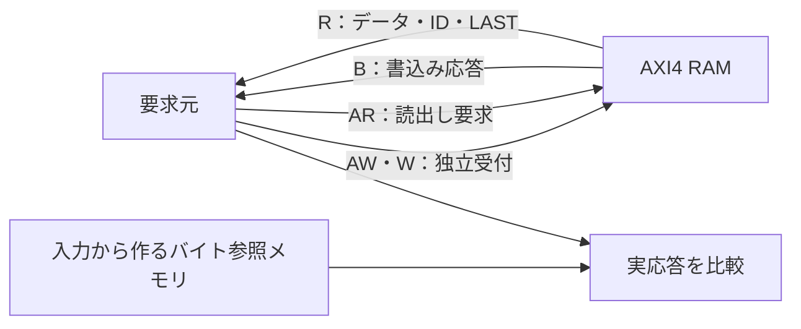

# AXI4のバースト・ID・複数未完了転送を検証する

[AXI4-Lite例](../local-axi/README.md)とは別のRTLで、バースト、ID、読書きそれぞれ2件の未完了転送を検証します。Pythonのバイト単位参照メモリで期待値を作り、実際のB／R応答を照合するローカル教材です。

## 独立チャネルと照合経路

書込みはAWの受付順にWを対応付け、読出しはARと各RビートをID・LAST・データで照合します。



読書きの矢印は論理チャネルです。本例はアウトオブオーダー応答やRのインターリーブを実装しません。

| 確認する場面 | 期待する動作 | 主な照合対象 |
| --- | --- | --- |
| 複数未完了 | 各方向2件まで保持し、受付順に応答 | 件数・ID・LAST |
| 部分書込み | 有効なWSTRBだけ更新 | 全バイトの期待値 |
| RREADY待ち | 保持中のRDATAは後続書込みでも不変 | 有効応答の保持 |

## 対象と実装方針

- 32ビットデータ、13ビット相対バイトアドレス、8KiBのメモリ、2ビットID。
- 4バイト整列、AxSIZE=2、INCR、1〜4ビート（AxLEN=0〜3）。
- 書込み2件、読出し2件まで。アウトスタンディング数は、アドレスの受付から最終応答の受理まで数えます。
- 書込みデータはAWの受付順に対応付けます。AXI4にはWIDがなく、この例にもありません。
- B／Rとも受付順で応答し、読出しバーストは交互に混ぜません。同じIDも繰り返して発行します。異なるIDを逆順で返す必要はなく、本例はアウトオブオーダーを実装しません。
- Rデータはビートごとに保持し、RREADY待ちの間は、別の書込みがメモリを変えても変化しません。実装はビート間に1クロックの空きを入れます。

AW／Wは独立したチャネルです。WVALIDが先行しても要求元は保持でき、このターゲットはAWを受理してからWREADYを上げます。応答生成をBREADY／RREADY待ちにしません。アウトスタンディング数が2件になれば次のアドレスを止めます。

非整列、対応外サイズ・バースト、4KiB境界越え・領域外はエラーとして書込みを抑止し、B／RにSLVERRを返します。4KiB境界越えは**不正な要求を加える異常系テスト**で、正常転送の例ではありません。不正要求の応答方針は教材独自の仕様です。WLASTと受付済みAWLENの不一致もSLVERRにする実装ですが、その違反を入力する試験は今回のカタログには含めません。途中まで反映した書込みをロールバックする仕様でもありません。

AxCACHE／AxPROT／AxLOCK／AxQOS／AxREGION／USERなどはポートを省略しています。WRAP、狭い転送、1〜4ビート以外、排他アクセス、ACE、AXI4-Stream、Rのインターリーブは検証対象に含めません。省略した属性まで含むAXI4全体の適合性を保証するものではありません。

## 独立した期待値と試験

1ベクトルは2つの書込みバーストと、その領域を読む2つの読出しバーストから成ります。PythonはRTLのFIFOや状態遷移を写さず、バイト配列へストローブを適用して期待する読出し値を作ります。テストベンチはAWを2件受け付けてからWを流し、ARも2件受け付けてからRを受理します。ID・RESP・各ビートのデータ・RLASTを検査し、B／R待ち中の保持、受付済み要求数、WLAST受理前のBVALIDも別に検査します。各ハンドシェイクの待ちは300クロックで打ち切り、停止を見逃しません。

固定ケースは全バースト長、全ID、同一IDの繰返し、全／部分／ゼロ／1バイトずつのストローブ、4KiB直前と直後の合法要求、不正要求、64クロックの応答待ちと復帰を含めます。部分・ゼロ書込みでは前のデータと異なる値を与え、ストローブを無視する不具合を検出できるようにしています。不正要求の後は、その書込み先をゼロストローブの書込みと読出しで確認し、エラー時に書込みが抑止されたことを照合します。

各シミュレーションの冒頭で、ベクトルとは別に次も確認します。

- 受付済みの複数要求・書込み途中・保留R応答のリセット。
- 保留B／R応答のリセットと再開。
- WVALIDがAWVALIDより先行する場合。
- 読書きの重なりと、保留Rデータを後続書込みから守る動作。

その後に再度初期化してから、Pythonが生成したベクトルを実行します。冒頭の応答はCOUNTに含めず、ベクトル部分の書込み／読出しバースト数、各ビート数、エラー応答数を照合します。checksはクロック数ではなく**ベクトル数**です。メモリをリセットで0にするのは教材独自の仕様で、実メモリマクロの初期化方法や合成効率を示す実装ではありません。

ランダム検証は長さ、ID、番地、データ、ストローブ種別、Wの間隔、B／Rの待ちを変えます。[要求カタログ](requirements.json)は9要求・26目標です。観測は`COVER`ログによる簡易機能カバレッジで、covergroup DBやネイティブSVAの計測ではありません。

4種類の変異は、読出しビット反転、BIDの誤り、RLASTの反転、WSTRBの無視です。予定したDATA／ID／LASTチェッカーのラベルと非ゼロ終了を要求します。

## 実行と確認範囲

[共通の準備・証跡](../local-common/README.md)に従い、リポジトリのルートから実行します。

```sh
python3 examples/local-axi4/run.py --out artifacts/axi4-smoke
python3 examples/local-axi4/run.py --seed 42 --iterations 100
python3 examples/local-axi4/run.py --profile nightly --out artifacts/axi4-nightly
python3 -m unittest discover -s examples/local-axi4/tests -v
```

構成名は`two-outstanding`の1構成です。smokeは48ベクトル×1 seed、nightlyは500×3 seedで、1ベクトルが2書込み＋2読出しです。固定14ベクトルと冒頭の試験はiterationsとは別です。JUnitは7／9件（固定1＋ランダム1／3＋変異4＋合否判定1）です。2026-10-27にPython 3.14.7、Icarus Verilog 14.0開発版でsmoke／nightly、全26目標、4種類の変異とセルフテスト6件が成功しました。

これはシミュレーション例です。[既存のフォーマル例](../local-bus-formal/README.md)の証明対象はAHB-LiteとAXI4-Liteで、本AXI4回路を証明した結果ではありません。バス全体のVIP、合成・タイミング・CDCの検査、無限時間の活性証明も含めません。

バースト、IDと順序、4KiB境界、チャネルの独立性は[Arm AXI IHI 0022E](https://documentation-service.arm.com/static/5f915b62f86e16515cdc3b1c)を参照しています。短いバーストへの制限、メモリ構成、エラー方針、応答間隔は本教材の仕様です。規格本文や外部RTLの転載はしていません。

## 制御証明・データBMCを追加で実行する

[AXI4のフォーマル例](../local-axi4-formal/README.md)を用意しました。同じRTLへメモリ容量パラメーターを加え、16／32バイト・1／2ビートへ縮めて検査します。制御・受付数は非有界証明、直列化したデータ比較は深さ12のBMC、並行受付は通常coverで扱います。上記8KiB・4ビートのシミュレーション構成全体の証明とは区別してください。`FORMAL`専用の抽象化・補助assertは通常シミュレーションでは無効で、元のsmoke／nightlyも再確認しています。

## 応答の順序を入れ替える

[AXI4応答順序の例](../local-axi-reorder/README.md)では、本RAMの前後へ応答バッファを追加します。共有メモリを保ち、異なるIDを先に返しつつ、同一ID内の順序と応答保持を検査します。本RAM単体の受付順応答と区別し、スケジューリング入力と対応範囲はリンク先に記載しています。
