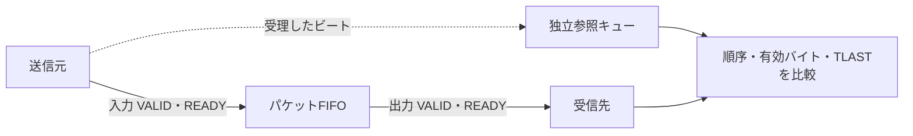

# AXI4-Streamのパケット境界と有効バイトを検証する

32ビットのパケットFIFOを、独立したキュー参照モデルで検証するローカル教材です。`s_*`が入力、`m_*`が出力で、valid／ready、data、keep、lastがそれぞれTVALID／TREADY、TDATA、TKEEP、TLASTに対応します。

## ビートと参照キューの対応

受理したデータ・TKEEP・TLASTを一組として保持し、出力の有効バイトと順序を照合します。



図の点線は期待値側への受理情報です。出力データを参照キューの期待値へ戻す接続ではありません。

| 確認する場面 | 期待する動作 | 主な照合対象 |
| --- | --- | --- |
| 出力待ち | VALIDと有効ペイロードを保持 | data・keep・last |
| 満杯で同時入出力 | 出力受理と同じエッジで入力も受理 | 占有数と順序 |
| 途中リセット | 保留ビートを破棄 | 破棄後の再開 |

## 契約と確認範囲

深さ2／4の2構成です。TKEEPは4バイトの有効レーン、TLASTはパケットの最後のビートを示します。FIFOはデータ・TKEEP・TLASTを一緒に保持し、レーンの詰め替えはしません。満杯でも同じエッジで出力を受理するなら入力も受け付け、空からの組合せバイパスは行いません。

受理したビートの順序、各有効バイト、TLAST、待ち中の保持を毎クロック照合します。無効レーンのデータ値は出力結果の比較対象から外します。パケット単位のビート数も数え、出力したビート数・パケット数・有効バイト数を予定と比較します。

固定ケースには1ビート／複数ビート、全／部分／疎なTKEEP、途中のTKEEP=0ビート、入力と出力の停止、満杯での同時入出力を含めます。ランダム検証ではデータ、長さ1〜10、有効レーン、待ちを変更します。最後のビートのTKEEPは非ゼロにし、空パケットの計画は含めません。

共通リセットでFIFOを破棄し、刺激側と受信側のパケット組立途中状態も初期化します。キューが空でも既に一部を出力したパケットは破棄対象です。リセット後は新しいパケットを先頭から送る契約で、残りのビートから自動的に再同期する回路ではありません。破棄前に出力済みのバイトはCOUNTへ残し、未完了パケットを完了数へ加えません。

[要求カタログ](requirements.json)は3要求・11目標。4変異はTLAST欠落、TKEEPを常に全バイトにする誤り、データ反転、満杯でも入力READYです。予定ラベルと非ゼロ終了を要求し、変異の観測は通常カバーへ足しません。

## 実行

[共通手順](../local-common/README.md)に従います。

```sh
python3 examples/local-axis/run.py
python3 examples/local-axis/run.py --profile nightly
python3 -m unittest discover -s examples/local-axis/tests -v
```

構成は`depth2`／`depth4`。smokeは32パケット×1 seed、nightlyは300×3 seedで、固定試験・途中パケットの破棄は別枠です。checksはクロックごとのベクトル数、JUnitは全構成14／18件です。

TID／TDEST／TUSER／TSTRB、幅変換、CDC、Stream DMA、全AXI4-Streamの適合性を確認した例ではありません。信号の基本事項は[AMDのStreaming Interfaces](https://docs.amd.com/r/2023.1-English/ug1393-vitis-application-acceleration/Streaming-Interfaces)を参照し、容量・リセットの扱いは教材の仕様です。
