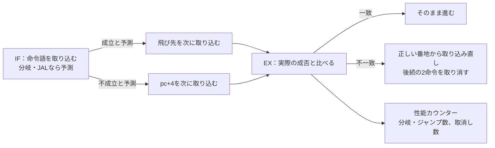

# 分岐予測器を、結果を変えないことと性能カウンターで確かめる

分岐予測は、分岐の行き先を先に推測して命令を取り込み、パイプラインの空きを減らす仕組みです。予測は性能だけに効き、命令の実行結果を変えてはいけません。一方で、予測が外れたときの戻し方を誤ると結果が変わります。予測の当たり外れの数を誤ると、結果は正しいまま遅くなります。この例では、[ISSとの逐次比較の例](../local-riscv-iss/README.md)のRV32Iコアに予測器を加え、2つの方法で確かめます。どの予測器でも退出の列がISSと一致すること、性能カウンターの値が期待どおりであることです。

## 予測して、外れたら戻す



コア[`rv32i_core.sv`](../local-riscv-iss/rtl/rv32i_core.sv)の`PREDICT`パラメーターで、予測器を選びます。

| 構成 | `PREDICT` | 予測の方法 |
| --- | --- | --- |
| `none` | 0 | 予測しない（常にpc+4を取り込む）。ISSとの比較の例と同じ |
| `static` | 1 | JALと、後ろへ飛ぶ分岐を成立と予測する |
| `dynamic` | 2 | JALは成立。分岐は、pcのビット5:2で選ぶ16個の2ビット飽和カウンターで予測する |

予測の正誤は、成立と予測したかどうかと、実際に成立したかどうかの一致で決めます。分岐とJALの飛び先は、取り込んだ命令語からpc＋即値として求めるので、EXで計算する飛び先と常に同じです。JALRとEBREAKは予測しません。カウンターは、EXで分岐の結果を使って更新します。

性能カウンターは2つです。`perf_ctrl`は、EXで解決した分岐・JAL・JALRの数、`perf_flush`は、予測外れによる取消しの数（EBREAKの分を除く）です。

## 2つの照合

1. **結果**：3つの構成で同じ命令列を実行し、退出の列をISSの記録と1命令ずつ比べます。予測器が何をしても、退出の列は同じでなければなりません。
2. **性能**：ISSの実行記録から、分岐・ジャンプの数と、予測の方向が外れる数を計算し、停止したときのカウンターと比べます（`ISS_PERF`）。予測しない構成と静的予測は、予測が命令語だけで決まるので、どの命令列でも取消しの数を正確に計算できます。動的予測は、予測が命令の取り込みのタイミングにも依存します。同じカウンターを使う分岐の間隔が3命令未満だと、前の分岐がEXでカウンターを更新する前に、次の分岐がIFで読むことがあるからです。そこで、動的予測では、固定の命令列とランダムな命令列については分岐・ジャンプの数だけを比べ、間隔を3命令以上にした`counters`の命令列でだけ取消しの数も比べます。

テストベンチとISS、ベクトルの作り方は、ISSとの比較の例と共通です。期待するカウンターの値は、ベクトルの最後の行（種別4）で渡します。

## 固定の命令列とランダムな命令列

固定の命令列は次を含みます。

1. 6回まわるループ、3×3の二重ループ（ループの出口で、成立の予測が外れる）
2. 前方へ成立する分岐と不成立の分岐
3. 予測が外れた分岐の2つ後ろ（pc+8）に、成立と予測されるJALや後ろへの分岐がある場面
4. 成立・不成立が交互になる分岐、ロードした値ですぐ判定する分岐、JAL、直前に書いたレジスタを基底にするJALR

3は、予測のある構成では、EXで予測外れを戻すのと同じサイクルに、IFが別の予測をする場面です。どちらを優先するかを誤ると、取り消すはずの道へ進みます。

`dynamic`だけは、もう1つの固定の命令列`counters`も実行します。同じカウンターを使う分岐の間隔を3命令以上にして、次を含めます。

- 成立の連続と不成立の連続（カウンターが両方向で飽和し、反対の結果が1回あっても予測の向きが変わらない）
- pcのビット5:2が同じになる、64バイト離れた分岐（カウンターを共有する）
- 4バイトと32バイト離れた、結果が逆の分岐（カウンターを共有しない）

期待する取消しの数は、Pythonのカウンターのモデル（`dynamic_flushes`）で計算します。このモデルは、間隔が3命令未満の分岐があるとエラーにします。カウンターの誤りは退出の列を変えないので、この命令列の`ISS_PERF`でしか見えません。セルフテストで、飽和しない、索引のビットが違う（`pc[3:0]`、`pc[4:2]`、`pc[6:3]`）、学習しない、逆に学習する、分岐を予測しない、の7つの誤りをRTLに入れ、すべて`ISS_PERF`で検出することを確かめます。

ランダムな命令列は、ISSとの比較の例の生成器に、回数を数えるループ（`x11`を数え、後ろへ`bne`で戻る）を足したものです。ループを足さないと、分岐がすべて前方へ飛ぶので、予測器の違いがほとんど現れません。ループを足さない既定の生成結果は、ISSとの比較の例と1語も変わりません。

[要求カタログ](requirements.json)は3要求・10目標です。ループの出口（後ろへの分岐が不成立になる）と、`branch/shadowed-predictable`（成立する前方の分岐の2つ後ろに、JALか後ろへの分岐がある）の2つは、この例で加えた目標です。後者は命令語の形だけで決まるので、予測をしない`none`でも到達します。IFがその語を実際に予測するかどうかは、構成によります。どの構成でも、固定の命令列だけで10目標に達します。

## 意図的な誤実装

コアの変異5〜8です（1〜4はISSとの比較の例のパイプラインの誤り）。`--demo-bug 1..4`は、変異5〜8を通常の実行に入れます。

| 番号 | 誤実装 | `none` | `static` | `dynamic` |
| --- | --- | --- | --- | --- |
| 5 | 成立と予測して外れた分岐を、pc+4ではなく飛び先から再開する | 影響なし | `ISS_FLOW` | `ISS_FLOW` |
| 6 | 成立の予測が当たっても、後続を取り消す | 影響なし | `ISS_PERF` | `ISS_PERF`（`counters`で検出） |
| 7 | 静的予測で、前方の分岐を成立、後ろへの分岐を不成立と予測する | 影響なし | `ISS_PERF` | 影響なし |
| 8 | EXの取り込み直しより、IFの予測を優先する | 影響なし | `ISS_FLOW` | `ISS_FLOW` |

「影響なし」の組合せは、変異を入れても合格しなければならない確認（診断）として実行します。予測しない構成では、予測に関わる誤りは何も変えません。変異6・7は結果を変えないので、退出の比較だけでは見つからず、性能カウンターで初めて分かります。動的予測の変異6は、取消しの数を照合する`counters`の命令列でだけ検出します。性能の誤りを確かめるには、正確な期待値を作れる命令列が必要だということです。

seed 17〜19のランダムな命令列だけで実行すると、変異5・6・7は、静的予測の300命令でもすべてのseedで検出できます。変異8は、静的予測の300命令では1つのseedだけ、2000命令では3つすべてで検出しました。動的予測では、変異5・8を300命令でもすべてのseedで検出します。

## 構成ごとの性能

| 命令列 | 構成 | サイクル数 | 分岐・ジャンプ | 取消し |
| --- | --- | --- | --- | --- |
| 固定 | `none` | 166 | 41 | 30 |
| 固定 | `static` | 136 | 41 | 15 |
| 固定 | `dynamic` | 150 | 41 | 22 |
| ランダム2000命令（seed 17） | `none` | 3437 | 541 | 355 |
| ランダム2000命令（seed 17） | `static` | 3143 | 541 | 208 |
| ランダム2000命令（seed 17） | `dynamic` | 3277 | 541 | 275 |
| `counters` | `dynamic` | 223 | 52 | 14 |

固定の命令列でも、ランダムな命令列でも、静的予測が最も速くなりました。動的予測のカウンターは弱い不成立から始まるので、各カウンターの最初の成立は必ず外れます。静的予測は、後ろへの分岐を最初から成立と予測します。

EXでの予測と結果を分岐ごとに記録して数えると、固定の命令列の分岐39回では、静的予測の外れ14回はすべて動的予測でも外れ、動的予測だけが外したのは7回でした。3回は、3つのループの後ろへの分岐の最初の成立です。残りの4回は、成立と不成立が交互になる前方の分岐です。この分岐で動的予測は8回すべて外します。カウンターが1と2を往復し、予測がいつも直前の結果と同じになるためです。静的予測はこの分岐を常に不成立と予測し、成立の4回だけ外します。表の取消しの数は、これらの外れにJALRの1回を足した値です。ランダムな命令列の分岐464回では、静的予測だけが外したのが46回、動的予測だけが外したのが113回、両方が外したのが119回でした。この2つの命令列からは、動的予測の方が速いとは言えません。`counters`は確認用の命令列で、`dynamic`でだけ実行します。

## 実行

```sh
python3 examples/local-branch-predictor/run.py --out artifacts/branch-predictor
python3 examples/local-branch-predictor/run.py --profile nightly --out artifacts/branch-predictor-nightly
python3 -m unittest discover -s examples/local-branch-predictor/tests -v
```

[共通手順](../local-common/README.md)を使い、構成は`none`・`static`・`dynamic`の3つです。smokeは300命令×1 seed、nightlyは2000命令×3 seedです。JUnitは`none`と`static`が各7／9件、`dynamic`が8／10件、全体22／28件で、セルフテストは8件です。テストベンチは停止時に、サイクル数とカウンターの値を`PERF`の行としてログへ出します。

## 確認範囲

2026-11-07に、Python 3.14.7、Icarus Verilog 14.0開発版で、3構成のsmoke／nightly、10目標、変異5〜8の検出と診断、セルフテスト8件が成功しました。Verilator 5.052の`--lint-only -Wall`では、`PREDICT`0〜2と変異0〜8のどの組合せでも警告はありません。予測器を加えた後も、ISSとの比較の例（`PREDICT=0`）の回帰とセルフテストは成功しています。

分岐の方向の予測だけを扱います。飛び先の予測（BTB）、戻り番地のスタック、JALRの予測、大域的な分岐履歴、予測器の面積・動作周波数は扱いません。
