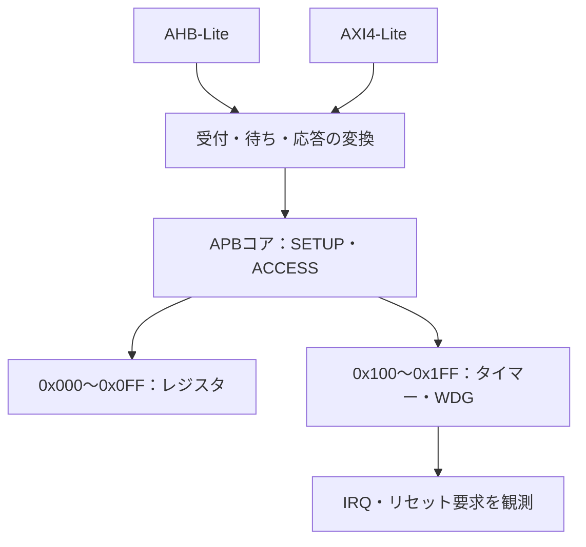

# AHB／AXI-LiteからAPBへ接続して検証する

AHB-Lite→APB3とAXI4-Lite→APB3の教材用ブリッジを作り、既存の[APBレジスタ](../gitlab-apb/README.md)と[APBタイマー・ウォッチドッグ](../local-apb-timer/README.md)へ接続します。バス単体の合格だけでは分からない、アドレス変換、応答の対応、周辺機能の動作を確認します。GitLabには追加しません。

## バス変換と接続先

上位のAHB-LiteまたはAXI4-Liteを、1要求ずつ処理するAPBコアへ変換します。



AHB版とAXI-Lite版は別の構成です。図の2入力は、同じ回路へ同時接続する2マスターを意味しません。

| 確認する場面 | 期待する動作 | 主な照合対象 |
| --- | --- | --- |
| 正常転送 | 対応するAPB操作を1回完了 | 番地・方向・データ |
| 待ち・エラー | APBの結果を上位の規則で返す | 上位応答と状態 |
| 周辺回路との競合 | 更新・満了とIRQを同じ時点で比較 | レジスタ・IRQ |

## アクセスとブリッジの方針

上位アドレスは10ビットの相対バイトアドレスで、0x200〜0x3FFは未割当です。下位8ビットを各APBターゲットへ渡します。

- 基本レジスタ：0x000がR/W CONFIG、0x004がR/O ID（0x41504233）、0x008がPENDING。外部イベントは0に固定しています。
- タイマー：0x100がCONTROL、0x104／0x108が各リロード値、0x10CがCOMMAND、0x110がSTATUS、0x114／0x118がカウンター、0x11CがIDです。各フィールドは[元のレジスタ仕様](../local-apb-timer/README.md)と同じです。コア幅は4ビットです。

APB3にはPSTRBがないため、整列した32ビットアクセスに限定します。AHBのHSIZE≠2、AXI-Liteの部分WSTRB、非整列、未割当領域はAPBへ出さずにエラーを返します。狭いAHB転送自体はAHBの正常な転送種別ですが、このブリッジでは対応しない仕様です。

AXI-LiteのWSTRB=0は、整列した割当領域ならAPBへ出さずOKAYにする方針です。この場合はターゲット内部の番地やR/O属性を評価しません。未割当領域・非整列のエラーは残します。APB4のバイト書込みやread-modify-writeを実装した例ではありません。

AHBはアドレスとデータを分け、待ちと2サイクルERRORを返します。AXI-LiteはAW／Wを別々に保持し、書込み・読出しを各1件まで受け付けます。APBコアは直列処理で、同時に両方を処理できる場合は書込みを先に選びます。B／Rはそれぞれ上位が受理するまで保持します。周辺回路への書込みはAPB完了時に反映され、上位応答の受理まで待ちません。

## 検査内容

Pythonは、上位の受付履歴、APB取引と完了時刻、基本レジスタの値、既存のタイマー参照モデルから、毎クロックの期待値を生成します。テストベンチは上位応答、PSEL・SETUP／ACCESS・アドレス・データ、ターゲット応答、更新後のレジスタ・カウンター・IRQを照合します。[ポートだけを見るプロトコルチェッカー](../local-bus-validation/README.md)も接続します。

固定刺激には、両ターゲットの読書き、R/O書込み・未定義レジスタからのAPBエラー、未割当・対応外要求、AHBの次アドレスとの重なり、AXIの同時AW／W／ARとB／R同時受理、待ち、IRQマスクと満了、ウォッチドッグ満了、転送中リセットと再開を含めます。ランダム刺激は方向、番地、データ、AW／Wの順序、応答待ち、リセット挿入を変更します。

ブリッジは非同期リセット、APB周辺回路は既存の同期リセットです。この例では必ずクロックでリセットを観測します。短パルスでAPB周辺回路まで初期化できるという仕様ではありません。watchdog_reset_requestは出力の照合までで、システムリセットへ戻す配線はありません。

[要求カタログ](requirements.json)は5要求・18目標です。各構成で全目標、上位の読書き完了数、APB完了数、各満了パルス数を要求します。2応答が同時に完了しても両方を数えます。

4変異は、ターゲットの入替え、APBエラーの隠蔽、PWDATAのビット反転、SETUPでのPENABLE誤アサートです。予定ラベルと非ゼロ終了を照合し、通常のカバーには算入しません。

## 実行

[共通の準備と証跡](../local-common/README.md)に従い、ルートから実行します。

```sh
python3 examples/local-bus-bridge/run.py --out artifacts/bus-bridge-smoke
python3 examples/local-bus-bridge/run.py --profile nightly --out artifacts/bus-bridge-nightly
python3 examples/local-bus-bridge/run.py --configuration axi-wait2 --seed 42 --iterations 100
python3 -m unittest discover -s examples/local-bus-bridge/tests -v
```

構成は`ahb-wait0`、`ahb-wait2`、`axi-wait0`、`axi-wait2`です。待ち数は**APBターゲット**の設定で、上位バスの総レイテンシではありません。smokeは32操作×1 seed、nightlyは300操作×3 seedです。iterationsは上位の取引数で、途中リセットで打ち切る場合も1操作に含めます。

構成当たりJUnitは7／9件（smoke／nightly）、全4構成で28／36件です。取り込むPython参照モデルも`EXTRA_INPUTS`としてマニフェストへハッシュを保存します。2026-10-27にPython 3.14.7、Icarus Verilog 14.0開発版で全構成のsmoke／nightly、各18目標・4変異、確認テスト9件が成功しました。

単一クロック・単純なデコードの教材です。アービトレーションの公平性、複数マスター、CDC、タイムアウト回復、製品ブリッジの適合性やフォーマル証明は対象に含めません。バスの一般規則は[AHB-Lite](https://documentation-service.arm.com/static/5f914801f86e16515cdc2a27)と[AXI](https://documentation-service.arm.com/static/5f915b62f86e16515cdc3b1c)を参照し、番地・対応サイズ・ゼロストローブ・優先順位は本教材の仕様として定めています。
