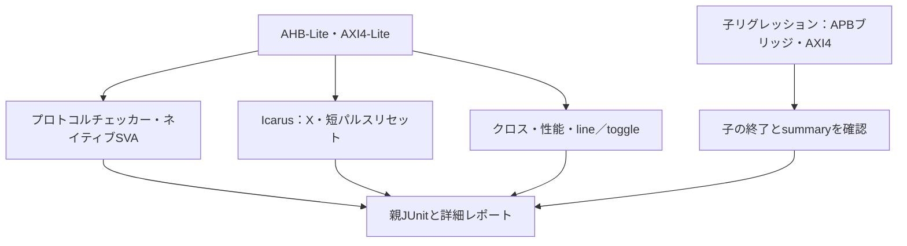

# AHB／AXIの検証を組み合わせる

ランダム検証・フォーマル検証に加え、独立したプロトコルチェック、明示的なクロス目標、APBとの結合、X・リセット、性能・長時間待ち、lint・コードカバレッジを実行するローカル教材です。バーストとIDを扱う[AXI4の別例](../local-axi4/README.md)もまとめて実行できます。GitLabの利用枠は使いません。

## 検査方式ごとの役割

同じバスへ異なる検査を組み合わせ、合否、到達、性能、コード計測を別の結果として保存します。



構成別の機能クロスとコードカバレッジは別指標です。親の子リグレッション合否判定を子のテストへ重複加算しません。

| 確認する場面 | 期待する動作 | 主な照合対象 |
| --- | --- | --- |
| Icarusの4値検査 | 有効なXを検出し、未使用Xを許容 | Verilator実行と分担 |
| ネイティブSVA | 保持・応答等の違反とカバーを計測 | 予定違反で感度確認 |
| コード計測・性能 | 未到達も含む計数と規定の性能を保存 | コード100%を合格条件にしない |

## 準備と実行

POSIX、Python 3.10以上、Icarus Verilog、Verilator、C++コンパイラ、makeを使います。追加Pythonパッケージは不要です。リポジトリのルートから実行します。

```sh
python3 examples/local-bus-validation/run.py --out artifacts/bus-validation-smoke
python3 examples/local-bus-validation/run.py --profile nightly --out artifacts/bus-validation-nightly
python3 -m unittest discover -s examples/local-bus-validation/tests -v
```

`--stage bus|fixtures|bridges|axi4`で一部だけ実行でき、既定の`all`は全項目を実行します。`bus`は既存の[AHB-Lite](../local-ahb/README.md)3構成と[AXI4-Lite](../local-axi/README.md)2構成、`fixtures`はチェッカーと短パルスリセット、残る2段階は各例のランナーを起動します。元のシミュレーション・フォーマルリグレッションを置き換えるものではありません。

`--seed`は既定17、`--transfers`は性能ケースの**書込み数と読出し数それぞれ**です。既定はsmoke 512、nightly 4096で、2〜50000を指定できます。`--timeout`は各シミュレーション・版取得の秒数（既定30）、`--build-timeout`は各ビルド・lintの秒数（既定180）です。子リグレッションの全体にはbuild-timeoutの4倍を適用します。`--iverilog`、`--vvp`、`--verilator`でツールを指定でき、既存の出力先は上書きしません。

## 1. 独立したチェックとSVA

`checkers/`はDUTの内部状態を参照せず、インターフェースだけを検査します。

- AHB：待ち中の次アドレス・制御、書込みデータの保持、2サイクルのERROR応答、必要な区間のX。
- AXI-Lite：5チャネルのVALID・ペイロードの保持、受付に対応したB／R応答、各方向のアウトスタンディング数の上限、VALID区間のX。

Icarusでは手続き的チェック、Verilatorでは`NATIVE_SVA`を定義して**実際のassert property／cover property**を使います。ネイティブ側でもクレジット管理は手続き処理です。全AMBA規則を網羅するVIPではなく、整列・サイズ・保護属性などの完全なプロトコル適合性は判定しません。意図的な不正要求と、正しい転送を区別して扱います。

固定刺激でチェッカーの各違反を作り、予定ラベルと非ゼロ終了を確認します。AHBの単サイクルERRORも検出します。Xを無効ペイロードだけへ入れた場合と、リセットで保持義務を取り消す場合は正常終了が必要です。これらの診断の観測で通常リグレッションのカバーを補いません。

SVAのリセット取消しには`disable iff`に加え、非同期リセットで更新する世代カウンターを使います。今回のVerilatorでは、クロック間で完結する短パルスでも以前の保持義務が残らないことを、この方法で確認しています。汎用SVAエンジンの挙動を表すための仮定ではなく、本シミュレーション用の実装です。

## 2. クロス目標

完了した転送の観測から次を収集し、**構成ごと**に全目標を要求します。

- AHB：方向2通り × サイズ3通り × OKAY／ERROR＝12目標。ERRORには未定義領域を使います。
- AXI-Lite：AW先行／W先行／同時 × WSTRBのゼロ／部分／全バイト × B待ちの有無＝18目標。読出しのOKAY／SLVERR × R待ちの有無＝4目標。合計22目標。

機能クロスは`CROSS`ログを使う簡易実装で、covergroupのDBではありません。一方、AHBの待ち・ERROR・パイプライン、AXI-Liteの5チャネルの待ちは、Verilatorのネイティブcover記録を照合します。AHB待ち0では通常の待ちカバー1個を構造上の対象外とし、理由も保存します。

## 3. APBとの結合

[AHB-Lite→APB3／AXI4-Lite→APB3](../local-bus-bridge/README.md)では、既存のAPBレジスタとタイマー・ウォッチドッグを実際に接続します。アドレス変換、待ち、エラーの返却、読書きの重なり、割り込み、転送中リセットを4構成で確認します。部分書込みを扱わない方針など、ブリッジ固有の仕様はリンク先に記載しています。

## 4. Xと非同期リセット

Icarusの4値シミュレーションで、使用中のペイロードのXを検出し、未使用のXを誤検出しないことを確認します。Verilatorの2値実行をX検証の代替にはしません。

`reset_tb.sv`では元のAHB／AXI-Lite DUTに非ゼロ値を書き、未完了のAHB書込みと保留AXI読出し応答を用意します。クロックの立下りから1／2／6ns後に、幅1nsのリセットを入れます。各パルスはクロック立上りをまたぎません。直後の初期化、取消した転送の再出現防止、再開を検査します。デジタルRTLでの確認であり、リセット解除のrecovery／removal、メタスタビリティ、RDCの静的解析は別途必要です。APB結合例のリセットはクロックで観測する試験です。

## 5. 性能と待ちからの復帰

各構成でN書込み＋N読出しを流し、受付と完了クロック、レイテンシ分布、最大値、観測期間内の完了数／クロック、定常時の完了間隔を記録します。記録数も応答件数と照合します。

AHBのレイテンシ・完了間隔はどちらも`WAIT_CYCLES+1`、AXI-Liteは最後のAW／W受付またはAR受付から`RESP_DELAY+2`、連続完了の間隔は`RESP_DELAY+3`です。バックプレッシャーのない性能ケースで、この教材の実装に対する値を検査します。AXI規格が要求する固定性能ではありません。AXIでは読書きを順に発行しており、読書き同時実行時の最大帯域を測るケースでもありません。

AXI-LiteではB／Rをそれぞれ64クロック止めてから通常転送へ戻すケースも実行します。nightlyは性能転送を8倍に増やし、ランダム操作もAHB 500／AXI-Lite 300に増やします。子リグレッションは各例のnightly（3 seed）に従います。有限のストレス試験であり、任意時間の停止や公平性の証明とは区別します。

## 6. lint・コードカバレッジと証跡

元の2つのレジスタRTLへVerilatorの`--lint-only --Wall`を適用します。既知の幅変換・未使用信号／パラメータ・ファイル名の警告は、`lint-*.json`に理由と全メッセージを残します。未知の警告分類、ツール異常、エラーは失敗です。警告を0件にしたという結果ではありません。新規ブリッジ・AXI4 RTLのlintをこの合否判定へ含めたとは扱いません。

`--coverage-user --coverage-line --coverage-toggle`で生成した各ケースの`coverage.dat`を解析し、元RTLのline／toggleとチェッカーのuserカバーが存在することを要求します。合格した通常実行だけを構成内で合算し、**未到達カウンターも含めて**`bus-report.json`へ保存します。コードカバレッジ100%を合格条件にはせず、branch／condition／FSM／商用ツールのカバレッジを取得したとも扱いません。

親の`manifest.json`、`tools.json`、ビルド／lint／実行ログ、VCD、ケース別結果、`bus-report.json`、`summary.json`、`junit.xml`を保存します。子の`bridges/`、`axi4/`にも[共通形式の証跡](../local-common/README.md)を保存します。子ランナーの終了0とsummary成功の両方が必要です。ソースを変えた後は新規出力先で再実行してください。

全段階の親JUnitは64件（bus 29、fixtures 33、子リグレッション判定2）です。子JUnitは別ファイルで、ブリッジ28／36件、AXI4 7／9件（smoke／nightly）です。親の子リグレッション判定と子の個別テストを混同しないでください。フォーマルリグレッション45件と既存GitLabリグレッションは別集計です。

2026-10-27にPython 3.14.7、Icarus Verilog 14.0開発版、Verilator 5.052でsmoke／nightlyの全段階を確認しました。ランナーとチェッカーのセルフテストは6件です。

## 参照先

- [Arm AHB-Lite IHI 0033A](https://documentation-service.arm.com/static/5f914801f86e16515cdc2a27)：アドレス・データフェーズ、待ち、ERROR応答。
- [Arm AXI IHI 0022E](https://documentation-service.arm.com/static/5f915b62f86e16515cdc3b1c)：チャネルの独立性、保持、応答と順序。
- [Verilatorのオプション](https://verilator.org/guide/latest/exe_verilator.html)と[カバレッジの説明](https://verilator.org/guide/latest/simulating.html#coverage-analysis)：assertとuser／line／toggleの計測。

チェック項目、クロスの分母、固定性能値、警告の扱いは教材独自の計画です。
