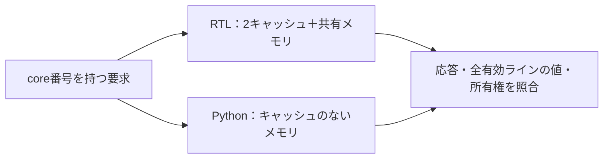

# 2クライアント間のキャッシュコヒーレンシを検証する

片方が書き換えたデータを、もう片方が古いキャッシュから読まないことを確認します。[キャッシュとDMA](../local-cache-dma/README.md)はソフトウェアによるclean／invalidateを扱いますが、この例では回路が更新データの受渡しと他方の無効化を行います。

MSIの安定状態（Modified・Shared・Invalid）の考え方は、[gem5の公式教材](https://www.gem5.org/documentation/learning_gem5/part3/cache-intro/)を参照しています。gem5のディレクトリプロトコルやソースを移植したものではありません。RTLと検証環境は、この例のために書き下しています。

## 回路と比較方法



各クライアントは1ワードだけのキャッシュを持ち、共有メモリは16ワード×32ビットです。アドレスはバイト単位ではなくワード番号0〜15で、書込みはワード全体を更新します。

| 動作 | 状態とデータの扱い |
| --- | --- |
| 読出しヒット | 自分のS／Mから返す |
| 読出しミス、他方がM | 他方の最新値を受け取り、共有メモリにも書き戻す。両方をSにする |
| その他の読出しミス | 共有メモリから取り込み、Sにする |
| 書込み | 自分をM、同じアドレスを持つ他方をIにする |
| 異なるアドレスへの置換 | 自分がMなら、旧アドレスへ書き戻してから置き換える |

要求は`req_valid && req_ready`で受理します。状態とデータの更新は受理端で直列に行い、`LATENCY`サイクル後に応答を有効にします。応答データは読出し値、書込みなら書き込んだ値です。`resp_valid && resp_ready`まで、応答データ・宛先を保持します。応答を消費するまで次の要求は受理しません。リセットは保留応答を取り消し、両キャッシュと共有メモリを0に初期化します。

Pythonの期待値にはキャッシュもMSIの状態遷移もありません。受理した順に普通のメモリを読み書きし、各応答を比較します。さらに、RTLの有効な全ラインが期待値の最新のメモリと一致すること、同じアドレスでMと他の有効なコピーが共存しないことを毎サイクル調べます。応答が正しくても、無効化を忘れたラインが残る誤りを検出できます。

## 実行と検出する誤り

Python 3.10以上とIcarus Verilogを使い、リポジトリのルートで実行します。

```sh
python3 examples/local-cache-coherence/run.py
python3 examples/local-cache-coherence/run.py --profile nightly
python3 -m unittest discover -s examples/local-cache-coherence/tests -v
```

構成は`latency1`・`latency3`です。各構成で固定・ランダム・4変異を実行し、JUnitはsmoke 14件／nightly 18件、通常ケースの目標は12個です。判定・証跡は[共通手順](../local-common/README.md)を使います。

| 変異 | 誤り | 検出ラベル |
| --- | --- | --- |
| 1 | 書込みで他方を無効化しない | `CACHE_DATA` |
| 2 | 他方がMでも、共有メモリの古い値を読む | `CACHE_DATA` |
| 3 | Mの追出しで書き戻さない | `CACHE_DATA` |
| 4 | 応答を待たせるとデータが変わる | `CACHE_RESPONSE` |

`--demo-bug 1..4`では通常ケースが失敗します。7セルフテストには、書込み権の往復後の追出し、遅延・バックプレッシャ中の次要求の拒否、保留中のリセット、応答消費後にも有効ラインを検査していることを含みます。

2026-10-31に、Python 3.14.7・Icarus Verilog 14.0開発版で2構成のsmoke／nightlyと7セルフテストが成功しました。Verilator 5.052でRTLの全構成・変異0〜4をlintしています。

## 確認範囲

中央の回路が1要求ずつ処理する、MSIを簡略化した同期RTLです。入力はcore番号付きの1ポートで、同時要求の仲裁、スヌープの通信路、過渡状態、複数outstanding、ACE／CHI、メモリモデルのlitmus試験、実際のSRAM初期化は扱いません。コヒーレンシとCPUのメモリ整合性モデルは別の確認事項です。
