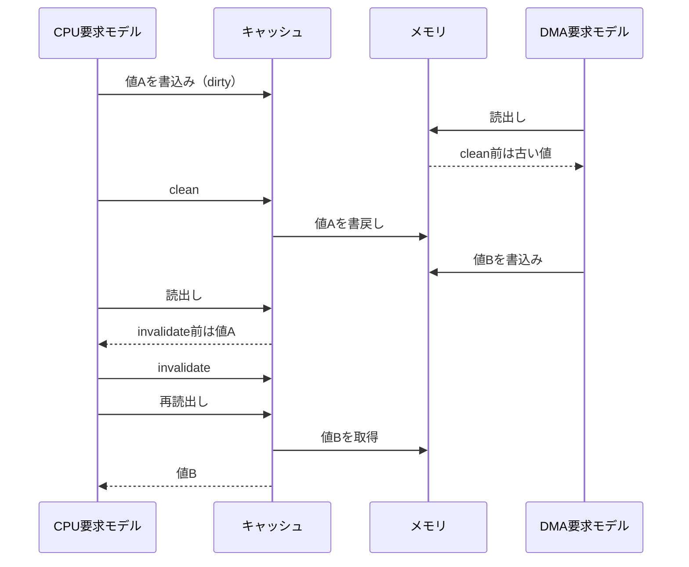

# 小規模キャッシュとDMAの見えるデータを検証する

1ワードを1ラインとする、1／2ライン構成の直接マップ・ライトバックキャッシュと、それを迂回するDMAアクセスを接続した教材です。CPUは単純な要求モデルで、実CPU命令やOSは実行しません。メモリは16ワード、データは32ビットです。

## 保守操作前後の可視性

CPU書込みはキャッシュを、DMA書込みはメモリを更新します。cleanとinvalidateの前後で見える値を区別します。



矢印は論理的な操作順序です。CPUとDMAは同じ要求口から直列に受け付け、物理的な同時実行やバリア命令はモデル化しません。

| 確認する場面 | 期待する動作 | 主な照合対象 |
| --- | --- | --- |
| CPU書込み後のDMA読出し | clean前は古いメモリ値、後は書戻し値 | DMA応答 |
| DMA書込み後のCPU読出し | invalidate前は古いヒット値、後は取得し直す | CPU応答 |
| dirty行のinvalidate | エラーで保持 | 応答とメモリ |

## 操作と可視性

要求はCPU読出し／書込み、clean（書戻し）、invalidate（無効化）、DMA読出し／書込みの6種類です。CPUとDMAは同じ要求口から直列に受け付けます。各処理の待ち時間と応答保持を含めて比較します。CPU・DMAの書込みには4ビットのバイトストローブがあり、無効レーンを保持します。

CPU書込みはキャッシュだけをdirtyにします。clean前のDMA読出しは古いメモリ値を返します。DMAがメモリを書き換えてもキャッシュは自動更新せず、invalidate前のCPUヒットは古いキャッシュ値を返します。固定シナリオでその差を観測した後、clean／invalidateを行った読出しを照合します。古い値が仕様どおり返るケース自体を、DUTの不具合として扱いません。

dirtyな行のinvalidateはエラーとし、データを保持します。dirtyな行を追い出す場合は書き戻してから新しい行を取り込みます。ストローブ0のCPU書込みも行の割当てとdirty化は行いますが、各バイトの値は変えません。リセットは保留処理、キャッシュとメモリを0へ初期化します。

一般的な利用手順は、CPUのdirtyデータをcleanしてからDMAに読ませ、DMAが更新した領域をinvalidateしてからCPUで読むことです。この教材でそれらの前後の可視性を比較します。メモリバリア命令やキャッシュコヒーレンシプロトコルの実装・保証ではありません。

## 独立した判定

Pythonはメモリ配列とキャッシュの対応を別に保持し、応答・エラー・全メモリのデバッグ読出しを照合します。デバッグ観測を期待値の生成には使いません。CPU/DMA、保守操作、dirty行の無効化拒否、追い出し、保持、途中リセット・復帰、保守前の古い値、部分／ゼロストローブを含む15目標を、構成ごとに確認します。

4種類の変異は書戻し欠落、無効化欠落、タグ比較無視、DMA書込み欠落です。通常実行は古いデータが見える仕様を含めて合格し、誤実装なら出力またはメモリ比較で失敗します。

```sh
python3 examples/local-cache-dma/run.py
python3 examples/local-cache-dma/run.py --profile nightly
python3 -m unittest discover -s examples/local-cache-dma/tests -v
```

[共通手順](../local-common/README.md)を使います。one-lineは処理待ち1、two-linesは3で、smoke 40操作、nightly 250操作×3 seedに固定シナリオを加えます。2構成のJUnitは14／18件、セルフテストは5件です。AXIバス、キャッシュラインの複数ビート転送、複数CPU、物理メモリ特性は対象外です。
