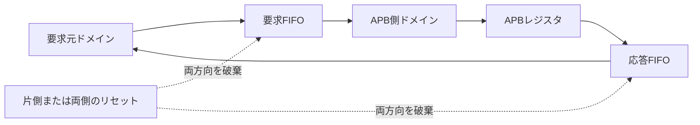

# 非同期の要求・応答経路とAPBを結合検証する

異なるクロックの要求元とAPBターゲットを、2本の非同期FIFOで接続する教材です。[既存の非同期FIFO](../local-async-fifo/README.md)を基に、ワード幅と各ドメインのリセット入力を分けた`packet_fifo.sv`を作成しています。元のFIFOの実装・ポートは変更しません。

## 2本のFIFOで要求と応答を渡す

要求と応答を別の非同期FIFOで運び、どちらかのリセットで両方向とAPB状態を破棄します。



リセット解除の同期段数と、FIFOポインターの同期段数は別の設定です。

| 確認する場面 | 期待する動作 | 主な照合対象 |
| --- | --- | --- |
| 通常転送 | 受付順とtagを保持 | APB要求と上位応答 |
| 応答待ち | 受理されるまで値を保持 | VALID・tag・error・data |
| 片側リセット | 全体破棄後に両側で同期解除 | 旧tagの消失と復帰 |

## 契約

要求はwrite・8ビット番地・32ビットデータ・16ビットtagを持つready／valid形式です。応答はerror・32ビットデータ・同じtagを返し、要求順を保持します。AXIチャネルをそのままクロックドメイン間で転送する実装ではありません。APB側は[既存レジスタ](../local-apb/README.md)を使い、0x00 CONFIG、0x04 ID、0x08 PENDINGを提供します。イベント入力は0に固定します。

深さ4の要求／応答FIFOでGrayポインターを同期します。要求読出しと応答読出しには各1件の取得中状態を持ち、FIFOの登録済み読出しデータを二重に取得しません。応答を上位へ保持している間も、残りのFIFO容量までは処理できます。

**どちらかのリセットで、両方向とAPBレジスタをまとめて破棄する**仕様です。片側だけを独立して継続させる機能ではありません。リセットを共通に非同期アサートし、各クロックで2段同期して解除します。FIFOのポインター同期段数は別に2／3段を設定します。解除の同期とポインター同期を混同しないでください。

## 検査

テストベンチは要求元の受付順に独立した台帳を作り、APBの実番地・方向・書込み値と、SETUP後のACCESS・構成どおりの待ち数を照合します。参照レジスタで期待するAPB応答を作り、要求元へ戻るtag・error・データと比較します。応答待ち中の保持、消失・重複、件数、リセット後のAPBレジスタ初期化も確認します。Pythonでも応答列のチェックサムと件数を計算し、最後に照合します。

固定シナリオは通常転送、APBエラー、応答待ち、未受理の応答を保持した状態での要求元のみ／ターゲットのみ／両側リセット、その後の転送です。リセット前の要求tag=0x8000を破棄し、復帰後は1から使います。破棄された要求は受付・APB件数へ含め、通常の完了数へは含めません。

構成は次の2つです。全パラメーターの直積を試した結果ではありません。

- `source-fast`：クロック半周期3／7ns、ポインター同期2段、APB待ち2。
- `target-fast`：半周期7／3ns、同期3段、APB待ち0。

ターゲットクロックに初期位相を付けています。新しい例では固定クロック比を使い、ジッター探索は既存FIFO例で扱います。デジタルでの転送・破棄の検証であり、メタスタビリティの物理モデル、静的CDC／RDC、MTBF、配置配線後の制約確認を実行したとは扱いません。

[要求カタログ](requirements.json)は3要求・7目標。4種類の変異はtag反転、APB番地変換の誤り、ターゲットリセット時の保留応答消去漏れ、エラーの隠蔽です。

## 実行

```sh
python3 examples/local-cdc-bridge/run.py
python3 examples/local-cdc-bridge/run.py --profile nightly
python3 -m unittest discover -s examples/local-cdc-bridge/tests -v
```

[共通手順](../local-common/README.md)を利用します。1ベクトルは1回の初期化・任意の破棄試験・5〜16要求の転送列です。smokeは12列×1 seed、nightlyは100×3 seedで、固定4列を別に実行します。JUnitは2構成合計14／18件です。クロック停止や片側だけの再開、リセット時に保持すべきトランザクションの再送は別仕様になります。
