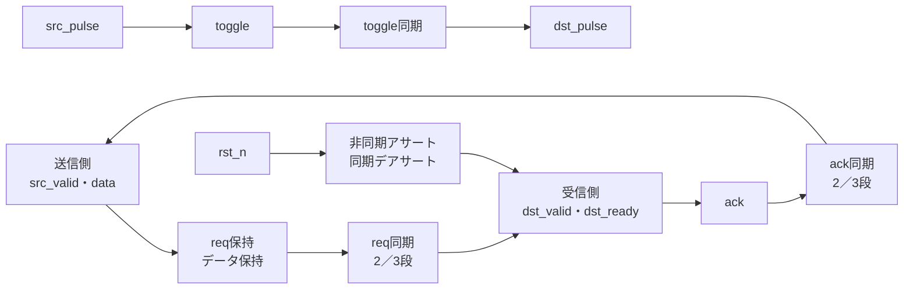
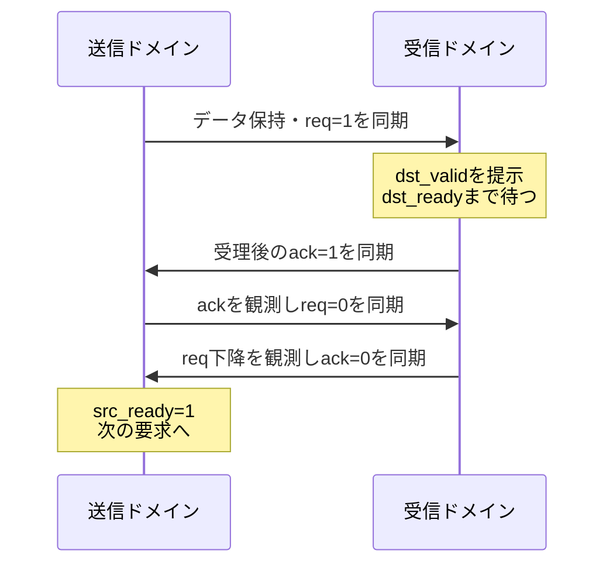

# 複数ビットのreq/ack・パルス・リセットをCDCで検証する

送信側と受信側のクロックが異なる回路で、4相のreq/ackによる複数ビット転送、toggleを使うパルス同期、非同期アサート・同期デアサートのリセット同期を確認します。データの保持、受理の重複・欠落、バックプレッシャ、リセット中の要求破棄を分けて判定します。

## 転送と同期の関係



図は論理的なCDC経路です。メタスタビリティの物理特性や、任意のCDC方式への適用を示すものではありません。

## 仕様

- 送信クロックの立上りで`src_valid && src_ready`ならデータを`data_reg`へ取り込み、`req=1`にします。`src_ready`は要求中とack同期中は0です。
- `req`は受信クロックの`SYNC_STAGES`段を通過し、`dst_valid=req_sync_last && !ack`になります。受信クロックの立上りで`dst_valid && dst_ready`なら`ack=1`です。
- 送信側がack同期を観測すると`req=0`にし、受信側はreqの下降を観測して`ack=0`に戻します。データはackが戻るまで保持します。
- 同時に両方のクロックが立ち上がる場合、両ドメインは更新前の相手側信号をサンプルします。
- `src_pulse`は送信側でtoggleへ変換し、受信側の同期後の変化を1サイクルの`dst_pulse`にします。`src_pulse`は送信側の1立上りだけ1にする入力です。各toggleを受信側が観測できる間隔が必要で、無制限な連発を保証しません。
- `rst_n`は両ドメインへ非同期にアサートし、受信側のデアサートは`SYNC_STAGES`段で同期します。受信側の状態は同期リセットが外れるまでリセット値に保持します。送信側のデアサート同期は本例に含みません。
- データバスはreq/ackで保持されるbundled dataです。各ビットを独立に同期する方式ではありません。

## 独立した期待値とクロック刺激

Pythonは2つのクロックをtick単位で生成し、立ち上がりごとに両ドメインの状態を更新します。同期段数の遅延も表現するサイクルモデルに加え、SV側の独立した送受信データ・件数の照合を使います。

| profile | 送信クロック | 受信クロック | 確認すること |
| --- | --- | --- | --- |
| 0 | 速い | 遅い | 送信側の先行とバックプレッシャ |
| 1 | 遅い | 速い | 受信側の先行 |
| 2 | 同じ | 同じ（位相違い） | 同時立上り付近 |
| 3 | 2±1 tick | 4±1 tick | 半周期のジッターを含むランダム |

[要求カタログ](requirements.json)は4要求・15目標です。固定シナリオは0x00・0xFF・0x55・0xAAの転送、待ち、連続転送、要求中のリセット、パルスの連続とリセット、3つのクロックprofileを含みます。

## 4相の完了と観測するクロック

次の要求を受理するには、ackが送信側へ返るだけでなく、reqとackがともに0へ戻る必要があります。図の同期には各構成の2／3段の遅延があります。



| 観測対象 | 数える時点 | 確認すること |
| --- | --- | --- |
| 送信の受理 | src_clk立上りでvalidかつready | 期待データを保存し、受理数を加算 |
| 受信の受理 | dst_clk立上りでvalidかつready | 保存データとの一致と受信数 |
| バックプレッシャ | dst_clk立上りでvalidかつready=0 | 実際の受信待ちを確認 |
| パルス | dst_clk立上りで同期パルスが1 | 1パルスを1回だけ計数 |
| リセット・終了 | リセットで保留分を破棄、終了前に排出 | 送信数＝受信数＋リセット破棄数、保留なし |

待ち指定は受信クロックの立上り数で扱います。受信を待つ間も送信側は次の別データでvalidを保持し、要求中のデータが変わらないことを確認します。パルス刺激は送信後に40tick待ち、終了時も同期の残りを排出します。単一パルスで連続パルス目標へ到達しないことも確認します。4相の「連続転送」は戻りを待った次の要求であり、毎クロックの受理ではありません。

間隔を設ける必要性は[AMDのパルスCDCの説明](https://docs.amd.com/r/en-US/pg382-xpm-cdc-generator/XPM_CDC_PULSE)も参照できます。製品マクロの最小間隔やリセット条件を、本教材へそのまま適用するものではありません。

## 構成と意図的な誤実装

| 構成 | 同期段数 |
| --- | --- |
| `sync2` | 2 |
| `sync3` | 3 |

| 番号 | 誤実装 | 期待する検出ラベル |
| --- | --- | --- |
| 1 | 受信データのLSBを反転 | CDC_DATA |
| 2 | req下降後もackを戻さない | CDC_READY |
| 3 | パルス出力を常に1にする | CDC_PULSE |
| 4 | リセットデアサートを同期しない | CDC_RESET |

変異3はパルスのレベル化を、変異4は受信側リセットの同期段数を比較して検出します。ネガティブテストの観測は通常の15目標へ加算しません。

## 実行

```sh
python3 examples/local-cdc-handshake/run.py --out artifacts/cdc-handshake
python3 examples/local-cdc-handshake/run.py --profile nightly --out artifacts/cdc-nightly
python3 -m unittest discover -s examples/local-cdc-handshake/tests -v
```

smokeは30回の送信×1 seed、nightlyは120回×3 seedを固定シナリオへ加えます。各構成7／9件、全体14／18件のJUnitで、セルフテストは8件です。

## 確認範囲

2026-10-28にPython 3.14.7、Icarus Verilog 14.0開発版で両構成のsmoke／nightly、14目標、4種類の変異、確認6件が成功しました。

2026-10-29のレビュー修正後も両構成のsmoke／nightlyが成功し、要求カタログはrevision 2の15目標、セルフテストは8件です。再発防止ケースと図表を追加し、実行したソースハッシュを現行ファイルと照合しています。

この教材はデジタルな遅延・位相・リセット順序の確認です。メタスタビリティの確率、MTBF、同期器の物理配置、タイミング制約、CDC/RDCの構造解析、任意の複数ビット方式や非同期FIFOの代替を保証しません。位相・ジッターはテストベンチの刺激であり、シリコンのばらつき分布ではありません。
