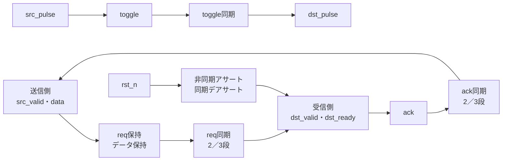

# 複数ビットのreq/ack・パルス・リセットをCDCで検証する

送信側と受信側のクロックが異なる回路で、4相のreq/ackによる複数ビット転送、toggleを使うパルス同期、非同期アサート・同期デアサートのリセット同期を確認します。データの保持、受理の重複・欠落、バックプレッシャ、リセット中の要求破棄を分けて判定します。

## 転送と同期の関係



図は論理的なCDC経路です。メタスタビリティの物理特性や、任意のCDC方式への適用を示すものではありません。

## 仕様

- `src_valid && src_ready`でデータを`data_reg`へ取り込み、`req=1`にします。`src_ready`は要求中とack同期中は0です。
- `req`は受信クロックの`SYNC_STAGES`段を通過し、`dst_valid=req_sync_last && !ack`になります。`dst_ready`で受理すると`ack=1`です。
- 送信側がack同期を観測すると`req=0`にし、受信側はreqの下降を観測して`ack=0`に戻します。データはackが戻るまで保持します。
- 同時に両方のクロックが立ち上がる場合、両ドメインは更新前の相手側信号をサンプルします。
- `src_pulse`は送信側でtoggleへ変換し、受信側の同期後の変化を1サイクルの`dst_pulse`にします。パルスを連続して入れた場合の取りこぼし・重複も観測対象です。
- `rst_n`は両ドメインへ非同期にアサートし、受信側のデアサートは`SYNC_STAGES`段で同期します。受信側の状態は同期リセットが外れるまで保持しません。
- データバスはreq/ackで保持されるbundled dataです。各ビットを独立に同期する方式ではありません。

## 独立した期待値とクロック刺激

Pythonは2つのクロックをtick単位で生成し、立ち上がりごとに両ドメインの状態を更新します。RTLのシフトレジスタを写さず、要求・ack・パルス・リセットの状態遷移を別に表現します。

| profile | 送信クロック | 受信クロック | 確認すること |
| --- | --- | --- | --- |
| 0 | 速い | 遅い | 送信側の先行とバックプレッシャ |
| 1 | 遅い | 速い | 受信側の先行 |
| 2 | 同じ | 同じ（位相違い） | 同時立上り付近 |
| 3 | 2±1 tick | 4±1 tick | 半周期のジッターを含むランダム |

[要求カタログ](requirements.json)は4要求・14目標です。固定シナリオは0x00・0xFF・0x55・0xAAの転送、待ち、連続転送、要求中のリセット、パルスの連続とリセット、3つのクロックprofileを含みます。

## 構成と意図的な誤実装

| 構成 | 同期段数 |
| --- | --- |
| `sync2` | 2 |
| `sync3` | 3 |

| 番号 | 誤実装 | 期待する検出ラベル |
| --- | --- | --- |
| 1 | 受信データのLSBを反転 | CDC_DATA |
| 2 | req下降後もackを戻さない | CDC_READY |
| 3 | パルス出力を常に1にする | CDC_PULSE |
| 4 | リセットデアサートを同期しない | CDC_RESET |

変異3はパルスのレベル化を、変異4は受信側リセットの同期段数を比較して検出します。負の試験の観測は通常の14目標へ加算しません。

## 実行

```sh
python3 examples/local-cdc-handshake/run.py --out artifacts/cdc-handshake
python3 examples/local-cdc-handshake/run.py --profile nightly --out artifacts/cdc-nightly
python3 -m unittest discover -s examples/local-cdc-handshake/tests -v
```

smokeは30回の送信×1 seed、nightlyは120回×3 seedを固定シナリオへ加えます。各構成7／9件、全体14／18件のJUnitで、確認テストは6件です。

## 確認範囲

2026-10-28にPython 3.14.7、Icarus Verilog 14.0開発版で両構成のsmoke／nightly、14目標、4変異、確認6件が成功しました。

この教材はデジタルな遅延・位相・リセット順序の確認です。メタスタビリティの確率、MTBF、同期器の物理配置、タイミング制約、CDC/RDCの構造解析、任意の複数ビット方式や非同期FIFOの代替を保証しません。位相・ジッターはテストベンチの刺激であり、シリコンのばらつき分布ではありません。
