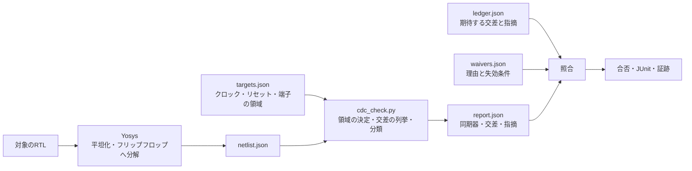

# ネットリストからクロックとリセットの交差を列挙して分類する

シミュレーションは、与えた位相と遅延で起きたことしか見ません。同期器が抜けている経路があっても、その経路でたまたま値が合えば合格します。この教材では、Yosysで作ったネットリスト（JSON）から、フリップフロップごとのクロックと非同期リセットを求め、クロック領域をまたぐ経路をすべて列挙して、6つの規則で分類します。回路を動かさずに構造だけを見る検査です。

これは考え方を学ぶための小さなチェッカーです。**商用の静的CDC/RDCツールの代わりではありません。** 扱う構造は[適用範囲と対象外](#適用範囲と対象外)のとおり限られます。分野全体の手順は[非同期検証](../../docs/method/asynchronous-verification.md)にあり、遅延や位相を変えるシミュレーションは[CDCハンドシェイク](../local-cdc-handshake/README.md)と[非同期FIFO](../local-async-fifo/README.md)で扱います。

## 解析の流れ



## チェッカーの契約

[`cdc_check.py`](cdc_check.py)が読むのは、次のYosysのスクリプトで作ったネットリストです。

```text
read_verilog -sv <ソース>
chparam -set <パラメーター> <値> <top>
hierarchy -check -top <top>
proc
flatten
opt_expr
opt_clean
memory_map
opt_expr
opt_dff
opt_clean
simplemap
opt_expr
opt_clean
write_json netlist.json
```

`opt_merge`は実行しません。同じ入力を持つフリップフロップをまとめてしまうと、「1つの信号を2つの同期器へ送る」という誤りが、合成の時点で消えるからです。`abc`も使わず、RTLの名前がそのまま残る段階で解析します。

| 項目 | 決め方 |
| --- | --- |
| フリップフロップ | `$_DFF_*`・`$_DFFE_*`・`$_SDFF*`の各セル。メモリは`memory_map`でフリップフロップに分解する |
| クロック領域 | クロック入力をインバーターとバッファーを通してさかのぼり、着いた入力端子の名前を領域とする。立下りエッジも同じ領域 |
| 端子の領域 | [`targets.json`](targets.json)で宣言する。入力は、領域の名前、`async`、`static`、「外で同期済み」（`synchronized_into`と`from`）のどれか。出力は領域の名前 |
| 交差 | フリップフロップのデータ・イネーブル・同期リセットの組合せ回路をさかのぼり、別の領域のフリップフロップか端子に着いたもの。出力端子についても同じ |
| 同期器 | 別の領域の1つの信号を、ゲートを通さずに受けるフリップフロップがあり、その出力が、同じ領域の1つのフリップフロップのデータ入力だけにつながっているもの。インバーターとバッファーは通してよい |
| 名前 | フリップフロップは出力のネット名で呼ぶ。`rsync[1][2]`と`rsync[0][0]`は`rsync`にまとめる |

読めないものは、指摘0件ではなくエラーにします。宣言のない端子、宣言にないクロック、ゲートを通ったクロック、ラッチ、対応していない記憶セルがこれに当たります。

### 6つの規則

| 規則 | 検出するもの | 負例 |
| --- | --- | --- |
| `NO_SYNC` | 同期器のない交差。受けたフリップフロップの出力が、そのまま論理や出力端子に使われる。別の領域の信号が出力端子へ直接出る場合も含む | [`cdc_no_sync.sv`](rtl/cdc_no_sync.sv) |
| `COMB_BEFORE_SYNC` | 同期器の前の組合せ論理。2段の形にはなっているが、初段の入力に別の領域の信号どうしのゲートがある。ゲートのグリッチを初段が取り込みうる | [`cdc_comb_before_sync.sv`](rtl/cdc_comb_before_sync.sv) |
| `FANOUT_BEFORE_SYNC` | 同期前の分岐。1つの信号を、同じ領域の2つ以上のフリップフロップが受ける。2つの写しが別のサイクルに変わりうる | [`cdc_fanout_before_sync.sv`](rtl/cdc_fanout_before_sync.sv) |
| `RECONVERGENCE` | 同期後の再収束。同じ領域から別々に同期した2つ以上の信号が、1つの組合せ回路で出会う | [`cdc_reconvergence.sv`](rtl/cdc_reconvergence.sv) |
| `MULTIBIT_SEPARATE_SYNC` | 複数ビットの個別同期。同じバスの2ビット以上が、それぞれ別の同期器を通る | [`cdc_multibit.sv`](rtl/cdc_multibit.sv) |
| `RESET_RELEASE` | 同期解除のない非同期リセット。非同期のリセット端子が、リセット同期器を通らずにフリップフロップへ届く。1段だけの同期器、別の領域のフリップフロップから来るリセットも含む | [`cdc_reset_release.sv`](rtl/cdc_reset_release.sv) |

リセット同期器は、データ入力が定数で、同じクロックと同じリセットを持つフリップフロップが2段以上つながったものです。リセット端子は性質上多くのフリップフロップへ分岐するので、`FANOUT_BEFORE_SYNC`の対象から外し、解除の扱いは`RESET_RELEASE`と`NO_SYNC`で見ます。

規則は構造だけで判定します。Gray符号のポインターは「複数ビットの個別同期」と「再収束」に当たりますが、1クロックに1ビットしか変わらないので安全です。これをチェッカーは区別できません。こうした指摘は、次の除外で人が理由を書きます。

### 台帳と除外

[`ledger.json`](ledger.json)は、対象ごとに期待する結果です。領域ごとのフリップフロップ数、非同期リセットを持つ数、同期器（送り側・受け側・ビット数・段数）、同期されていない交差、指摘、除外されずに残るはずの指摘を持ちます。最初の内容はチェッカーの出力から作り、RTLを読んで1件ずつ確かめました。フリップフロップ数は、RTLの宣言から計算した式と、セルフテストで照合しています。

[`waivers.json`](waivers.json)は除外の台帳です。1件の除外は、対象、指摘、扱い、理由、レビュー方法、失効条件を持ちます。

| 扱い | 意味 |
| --- | --- |
| `waived` | 構造は規則に当たるが、方式として安全だと判断した。理由を書く |
| `known-debt` | 安全だという判断ではない。教材の範囲外として残している既知の不足 |

失効条件は、レビューしたときのソースのSHA-256です。対象のRTLが1バイトでも変われば除外は失効し、交差を取り直して理由を見直すまで不合格になります。次の除外も不合格です：理由・レビュー方法・失効条件のどれかが空のもの、対象にない指摘を挙げたもの、同じ指摘を2件の除外が挙げたもの。

## 検証すること

### この例の正例と負例

[`cdc_good.sv`](rtl/cdc_good.sv)は正例です。レベル信号、トグルによるパルス、逆向きのレベル信号の3本を、どれも2段の同期器で渡します。両方の領域が、2段のリセット同期器を通して非同期リセットを解除します。指摘は0件でなければなりません。

負例は規則ごとに1つで、その規則の指摘だけが出ることを要求します。別の規則の指摘が混ざっても、何も出なくても不合格です。

### 既存の3例の交差一覧

| 対象 | 構成 | フリップフロップ | 同期器 | 指摘 | 除外 |
| --- | --- | --- | --- | --- | --- |
| [CDCハンドシェイク](../local-cdc-handshake/README.md) | `SYNC_STAGES=2` | 送信12・受信8 | 3本（`req`・`ack`・`toggle`） | 8 | `waived` 1、`known-debt` 7 |
| 同上 | `SYNC_STAGES=3` | 送信13・受信11 | 3本、各3段 | 8 | 同上 |
| [非同期FIFO](../local-async-fifo/README.md) | `DEPTH=4`・`SYNC_STAGES=2` | 書込み45・読出し22 | 2本（Grayポインター各3ビット） | 16 | `waived` 5、`known-debt` 11 |
| 同上 | `DEPTH=8`・`SYNC_STAGES=3` | 書込み85・読出し30 | 2本（各4ビット、3段） | 16 | 同上 |
| [割り込み・CDC](../local-irq-cdc/README.md)の`cdc_receiver` | 既定 | 2 | 0（同期器はテストベンチ側） | 2 | `waived` 2 |
| 同上の`irq_pending` | 既定 | 1 | 0 | 0 | － |

指摘の内訳と、除外に書いた理由は次のとおりです。

| 対象 | 指摘 | 扱いと理由 |
| --- | --- | --- |
| CDCハンドシェイク | `data_reg`から`dst_data`への同期なしの交差 | `waived`。4相ハンドシェイクでは、要求を出してから応答が戻るまでデータを保持し、データそのものは同期しない |
| CDCハンドシェイク | `rst_n`が、送信側の4つのレジスタのリセットと、`src_ready`・イネーブルの論理へ直接届く（7件） | `known-debt`。その例のREADMEが「送信側のデアサート同期は本例に含みません」と書いている |
| 非同期FIFO | Grayポインターのビットごとの同期と、`full`・`empty`での再収束（4件） | `waived`。1クロックに1ビットしか変わらない。Gray符号であることは構造からは判定していない |
| 非同期FIFO | `memory`から`rd_data`への同期なしの交差 | `waived`。同期したポインターから作る`empty`が0のときだけ読む |
| 非同期FIFO | 共通の`rst_n`が両方の領域へ直接届く（11件） | `known-debt`。その例のREADMEが、リセット解除はモデル化せず、構造解析が別に必要だと書いている |
| `cdc_receiver` | 同期済みの`a`と`b`の再収束（2件） | `waived`。2本が一致したときだけ受理する回路である |

`known-debt`の18件（2構成ずつ数えて36件）は、この解析が既存例のリセットについて見つけた不足です。どちらの例も、READMEで対象外と明記している範囲です。受信側のリセット（`rst_sync`）は2段のリセット同期器として認識され、指摘は出ません。

`cdc_receiver`は単一クロックの回路で、同期器はテストベンチの遅延モデルにあります。このため`a`と`b`を「外で同期済みの端子」と宣言して解析します。宣言が実際の接続と合っているかは、この解析では確かめません。

### チェッカーそのものの確認

チェッカーの誤りを、次の方法で検出します。

| 確認 | 方法 |
| --- | --- |
| 規則を1つ無効にしたチェッカー（6種類） | その規則の負例で指摘が消え、台帳との照合が不合格になることを要求する。`--demo-bug N`は、通常の解析から規則Nを外し、回帰全体が失敗することを示す |
| ランダムに組み立てた設計 | [`generator.py`](generator.py)が、9種類のパターン（正しい同期、領域内の論理、6規則の違反、出力端子への直結）を3クロックの間にランダムに並べる。期待する同期器と指摘は、並べたパターンから決まり、チェッカーの結果を使わない |
| 除外の負例（3種類） | ハッシュを変えた失効、対象にない指摘、空の理由が、どれも拒否される |
| 読めない入力（3種類） | 宣言のない端子、宣言のないクロック、構文エラーのソースが、指摘0件ではなくエラーになる |

ビルドの失敗と時間切れは、検出の成功に数えません。構文エラーのソースの確認は、Yosysが時間内に失敗を返したときだけ合格です。時間切れなら不合格にします。

[要求カタログ](requirements.json)は7要求・28目標です。目標は、合格した検査だけから数えます。

## 実行

Yosysが要ります。[共通フォーマル手順](../local-formal-common/README.md)の固定版（YoWASP版）を使います。`--yosys`で場所を指定できます。

```sh
. artifacts/toolchains/formal-venv/bin/activate
python3 examples/local-cdc-structural/run.py --out artifacts/cdc-structural
python3 examples/local-cdc-structural/run.py --profile nightly --out artifacts/cdc-structural-nightly
python3 examples/local-cdc-structural/run.py --demo-bug 4 --out artifacts/cdc-structural-demo
python3 -m unittest discover -s examples/local-cdc-structural/tests -v
```

- `--profile smoke|nightly`：ランダムな設計は、smokeが1 seed・12ブロック、nightlyが3 seed（基準seed、+1、+2）・40ブロックです。固定の対象13件と負例は減らしません。
- `--seed`：ランダムな設計の基準seed。既定は17です。`--blocks`でブロック数を指定できます（9〜200）。
- `--demo-bug 1..6`：規則を1つ外したチェッカーで実行します。終了コード1が期待結果です。番号は上の規則の表の順です。
- `--timeout`：Yosysの1回の実行に適用する秒数。既定は30秒です。
- `--out`：新規の出力先。既存のディレクトリは上書きしません。

検査はsmokeが29件、nightlyが31件で、JUnitの件数も同じです。構成は1つです。

| 検査 | 件数（smoke／nightly） |
| --- | --- |
| ツールの版 | 1 |
| 対象と台帳の照合（正例1・負例6・既存6） | 13 |
| 規則を1つ無効にしたチェッカー | 6 |
| 除外の負例と、台帳どうしの整合 | 4 |
| 読めない入力 | 3 |
| ランダムな設計 | 1／3 |
| 要求と目標 | 1 |

## 証跡

[探索用の共通処理](../local-exploration-common/README.md)の形式で保存します。

- `manifest.json`：予定した検査のID、seed、ブロック数、規則の一覧、入力のSHA-256。ランナー、チェッカー、生成器、3つの台帳、要求カタログ、解析したすべてのRTL（既存3例のRTLを含む）を記録します。
- 対象ごとのディレクトリ：コピーしたソース、Yosysのスクリプトとログ、`netlist.json`、`report.json`（同期器、交差、指摘、除外した指摘とその除外、残った指摘、台帳との相違）。
- `crossings.json`：全対象の交差一覧のまとめ。
- `random-seed<N>-expected.json`と`random-seed<N>/`：生成した設計、期待した結果、チェッカーの結果。
- `coverage.json`：目標ごとの、到達した検査。
- `summary.json`・`junit.xml`：予定と完了の件数、検査ごとの合否。予定した検査が1つでも完了しなければ不合格です。

## 適用範囲と対象外

2026-11-20に、macOS arm64のPython 3.14、YoWASP版Yosys 0.70で、smoke 29件とnightly 31件、28目標、6種類の規則の無効化の検出、セルフテスト23件が成功しました。この例のRTL 7ファイルは、Verilator 5.052の`--lint-only -Wall`で警告0件、Icarus Verilog 14.0開発版でコンパイルできることを確かめました。Linuxでは実行していません。

この教材で確かめていないこと、できないことは次のとおりです。

- **商用の静的CDC/RDCツールの代わりではありません。** 同期器として認めるのは、直結した2段以上のフリップフロップだけです。専用の同期セル、ハンドシェイクやFIFOなどの方式の認識、Gray符号かどうかの判定、プロトコルに基づく検証は行いません。これらは除外の理由として人が書きます。
- 再収束は、同期器の出力が1つの組合せ回路で出会う場合だけを見ます。フリップフロップを何段か挟んだ後に出会う再収束は検出しません。
- クロックは、入力端子からインバーターとバッファーだけを通って届くものに限ります。分周クロック、ゲーテッドクロック、クロックの切替え、生成クロックはエラーになります。同じ端子から来るクロックは、位相や周波数の関係を見ずに同じ領域として扱います。
- 端子の領域は宣言を信じます。宣言の誤りは検出できません。ブロックの外にある同期器（`cdc_receiver`の例）も、宣言として与えます。
- 平坦化した1つのモジュールを対象にします。ブラックボックス、メモリのマクロ、ラッチ、3状態は扱いません。メモリはフリップフロップに分解するので、大きなメモリには向きません。
- 見るのは構造だけです。メタステーブルの確率、MTBF、同期器の配置、タイミング制約（`set_clock_groups`・`set_max_delay`など）との整合、リセットのrecovery／removalは扱いません。
- 解析するのは合成前のRTLをYosysが展開したネットリストです。合成の最適化、スキャン挿入、配置配線の後のネットリストに同じ構造が残っていることは確かめていません。
- 台帳の期待値は、最初にチェッカーの出力から作りました。フリップフロップ数は独立に計算して照合していますが、交差と指摘の一覧は、人がRTLを読んで確かめたものです。

## 参考にした一次資料

- Clifford E. Cummings, "Clock Domain Crossing (CDC) Design & Verification Techniques Using SystemVerilog", SNUG Boston 2008：2段の同期器、同期前の組合せ論理、複数ビットの渡し方（Gray符号、ハンドシェイク、FIFO）、リセットの同期解除。規則の分類の参考にしました。本文は引用していません。
- [Yosysの文書](https://yosyshq.readthedocs.io/projects/yosys/en/latest/)：`write_json`の形式、`simplemap`と`memory_map`、ゲートレベルのフリップフロップのセル名。
- [AMDのパルスCDCの説明](https://docs.amd.com/r/en-US/pg382-xpm-cdc-generator/XPM_CDC_PULSE)：[CDCハンドシェイクの例](../local-cdc-handshake/README.md)が参照している、トグルによるパルスの渡し方。
- [非同期検証の手順](../../docs/method/asynchronous-verification.md)：構造解析、遅延を変えるシミュレーション、物理制約の分担。
