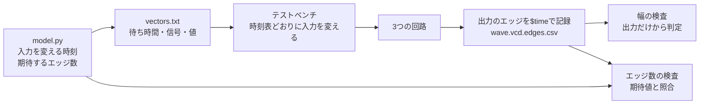

# クロックゲート・クロック切替・奇数分周を、出力のエッジ時刻から検証する

クロックを止める、切り替える、分周する回路は、論理式としては数行です。誤りは値ではなく波形に出ます。イネーブルをANDするだけのゲートは、イネーブルの変わる時刻によって短いパルスを出します。出力を使う側のフリップフロップは、そのパルスで誤って動くか、動かないかが決まりません。この教材では、3つの小さな回路の出力について、立上りと立下りの実際の時刻を測り、パルスの幅とエッジの数で合否を決めます。

| 回路 | ファイル | 誤実装（変異） |
| --- | --- | --- |
| ラッチ型のクロックゲート | [`clock_gate.sv`](rtl/clock_gate.sv) | AND直結、ラッチの極性違い |
| グリッチのないクロック切替 | [`clock_switch.sv`](rtl/clock_switch.sv) | 単純なマルチプレクサー、相手の停止を待たない切替 |
| デューティ50%の奇数分周 | [`odd_divider.sv`](rtl/odd_divider.sv) | 立上りエッジだけを使う分周 |

低電力設計の中での位置付けは[低電力設計の検証手順](../../docs/method/low-power-verification.md)、クロックの停止とリセットを組み合わせた制御は[クロック停止・再開とリセットの例](../local-clock-reset/README.md)、エッジ時刻から測る方法の元は[PLL出力の測定実習](../local-pll-clock-quality/README.md)にあります。

## 測り方



- クロックのエッジは、すべて1000 psの倍数の時刻にあります。入力（イネーブル、選択、クロックの停止と再開、リセット）は、必ずその格子から100 ps以上離れた時刻に変えます。入力とクロックが同じ時刻に変わることがないので、結果はシミュレーターの実行順に依存しません。モデルは、格子の上で入力を変える時刻表を作ろうとするとエラーにします。
- 幅の検査は、出力の変化で起動する`always @(出力)`が`$time`を記録して行います。時刻表の値は使いません。
- エッジの数は、RTLのレジスタを追わず、元のクロックのエッジ時刻と[仕様の規則](#仕様)から数えます。

テストベンチ[`clock_gating_tb.sv`](tb/clock_gating_tb.sv)は1つで、3つの回路を同時に動かします。ゲートと分周器は止まらないクロック（周期`PERIOD_A`）を使い、切替回路は、止められる2つのクロック（周期`PERIOD_A`と`PERIOD_B`）を使います。

## 仕様

### クロックゲート

- クロックがLowの間だけイネーブルを取り込むラッチと、ANDで構成します。
- クロックのパルスは、**その立上りの時点でイネーブルが1なら丸ごと通り、0ならまったく出ません**。イネーブルがHighの期間の途中で変わっても、出ているパルスは切れず、途中から出ることもありません。
- したがって、出力のHigh幅とLow幅は、クロックの半周期以上です。

| イネーブルを変える時刻 | 正しい回路 | AND直結 |
| --- | --- | --- |
| Lowの期間に1にする | 次のパルスから通る | 同じ |
| Highの期間に0にする | 出ているパルスは最後まで通る | パルスがそこで切れる |
| 立上りの直後（100 ps後）に1にする | そのパルスは出ない。次から通る | 100 ps欠けたパルスが出る |
| 立上りの直前に1にし、立下りの直後に0にする | パルスが1つだけ通る | 同じ |

### クロック切替

- 入力は2つのクロック`clk_a`・`clk_b`、選択`sel`（0で`clk_a`）、非同期リセット`arst_n`です。出力は`clk_out`と、今どちらを通しているかを示す`active_a`・`active_b`です。
- 各クロックにイネーブルがあります。イネーブルの要求は、相手のイネーブルが0になってから出します（先に切ってから入れる）。要求は自分のクロックの立上りで取り込み、次の立下りで反映します。ゲートが開閉するのは、自分のクロックがLowの間だけです。
- `active_a`と`active_b`が同時に1になることはありません。
- 出力のHigh幅とLow幅は、2つのクロックの半周期のうち短い方以上です。
- 両方のクロックが動いていれば、`sel`を変えてから、元のクロックの1.5周期と新しいクロックの1.5周期の合計以内に切替が終わります。切替の途中、出力はLowです。
- どちらかが選ばれて落ち着いている間、出力の立上りは、そのクロックの立上りと同じ数です。

止まっているクロックの扱いは、次のように決めています。タイムアウトや強制の経路は持ちません。

| 場面 | 動作 |
| --- | --- |
| 切替先が止まっている | 元のクロックは外れ、出力はLowのまま。`active_a`・`active_b`はどちらも0。切替先が動き出せば、その1.5周期以内に切替が終わる |
| 今のクロックが止まっている | 元のクロックのイネーブルは、そのクロックのエッジがないと下げられない。切替は終わらず、`active`は元のまま、出力にエッジは出ない |
| 上の状態からの復帰 | `arst_n`を0にすると両方のイネーブルが0になる。解除すると、`sel`が選ぶクロックが、その1.5周期以内に有効になる |

クロックがHighで止まった場合、出力はHighのままです。リセットで出力は0に戻ります。このリセットによるエッジは、幅の検査から外します。動いているクロックを通している最中にリセットをかけると、パルスは切れます。その使い方はこの教材では行いません。

### 奇数分周

- `DIV`（3以上の奇数）で分周します。立上りで動くカウンターから、`DIV/2`（切捨て）周期だけHighの信号を作り、それを半周期遅らせた信号とORを取ります。
- 出力の周期は入力の`DIV`周期、High幅とLow幅はどちらも入力の`DIV/2`周期です。入力のデューティが50%であることが前提です。
- リセットを解除した後、最初の立上りで出力が立ち上がり、以後`DIV`回ごとに立ち上がります。

## 検証すること

[要求カタログ](requirements.json)は4要求・13目標です。

| 要求 | 内容 | 目標 |
| --- | --- | --- |
| `CG-GATE` | パルスは丸ごと通るか、まったく出ない | 通過、停止中のエッジなし、Highの期間の変更、Lowの期間の変更 |
| `CG-SWITCH` | 両方向の切替で短いパルスが出ず、2つが同時に有効にならない | a→b、b→a、出力がHighの間の選択の変更 |
| `CG-STOPPED` | 止まったクロックの扱いと、リセットによる復帰 | 切替先の停止、今のクロックの停止、リセット後の復帰、`clk_b`を選んだままのリセット解除 |
| `CG-DIVIDER` | 周期とデューティ | デューティの測定、パルスの途中のリセットからの再開 |

検査のラベルは次のとおりです。

| ラベル | 検査 | 期待値の出所 |
| --- | --- | --- |
| `CG_SHORT_HIGH`・`CG_SHORT_LOW` | ゲート出力の幅が半周期以上 | 出力のエッジ時刻だけ |
| `CG_OFF_EDGE` | ゲート出力が立ち上がるとき、イネーブルが1 | 出力のエッジと入力 |
| `CG_EDGES` | ゲート出力の立上りの累計 | 立上りの時点のイネーブルから数えた値 |
| `CS_SHORT_HIGH`・`CS_SHORT_LOW` | 切替出力の幅が、短い方の半周期以上 | 出力のエッジ時刻だけ |
| `CS_OVERLAP` | `active_a`と`active_b`が同時に1にならない | 出力だけ |
| `CS_ACTIVE` | 期限の時刻に、予定のクロックが有効（止まった場面では、予定どおり切り替わっていない） | 仕様の期限 |
| `CS_EDGES` | 落ち着いた区間の立上りの数 | 選ばれたクロックの、区間内の立上りの数 |
| `DIV_PERIOD`・`DIV_DUTY` | 周期が`DIV`周期、High幅とLow幅が`DIV/2`周期 | 出力のエッジ時刻だけ |
| `DIV_EDGES` | リセット解除からの立上りの数 | 入力の立上りの数を`DIV`で割って切り上げた値 |
| `CK_X` | 検査の時点と各エッジで、出力がXでない | － |

固定シナリオは83行で、これだけで13目標に達します。ゲートは、イネーブルを立上りの100 ps前・100 ps後、立下りの100 ps前・100 ps後に変える場合を含みます。切替は、往復、切替先の停止、今のクロックの停止とリセットによる復帰を、クロックがLowで止まる場合とHighで止まる場合の両方で行います。最後に、両方のクロックが動いていて`clk_b`を選んだまま、リセットをかけて解除します。リセットは`clk_b`がLowの間にかけ、`clk_a`がHighの間に解除して、直後の`clk_a`の立下りの300 ps後に、`clk_a`が有効になっていないことを確かめます。ランダム刺激は、イネーブルの変更、切替、停止の場面、分周器の検査とリセットを、乱数で選んだ時刻に加えます。

終了時には、行数、ゲート出力のパルス数、閉じた測定区間の数、分周出力のパルス数を、モデルの値と照合します（`COUNT`）。

### 意図した誤実装

| 番号 | 誤実装 | 検出するラベル | 最初の構成で検出する時刻と内容 |
| --- | --- | --- | --- |
| 1 | イネーブルをクロックとANDするだけ | `CG_SHORT_HIGH` | 96.5 ns。立上りの1.5 ns後にイネーブルを0にし、1.5 nsのパルスが出る |
| 2 | ラッチが、クロックがHighの間に透過する | `CG_SHORT_HIGH` | 同じ時刻。Highの間のイネーブルの変化が、そのまま出力に出る |
| 3 | `sel ? clk_b : clk_a`のマルチプレクサー | `CS_SHORT_HIGH` | 116.5 ns。`clk_a`の立上りの1.5 ns後に`sel`を変え、Lowの`clk_b`へ切り替わる |
| 4 | 相手のイネーブルが下がるのを待たずに要求を出す | `CS_OVERLAP` | 126 ns。`clk_a`が外れる前に`clk_b`が有効になる |
| 5 | 分周に立上りエッジだけを使う | `DIV_DUTY` | 45 ns。High幅が1周期で、1.5周期にならない |

変異3と4を確実に検出するため、固定シナリオの最初の切替は、モデルが時刻を探して決めます。`clk_a`の立上りの1.5 ns後で、その時点で`clk_b`がLowであり、相手を待たない回路なら`clk_b`が先に有効になる時刻です。この条件はセルフテストで確かめています。変異4は、2つのクロックの位相によっては重なりが起きず、合格します。先に切ってから入れる順序は、時刻を選ばないと検査できません。

変異1と2は同じラベルで検出します。ラッチの極性が逆でも、AND直結と同じく、Highの期間のイネーブルの変化が出力に出るためです。

## 実行

Python 3とIcarus Verilog（`iverilog`・`vvp`）が要ります。リポジトリのルートから実行します。

```sh
python3 examples/local-clock-gating/run.py --out artifacts/clock-gating
python3 examples/local-clock-gating/run.py --profile nightly --out artifacts/clock-gating-nightly
python3 examples/local-clock-gating/run.py --configuration a10-b14-div3 --seed 42 --iterations 100 --out artifacts/clock-gating-seed42
python3 -m unittest discover -s examples/local-clock-gating/tests -v
```

[共通手順](../local-common/README.md)を使います。構成は2つです。

| 構成 | `PERIOD_A` | `PERIOD_B` | `DIV` |
| --- | --- | --- | --- |
| `a10-b14-div3` | 10 ns | 14 ns | 3 |
| `a16-b10-div5` | 16 ns | 10 ns | 5 |

smokeは固定シナリオと、ランダムな操作24個×1 seedです。nightlyは160個×3 seedです。変異は5種類なので、`--demo-bug`は1〜5を取ります。JUnitはsmoke 16件／nightly 20件、セルフテストは12件です。

## 証跡

共通手順の証跡（`manifest.json`、`builds.json`、ケースごとの`vectors.txt`・`simulation.log`・`wave.vcd`・`result.json`、`coverage.json`、`summary.json`、`junit.xml`）に加えて、各ケースのディレクトリに`wave.vcd.edges.csv`を残します。3つの出力のすべてのエッジについて、時刻（ps）、信号名、値を記録したものです。`vectors.txt`の各行は、前の行からの待ち時間（ps）、信号の番号、値を16進で並べたものです。信号の番号は[`model.py`](model.py)の`SIGNALS`にあります。

## 適用範囲と対象外

2026-11-20に、macOS arm64のPython 3.14、Icarus Verilog 14.0開発版で、2構成のsmoke 16件とnightly 20件、12目標、5変異の検出、セルフテスト12件が成功しました。seedを変えた400操作の実行5回も合格しました。Verilator 5.052の`--lint-only -Wall`は、3つの回路の既定の構成で警告0件です。YoWASP版Yosys 0.70で3つの回路を読み込めることも確かめました。同じベクトルをVerilator（`--timing`）で実行し、正常ケースの件数と、5変異の検出ラベルがIcarusと一致することを1ケースで確かめましたが、これは回帰には入れていません。Linuxでは実行していません。

2026-11-21のリポジトリ全体のレビューで見つかった試験の抜けを補いました。リセットの解除は、止まったクロックからの復帰の場面にしかなく、「`clk_a`の要求のリセット値が1」という誤りが固定シナリオとsmokeを通っていました（nightlyのランダムは検出していました）。`clk_b`を選んだままのリセット解除と、直後の観測（`CHECK_RELEASE`）、目標`switch/release-on-b`を足し、固定シナリオは83行・13目標になりました。写しのRTLにこの誤りを入れると、2構成の固定シナリオが`CS_ACTIVE`で不合格になります。JUnitとセルフテストの件数は変わりません。

この教材で確かめていないことは次のとおりです。

- 遅延のないRTLの動作です。ラッチとANDの間の遅延、クロックとイネーブルの配線の遅延の差は表れません。実際の回路では、セルライブラリのクロックゲート専用セル（ICG）を使い、STAのクロックゲーティングの検査（イネーブルのセットアップとホールド）で確かめます。
- スキャン試験のときにゲートを開けるテストイネーブルは持ちません。合成ツールによるクロックゲートの自動挿入も扱いません。
- 切替回路の2段の取り込み（立上りと立下り）は、非同期の信号のメタステーブルを収める同期器としての評価をしていません。入力は必ずクロックのエッジから100 ps以上離して変えます。同期器の段数と故障間隔、リセット解除のリカバリとリムーバルは対象外です。
- 止まったクロックからの切替には、リセットを使います。クロックの停止を検出して自動で切り替える回路は、[PLLの復帰の例](../local-pll-recovery/README.md)の範囲です。
- 奇数分周は、入力のデューティが50%であることを前提にします。入力のデューティのずれ、ジッター、分周比の動的な変更、偶数分周は扱いません。
- ゲート・切替・分周で作ったクロックのSTAでの定義（生成クロック）、クロックツリー、消費電力の測定は扱いません。
- 幅の検査は、与えた時刻表が通った場面だけを見ます。すべての位相についての証明ではありません。

## 参考にした一次資料

- IEEE Std 1800-2023：`always_latch`（9.2.2.3）と、同じ時刻のイベントの実行順が決まらないこと（4章）。本文は引用していません。入力をクロックのエッジからずらす設計は、この実行順に頼らないためです。
- [OpenTitanの基本部品](https://opentitan.org/book/hw/ip/prim/index.html)：クロックゲートやクロックのマルチプレクサーを、技術に依存する専用の部品として切り出している公開の実例。この教材のRTLは新しく書いたもので、転載はしていません。
- [検証計画の抜けの点検 8節](../../docs/method/verification-gap-review.md#8-低電力電源状態の遷移)：クロック停止の検証の、計画上の位置付け。
