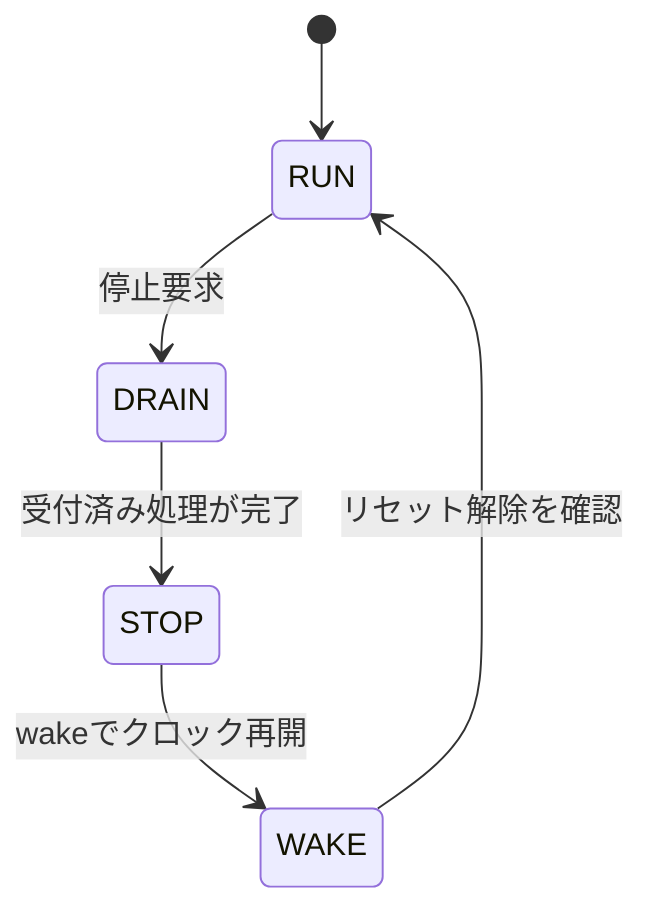

# クロック停止・再開とリセット制御を結合検証する

常時動作クロック側の制御と、停止できるクロック側の簡単な演算器を接続した新規教材です。動作中の処理を排出してから停止し、停止中の要求を受け付けず、再開後に処理できることを確認します。

## 停止とリセット解除の順序

新規受付を止めて処理を排出し、停止後はクロック再開と同期解除を待ってから受付を再開します。



図は通常の停止・再開の流れです。非同期リセットは別途アサートされ、停止中には同期解除が進みません。

| 確認する場面 | 期待する動作 | 主な照合対象 |
| --- | --- | --- |
| 処理中の停止 | 受付済み演算を完了して停止 | 結果・完了数 |
| クロック停止中 | work_clkの立上り回数が増えない | 実クロックの観測 |
| 停止中のリセット解除 | 再開後の2／3段同期完了まで受付しない | 解除状態と再開 |

## クロック・リセットの契約

ゲート制御は常時動作クロックの立下りで更新し、実際の`work_clk`の立上り回数も観測します。停止中はエッジが増えず、動作中は予定どおり増えることを要求します。停止要求を受けた時点から新規受付を止め、既に受け付けた演算は完了させます。処理時間は4ワーククロックです。

演算器のリセットは非同期にアサートし、解除はワーククロックの2／3段同期回路を通します。停止中にアサートして解除した場合、クロックが再開するまではリセット解除が進みません。WAKEは解除完了まで新規受付を抑えます。リセットなしの停止では結果を保持し、リセットした場合は結果・完了数・保留処理を破棄します。

常時動作側と演算器側は、停止していない期間には同じクロック源です。制御入力はテストベンチがクロックの低い期間に変更します。任意の非同期パルスの取り込みやRDC構造全般を検証する例ではありません。

## 試験と実行

処理中・アイドル中の停止、停止中の要求、結果保持、停止中のリセットと解除待ち、動作中リセット、再開後の演算を含め、各10目標を要求します。Pythonの参照モデルと、受付・停止・解除・結果・完了数を照合します。

4変異は排出前の停止、解除同期の迂回、再開時の結果消失、停止要求と同時の誤受付です。

```sh
python3 examples/local-clock-reset/run.py --out artifacts/clock-reset
python3 examples/local-clock-reset/run.py --profile nightly
python3 -m unittest discover -s examples/local-clock-reset/tests -v
```

[共通手順](../local-common/README.md)を使います。smokeは24回、nightlyは160回×3 seedの演算・停止・再開を固定シナリオへ追加します。2構成合計JUnitは14／18件です。VCDには常時動作側とワーク側の両クロックを保存します。

デジタル動作モデルです。実際のICGセル、グリッチ、メタステーブル、recovery/removal、クロックスキュー、STA、静的CDC/RDC、UPFの確認は別途必要です。この例の合格を、それらの物理的な保証へ置き換えません。
