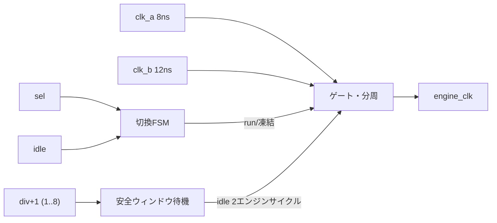
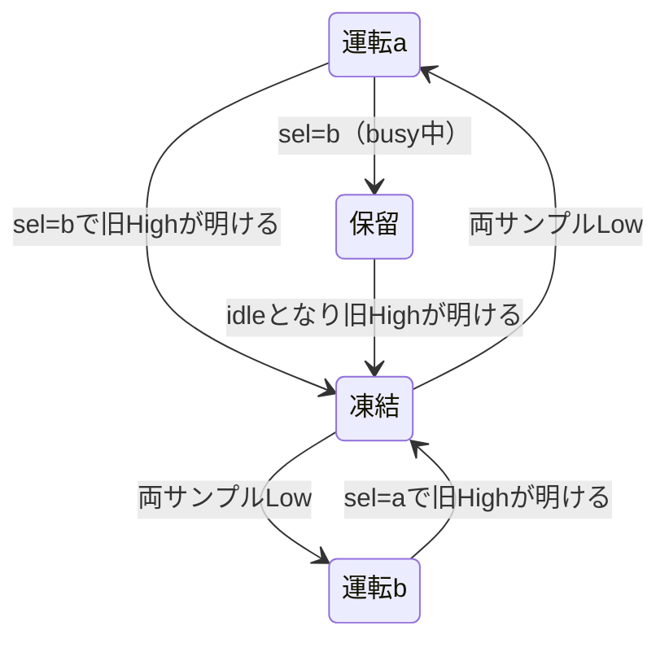

# グリッチフリーなクロック切替とDVFS分周を検証する

2系統の常発クロック（`clk_a`周期8ns／`clk_b`周期12ns）からエンジンへ渡す系統を`sel`で切り替える、グリッチフリーなクロック切換器の教材です。切り替え中は出力を凍結し、安全な窓だけで分周比（DVFS相当）を更新します。エンジンが消費したクロックエッジ数をPythonの厳密モデルと1周期単位で突き合わせ、凍結窓にもれたエッジや分周比の即反映を別々のラベルで判定します。

## 回路の契約



| 条件 | 要求する動作 |
| --- | --- |
| 切換要求 | `idle=1`のときだけ受理。`idle=0`のあいだは`busy_hold`を立てて保留する |
| 凍結 | 旧系統のHighが明けたサイクルから`switching=1`。窓に入ってから翌行まで`engine_clk`はLowのまま |
| 凍結解除 | 両系統のサンプルが揃ってLowのサイクルで`sel_q`を新系統へ入れ替え、流れ始める |
| 分周比 | `div+1`を`div_pend`に保持し、`idle=1`が2エンジンサイクル続いた窓だけで`ratio`へ反映。待機中はphaseを0に保ち、待機が明けたサイクルから1回のエッジを出す |
| 起動 | リセット解除後、`sel`要求の系統を`BOOT`の分周比で流し始める |

リセットは全状態を消し、`ratio`と`div_pend`を`BOOT`に戻します。`engine_clk`はレジスタ出力で、ゲートの遅れは1グリッド（4ns）分だけです。

## 切換と凍結の状態



`switching`は凍結窓のあいだだけ立ちます。窓の直後はレジスタ出力の遅れで1サイクル古い値が読めるため、TBは「switching=1の行の翌行に出力が残っていないか」を不変条件として毎行検査します。系統が入れ替わった行で出力がHighのままなら（＝凍結しない入替わり）、これもグリッチとして弾きます。

## 独立した期待値と構成

PythonのPlanはRTLと1対1の状態遷移で、4nsグリッド上の整数周期（a=2グリッド、b=3グリッド）をそのまま再現します。TBがposedgeで数えるエンジンエッジ数（検出が1エッジ遅れる動作を含む）を、sel/div/idleの履歴から毎行厳密に計算し、`ecount`列として比較します。期待値が回路と同じ方法では決まらないよう、分周・凍結・保留の判定はモデル側で独立に書き下しています。

| 構成 | 始動分周比 |
| --- | --- |
| `boot1` | `BOOT=1`（リセット後から/1で運転） |
| `boot4` | `BOOT=4`（/4で始動し、リセット復帰後に/2へ下げても窓で反映されることを確認） |

[要求カタログ](requirements.json)は5要求・11目標です。切替方向・凍結窓・無エッジ・分周の増減・最大比・セーフウィンドウ反映・busy保留・復帰・リセット復帰を、両構成の機能ケースだけで埋めます。

## 意図的な誤実装

| 番号 | 誤実装 | 期待する検出ラベル |
| --- | --- | --- |
| 1 | 凍結せず`sel_q`を即入れる（High中に断ち切る／途中接続） | CLK_GLITCH |
| 2 | 凍結解除が「どちらかLow」で1サンプル早い | CLK_SEL |
| 3 | 分周比をidle=1なら即反映（窓を無視） | CLK_DIV |
| 4 | idle=0でも切換要求を受理する | CLK_SEL |

判定順は「グリッチ不変条件→分周まわりの列（ratio・phase・idle_run・div_pend）→エンジン列（engine・switching・busy_hold・ecount・sel_q）」です。変異1は系統入替わりに出力が残る行で最初に弾かれるので必ずCLK_GLITCH、変異2と4はエンジン列より前にずれる`switching`/`busy_hold`でCLK_SELになり、ラベルは決定的です。

## 実行

```sh
python3 examples/local-clock-switch/run.py --out artifacts/clock-switch
python3 examples/local-clock-switch/run.py --profile nightly --out artifacts/clock-switch-nightly
python3 -m unittest discover -s examples/local-clock-switch/tests -v
```

smokeは200操作×1 seed、nightlyは1000操作×3 seedを固定シナリオへ加えます。各構成6／8件、全体12／16件の回帰に構成別の目標ゲート2件を足したJUnitです。

## 確認範囲

2026-11-22にPython 3.14.7、Icarus Verilog 14.0開発版で両構成のsmoke（回帰12件・JUnit 14・目標11/11・変異8/8検出）とnightly（回帰16件・JUnit 18）が成功し、セルフテスト8件も成功しました。

この教材は実際のClock GatingセルやPLL、DVFSプロトコルの検証ではありません。入力クロックは4nsグリッド上の整数周期に限定したビットレベルモデルで、非同期な位相関係、メタステーブル、ゲート遅れ差による実グリッチ、アナログな電圧変動を伴う動作、位相アジャストを伴う切替、スプレッド・スペクトラム変調は対象外です。
