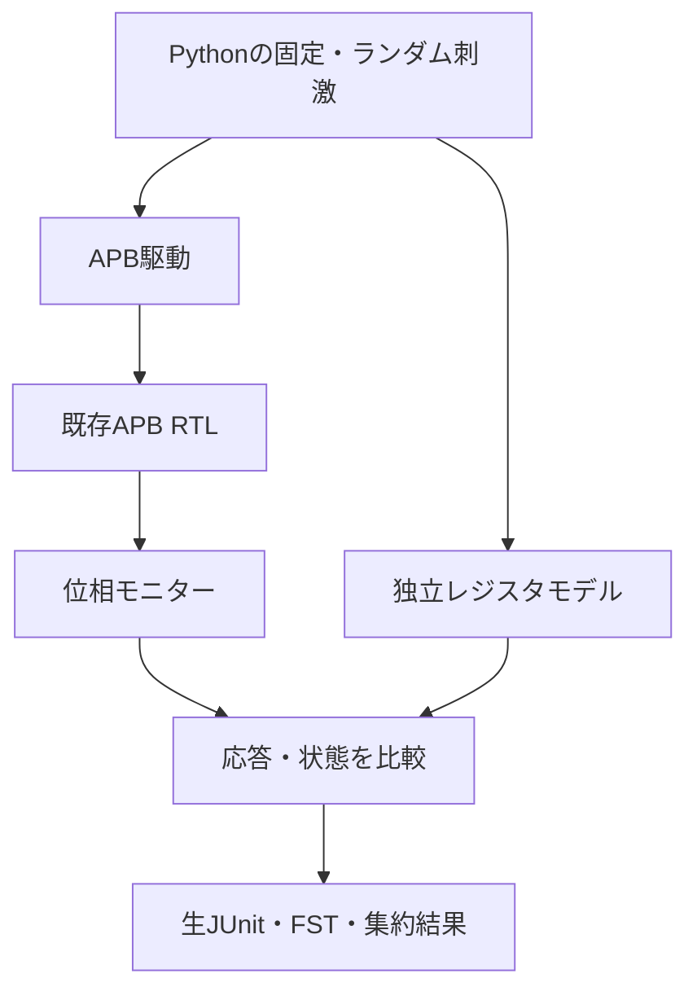

# cocotbからAPB RTLを検証する

Pythonのコルーチンで刺激・位相モニター・レジスタ参照モデルを動かす、実行可能なcocotb例です。[既存APBレジスタ](../gitlab-apb/README.md)を変更せずに使います。

## 駆動・観測・期待値を分ける

PythonがAPBを駆動し、完了エッジの前後を区別して参照レジスタと照合します。



cocotbが出力するJUnitとランナーのJUnitは、同じ試験の別階層として保存します。

| 確認する場面 | 期待する動作 | 主な照合対象 |
| --- | --- | --- |
| SETUP・待ち中 | 早すぎる更新がない | CONFIG・PENDING |
| 完了エッジ | 更新前の読出し値を比較 | PREADY・PSLVERR・PRDATA |
| エッジ後 | イベントとW1Cの優先順位を適用 | 更新後の状態 |

## 準備

POSIX、Python 3.10以上、Icarus Verilogを用意します。初回だけ専用の一時仮想環境へ[固定版パッケージ](tools-requirements.txt)を入れます。既に作成した環境を再利用する場合はactivateから始めます。

```sh
python3 -m venv /tmp/lsi-cocotb-venv
. /tmp/lsi-cocotb-venv/bin/activate
python3 -m pip install -r examples/local-cocotb/tools-requirements.txt
python3 examples/local-cocotb/run.py
```

cocotb 2.1.0と依存パッケージを固定しています。Python runnerのAPIを使い、Icarusのtime unit／precisionを1ns／1psに指定します。APIの参照先は[cocotb公式](https://docs.cocotb.org/en/stable/runner.html)です。

## 検査内容

各トランザクションのSETUPとACCESSをPythonから直接駆動し、SETUPで未完了のまま値が変わらないこと、規定の待ち数、PREADY・PSLVERR、読出しデータ、更新後のCONFIG／PENDINGを確認します。期待値はレジスタ属性とイベント優先順位から計算します。

固定試験はCONFIG読書き、ID読出し、IDへの不正書込み、未定義・非整列番地、イベントとW1Cの同時成立です。新しいイベントをクリアより優先します。読出し値は完了エッジの更新前、レジスタ状態はエッジ後を照合します。ランダム試験では番地・方向・データ・SETUP／完了時イベントを変えます。

`wait0`／`wait2`の各構成で[3要求・6目標](requirements.json)を要求します。3つのRTL変異はSETUPでの早期書込み、W1C優先順位の誤り、不正書込みでのCONFIG更新です。別に、正しいRTLへ意図的に誤った期待IDを与える診断も実行します。これは期待値側を自動診断する機能ではなく、期待値が誤っていてもテストが失敗する例です。

## 実行と証跡

```sh
python3 examples/local-cocotb/run.py --profile nightly
COCOTB_PYTHON=/tmp/lsi-cocotb-venv/bin/python python3 -m unittest discover -s examples/local-cocotb/tests -v
```

smokeは固定10トランザクションと32ランダムトランザクション×1 seed、nightlyは300×3 seedです。ランダムケースの冒頭にも固定10トランザクションを入れます。checksはAPBトランザクション数で、クロック数ではありません。JUnitは2構成合計14／18件です。

[共通ホスト手順](../local-host-common/README.md)の証跡に加え、各ケースにcocotbが出力するJUnitとFST波形を保存します。予定した生JUnitの件数・成功／失敗と、波形の存在も要求します。生JUnitを親のJUnitへ再合算しません。診断・変異は通常実行のカバレッジへ加えません。

セルフテストは5件で、実cocotb、seed、件数、診断分類、指定コンパイラーが無い場合の拒否を含みます。UVM、covergroup DB、cocotbの全シミュレーターへの互換性を検証した例ではありません。
