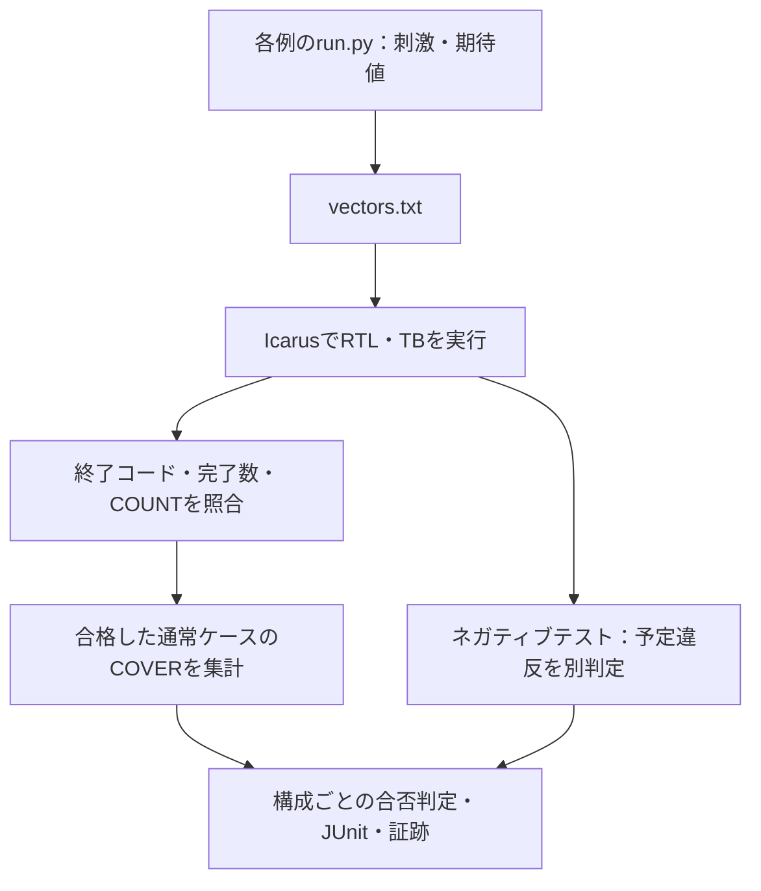

# Icarus共通ランナーで検証例を実行する

[ECC](../local-ecc/README.md)、[SPI](../local-spi/README.md)、[タイマー・ウォッチドッグ](../local-timer-watchdog/README.md)、[非同期FIFO](../local-async-fifo/README.md)、[I²C](../local-i2c/README.md)、[APB＋タイマー＋ウォッチドッグ](../local-apb-timer/README.md)、[AHB-Lite](../local-ahb/README.md)、[AXI4-Lite](../local-axi/README.md)、[AHB／AXI-Lite→APB結合](../local-bus-bridge/README.md)、[AXI4](../local-axi4/README.md)、[DMA](../local-dma/README.md)、[複数マスター接続](../local-interconnect/README.md)、[非同期APBブリッジ](../local-cdc-bridge/README.md)、[タイムアウト復旧](../local-recovery/README.md)、[低電力制御](../local-power/README.md)、[AXI4-Stream](../local-axis/README.md)、[固定小数点DSP](../local-dsp/README.md)、[同一領域の競合](../local-memory-order/README.md)、[AXI幅変換](../local-width-converter/README.md)、[アクセス保護](../local-access-control/README.md)、[ECCメモリ](../local-ecc-memory/README.md)、[クロック・リセット](../local-clock-reset/README.md)、[優先度付き割り込み](../local-priority-irq/README.md)、[リング式DMA](../local-descriptor-dma/README.md)、[クレジット通信](../local-credit-link/README.md)、[キャッシュとDMA](../local-cache-dma/README.md)、[AXI応答順序](../local-axi-reorder/README.md)、[DMA所有権](../local-dma-ownership/README.md)、[Stream DMA](../local-stream-dma/README.md)、[CRC](../local-packet-crc/README.md)、[64ビットカウンター](../local-counter-snapshot/README.md)、[MBIST](../local-mbist/README.md)、[セキュリティ・ライフサイクル](../local-secure-lifecycle/README.md)、[性能モニター](../local-performance-monitor/README.md)、[CDCハンドシェイク](../local-cdc-handshake/README.md)、[JTAG TAP](../local-jtag-tap/README.md)、[アドレスマップ](../local-address-map/README.md)、[ロックステップ監視](../local-lockstep-monitor/README.md)、[INT8シストリックアレイ](../local-systolic-array/README.md)、[再量子化](../local-requantize/README.md)、[活性化関数](../local-activation/README.md)、[畳み込みのラインバッファ](../local-conv-window/README.md)、[合成後ネットリストのシミュレーション](../local-gate-sim/README.md)、[多サイクル除算器](../local-divider/README.md)、[RISC-VコアとISSの比較](../local-riscv-iss/README.md)、[分岐予測器](../local-branch-predictor/README.md)、[ロード・ストア](../local-load-store/README.md)、[例外・割り込み](../local-riscv-traps/README.md)の共通ランナーです。

## 実行から構成別判定まで

入力と独立した期待値を生成し、終了状態・件数・通常実行のカバレッジを構成ごとに照合します。



図は実行と判定の依存関係です。ネガティブテストの到達で、通常ケースの未達を補いません。

| 確認する場面 | 期待する動作 | 主な照合対象 |
| --- | --- | --- |
| 通常ケース | 終了・比較数・種別件数が一致 | ログ・result.json |
| 構成ごとの合否判定 | 各構成で必須目標へ到達 | coverage.json |
| ネガティブテスト | 予定ラベルと異常終了が一致 | 通常実行のカバレッジへ加算しない |

## 準備と実行

POSIX環境（macOS／Linux）、Python 3.10以上、PATH上のIcarus Verilog（`iverilog`と`vvp`）を使います。追加のPythonパッケージは不要です。リポジトリのルートから実行してください。

```sh
python3 examples/local-ecc/run.py
python3 examples/local-spi/run.py
python3 examples/local-timer-watchdog/run.py
python3 examples/local-async-fifo/run.py
python3 examples/local-i2c/run.py
python3 examples/local-apb-timer/run.py
python3 examples/local-ahb/run.py
python3 examples/local-axi/run.py
python3 examples/local-bus-bridge/run.py
python3 examples/local-axi4/run.py
python3 examples/local-system-regression/run.py --stage simulation
python3 examples/local-axis/run.py
python3 examples/local-dsp/run.py
python3 examples/local-memory-order/run.py
python3 examples/local-gap-regression/run.py --stage core
```

各例は、境界値の通常検証、seedを固定したランダム検証、意図的な不具合・期待値の誤りを加えた4種類のネガティブテストを実行します。ECCは保証範囲外の診断2件も別枠で実行します。カバレッジはSystemVerilogのcovergroupではなく、テストベンチが出力する`COVER`ログを集計する簡易実装です。

各例の`run.py`が刺激と期待値を作り、このディレクトリの`runner.py`が実行・集計します。[既存IRQ例](../local-irq-cdc/run.py)のプロセス起動、タイムアウト、終了判定を再利用するため、例のディレクトリだけを抜き出さず、リポジトリ全体を取得してください。

## オプションと再現

```sh
python3 examples/local-spi/run.py --configuration mode3-div4 --seed 42 --iterations 100 --out artifacts/spi-seed42
python3 examples/local-timer-watchdog/run.py --profile nightly --out artifacts/timer-nightly
```

- `--configuration`：既定は`all`。選択肢は各例のREADMEまたは`--help`で確認できます。
- `--profile smoke|nightly`：既定はsmoke。nightlyは基準seed、seed+1、seed+2の3回を実行し、既定のランダム操作数も増やします。ローカルでの長めのリグレッションであり、自動スケジュールではありません。
- `--seed`：既定は17。`--iterations`は**各seedのランダム操作数**です。ECCの全数検査や各例の固定シナリオは削減しません。
- `--demo-bug 1..4`：通常検証側にも指定の変異を入れます。意図した不具合の検出を通常リグレッションの失敗として確認するため、終了コード1が期待結果です。固定の変異検出ケース4件も別に残ります。
- `--timeout`：ツール版の取得、各ビルド、各シミュレーションに適用する秒数。既定は10秒で、リグレッション全体の制限時間ではありません。
- `--iverilog`、`--vvp`：使用する実行ファイルを指定します。自動でツールのインストールはしません。
- `--requirements`：別の要求カタログを試す場合に指定します。未到達目標の追加などの自己確認に使えます。分母を変更した結果は標準カタログと比較せず、カタログの版とハッシュを確認してください。
- `--out`：新規の出力先。既存ディレクトリは上書きしません。省略時は`artifacts/`以下にUTC時刻を含む名前を付けます。

同じソース、カタログ、Python・シミュレータの版、構成、profile、seed、iterationsで再現します。生成ベクトル自体も保存するので、乱数生成の版が変わった場合の比較にも使えます。

## 合格条件と証跡

通常検証は、終了コード0、唯一の`RESULT PASS checks=N`、予定の検査数、重複のない種別別`COUNT`がすべて一致して合格です。ネガティブテストは、予定した唯一の`CHECK_FAIL`ラベルと非ゼロ終了が必要です。無関係なクラッシュ、タイムアウト、ビルド失敗を変異検出成功には数えません。

必須目標は**合格した通常検証だけ**から集計し、全構成がそれぞれ全目標を達成する必要があります。変異検出やECCの保証範囲外の診断で得た観測は、通常検証の不足を埋めません。予定ケースの完了、全ケースの期待結果、構成別の必須目標がそろった場合だけリグレッションの終了コードを0にします。100%は、この教材のカタログの達成を示します。

出力先には次を保存します。

- `manifest.json`：全ケースと入力・期待値、構成、seed、ツール引数の元になる設定、ソース・カタログのSHA-256。取り込むPython参照モデルなど、プラグインの`EXTRA_INPUTS`も記録します。
- `tools.json`、版取得ログ、`builds.json`、構成・変異別ビルドログ。
- ケース別`vectors.txt`、`simulation.log`、`wave.vcd`、`result.json`。
- `requirements.json`：使用した要求カタログの写し。
- `coverage.json`：構成別の必須数、達成数、未達、目標に対応する成功ケース。
- `summary.json`：予定／完了数、通常成功、変異検出、診断成功、総合判定。
- `junit.xml`：各実行と**各構成の合否判定**を別テストケースとして出力。

`artifacts/`はGit管理の対象外です。ビルド失敗など通常のエラー時も集計を保存しますが、強制終了・ディスク書込み失敗などで最終ファイルが完成しない場合は、残ったマニフェストとログから調べます。

## ランナー自体の確認

```sh
python3 -m unittest discover -s examples/local-common/tests -v
python3 -m unittest discover -s examples/local-ecc/tests -v
python3 -m unittest discover -s examples/local-spi/tests -v
python3 -m unittest discover -s examples/local-timer-watchdog/tests -v
python3 -m unittest discover -s examples/local-async-fifo/tests -v
python3 -m unittest discover -s examples/local-i2c/tests -v
python3 -m unittest discover -s examples/local-apb-timer/tests -v
python3 -m unittest discover -s examples/local-ahb/tests -v
python3 -m unittest discover -s examples/local-axi/tests -v
python3 -m unittest discover -s examples/local-bus-bridge/tests -v
python3 -m unittest discover -s examples/local-axi4/tests -v
python3 -m unittest discover -s examples/local-dma/tests -v
python3 -m unittest discover -s examples/local-interconnect/tests -v
python3 -m unittest discover -s examples/local-cdc-bridge/tests -v
python3 -m unittest discover -s examples/local-recovery/tests -v
python3 -m unittest discover -s examples/local-power/tests -v
python3 -m unittest discover -s examples/local-axis/tests -v
python3 -m unittest discover -s examples/local-dsp/tests -v
python3 -m unittest discover -s examples/local-memory-order/tests -v
python3 -m unittest discover -s examples/local-secure-lifecycle/tests -v
python3 -m unittest discover -s examples/local-performance-monitor/tests -v
python3 -m unittest discover -s examples/local-cdc-handshake/tests -v
python3 -m unittest discover -s examples/local-jtag-tap/tests -v
python3 -m unittest discover -s examples/local-address-map/tests -v
python3 -m unittest discover -s examples/local-lockstep-monitor/tests -v
python3 -m unittest discover -s examples/local-gap-regression/tests -v
python3 -m unittest discover -s examples/local-systolic-array/tests -v
python3 -m unittest discover -s examples/local-requantize/tests -v
python3 -m unittest discover -s examples/local-activation/tests -v
python3 -m unittest discover -s examples/local-conv-window/tests -v
python3 -m unittest discover -s examples/local-ai-regression/tests -v
python3 -m unittest discover -s examples/local-gate-sim/tests -v
python3 -m unittest discover -s examples/local-divider/tests -v
python3 -m unittest discover -s examples/local-riscv-iss/tests -v
python3 -m unittest discover -s examples/local-branch-predictor/tests -v
python3 -m unittest discover -s examples/local-load-store/tests -v
python3 -m unittest discover -s examples/local-riscv-traps/tests -v
python3 -m unittest discover -s examples/local-access-control/tests -v
python3 -m unittest discover -s examples/local-axi-reorder/tests -v
python3 -m unittest discover -s examples/local-cache-dma/tests -v
python3 -m unittest discover -s examples/local-clock-reset/tests -v
python3 -m unittest discover -s examples/local-counter-snapshot/tests -v
python3 -m unittest discover -s examples/local-credit-link/tests -v
python3 -m unittest discover -s examples/local-descriptor-dma/tests -v
python3 -m unittest discover -s examples/local-dma-ownership/tests -v
python3 -m unittest discover -s examples/local-ecc-memory/tests -v
python3 -m unittest discover -s examples/local-mbist/tests -v
python3 -m unittest discover -s examples/local-packet-crc/tests -v
python3 -m unittest discover -s examples/local-priority-irq/tests -v
python3 -m unittest discover -s examples/local-stream-dma/tests -v
python3 -m unittest discover -s examples/local-width-converter/tests -v
```

従来18例の内訳は、共通14、ECC 6、SPI 4、タイマー・ウォッチドッグ6、非同期FIFO 6、I²C 5、APB結合7、AHB 9、AXI 9、バスブリッジ9、AXI4 6、DMA 6、複数マスター6、非同期APBブリッジ5、復旧6、低電力5、Stream 6、DSP 6、同一領域の競合6の計127テストです。実RTLの検証に加え、ビルド失敗、タイムアウト、無関係な異常終了、完了記録不足、件数の誤り・重複、通常検証のカバー欠落、要求未達、カタログ重複、出力先保護を確認します。これらは初期の11例のランナーのセルフテスト132件や、そのJUnit件数とは別です。

現在のローカル例全体のセルフテストは511件です。このうち共通シミュレーション48例が314件、本共通ランナーが15件で、合計329件です。残る182件は、フォーマル・ホスト連携・UVM・生成・探索・集約などの確認です。FP16／MXFP8／MXFP4の有理数モデル・ランナーの19件、Top-Kの4件、AI用回路の集約手順の5件、接続性の12件、命令デコーダの9件も含みます。SystemRDLを使う6件は、[専用のPython環境](../local-register-spec/README.md#準備と実行)で実行します。初期の11例の132件を合わせると、全セルフテストは643件です。

## AHB／AXIのフォーマル検証

[ローカルのフォーマル例](../local-bus-formal/README.md)は別ランナーで実行します。Pythonだけでなく、専用の仮想環境へ固定版のYosys・SBY・Z3を準備します。安全性証明・データBMC・到達性・変異検出・過剰な仮定の診断を分けて判定し、シミュレーションとは別に45件のJUnitを保存します。

```sh
python3 -m unittest discover -s examples/local-bus-formal/tests -v
```

フォーマルの判定テスト12件はツールなしでも実行できます。実際の証明はリンク先の実行コマンドで確認してください。

## プロトコル・クロス・X／リセット・性能・コードカバレッジ

[バス検証の追加ランナー](../local-bus-validation/README.md)は、VerilatorによるネイティブSVA・line／toggle計測と、Icarusによる4値検査をまとめます。APBブリッジとAXI4を子リグレッションとして呼ぶこともできます。フォーマル45件・本共通ランナー48例の734／942件とは、実行内容とJUnitの階層を分けて確認してください。

```sh
python3 examples/local-bus-validation/run.py
python3 -m unittest discover -s examples/local-bus-validation/tests -v
```

## システム例と追加の証明

[システムリグレッション](../local-system-regression/README.md)は5つのシミュレーション例と、AXI4フォーマル・FIFO等価性を子リグレッションとして実行します。後2例は[共通フォーマルランナー](../local-formal-common/README.md)を使い、本シミュレーションランナーとは別の計画・JUnit・仮定を保存します。集約ランナーの合否判定と子の個別結果を二重計上しないでください。

## C・cocotb・差分・完了期限

[追加検証7例](../local-advanced-regression/README.md)は、上記3例に加え、Cドライバ・cocotb・シミュレータ差分と、進行条件を置く完了期限の証明を実行します。C等の3例は[別のホストランナー](../local-host-common/README.md)、完了期限は共通フォーマルランナーを使います。追加パッケージ、チェック単位、ネガティブテストの注入先は各手順を参照してください。ネガティブテストの件数は一律のRTL変異の検出率ではありません。

## 失敗の縮小・カバレッジ収束・保護・UVMへの追加

[7例のローカルリグレッション](../local-workflow-regression/README.md)には、4つの新規回路（幅変換・アクセス保護・ECCメモリ・クロック停止とリセット）と、失敗の縮小・カバレッジによる刺激調整・UVMがあります。4回路は本共通ランナーを使い、残る例は[別の証跡補助コード](../local-exploration-common/README.md)を使います。

```sh
python3 examples/local-width-converter/run.py
python3 examples/local-access-control/run.py
python3 examples/local-ecc-memory/run.py
python3 examples/local-clock-reset/run.py
python3 examples/local-workflow-regression/run.py --stage core
```

前回追加までの計画は22例・53構成、JUnit 373／479件です。従来18例・45構成の317／407件へ、4例・8構成の56／72件を加えた値です。セルフテストは従来のシミュレーション・共通127件に4回路24件を加え151件で、探索・UVM等は別に数えます。元の18例の確認結果を、新規例の実行結果として流用しません。

## 優先度付き割り込み・リング式DMA・クレジット・キャッシュ

[新しい7例の集約手順](../local-soc-regression/README.md)のうち、4回路は本共通ランナーで動きます。各2構成・4種類の変異、合計8構成のJUnitはsmoke 56件／nightly 72件です。4回路各5件のセルフテストも用意しています。

```sh
python3 examples/local-soc-regression/run.py --stage core
python3 examples/local-soc-regression/run.py --stage core --profile nightly
```

前回追加時の共通シミュレーションは26例・61構成、JUnit 429／551件です。シミュレーション・共通のセルフテストは151＋20＝171件です。今回のツール連携・反例再現・集約の確認18件は別枠です。他の集約ランナーへの追加3件も含め、その追加までのローカル確認全体の計画は275件です。今回の7例に対応する確認は38件です。従来の例の実行結果を、新規例の結果へ流用しません。

## RALとRTLの接続・AXI順序・DMA・CRC・カウンター・MBIST

[新しい7例](../local-extension-regression/README.md)のうち、6回路は本ランナーを使います。各2構成・4種類の変異で、12構成のJUnitは84／108件です。生成RALのfrontdoorは別のUVMランナーです。

```sh
python3 examples/local-extension-regression/run.py --stage core
python3 examples/local-extension-regression/run.py --stage core --profile nightly
```

この7例を追加した時点の共通シミュレーションは32例・73構成、JUnit513／659件、シミュレーション・共通のセルフテストは206件でした。生成RAL2件・親4件も加えた新規確認はレビュー追加5件を含めて41件です。その後、下記6例が加わった時点では38例・85構成、JUnit597／767件、シミュレーション・共通のセルフテスト251件でした。現在の件数と内訳は、上記の「ランナー自体の確認」を参照してください。


## セキュリティ・性能・CDC・JTAG・アドレスマップ・ロックステップ

[検証領域を補う6例](../local-gap-regression/README.md)も本共通ランナーを使います。各2構成・4種類の変異で、12構成のJUnitはsmoke 84件／nightly 108件です。子の通常実行のカバレッジ目標はセキュリティ15、性能13、CDC15、JTAG14、アドレスマップ13、ロックステップ12で、6例のセルフテストは45件、親の4件を加えると49件です。

```sh
python3 examples/local-gap-regression/run.py --stage core
python3 examples/local-gap-regression/run.py --stage core --profile nightly
```

この6例を追加した時点の共通シミュレーションは38例・85構成、JUnit597／767件です。追加時に実行した範囲は6例のsmoke／nightlyと確認49件です。


## MXFP4の4×4 GEMMと量子化

[FP16／MXFP8／MXFP4例](../local-mxfp4/README.md)は、記事と元リポジトリの仕様・RTLを固定版で取り込み、FP16／MXFP8を拡張してVerilatorで実行します。上流の検証環境に加え、独立した有理数モデルで各モードの積和・丸め・量子化中点を照合します。nightlyでは全65,536通りのE4M3要素ペアと全FP16コードの変換も実行します。本共通Icarusランナーの例数・構成数やJUnit件数には含めません。独自ランナーの26件は親子の集約判定ではなく、各検査群の合否です。

```sh
python3 examples/local-mxfp4/run.py
python3 examples/local-mxfp4/run.py --profile nightly
python3 -m unittest discover -s examples/local-mxfp4/tests -v
```

## AI用回路の4例

[AI用回路の集約手順](../local-ai-regression/README.md)のうち、シストリックアレイ・再量子化・活性化関数・ラインバッファの4例は本共通ランナーを使います。各2構成・4種類の変異で、8構成のJUnitはsmoke 60件／nightly 76件です。この件数には活性化関数の診断4件を含みます。通常実行のカバレッジ目標はシストリックアレイ18、再量子化19、活性化関数14、ラインバッファ17で、4例のセルフテストは30件です。

```sh
python3 examples/local-ai-regression/run.py --stage simulation
python3 examples/local-ai-regression/run.py --stage simulation --profile nightly
```

活性化関数の例では、ベクトルに正確な関数値と許容幅を入れ、テストベンチが誤差の上限で判定します。ビット列の一致を求めるほかの例と同じランナー・証跡の形式で扱えます。AI用回路を加えた時点の共通シミュレーションは42例・93構成、JUnit657／843件でした。Top-K（フォーマル）とMXFP4（Verilator）は別のランナーで、この件数には含めません。

## 検証手法を補う4例

[合成後ネットリストのシミュレーション](../local-gate-sim/README.md)、[多サイクル除算器](../local-divider/README.md)、[RISC-VコアとISSの比較](../local-riscv-iss/README.md)の3例は本共通ランナーを使います。[接続性のフォーマル検査](../local-connectivity/README.md)は[共通フォーマル手順](../local-formal-common/README.md)を使います。

| 検証例 | 構成 | JUnit（smoke／nightly） | 目標 | セルフテスト |
| --- | --- | --- | --- | --- |
| 合成後ネットリスト | `rtl`・`gate` | 14／18 | 9 | 6 |
| 多サイクル除算器 | `w32`・`w8` | 14／18 | 16 | 8 |
| RISC-VコアとISS | `rv32i` | 7／9 | 16 | 10 |

合成後ネットリストの例のため、プラグインに2つの任意のフックを加えました。どちらも、定義しない例の動作は変わりません。

- `build_sources(args, configuration, parameters, mutation, directory)`：構成と変異ごとに、コンパイルするソースの一覧と、その準備の実行結果を返します。合成後ネットリストの例は、ここでYosysを実行してネットリストを作ります。準備が失敗すると、そのビルドを使うケースはエラーになり、準備のログを案内します。成功した場合は、準備の結果と、実際にコンパイルした全ソースのSHA-256を`builds.json`に記録します。マニフェストは実行前に作るため、生成するファイルのハッシュはこちらに残します。
- `add_arguments(parser)`：例ごとのオプション（`--yosys`、`--cell-library`など）を追加します。

除算器の例は、シミュレーションの`run.py`とは別に、フォーマルの`formal.py`（4・8ビット、12件のJUnit）を持ちます。3例を加えた共通シミュレーションは45例・98構成、JUnit 692／888件です。

## プロセッサの例の追加

[分岐予測器](../local-branch-predictor/README.md)は、[RISC-VコアとISSの比較](../local-riscv-iss/README.md)のコア・テストベンチ・ISSを共有し、構成`none`・`static`・`dynamic`で予測器を切り替えます。JUnitは21／27件、目標は10、セルフテストは6件です。コアの変異5〜8を使うため、この例の`--demo-bug 1..4`は変異5〜8を選びます。予測に関わらない構成で合格すべき変異は、診断として実行します。分岐予測器を加えた時点の共通シミュレーションは46例・101構成、JUnit 713／915件でした。

[ロード・ストア](../local-load-store/README.md)も同じコアとテストベンチを共有し、バイト・ハーフワードのアクセスを加えます。構成は`rv32i`の1つで、JUnitは7／9件、目標は11、セルフテストは8件です。この例の`--demo-bug 1..4`はコアの変異9〜12を選びます。ロード・ストアを加えた時点の共通シミュレーションは47例・102構成、JUnit 720／924件でした。

[例外・割り込み](../local-riscv-traps/README.md)も同じコアとテストベンチを共有し、`TRAPS=1`で機械モードのCSR・例外・外部割り込み・MRETを加えます。構成は`traps`（予測なし）と`traps-predict`（動的予測）の2つで、JUnitは14／18件、目標は10、セルフテストは9件です。この例の`--demo-bug 1..4`はコアの変異13〜16を選びます。不正な命令の判定には、[命令デコーダ](../local-riscv-decoder/README.md)で証明した回路を使うので、コアのソースにはデコーダのRTLも含まれます。例外・割り込みを加えた共通シミュレーションは48例・104構成、JUnit 734／942件です。
