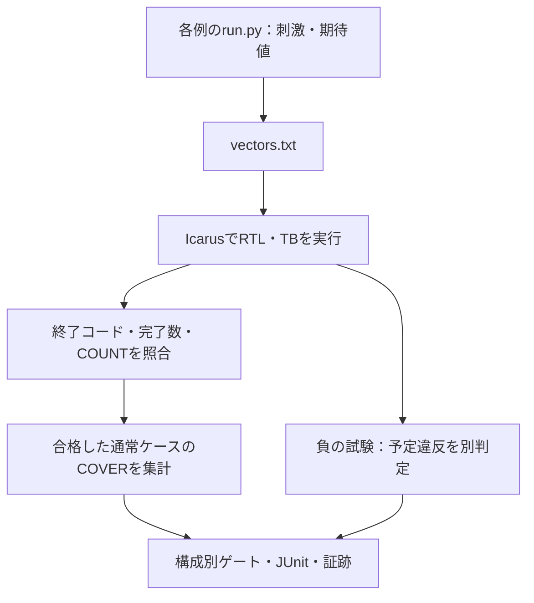

# ローカル専用の検証例を実行する

[ECC](../local-ecc/README.md)、[SPI](../local-spi/README.md)、[タイマー・ウォッチドッグ](../local-timer-watchdog/README.md)、[非同期FIFO](../local-async-fifo/README.md)、[I²C](../local-i2c/README.md)、[APB＋タイマー＋ウォッチドッグ](../local-apb-timer/README.md)、[AHB-Lite](../local-ahb/README.md)、[AXI4-Lite](../local-axi/README.md)、[AHB／AXI-Lite→APB結合](../local-bus-bridge/README.md)、[AXI4](../local-axi4/README.md)、[DMA](../local-dma/README.md)、[複数マスター接続](../local-interconnect/README.md)、[非同期APBブリッジ](../local-cdc-bridge/README.md)、[タイムアウト復旧](../local-recovery/README.md)、[低電力制御](../local-power/README.md)、[AXI4-Stream](../local-axis/README.md)、[固定小数点DSP](../local-dsp/README.md)、[同一領域の競合](../local-memory-order/README.md)、[AXI幅変換](../local-width-converter/README.md)、[アクセス保護](../local-access-control/README.md)、[ECCメモリ](../local-ecc-memory/README.md)、[クロック・リセット](../local-clock-reset/README.md)、[優先順位付き割込み](../local-priority-irq/README.md)、[リング式DMA](../local-descriptor-dma/README.md)、[クレジット通信](../local-credit-link/README.md)、[キャッシュとDMA](../local-cache-dma/README.md)の共通ランナーです。GitLabのプロジェクト、Runner、利用枠は使いません。ルートの`.gitlab-ci.yml`からも呼び出しません。

## 実行から構成別判定まで

入力と独立した期待値を生成し、終了状態・件数・通常カバレッジを構成ごとに照合します。



図は実行と判定の依存関係です。負の試験の到達で、通常ケースの未達を補いません。

| 確認する場面 | 期待する動作 | 主な照合対象 |
| --- | --- | --- |
| 通常ケース | 終了・比較数・種別件数が一致 | ログ・result.json |
| 構成別ゲート | 各構成で必須目標へ到達 | coverage.json |
| 負の試験 | 予定ラベルと異常終了が一致 | 通常カバーへ加算しない |

## 準備と実行

POSIX環境（macOS／Linux）、Python 3.10以上、PATH上のIcarus Verilog（`iverilog`と`vvp`）を使います。追加のPythonパッケージは不要です。リポジトリのルートから実行してください。

```sh
python3 examples/local-ecc/run.py
python3 examples/local-spi/run.py
python3 examples/local-timer-watchdog/run.py
python3 examples/local-async-fifo/run.py
python3 examples/local-i2c/run.py
python3 examples/local-apb-timer/run.py
python3 examples/local-ahb/run.py
python3 examples/local-axi/run.py
python3 examples/local-bus-bridge/run.py
python3 examples/local-axi4/run.py
python3 examples/local-system-regression/run.py --stage simulation
python3 examples/local-axis/run.py
python3 examples/local-dsp/run.py
python3 examples/local-memory-order/run.py
```

各例は、境界値の通常検証、seedを固定したランダム検証、意図的な不具合・期待値の誤りを加えた4種類の負の試験を実行します。ECCは保証範囲外の診断2件も別枠で実行します。カバレッジはSystemVerilogのcovergroupではなく、テストベンチが出力する`COVER`ログを集計する簡易実装です。

各例の`run.py`が刺激と期待値を作り、このディレクトリの`runner.py`が実行・集計します。[既存IRQ例](../gitlab-regression/run.py)のプロセス起動、タイムアウト、終了判定を再利用するため、例のディレクトリだけを抜き出さず、リポジトリ全体を取得してください。

## オプションと再現

```sh
python3 examples/local-spi/run.py --configuration mode3-div4 --seed 42 --iterations 100 --out artifacts/spi-seed42
python3 examples/local-timer-watchdog/run.py --profile nightly --out artifacts/timer-nightly
```

- `--configuration`：既定は`all`。選択肢は各例のREADMEまたは`--help`で確認できます。
- `--profile smoke|nightly`：既定はsmoke。nightlyは基準seed、seed+1、seed+2の3回を実行し、既定のランダム操作数も増やします。ローカルでの長めの回帰であり、自動スケジュールではありません。
- `--seed`：既定は17。`--iterations`は**各seedのランダム操作数**です。ECCの全数検査や各例の固定シナリオは削減しません。
- `--demo-bug 1..4`：通常検証側にも指定の変異を入れます。意図した不具合の検出を通常回帰の失敗として確認するため、終了コード1が期待結果です。固定の変異検出ケース4件も別に残ります。
- `--timeout`：ツール版の取得、各ビルド、各シミュレーションに適用する秒数。既定は10秒で、回帰全体の制限時間ではありません。
- `--iverilog`、`--vvp`：使用する実行ファイルを指定します。自動でツールのインストールはしません。
- `--requirements`：別の要求カタログを試す場合に指定します。未到達目標の追加などの自己確認に使えます。分母を変更した結果は標準カタログと比較せず、カタログの版とハッシュを確認してください。
- `--out`：新規の出力先。既存ディレクトリは上書きしません。省略時は`artifacts/`以下にUTC時刻を含む名前を付けます。

同じソース、カタログ、Python・シミュレータの版、構成、profile、seed、iterationsで再現します。生成ベクトル自体も保存するので、乱数生成の版が変わった場合の比較にも使えます。

## 合格条件と証跡

通常検証は、終了コード0、唯一の`RESULT PASS checks=N`、予定の検査数、重複のない種別別`COUNT`がすべて一致して合格です。負の試験は、予定した唯一の`CHECK_FAIL`ラベルと非ゼロ終了が必要です。無関係なクラッシュ、タイムアウト、ビルド失敗を変異検出成功には数えません。

必須目標は**合格した通常検証だけ**から集計し、全構成がそれぞれ全目標を達成する必要があります。変異検出やECCの保証範囲外の診断で得た観測は、通常検証の不足を埋めません。予定ケースの完了、全ケースの期待結果、構成別の必須目標がそろった場合だけ回帰の終了コードを0にします。100%は、この教材のカタログの達成を示します。

出力先には次を保存します。

- `manifest.json`：全ケースと入力・期待値、構成、seed、ツール引数の元になる設定、ソース・カタログのSHA-256。取り込むPython参照モデルなど、プラグインの`EXTRA_INPUTS`も記録します。
- `tools.json`、版取得ログ、`builds.json`、構成・変異別ビルドログ。
- ケース別`vectors.txt`、`simulation.log`、`wave.vcd`、`result.json`。
- `requirements.json`：使用した要求カタログの写し。
- `coverage.json`：構成別の必須数、達成数、未達、目標に対応する成功ケース。
- `summary.json`：予定／完了数、通常成功、変異検出、診断成功、総合判定。
- `junit.xml`：各実行と**各構成のゲート**を別テストケースとして出力。

`artifacts/`はGit管理の対象外です。ビルド失敗など通常のエラー時も集計を保存しますが、強制終了・ディスク書込み失敗などで最終ファイルが完成しない場合は、残ったマニフェストとログから調べます。

## ランナー自体の確認

```sh
python3 -m unittest discover -s examples/local-common/tests -v
python3 -m unittest discover -s examples/local-ecc/tests -v
python3 -m unittest discover -s examples/local-spi/tests -v
python3 -m unittest discover -s examples/local-timer-watchdog/tests -v
python3 -m unittest discover -s examples/local-async-fifo/tests -v
python3 -m unittest discover -s examples/local-i2c/tests -v
python3 -m unittest discover -s examples/local-apb-timer/tests -v
python3 -m unittest discover -s examples/local-ahb/tests -v
python3 -m unittest discover -s examples/local-axi/tests -v
python3 -m unittest discover -s examples/local-bus-bridge/tests -v
python3 -m unittest discover -s examples/local-axi4/tests -v
python3 -m unittest discover -s examples/local-dma/tests -v
python3 -m unittest discover -s examples/local-interconnect/tests -v
python3 -m unittest discover -s examples/local-cdc-bridge/tests -v
python3 -m unittest discover -s examples/local-recovery/tests -v
python3 -m unittest discover -s examples/local-power/tests -v
python3 -m unittest discover -s examples/local-axis/tests -v
python3 -m unittest discover -s examples/local-dsp/tests -v
python3 -m unittest discover -s examples/local-memory-order/tests -v
```

従来18例の内訳は、共通14、ECC 6、SPI 4、タイマー・ウォッチドッグ6、非同期FIFO 6、I²C 5、APB結合7、AHB 9、AXI 9、バスブリッジ9、AXI4 6、DMA 6、複数マスター6、非同期APBブリッジ5、復旧6、低電力5、Stream 6、DSP 6、同一領域の競合6の計127テストです。実RTLの検証に加え、ビルド失敗、タイムアウト、無関係な異常終了、完了記録不足、件数の誤り・重複、通常検証のカバー欠落、要求未達、カタログ重複、出力先保護を確認します。これらは既存GitLab例のランナー確認132テストや、GitLab回帰のJUnit件数とは別です。

## AHB／AXIのフォーマル検証

[ローカルのフォーマル例](../local-bus-formal/README.md)は別ランナーで実行します。Pythonだけでなく、専用の仮想環境へ固定版のYosys・SBY・Z3を準備します。安全性証明・データBMC・到達性・変異検出・過剰な仮定の診断を分けて判定し、シミュレーションとは別に45件のJUnitを保存します。

```sh
python3 -m unittest discover -s examples/local-bus-formal/tests -v
```

フォーマルの判定テスト12件はツールなしでも実行できます。下記のバス検証6件、共通フォーマル9件・AXI4計画3件・等価性計画2件・システム集約3件、さらにホスト共通8件・Cドライバ4件・cocotb 5件・差分5件・完了性3件・追加集約3件も含め、従来のローカル確認テストは190件です。[UVM等の7例](../local-workflow-regression/README.md)とレビュー時の追加44件を含む計画は234件でした。[今回の7例](../local-soc-regression/README.md)の36件を加えた計画は270件です。実際の証明はリンク先の実行コマンドで確認してください。

## プロトコル・クロス・X／リセット・性能・コードカバレッジ

[バス検証の追加ランナー](../local-bus-validation/README.md)は、VerilatorによるネイティブSVA・line／toggle計測と、Icarusによる4値検査をまとめます。APBブリッジとAXI4を子回帰として呼ぶこともできます。フォーマル45件・本共通ランナー26例の429／551件とは、実行内容とJUnitの階層を分けて確認してください。

```sh
python3 examples/local-bus-validation/run.py
python3 -m unittest discover -s examples/local-bus-validation/tests -v
```

## システム例と追加の証明

[システム回帰](../local-system-regression/README.md)は5つのシミュレーション例と、AXI4フォーマル・FIFO等価性を子回帰として実行します。後2例は[共通フォーマルランナー](../local-formal-common/README.md)を使い、本シミュレーションランナーとは別の計画・JUnit・仮定を保存します。親の集約ゲートと子の個別結果を二重計上しないでください。

## C・cocotb・差分・完了期限

[追加検証7例](../local-advanced-regression/README.md)は、上記3例に加え、Cドライバ・cocotb・シミュレーター差分と、進行条件を置く完了期限の証明を実行します。C等の3例は[別のホストランナー](../local-host-common/README.md)、完了期限は共通フォーマルランナーを使います。追加パッケージ、チェック単位、負の試験の注入先は各手順を参照してください。負の試験の件数は一律のRTL変異率ではありません。

## 失敗の縮小・カバレッジ収束・保護・UVMへの追加

[7例のローカル回帰](../local-workflow-regression/README.md)には、4つの新規回路（幅変換・アクセス保護・ECCメモリ・クロック停止とリセット）と、失敗の縮小・カバレッジによる刺激調整・UVMがあります。4回路は本共通ランナーを使い、残る例は[別の証跡補助コード](../local-exploration-common/README.md)を使います。

```sh
python3 examples/local-width-converter/run.py
python3 examples/local-access-control/run.py
python3 examples/local-ecc-memory/run.py
python3 examples/local-clock-reset/run.py
python3 examples/local-workflow-regression/run.py --stage core
```

前回追加までの計画は22例・53構成、JUnit 373／479件です。従来18例・45構成の317／407件へ、4例・8構成の56／72件を加えた値です。確認テストは従来のシミュレーション・共通127件に4回路24件を加え151件で、探索・UVM等は別に数えます。元の18例の確認結果を、新規例の実行結果として流用しません。

## 優先順位付き割込み・リング式DMA・クレジット・キャッシュ

[新しい7例の集約手順](../local-soc-regression/README.md)のうち、4回路は本共通ランナーで動きます。各2構成・4変異、合計8構成のJUnitはsmoke 56件／nightly 72件です。4回路各5件の確認テストも用意しています。

```sh
python3 examples/local-soc-regression/run.py --stage core
python3 examples/local-soc-regression/run.py --stage core --profile nightly
```

現在の共通シミュレーションの計画は26例・61構成、JUnit 429／551件です。シミュレーション・共通の確認テストは151＋20＝171件です。今回のツール連携・反例再現・集約の確認16件は別枠で、ローカル確認全体の計画は270件です。今回実行した範囲は新規7例のsmoke／nightlyと追加36件です。従来の例の実行結果を、新規例の結果へ流用しません。
