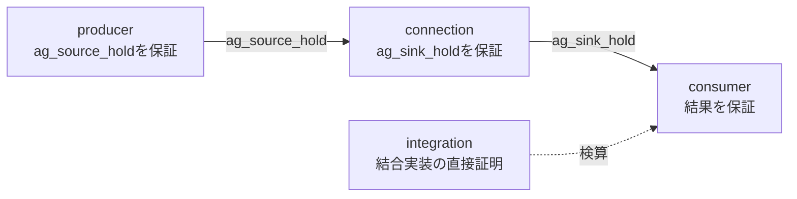

# 仮定・保証と証明の依存関係を確認する

要求を保持する送信側と、要求の先頭でデータを保存する受信側を、配線でつなぎます。受信側の結果が受理時のデータに対して正しいためには、送信側が待ち中のvalid・dataを保持し、配線がそれを崩さない必要があります。この契約を、送信側・配線・受信側の個別証明へ分け、仮定と保証の対応を台帳で照合する教材です。

## 1. 回路の契約

データは8ビットです。送信側は空き、または前要求の受理時に新しい`issue/value`を取り込み、validを提示した後はreadyまで保持します。受信側はvalidを最初に見たエッジでデータを保存し、次のエッジでreadyを提示して受理します。結果は保存値XOR `0xA5`です。同期リセットは未完了要求を取り消します。

| 証明ID | 対象と保証 | 入力の仮定 |
| --- | --- | --- |
| producer | 実際の送信側が待ち中にvalid・dataを保持する（`ag_source_hold`） | 初回リセット。ready等は任意。 |
| connection | 配線だけを対象に、受信側の入口でも保持が成り立つ（`ag_sink_hold`）。両ブロックのRTLは含まない。 | 初回リセットと、送信側の出口の`ag_source_hold`。 |
| consumer | 実際の受信側で受理とdoneが対応し、結果が受理値XOR `0xA5`になる | 初回リセットと、受信側の入口の`ag_sink_hold`。 |
| integration | 送信側・配線・受信側の実装を結合し、結果を直接証明する | 初回リセットのみ。契約をassumeしない。 |



[依存台帳](plan.json)の`contracts`は、どの仮定をどの証明の保証で解消するかを記録します。consumerはconnectionへ、connectionはproducerへ依存します。producerはreadyを任意にして証明するので、受信側の振る舞いを仮定しません。依存は一方向で、循環しません。したがって、3証明とも成立すれば、実装を結合した場合の`ap_done`・`ap_result`が導かれます。

integrationは**他の3証明から導いた結果ではありません**。同じ性質を結合実装に対して別に証明する独立した検算で、台帳の依存にも含めません。この小回路では全体を直接証明できるので検算に使えます。証明分割による高速化や、任意の契約を自動導出するアルゴリズムを示すものではありません。

## 2. 仮定と保証を一つの文から作る

保持契約の文は`contract_formal.sv`に、送信側出口の`ag_source_hold`と受信側入口の`ag_sink_hold`の2つだけです。書かれたままの形では、前者がproducerの保証（assert）、後者がconsumerの仮定（assume）です。connectionの証明では`formal_tasks.py`の`prepare`がYosysの`chformal`で同じ2文の役割を入れ替え、前者を仮定、後者を保証にします。

仮定だけを強めるとconnectionの証明が失敗し、文を弱めると配線・送信側のvalid変異を検出できなくなって失敗します。文を役割別に分けて書き直すと、コンパイル結果の`src`が一致しないため台帳の照合で拒否します。

## 3. 実行

[固定版のYoWASP・SBY・Z3](../local-formal-common/README.md)を準備し、そのPythonを使います。

```sh
. artifacts/toolchains/formal-venv/bin/activate
python3 examples/local-compositional-formal/run.py \
  --formal-python artifacts/toolchains/formal-venv/bin/python \
  --out artifacts/contract-proof
python3 -m unittest discover -s examples/local-compositional-formal/tests -v
```

プロファイルにかかわらず、内部の18フォーマルタスクと親の16判定を実行します。`--timeout`は各タスク、`--child-timeout`は内部の証明ランナー全体の上限です。境界は8ステップで、通常の4保証は帰納法完了を要求します。BMCやcoverと区別します。

内部の`formal_tasks.py`は登録済みの子入口です。`--suite formal`や全例実行では親から一度だけ起動し、依存判定も必ず行います。内部の部分タスクだけの成功を、最終の依存台帳の完了には使いません。

## 4. 診断と保存物

18タスクの内訳は次のとおりです。

| 種類 | 件数 | 内容 |
| --- | --- | --- |
| 通常の証明 | 4 | producer、connection、consumer、integration |
| 到達確認 | 4 | 各証明と同じ構成・同じ仮定のcover。動作、待ち、保持の前件、0以外の値 |
| 変異 | 6 | 送信側のdata・valid、受信側、配線のdata・valid、結合実装 |
| 仮定を外した反例 | 2 | consumerの`ap_result`、connectionの`ag_sink_hold` |
| 常時リセットの診断 | 2 | 証明と到達不能 |

常時リセットのproveはPASSになりますが、正常動作のcoverは未到達です。この診断のPASSを通常の保証へ流用しません。

親の16判定は、内部タスクの成功、正常な依存照合と、14診断です。

| 診断 | 拒否の理由 |
| --- | --- |
| 証明欠落・重複 | 予定した証明の結果がそろわない |
| 失敗・BMCだけの結果 | 帰納法で完了した証明ではない |
| 古いソース・ソース一覧の不足 | 現行ソースと異なる、またはコンパイル対象を含まない |
| 循環依存・孤立した証明 | 依存が閉じていない |
| プロパティ一覧の改変、常時リセット証明の付け替え | コンパイル結果のassert・assume・coverが計画と異なる |
| パラメータの改変 | ROLE等が計画と異なる、MUTATION・LOCK_RESETが0でない、ASSUME_HOLDが1でない |
| 仮定の未解消 | `contracts`にも初回リセットにも当たらない仮定が残る |
| 契約のない依存 | `requires`の辺が`contracts`と一致しない |
| 仮定と保証が別の文 | 同じプロパティ名のコンパイル結果の`src`が異なる |

各診断は拒否されるだけでなく、予定した理由で拒否される必要があります。依存checkerは、証明の成立を自分で確かめる証明器でも、改ざん検知の仕組みでもありません。実際の証明結果とコンパイル結果を照合します。仮定の妥当性は証明で、仕様に対する契約の適切さはレビューで確認します。

`tasks/`にSBY設定・コンパイル後のプロパティ一覧・ログ・反例と到達トレース、親に依存順序と各診断のJSON・JUnitを保存します。18タスクと16判定は別集計で、すべてを独立した証明数へ足しません。

モデルは単一クロック・2値・同期リセットです。初回以降のリセットも任意ですが、物理タイミング・CDC/RDC・4値動作や、無期限に待たせる相手との最終完了は証明していません。[証明の分割](../../docs/method/formal-verification.md#43-assume-guaranteeの仮定と保証の依存関係を確認する)と併せて使います。
