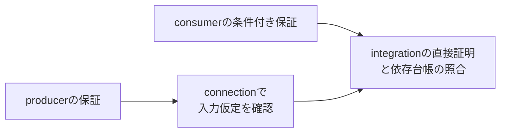

# 仮定・保証と証明の依存関係を確認する

要求を保持する送信側と、要求の先頭でデータを保存する受信側を接続します。受信側の結果が受理時のデータに対して正しいためには、送信側が待ち中のvalid・dataを保持する必要があります。この契約を、個別証明・接続時の確認・依存台帳へ分ける教材です。

## 1. 回路の契約

データは8ビットです。送信側は空き、または前要求の受理時に新しい`issue/value`を取り込み、validを提示した後はreadyまで保持します。受信側はvalidを最初に見たエッジでデータを保存し、次のエッジでreadyを提示して受理します。結果は保存値XOR `0xA5`です。同期リセットは未完了要求を取り消します。

| 証明ID | 対象と保証 | 入力の仮定 |
| --- | --- | --- |
| producer | 送信側が待ち中にvalid・dataを保持する | 初回リセット。ready等は任意。 |
| consumer | 受理とdoneが対応し、結果が受理値XOR `0xA5`になる | 初回リセットと、上流のvalid・data保持。 |
| connection | 実際の送信側と配線が、受信側の保持仮定を満たす | 初回リセット。上流保持をassumeしない。 |
| integration | 小さな結合実装の結果を直接証明する | 初回リセット。上流保持をassumeしない。 |



[依存台帳](plan.json)は、integrationがconsumerとconnectionへ、connectionがproducerへ依存することを記録します。consumerを証明するときにconnectionの結果を仮定して循環させる構成ではありません。条件付き保証と、その仮定を満たす実装・配線の証明をそろえます。

この小回路は結合実装も直接証明し、分割した結果の検算に使います。証明分割による高速化や、任意の契約を自動導出するアルゴリズムを示すものではありません。

## 2. 実行

[固定版のYoWASP・SBY・Z3](../local-formal-common/README.md)を準備し、そのPythonを使います。

```sh
. artifacts/toolchains/formal-venv/bin/activate
python3 examples/local-compositional-formal/run.py \
  --formal-python artifacts/toolchains/formal-venv/bin/python \
  --out artifacts/contract-proof
python3 -m unittest discover -s examples/local-compositional-formal/tests -v
```

プロファイルにかかわらず、内部の11フォーマルタスクと親の9判定を実行します。`--timeout`は各タスク、`--child-timeout`は内部の証明ランナー全体の上限です。境界は8ステップで、通常の4保証は帰納法完了を要求します。BMCやcoverと区別します。

内部の`formal_tasks.py`は登録済みの子入口です。`--suite formal`や全例実行では親から一度だけ起動し、依存判定も必ず行います。内部の部分タスクだけの成功を、最終の依存台帳の完了には使いません。

## 3. 診断と保存物

11タスクは、通常の4証明と到達確認、送信側・受信側・配線の3変異、保持仮定を外した受信側の反例、常時リセットの証明と到達不能の診断です。仮定を外すと`ap_result`の反例が出ること、正しいブロックでも配線を壊すと`ap_contract`が破れることを確認します。

常時リセットのproveはPASSになりますが、正常動作のcoverは未到達です。この診断のPASSを通常の保証へ流用しません。

親の9判定は、内部タスクの成功、正常な依存照合、証明欠落・重複・失敗・BMCだけの結果・古いソース・循環依存・孤立した証明の7診断です。証明のID・構成・mode・分類・プロパティ一覧・現行ソースを確認します。依存checkerは台帳の整合を検査するもので、仮定の意味を自動理解する証明器ではありません。

`tasks/`にSBY設定・コンパイル後のプロパティ一覧・ログ・反例と到達トレース、親に依存順序と各診断のJSON・JUnitを保存します。11タスクと9判定は別集計で、すべてを独立した証明数へ足しません。

モデルは単一クロック・2値・同期リセットです。初回以降のリセットも任意ですが、物理タイミング・CDC/RDC・4値動作や、無期限に待たせる相手との最終完了は証明していません。[証明の分割](../../docs/method/formal-verification.md#43-assume-guaranteeの仮定と保証の依存関係を確認する)と併せて使います。
