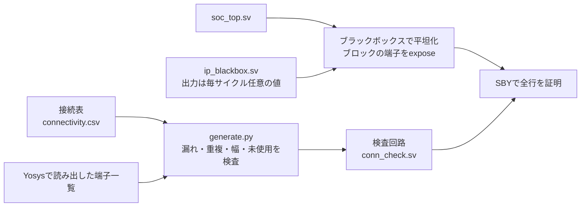

# SoCの配線を接続表からフォーマルに証明する

SoCの上位階層で、ブロック同士と端子をつなぐ配線を検証する教材です。各ブロックは単体で検証済みでも、結合時に割り込み番号の取り違え、使わない入力の固定値の誤り、デバッグ信号の出し忘れ・止め忘れ、リセットのつなぎ間違いが起きます。この例では、結合の仕様を接続表（CSV）に書き、表から検査回路を生成し、すべての行が成り立つことをフォーマル検証で証明します。

## 表から検査回路を作って証明する



検証対象は[`soc_top.sv`](rtl/soc_top.sv)の配線と、配線に含まれる小さな論理（端子の切替え、固定値、CPUへの割り込みのレジスタ1段）だけです。8つのブロックは、[`ip_blackbox.sv`](ip_blackbox.sv)の端子だけのモジュールに置き換えます。ブラックボックスの出力は毎サイクル任意の値をとるので、証明はブロックがどう動いても成り立ちます。ブロックの中身は、それぞれの単体検証で確かめる前提です。

## 接続表

[`connectivity.csv`](connectivity.csv)の1行が、生成される1つのassertになります。表は26行です。

| 列 | 内容 |
| --- | --- |
| `id` | 行の名前。assertは`ap_`に小文字の`id`を付けた名前になります |
| `to` | 接続先。ブロックの入力かSoCの出力で、空白で区切って複数書けます |
| `from` | 接続元。ブロックの出力、SoCの入力、幅付きの定数と、それらの連結 |
| `when` | 行が成り立つ条件。空欄なら常に成り立ちます |
| `delay`・`reset` | `1`なら、1サイクル前の`from`と一致します。ただし1サイクル前に`reset`が0なら0です |
| `note` | 説明。生成した検査回路のコメントになります |

| 行の種類 | 行数 | 例 |
| --- | --- | --- |
| クロック・リセット | 3 | 端子のリセットは同期化回路だけに入れ、ほかのブロックは同期化したリセットを使う |
| 割り込み番号の割当て | 7 | 番号0は「割り込みなし」に予約し、0に固定する |
| CPUへの割り込み | 1 | 割り込みコントローラーの出力を1段のレジスタで遅らせる |
| DMAの転送要求・GPIO入力 | 3 | 使わないDMAチャネルの要求を0に固定する |
| 端子の切替えとデバッグ | 12 | 条件とその否定の2行で、どちらの場合も接続先を決める |

割り込み番号は次のように割り当てます。

| 番号 | 0 | 1 | 2 | 3 | 4 | 5 | 6・7 |
| --- | --- | --- | --- | --- | --- | --- | --- |
| 要因 | なし（0に固定） | タイマー | UART | GPIO | DMAの完了 | DMAのエラー | 未使用（0に固定） |

端子は、システム制御ブロックの`pinmux_o`と`debug_en_o`で切り替えます。

| 端子 | 条件 | 出力・出力許可 | 入力の行き先 |
| --- | --- | --- | --- |
| 0 | `pinmux_o[0]=1` | UARTの送信・常に出力 | GPIO |
| 0 | `pinmux_o[0]=0` | GPIO | GPIO |
| 1 | `pinmux_o[1]=1` | 0・出力しない | UARTの受信とGPIO |
| 1 | `pinmux_o[1]=0` | GPIO（UARTの受信はアイドルの1） | GPIO |
| 2 | `debug_en_o=1` | 0・出力しない | デバッグのTDIとGPIO |
| 2 | `debug_en_o=0` | GPIO（TDIは0） | GPIO |
| 3 | `debug_en_o=1` | デバッグのTDO・常に出力 | GPIO |
| 3 | `debug_en_o=0` | GPIO（TDOは出さない） | GPIO |

## 生成時に表を検査する

[`generate.py`](generate.py)は、YosysでRTLを読んでブロックとSoCの端子の幅を取り出し、表と照合してから[`conn_check.sv`](conn_check.sv)を書きます。生成物は登録してあり、セルフテストで表から再生成した結果と一致することを確かめます。

| 検出する誤り | 理由 |
| --- | --- |
| ブロックの入力・SoCの出力のビットで、表にないもの | 仕様のない配線は検証されないまま残る |
| 同じビットに、条件の重なる行が2つ以上ある | 条件`c`と`!c`の2行か、条件なしの1行に限る |
| `to`と`from`の幅が違う | Verilogの比較は幅を黙って拡張するので、検査が意図と変わる |
| 表で一度も使わないブロックの出力 | つなぎ忘れの可能性が高い |
| 存在しない端子名 | 名前の誤りで検査対象が変わるのを防ぐ |

フォーマル検証は表の各行が成り立つことを示しますが、表そのものの漏れは示しません。そのため、漏れは生成の段階で止めます。表が仕様を誤って写していれば、検査はその誤りを確かめてしまう点にも注意します。

## 配線の書き方によらず確かめる

接続先と接続元を構造でたどる検査は、間に論理が入ると判定が難しくなります。例えば`soc_top.sv`では、端子3の出力許可を`debug_en || gpio_oe[3]`と書いています。表の「デバッグ有効時は1、無効時はGPIOの値」とは書き方が違いますが、どちらの条件でも値は一致します。フォーマル検証は値の一致を確かめるので、書き方の違いには左右されず、条件付きの接続や固定値も同じ方法で扱えます。

## Yosysで内部の端子を取り出す

検査回路は、平坦化したSoCの内部にあるブロックの端子を参照する必要があります。オープンソース版YosysのVerilog読込みは、SystemVerilogの`bind`や階層参照（`u_irq.src_i`のような名前）を扱えません。そこで、SoCを平坦化してから`expose`コマンドで、表に出てくるブロックの端子を外部端子として取り出し、`soc_probe`という名前に変えます。生成した検査回路は、`soc_probe`を取り出した端子ごと接続します。

```text
read -formal -sv soc_top.sv ip_blackbox.sv
chparam -set MUTATION 0 soc_top
hierarchy -top soc_top
proc
flatten
expose w:u_rst.clk_i w:u_sys.clk_i ...
rename soc_top soc_probe
read -formal -sv conn_check.sv
```

この手順は[共通フォーマル手順](../local-formal-common/README.md)の`prepare`フックで渡します。コンパイル後のパラメーターは、検査回路ではなく`soc_probe`で照合します。

## タスク

6タスク、6件のJUnitです。

- `connectivity-proof`：26個のassertをk-induction（深さ2）で証明します。配線は組み合わせ回路なので、ほとんどの行は深さ1でも閉じます。ただし、CPUへの割り込みの行は1サイクル前の値と比べるため、深さ1では帰納法の最初の状態でレジスタが任意の値になり、閉じません。
- `scenario-cover`：表に出てくる6つの条件（`pinmux_o[0]`、`pinmux_o[1]`、`debug_en_o`とその否定）と、CPUへの割り込みが1になる状態に到達することを確認します。条件が常に偽なら、その条件の行は何も検査しないためです。
- 4種類の変異：深さ8のBMCで、予定したassertの反例を要求します。

| 番号 | 誤実装 | 期待する反例 |
| --- | --- | --- |
| 1 | タイマーとUARTの割り込みを入れ替える | `ap_irq1_timer`（`ap_irq2_uart`も同時に破れる） |
| 2 | 受信を割り当てないときのUARTの受信を0に固定する | `ap_uart_rx_idle` |
| 3 | デバッグ無効時も端子3にTDOを出す | `ap_pad3_gpio` |
| 4 | DMAのリセットを、同期化前の端子のリセットにつなぐ | `ap_rst` |

変異2では、受信線が0のままになり、UARTはスタートビットが来続けていると判断します。変異3では、デバッグを無効にした製品でもデバッグ回路の出力が端子に出ます。どちらも単体検証では見つからず、結合して初めて現れる誤りです。

## 実行

[共通フォーマル手順](../local-formal-common/README.md)の固定版ツールを使います。

```sh
. /tmp/lsi-bus-formal-venv/bin/activate
python3 examples/local-connectivity/run.py
python3 examples/local-connectivity/generate.py --check
python3 -m unittest discover -s examples/local-connectivity/tests -v
```

`generate.py --check`は、登録した`conn_check.sv`が表と一致するかを確かめます。表を変えたら`generate.py`で再生成します。`--demo-bug 1..4`は証明のタスクにも変異を入れ、証明がFAILになることを確かめます。セルフテストは9件で、表の検査を確かめる6件にはYosysが必要です。

## 確認範囲

2026-10-31に、Python 3.14.7とYoWASP版Yosys・SBY・Z3（[共通フォーマル手順](../local-formal-common/README.md)の固定版）で、6タスクが成功しました。各タスクは約2秒です。証明のタスクに4種類の変異を入れると、どれもFAILになりました。セルフテスト9件も成功しています。

対象は配線と配線上の小さな論理です。ブロックの中身、クロックの品質や分周・停止、リセットの解除タイミングとクロックドメインの乗換え、アナログの端子、スキャンチェーンは扱いません。ブラックボックスの端子はこの例のために定めたもので、実際の案件では各ブロックのRTLから端子一覧を取り出して作ります。接続表の`from`と`to`は、名前・ビット範囲・幅付きの定数とそれらの連結だけを扱います。
