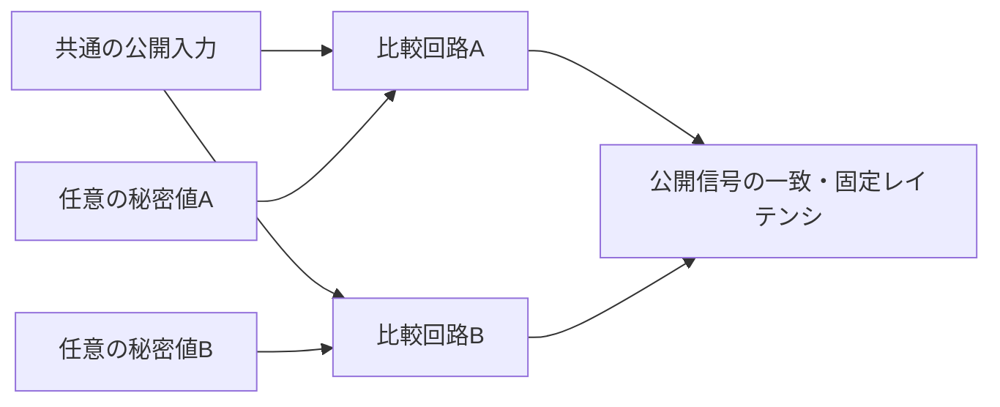

# 秘密値によって処理時間が変わらないことをフォーマルに証明する

比較を最初の不一致で打ち切ると、何バイト目まで一致したかが処理時間へ現れます。この例は、全バイトを必ず比較する回路を作り、異なる秘密値でも公開信号の値とタイミングが一致することを証明します。[セキュリティ・ライフサイクル](../local-secure-lifecycle/README.md)の権限・ロックの検証に、情報の流れを調べる観点を補います。

## 2つの実行を並べて比較する



同じ公開入力を持つ2つの回路へ、独立した秘密入力を与えて証明する方法を、自己合成（self-composition）と呼びます。2実行を比較する定時間性の検証は、[Verifying Constant-Time Implementations](https://www.usenix.org/conference/usenixsecurity16/technical-sessions/presentation/almeida)などでも使われています。この例では`rst_n`・`start`・`guess`・`result_ready`を共有し、`secret`だけを独立させます。秘密入力は毎サイクル変わってもよく、安定させる仮定は置きません。

回路は`start && ready`で秘密値と比較値を取り込み、1サイクルに1バイトを比較します。受理端から`BYTES`サイクル後に`result_valid`を有効にし、`match`に一致／不一致を出します。不一致の位置によらず、全バイトを処理します。結果は受け取られるまで保持し、処理中・結果保留中のstartを無視します。リセットでは処理を取り消します。

`match`は、`result_valid`時に公開を許す情報です（declassification）。秘密値によって一致／不一致が違うことは仕様どおりなので、2回路の`match`同士は比較しません。代わりに、それぞれが受理時の秘密値と比較値の等値判定に一致することを、別の期待値で確認します。

## 証明する性質

| プロパティ | 内容 |
| --- | --- |
| `ap_timing` | 2回路のready・busy・result_validが一致し、独立した固定時間モデルとも一致する |
| `ap_public` | public_statusが秘密値に依存しない |
| `ap_result` | 結果が、それぞれ受理時に取り込んだ2値の等値判定と一致する |
| `ap_hold` | リセットされない限り、受取り待ちの結果を保持する |
| `ai_model_bounds` | 証明用の残りサイクル数が0〜BYTESの範囲内にある補助不変条件 |

仮定は初回クロックのリセットだけです。以後のリセット・要求・受取り待ちは任意です。coverは一致、不一致、2回路で異なる結果、最初のバイトでの不一致、最後のバイトだけの不一致、受取り待ち、処理中のリセットの7個です。不一致位置のcoverには、受理時に保存した条件を使います。

## 実行と誤実装の検出

[共通フォーマル手順](../local-formal-common/README.md)のオープンソース環境を使います。

```sh
. artifacts/toolchains/formal-venv/bin/activate
python3 examples/local-constant-time/run.py
python3 -m unittest discover -s examples/local-constant-time/tests -v
```

構成は`bytes2`・`bytes4`です。各構成で深さ8からのk-inductionによる証明、深さ12のcover、4変異のBMCを実行し、合計12タスク・JUnit 12件です。深さ8までの検査だけでなく、帰納法の完了を要求します。

| 変異 | 誤り | 予定した反例 |
| --- | --- | --- |
| 1 | 最初の不一致で比較を打ち切る | `ap_timing` |
| 2 | 処理中の秘密値の1ビットをpublic_statusへ出す | `ap_public` |
| 3 | 最後のバイトを結果へ反映しない | `ap_result` |
| 4 | 取り込んだ秘密値ではなく、処理中の入力を読む | `ap_result` |

`--demo-bug 1..4`は証明対象にも誤りを入れ、証明がFAILになることを確認します。6セルフテストではIcarusを使い、各不一致位置のレイテンシ、処理中の入力変更とstart、結果の保持、リセット時の取消しと作業レジスタの消去、4変異の検出を照合します。

2026-10-31に、固定版YoWASP Yosys／SBY／Z3で12タスクが成功しました（各SBYタスクの実行時間の合計は約25秒）。Python 3.14.7・Icarus Verilog 14.0開発版で6セルフテストも成功しました。Verilator 5.052で両構成・変異0〜4をlintしています。[SBYのプロパティ記述方法](https://yosyshq.readthedocs.io/projects/sby/en/stable/verilog.html)を参照し、回路と検査ハーネスは本教材向けに作成しました。

## 確認範囲

この証明の観測対象は、公開ポートのデジタル値とクロックサイクル数です。物理的な消費電力・電磁放射・遅延差、キャッシュ、実機のサイドチャネルを保証するものではありません。また、比較結果の公開、試行回数、鍵の保管、認証プロトコル全体の安全性は別に設計する必要があります。
