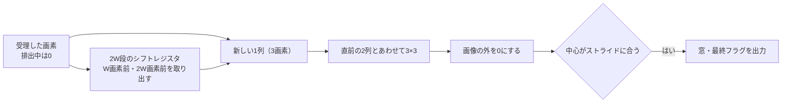

# 畳み込み用ラインバッファの端・角・フレーム境界を検証する

画像を1画素ずつラスター順に受け取り、3×3畳み込み用の窓を切り出す回路の教材です。CNNの推論回路では、窓の生成と積和を分けることが多く、この例は窓の生成だけを扱います。窓の値は単純でも、誤りが出やすいのは画像の端と角、ストライド、フレームの終わりの排出、連続するフレームの境目です。

## ラインバッファで窓を作る



中心が画素kの窓は、画素k+W+1が届いた時点でそろいます。そのため、1回の処理で完成する窓は最大1つです。フレームの最後の画素の後、W+1回の排出処理で、残りの窓をパディングの0から作ります。排出中は次のフレームの画素を待たせます。

| 確認する場面 | 期待する動作 | 主な照合対象 |
| --- | --- | --- |
| 端と角 | 画像の外を0にする（same padding） | 9画素すべて |
| ストライド2 | 行・列が偶数の中心だけを出す | 窓の数と最終フラグ |
| フレームの終わり | W+1回の排出で残りの窓を出す | 排出中の`in_ready` |
| 連続フレーム | 前のフレームの画素を次の窓へ混ぜない | 2フレーム目以降の窓 |
| 出力待ち | 窓を保持し、排出も止める | 保持・停止中の進み方 |

## 仕様

| 構成 | 幅W | 高さH | ストライド | 1フレームの窓 |
| --- | --- | --- | --- | --- |
| `w5h4-s1` | 5 | 4 | 1 | 20 |
| `w7h5-s2` | 7 | 5 | 2 | 12（4列×3行） |

- 画素は8ビットで、`in_valid && in_ready`で受理します。
- 出力`out_window`は、中心の上・中・下の行を順に、各行の左・中・右の画素を並べた72ビットです。`out_last`はフレームの最後の窓に付きます。
- 出力を待たされている間は窓を保持し、入力の受理と排出の処理をどちらも止めます。
- リセットは処理中のフレームを捨て、ラインバッファを0にします。

ストライド2の構成で幅と高さを奇数にしたのは、右端と下端にも中心が来るようにするためです。偶数の幅では、右端に中心が来ません。

## 独立した期待値

Pythonは受け取ったフレームを配列に保存し、中心(r, c)の9画素を、画像の外なら0として直接切り出します。シフトレジスタや列の組み立ては写しません。共有するのは「画素k+W+1で中心kの窓を出し、フレームの後にW+1回排出する」という時間の約束だけです。

テストベンチは毎サイクル、`in_ready`・`out_valid`、出力待ちの間の保持、有効な窓の9画素と`out_last`を照合します。テストベンチは窓の数を自分で数えて中心の位置を求め、端・角・内部の目標に加算します。

## 固定シナリオとランダム刺激

固定シナリオは次の順に実行します。

1. リセット直後の1フレーム目
2. 排出を待って始まる2フレーム目（出力待ちと入力の空きを含む）
3. 排出中の出力待ち
4. 連続する3フレーム目
5. 4フレーム目の途中でのリセット
6. リセット後のフレーム

各フレームの画素は0以外の異なる値で、255と1を含みます。混ざった画素や位置のずれが値に表れるようにするためです。ランダム刺激は、乱数の画素によるフレームを、入力の空き・出力待ち・まれなリセットと組み合わせます。

[要求カタログ](requirements.json)は4要求・17目標です。両構成とも、固定シナリオだけで17目標に達します。

## 意図的な誤実装

| 番号 | 誤実装 | 期待する検出ラベル |
| --- | --- | --- |
| 1 | 左端を0にせず、前の行の右端の画素を使う | CONV_DATA |
| 2 | 右端を0にせず、次の行の左端の画素を使う | CONV_DATA |
| 3 | 排出を1回少なくする | CONV_CONTROL |
| 4 | 出力待ちの間も排出を進める | CONV_HOLD（`w5h4-s1`）／CONV_CONTROL（`w7h5-s2`） |

変異4では、同じ誤りでも構成によって最初に破れる検査が変わります。ストライド1では、出力待ちの間の排出が保持中の窓を上書きし、保持の検査で止まります。ストライド2では、排出の多くが窓を出さないので、排出が早く終わって`in_ready`が早く1になり、制御の検査が先に失敗します。

## 検出できない変異

上端と下端の0埋めを外しても、この設計では結果が変わりません。画像の上の行にあたる値は、前のフレームのW+1回の排出か、リセットで入った0です。下の行にあたる値も、排出中に流し込む0です。つまり、この2つの0埋めは出力に影響しない等価変異です。セルフテストで、固定シナリオとランダム刺激の両方で合格することを確かめています。

等価変異は、どんな刺激でも検出できません。検出できない変異が残ったら、刺激を増やす前に、その変異が出力を変えうるかを確認します。ただし、この等価性は「排出で0を流す」「リセットで0にする」という設計の性質に依存します。どちらかを変えると、上端・下端の0埋めが必要になります。

## 実行

```sh
python3 examples/local-conv-window/run.py --out artifacts/conv-window
python3 examples/local-conv-window/run.py --profile nightly --out artifacts/conv-window-nightly
python3 -m unittest discover -s examples/local-conv-window/tests -v
```

[共通手順](../local-common/README.md)を使います。`--iterations`はランダムなフレームの数で、smokeは6フレーム×1 seed、nightlyは40フレーム×3 seedです。JUnitは各構成7／9件、全体14／18件で、セルフテストは7件です。

## 確認範囲

2026-10-30にPython 3.14.7、Icarus Verilog 14.0開発版で、両構成のsmoke／nightly、17目標、4種類の変異、セルフテスト7件が成功しました。Verilator 5.052の`--lint-only -Wall`では警告はありません。

窓の生成だけを扱い、積和、複数チャネル、5×5以上のカーネル、反射などの0以外のパディング、大きな画像でのメモリの使い方は扱いません。行列の積和は[シストリックアレイの例](../local-systolic-array/README.md)を参照してください。
